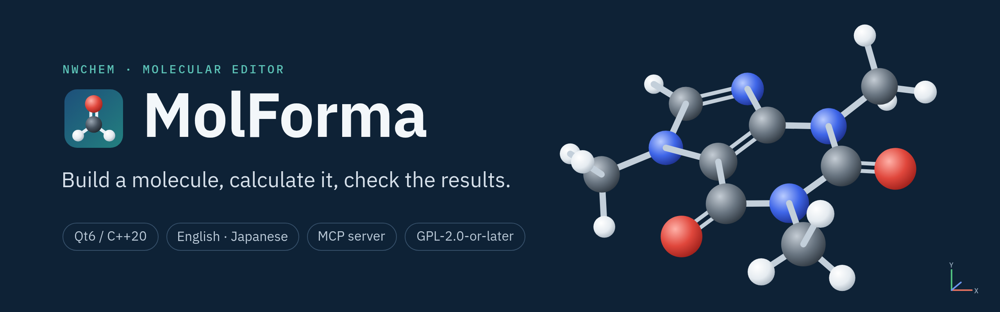
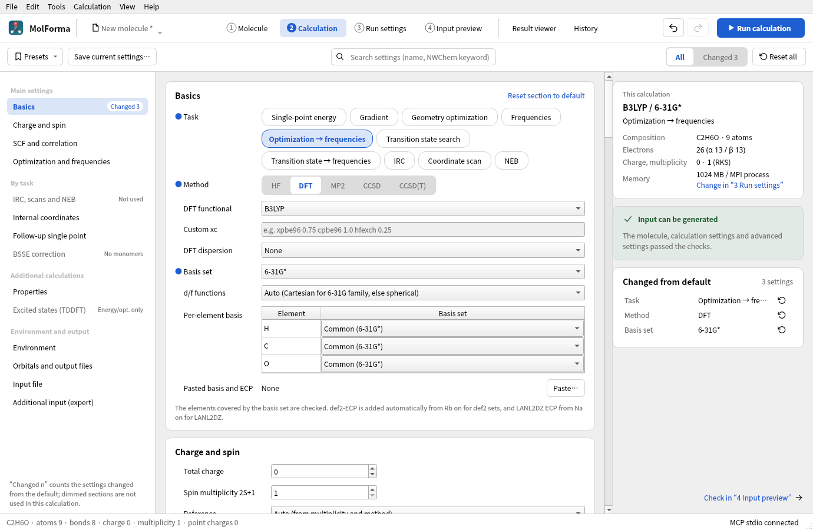
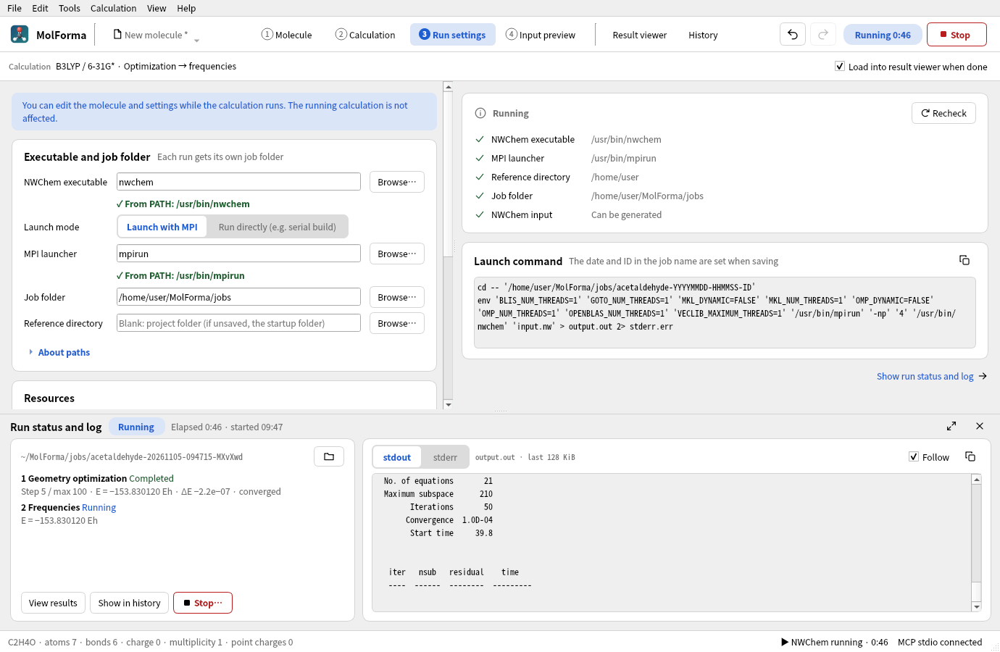
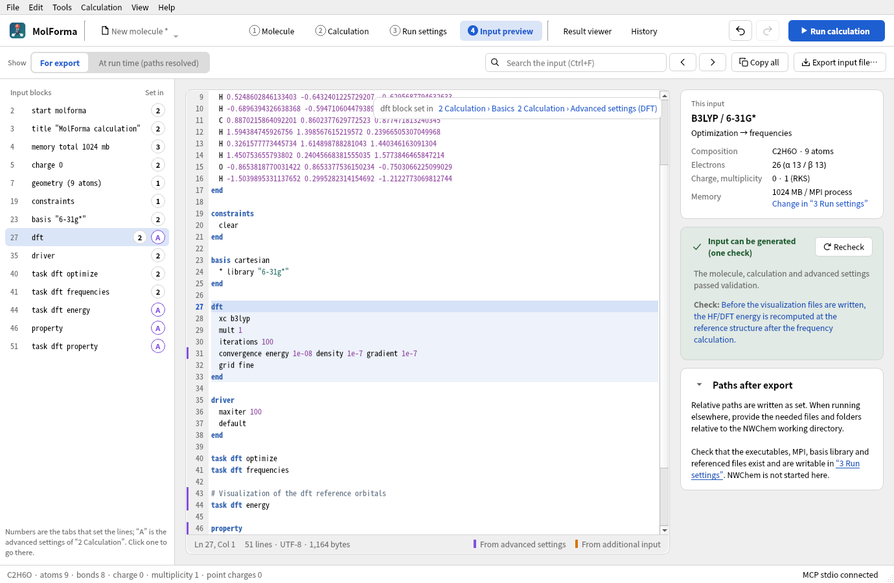
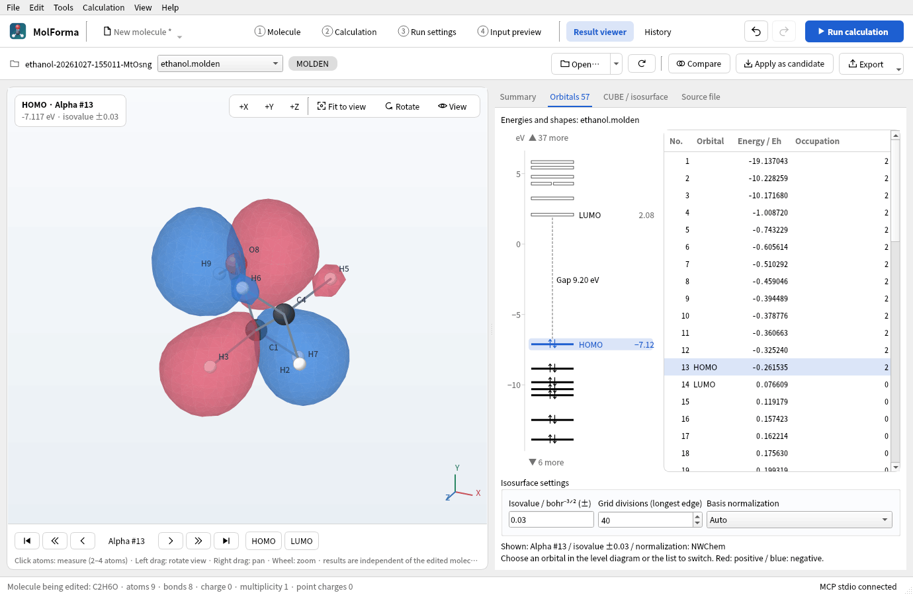
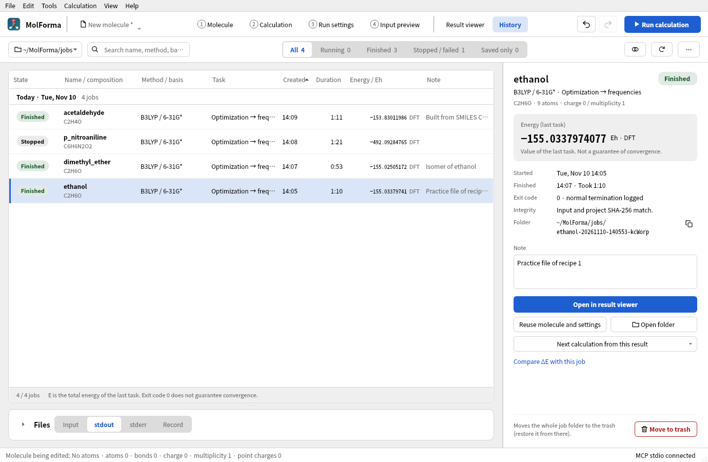

# MolForma

[日本語](README.md) | **English**

MolForma is a Qt6 / C++20 desktop application for building molecules, editing coordinates and preparing calculation inputs for NWChem. The work moves through the tabs “1 Molecule”, “2 Calculation”, “3 Run settings” and “4 Input preview”, then “Result viewer” and “History”. It has a parts palette, a 3D editor, a coordinate table, and checks and export of NWChem input. It runs and stops NWChem locally and shows its log, and it displays the structures, energies and vibrations of the results and isosurfaces of CUBE data and MOLDEN molecular orbitals. A history lists saved calculations, with their inputs and logs and reuse of their molecules and settings. The interface and manual are available in Japanese and English (by default the system language; “表示言語 / Language” in “Edit → Preferences” changes it, effective after a restart). No Python is needed at run time.


## Build and run

The development packages needed are Qt 6.4 or later (Widgets, Network, Test), Eigen3, zlib, Open Babel 3, CMake 3.21 or later and a C++20 compiler. An example with Ninja:

```sh
cmake -S . -B build -G Ninja -DCMAKE_BUILD_TYPE=Release
cmake --build build -j 4
ctest --test-dir build --output-on-failure
./build/molforma
```

You can start MolForma with a structure file (XYZ, MOL, SDF, Mol2, CML, PDB, mmCIF, small-molecule CIF; gzip-compressed files too), an NWChem or Gaussian input, or a project. Files also open by dropping them on the window or from “File → Recent files”. “File → Download from PDB…” fetches an entry by its PDB ID, and “File → Get from PubChem…” a compound by its name or CID.

```sh
./build/molforma tests/fixtures/ala_gly_ser.molforma.json
./build/molforma molecule.xyz
```

For a distribution build that does not need Qt Test, set `-DBUILD_TESTING=OFF`. Besides the shared libraries of Open Babel, its format plugins and force-field data are needed. The Python bindings are not used. When CMake finds the RDKit C++ development package, strict stereochemistry detection and recording and residue recognition are enabled too. With the optional Qt SVG module, charts, spectra and reaction profiles can be saved as SVG too (otherwise PNG and PDF). MP4 video export uses `ffmpeg` from PATH at run time, and preparing metal complexes uses a separately installed `xtb` (neither is shipped).

With the development packages of VTK 9.1 or later built for Qt6 (`GUISupportQt`, `RenderingOpenGL2` and so on) and Qt6 OpenGL Widgets, the molecule editor and the result viewer draw their 3D views with VTK. The development packages of VTK's external dependencies are needed too (depending on the distribution, MPI, FastFloat, nlohmann_json and others). VTK is used through its C++ API; Python and PyVista are not needed. Include the shared libraries of VTK when distributing. The `MolForma rendering:` line of CMake's output shows the configuration in use.

Builds without VTK or with `-DMOLFORMA_ENABLE_VTK=OFF` draw with QPainter. At run time, `MOLFORMA_RENDERER=painter ./build/molforma` selects QPainter drawing. The offscreen and minimal Qt platforms and environments that cannot create an OpenGL 3.2 context use QPainter automatically. See [3D rendering](docs/en/features/rendering.md) for how it works and how it was checked.

An installation example:

```sh
cmake --install build --prefix /tmp/molforma-install
/tmp/molforma-install/bin/molforma
```

Installing also places the desktop launcher (`share/applications/molforma.desktop`), the icon and the MIME types of `*.molforma.json` and `*.nw`. The manual is built into the executable and opens with “Help → Guide and manual” (F1). Unsaved work is saved automatically every minute, and after an abnormal exit the next start offers to recover it.

On Linux, the AppImage in the ZIP on [Releases](https://github.com/hnakada123/MolForma/releases) runs without building anything. On Apple silicon Macs with macOS 27 or later, so does the DMG in the macOS ZIP, and on Windows 11 (x64), the folder in the Windows ZIP. The packages each OS needs and the installation steps are in [Installation and required packages by OS](docs/en/installation.md). On Arch Linux, you can build a package from `packaging/arch/PKGBUILD` and install it with pacman. On Ubuntu and similar systems, `cpack -G DEB` in the build folder makes a deb package. An AppImage that runs on any distribution can be made with the Dockerfile and scripts in `packaging/appimage/`. On macOS, install the libraries and NWChem with Homebrew and build; `cpack -G DragNDrop` in the build folder then makes a disk image (DMG) of `MolForma.app` that includes the libraries. On Windows, build with Visual Studio (MSVC); `cmake --install` makes a folder that includes Qt and the other libraries (NWChem runs in WSL).

## Usage

- The header at the top switches between the steps of the work (“1 Molecule” to “4 Input preview”, “Result viewer”, “History”), and “Run calculation” (F5) at its right end starts a calculation. “1 Molecule” consists of the tool column at the left edge, the parts palette, the 3D view with the coordinate table, and the pages on the right (Edit, Transform, Attributes, Coordination, Residue, Charge); the settings of the current tool appear above the 3D view. “3D”, “3D + table” and “Table” below the 3D view choose how the coordinate table is shown.
- Choose an atom, a skeleton or another part in the palette on the left and click in the middle to place it. Parts can also be dragged and dropped.
- Click an atom to select it; Shift+click or Ctrl+click adds or removes atoms in order. With 2, 3 or 4 atoms selected, the distance, angle or dihedral is measured, and “Apply dimension” changes it. When the atoms chosen belong to separate molecules with no bond between them, the whole molecule of the atom chosen later moves (the distance of a dimer, a hydrogen-bond angle and so on).
- Left drag rotates the view around its vertical and horizontal axes (the rotation sliders follow), right drag pans, and the wheel zooms around the cursor. Shift+drag selects a range and Ctrl+drag adds to the selection.
- Candidates from ligands, sequence building, deletion, cleanup and so on are applied with “Confirm changes” in the amber bar above the 3D view (the 3D view marks atoms that disappear with a red ×, atoms that appear with green circles and atoms that move with orange circles) or with Ctrl+Enter. Esc discards the candidate; Ctrl+Z undoes confirmed operations. Every way of deleting makes the same candidate and also removes the hydrogens bonded only to the deleted atoms. “Cap with hydrogens after deleting” (on by default) adds hydrogens to the atoms at the other end of the cut bonds. “Help → Keyboard shortcuts” lists the keys.
- `.molforma.json` keeps bonds, residues, coordination centers, fixed atoms, isotopes, point charges and settings. XYZ is for exchanging coordinates; bond orders are estimated when it is read. Existing NWChem inputs (`.nw`) bring in the structure and calculation settings, and Gaussian inputs (`.gjf` / `.com`) the structure, charge and multiplicity.
- The “View” menu switches the display style (ball and stick, stick, space-filling, wireframe), temporarily hides atoms, keeps measurements on screen and shows hydrogen bonds as dashed lines. The “Tools” menu has structure checks, point-group detection and symmetrization, viewing and editing the Z-matrix, conformer search, regenerating 3D coordinates, comparing and superposing structures (RMSD), and optimizing structures (metal complexes included) with the external xtb. “View → Export 3D view as image…” saves the 3D view as a picture at a chosen scale, with a transparent background if wanted.
- “File → From SMILES” generates a 3D molecule with hydrogens. It replaces only the structure and keeps the calculation and run settings. “Add fragment from SMILES” and “Add fragment from file” add another molecule beside the current one. “Stop cleanup” interrupts a cleanup in progress.
- The coordinate table of “1 Molecule” (shown with “3D + table”, “Table” or “View → 1 Molecule layout”) edits the element, X/Y/Z, isotope mass, ghost and fixed state cell by cell. Formal charges, unpaired electrons and atom names can also be edited as a table with “Attributes”. The Å/Bohr switch of the table changes only the display. It also adds atoms, filters rows, makes a deletion candidate with the Delete key, loads structure files, pastes XYZ and reorders atoms from the “Structure” menu, and reads dropped files. Bulk actions on selected atoms (fixing them, making them ghosts, moving them to the origin and so on) are on the pages on the right (“Edit”, “Transform”, “Attributes”).
- The “Export” menu of the table copies NWChem `geometry` / `constraints` blocks (or XYZ) or saves them as `.nw` / `.xyz`. This `.nw` is only the coordinate part of an input: a calculation also needs the charge, basis set, method and `task`. The output units are independent of the display units of the table and are set in “2 Calculation”. “File → Export structure” writes XYZ, SDF, MOL, Mol2, CML, PDB and Gaussian input.
- “2 Calculation” sets the method (HF, DFT, MP2, the CCSD family), basis set (also per element), total charge and multiplicity, convergence, optimization, frequencies, transition-state search, IRC and coordinate scans, internal-coordinate constraints, COSMO and SMD, relativistic methods (ZORA, DKH, X2C), RI-J, properties (Mulliken and ESP/RESP charges, NMR, polarizability), excited states (TDDFT), BSSE correction, a single point with other settings after optimization, additional input that is not checked, and more. It checks the electron count and the combination of settings and generates NWChem input with the coordinates, basis set/ECP, settings and `task` (copying and saving are in “4 Input preview”). The section list on the left shows the number of settings changed from default and the sections the current calculation does not use, and changed settings can be reset one by one from the list on the right. Built-in and user presets, undo/redo and saving in projects are supported. See below for the full scope.
- The 56 advanced settings for NWChem (HF/DFT convergence, MP2/CCSD, optimization, frequencies and thermochemistry, COSMO, orbital files and where they are kept) are adjusted by opening “Advanced settings” in each section of “2 Calculation”. Only the settings the current calculation uses are shown, and the search and the “Changed” filter include them. A blank field uses the default, and only values given explicitly override the basic settings. Blank fields show the value actually used and where it comes from, and the selected setting shows which block of the input it goes into. Resetting by setting or section, undo/redo and input checks are supported.
- CUBE and MOLDEN output is enabled in “Orbitals and output files” in “2 Calculation”. You can set the electron density, spin density, HOMO/LUMO or numbered molecular orbitals, the grid range and divisions, and MOLDEN normalization; the input preview and runs follow them.



- “3 Run settings” sets the NWChem executable, the number of MPI processes, OpenMP/BLAS threads, memory, the job folder and additional environment variables. The defaults for new documents can be saved in “Edit → Preferences”. Calculations start with “Run calculation” (F5) in the header. Checks before running, saving as a job, asynchronous running and stopping, time limits, a notification at the end and automatic loading into the result viewer are supported. The task stage of a running job, the progress of an optimization (steps and convergence criteria such as Gmax) and standard output and error appear in the run panel, which opens from any tab (“Calculation → Run status and log”). Calculations need NWChem, installed separately, and for MPI builds a matching MPI launcher.



- “4 Input preview” shows the finished NWChem input read-only, with line numbers and colors, search, the structure of the input (with jumps to the tab or advanced settings that set each part), marks on the lines from advanced settings and additional input, jumps from check results to the settings tabs, copying the whole text and saving as `.nw`. You can switch between the normal export input and the run-time input, in which the paths of input movecs are resolved. Previewing and saving do not need NWChem itself.



- “Result viewer” opens NWChem logs, XYZ structure series, CUBE and MOLDEN files (opening a job folder lists the matching files). It shows structures, a list of energies (ΔE from a chosen reference, with unit conversion), the convergence of optimizations with a graph, vibration animations, displacement arrows, export of numbered images and XYZ, IR spectra, thermochemistry, TDDFT excited states, path graphs of scans and IRC, atomic charges and NMR, atom measurements, positive and negative CUBE isosurfaces, and isosurfaces of MOLDEN molecular orbitals (HOMO/LUMO or chosen from a list). The reference structure can be exported as XYZ and the view as PNG. “Compare” shows the RMSD to the molecule being edited. The latest job can also be opened from the run panel. Viewing results does not change the molecule being edited; “Apply as candidate” brings the shown structure (after optimization, for example) into “1 Molecule” as a candidate. “Summary” shows the energy, optimization convergence, imaginary frequencies, the HOMO–LUMO gap and more on cards, and warns about logs in which NWChem did not finish normally.



- “History” lists saved calculations by day, with search, filtering by state and sorting. The energy, record, note and actions of the chosen job are on the right and its input and logs below the list; a job running in this window shows the same progress as the run panel. “Compare ΔE” shows the differences from a reference job for jobs with the same composition, method, basis set and kind of energy. “Reuse molecule and settings” makes a new unsaved project. Saving the listed rows as CSV, stopping a running calculation, moving finished jobs to the trash and repairing records left as “Running” after their process ended are supported too.



## MCP server

MolForma can also be operated from MCP clients. Give `molforma --mcp-gui` as the server's start command to show the GUI, or `molforma --mcp` to run without a window. It supports MCP **2026-07-28** (the latest stable version when checked on 2026-10-24) and the earlier **2025-11-25** over stdio. In Claude Code, register it with `claude mcp add molforma -- /absolute/path/to/molforma --mcp-gui`. By default, MCP cannot change the NWChem executable, the launcher, the environment variables or the additional input of the calculation settings (`--mcp-allow-execution-settings` allows it). `--mcp-allow-dir` limits where it reads and writes. See [MCP server](docs/en/mcp.md) for setup examples for Claude Code and Codex, the tools and the limits.

## Manual

The manual, recipes and MCP guide are also published as HTML generated from `docs/` at https://hnakada123.github.io/MolForma/en/.

See [docs/en/features.md](docs/en/features.md) (a list of pages per screen and tab) for the scope of the features, limitations and verified examples. [docs/en/recipes.md](docs/en/recipes.md) has recipes that go from building a molecule to calculating it and checking the results, one subject at a time (16 subjects such as ethanol, a metal complex, a peptide, BSSE correction, a radical and a transition state, with screenshots and practice files). They also open with “Help → Guide and manual”.

The case study [Planning and calculating a Soai addition model with Codex](docs/en/calculations/soai_addition.md) documents a 47-atom model without an autocatalyst, including its plan, method, convergence history, relative energies and interpretation of density and molecular orbitals.

## Development

Sources are in `src/`, Qt Tests in `tests/`, documentation in `docs/`, and built-in data (parts and element data, the English translation `assets/translations/en.json`) in `assets/`. The data is embedded as Qt Resources and does not depend on the working directory at run time.

`src/` is divided by responsibility, and each `.cpp` is in the same directory as its `.h`. The main directories are:

| Directory | Contents |
| --- | --- |
| `src/model/` | Molecule document, file format, geometry calculations, unit definitions, translation of displayed text |
| `src/editing/` | Molecule and coordinate editing, shared validation of atom attributes, parts library, peptide and coordination structures, PDB, mmCIF and small-molecule CIF (crystal structure) parsing, solvation shells, active-site cut-out, chemistry job management |
| `src/io/` | Reading and writing by file format, project saving, recent files, autosave and recovery |
| `src/nwchem/` | NWChem input generation and import, advanced settings, visualization output settings, run control, calculation history |
| `src/results/` | Reading calculation results, isosurface generation, evaluation of MOLDEN molecular orbitals |
| `src/ui/` | Main window, panels, molecule drawing, UI components, MCP tools that operate the GUI |
| `src/mcp/` | MCP server (stdio, JSON-RPC), shared tool definitions, calculations and result reading without a window, access limits |
| `packaging/` | Desktop integration (`.desktop`, icon, MIME types), the Arch Linux `PKGBUILD` (`arch/`), the AppImage build environment and the making of the release files (`appimage/`), batch files that start NWChem in WSL on Windows and the making of the release files (`windows/`), and the macOS application bundle settings, icon and the making of the release files (`macos/`). `docs/manual.qrc` builds the manual and icon into the executable |
| `tools/screenshots/` | Scripts that take the screenshots of the manual and recipes by operating `molforma --mcp-gui` (development tools; MolForma itself does not depend on Python) |
| `tools/templates/` | Script that adds the polydentate, η and solvent parts to `assets/library.json` (development tool, uses RDKit) |

The entry point is `src/main.cpp`. Headers are included by their path from `src/`, as in `#include "model/document.h"`. `molforma_core` is an interface target that bundles `molforma_model`, `molforma_editing`, `molforma_results`, `molforma_nwchem` and `molforma_io`. Dependencies run io → nwchem → editing / results → model; project headers included in the opposite direction are detected when CMake configures and in CTest. `molforma_mcp` (mcp) depends on the core, and `molforma_ui` (ui) on the core, MCP and Qt Widgets. Chemistry jobs and autosave can be tested without creating a window, and the panels and the GUI MCP tools edit and read state through public APIs.

Formatting the sources, and taking a screenshot without a display:

```sh
rg --files src tests -g '*.h' -g '*.cpp' -0 | xargs -0 clang-format -i
QT_QPA_PLATFORM=offscreen ./build/molforma \
  tests/fixtures/ala_gly_ser.molforma.json --screenshot /tmp/molforma.png
```

The tests need no network or private data. They switch the app's settings and data folders to temporary directories, so they do not change the user's settings. Interface settings and user presets are saved in `QSettings("MolForma", "MolForma")`, and molecule, calculation and run settings in the project. Cleanup, 3D generation from SMILES, conformer search and reading result files start the same executable in a worker mode (`--worker` / `--result-worker`) through `QProcess` and exchange JSON in a temporary directory, so they can be cancelled.

`docs/` is also the source of the GitHub Pages site. When a change to `docs/` is pushed to main, `.github/workflows/pages.yml` generates the HTML with Jekyll and publishes it.

## License

MolForma is distributed under the [GNU General Public License](LICENSE) version 2 or (at your option) any later version (GPL-2.0-or-later). The bundled data of 101 parts and the element data are under the same terms. The external libraries it links (Qt6, Eigen3, zlib, Open Babel 3, RDKit, VTK) follow their own licenses. Because Open Babel is GPL-2.0-only, binaries linked with Open Babel are distributed under the terms of GPL version 2 ([NOTICE](NOTICE)).

MolForma does not include NWChem. Calculations use a separately installed NWChem, which follows its own license ([Educational Community License 2.0](https://github.com/nwchemgit/nwchem/blob/master/LICENSE.TXT)). MolForma is independent software with no connection to the developers of NWChem. When you publish results obtained with NWChem, please cite the NWChem paper (E. Aprà et al., “NWChem: Past, present, and future”, *J. Chem. Phys.* 152, 184102 (2020), [doi:10.1063/5.0004997](https://doi.org/10.1063/5.0004997)).

Local workflows include a sequential calculation queue, failure guidance, recalculation from result geometries, reaction energy diagrams with thermal corrections, and saved conformer sets with batch optimization. Charts cover NMR, normal Raman, solution ESR, ECD and ORD (β); property views include ESP surface coloring, grid slices, dipoles and polarizability axes. See [Results](docs/en/features/results.md), [History](docs/en/features/history.md) and [Conformer sets](docs/en/features/molecule_pages.md) for operation and supported conditions.

MolForma also restarts calculations from NWChem’s database, carries over the Hessian of a frequency job or the molecular orbitals, keeps calculations running when the window closes, restores the queue, writes job scripts and imports results for runs on another computer, and submits calculations to computers reached over SSH (shell, Slurm, PBS) and fetches their results back. The result views show the orbital contributions of excited states and bond indices; the thermal corrections offer frequency scaling, quasi-RRHO entropies, a standard-state correction, rate constants and conformer-averaged spectra. MolForma also finds reaction paths between two structures (NEB), chains calculations that go on from the final structure, the highest point of a path or an end of an IRC of an earlier one (transition-state search → IRC → optimization of both ends), prepares metal complexes with xtb, and exports structure lists and vibrations as GIF or MP4 and charts as PDF or SVG. See the [changes](docs/en/changes.md) for the scope and limits.
