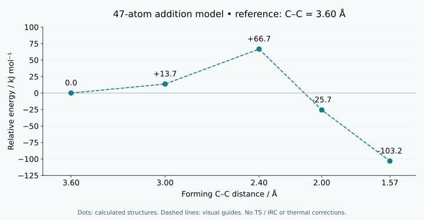
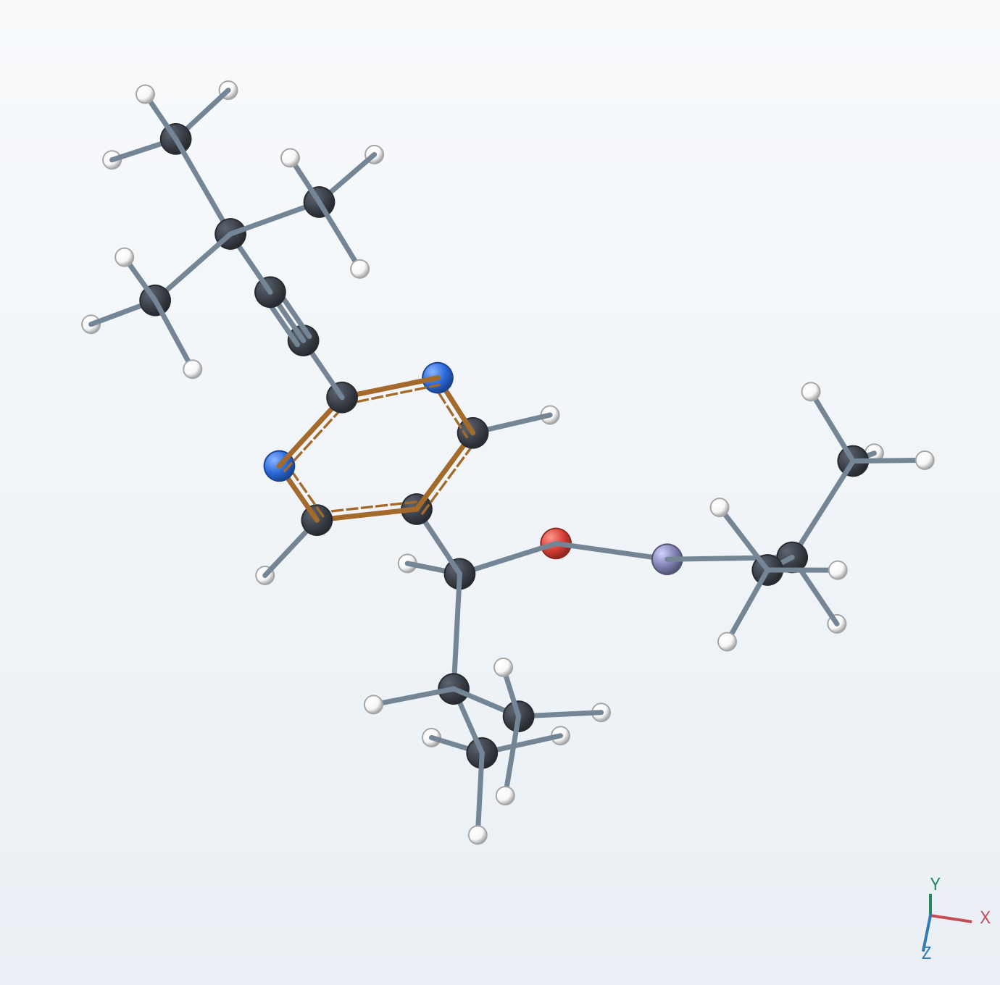
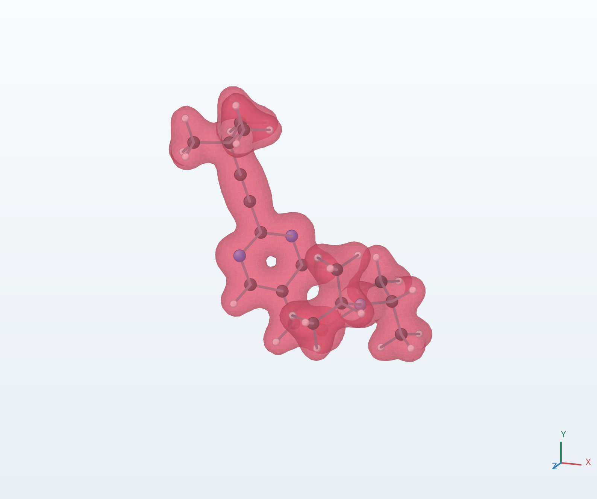
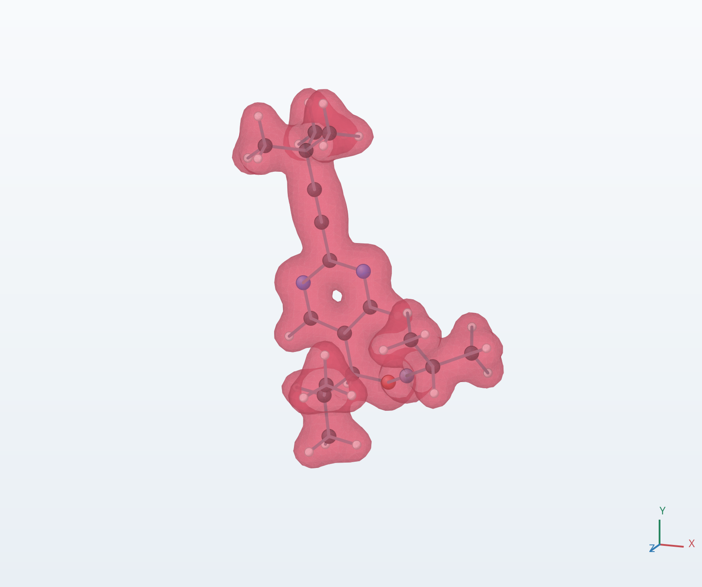
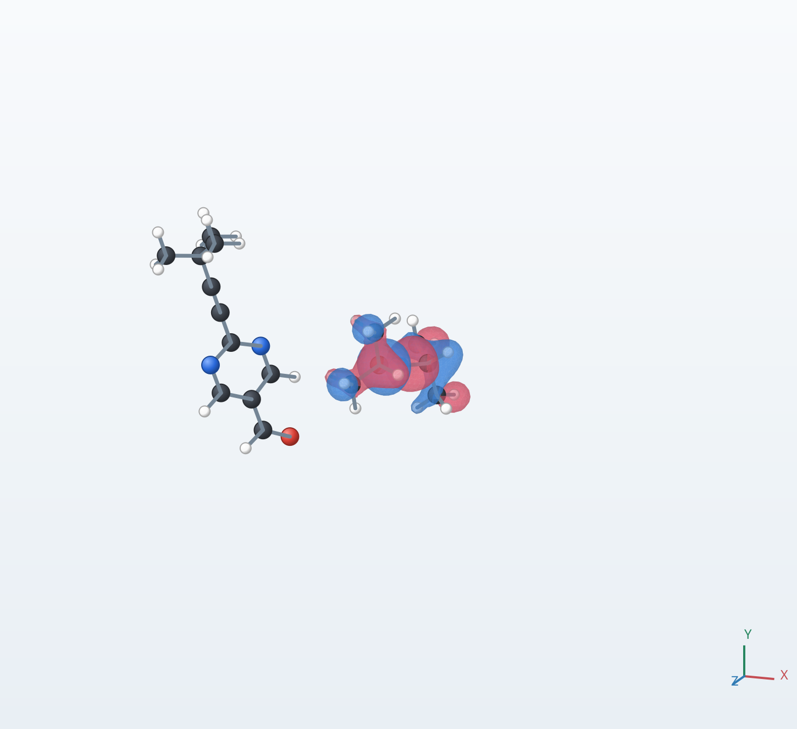
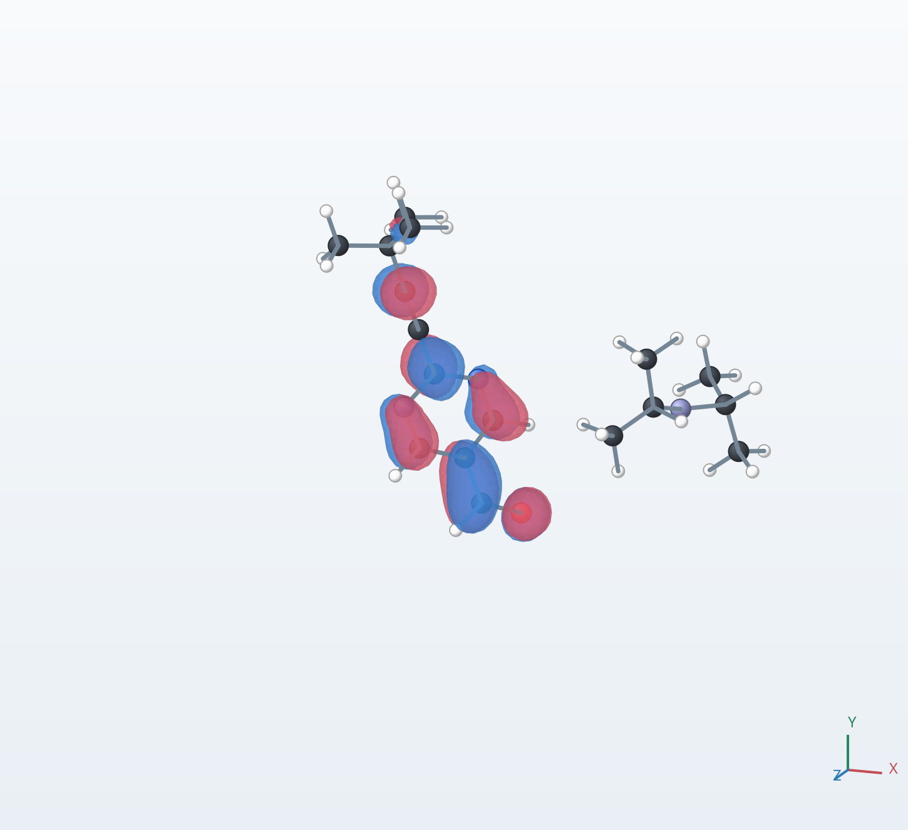
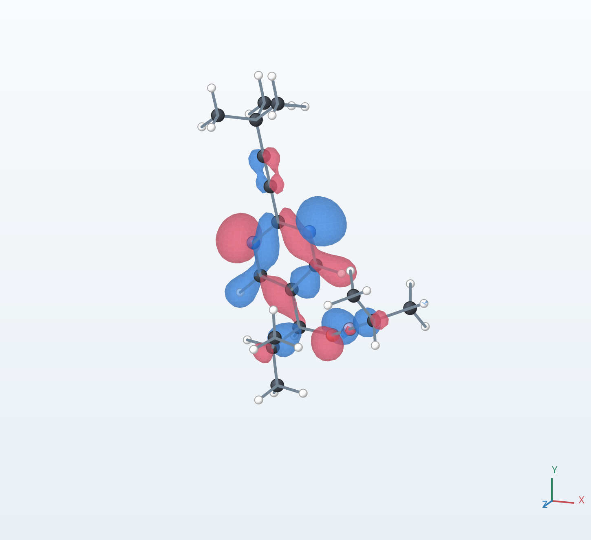
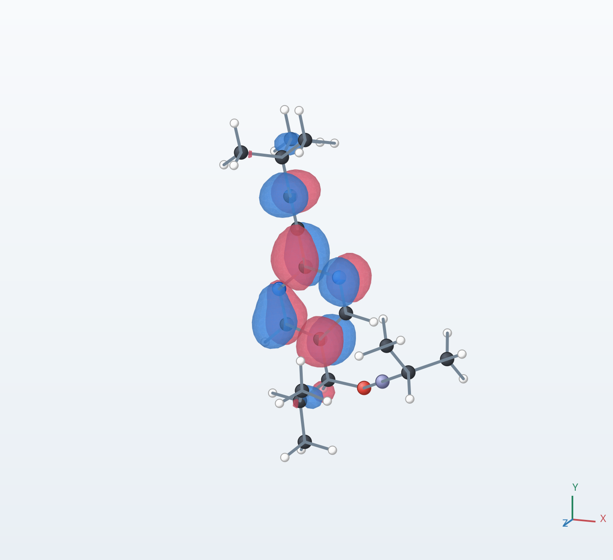

# 硤合反応の付加モデルをCodexで計画し計算する

[トップページ](../index.html) / 計算事例

Codexが計算計画を立案し、MolFormaによる分子の作成・編集と結果表示、NWChemによる量子化学計算、動画の作成までを進めた事例です。モデルと制作方針はユーザーと相談して決定しました。

扱うのは、硤合反応のうち、ピリミジン環を持つアルデヒドにジイソプロピル亜鉛が付加する段階です。**自己触媒を含まない47原子モデル**について、距離を拘束した構造最適化と電子状態計算を行いました。生成物は後処理前の亜鉛アルコキシドです。

新しいC–C結合と不斉炭素を持つ構造が得られ、構造ごとのエネルギーと電子状態を比較できました。自己触媒作用、不斉増幅、R/S生成比をこの計算から予測したものではありません。

本番計算の完了日：2026年11月8日。動画の後処理説明を修正した日：2026年11月9日。

## 計算計画とモデルの選定

目的は、ローカルPCで計算できる規模に抑えながら、分離した分子の接近、付加による構造変化、電子密度・分子軌道を説明することでした。初期には13原子・21原子の簡略モデルを検討し、最終的にはピリミジン環、環上の置換基、新しく生じる不斉炭素を残す47原子モデルを採用しました。

| 成分 | 組成 | 原子数（水素を含む） |
| --- | --- | ---: |
| 2-(tert-ブチルエチニル)ピリミジン-5-カルバルデヒド | C11H12N2O | 26 |
| ジイソプロピル亜鉛 Zn(iPr)2 | C6H14Zn | 21 |
| 合計 | C17H26N2OZn | 47 |

iPrはイソプロピル基です。全電荷は0、多重度は1の閉殻一重項として扱いました。

別途検討した73原子の文献由来構造は、自己触媒の説明を補うための別モデルです。このページの47原子の反応計算に触媒として加えたものではなく、両者のエネルギーを同じ反応曲線に混ぜていません。完成した47原子版の動画も、付加段階に範囲を絞っています。

## CodexとMolFormaとNWChemの役割

| 担当 | この事例で行ったこと |
| --- | --- |
| ユーザー | 計算時間・モデルの範囲・動画内容の希望を示し、継続方針や説明の修正を相談 |
| Codex | モデル・計算条件・実行順序の立案、ツールの操作、ジョブの進行管理、未収束時の調整、結果の照合、動画編集 |
| MolForma | 分子の作成・座標編集、NWChem入力の作成、構造・電子密度・分子軌道の表示 |
| NWChem | 構造最適化、各構造のエネルギー・電子状態の計算、CUBE・MOLDENの出力 |

MolFormaはMCP経由で操作しました。本番の継続計算では、保存した入力を用いて端末からNWChemを実行しています。動画内の操作例は、初期構造での試算と結果表示です。本番の収束済み構造・電子状態の結果とは区別して示しています。

操作の基礎は、[MCPサーバー](../mcp.md)、[計算条件](../features/calculation.md)、[結果ビューア](../features/results.md)を参照してください。

## 計算方法

### 電子状態と実行条件

| 項目 | 採用した条件 |
| --- | --- |
| 計算プログラム | NWChem 7.3.1 |
| DFT汎関数・分散補正 | PBE-D3(BJ) |
| 基底関数 | def2-SVP、球面調和関数 |
| クーロン項の近似 | RI-J、Weigend Coulomb fitting補助基底 |
| 溶媒 | SMDトルエン |
| 本番の積分格子 | fine（初期探索ではmediumも使用） |
| SCF収束閾値 | energy・density・gradientを各1e-7に指定 |
| 構造最適化の収束閾値 | NWChemの既定値 |
| 並列実行 | MPI 12プロセス、OpenMP・BLAS各1スレッド、1ジョブずつ |

本番はAMD Ryzen 7 2700Xを搭載したローカルPCで実行しました。12プロセスのMPI実行には、このNWChem構成のデータサーバープロセスも含まれます。並列数だけでなくメモリーの使用状況も確認しながら進めました。

### トルエンの取り込み方

トルエンはSMD連続体溶媒モデルとして取り込みました。47原子の周囲を、トルエンの誘電率などの物性を持つ媒体として扱います。個々のトルエン分子の原子は置いていません。

溶質の電荷分布に応答する溶媒の分極を自己無撞着に求め、さらに空洞形成・分散・溶媒構造に関する補正を加えます。出力に記録されたトルエンの比誘電率は2.3741です。この設定は構造最適化と電子状態計算の両方に適用しました。

実際の入力の溶媒設定は次のとおりです。

```text
cosmo
  do_gasphase false
  do_cosmo_smd true
  solvent toluene
end
```

`do_gasphase false` は、溶媒計算に先立つ別途の気相計算を省く指定です。特定のトルエン分子の配位、衝突、溶媒分子の動きは、このモデルの対象に含まれません。

### 距離を拘束した構造最適化

対象は、アルデヒドの炭素C2と、亜鉛試薬から移るイソプロピル基の炭素C28の距離です。番号は今回の入力・表示の原子順に対応します。

計算はまず付加生成物を最適化し、そこからC–C距離を2.0 → 2.4 → 3.0 → 3.6 Åへ広げる順序で進めました。各点ではこの距離を保って他の自由度を最適化し、収束した座標で電子状態の単一点計算を行いました。これは1本の距離を用いた拘束最適化による探索で、遷移状態からたどるIRCではありません。

動画では理解しやすいように逆向きに再生しています。

```text
計算：付加生成物 → 2.0 → 2.4 → 3.0 → 3.6 Å
表示：分離 → 接近 → 3.6 → 3.0 → 2.4 → 2.0 Å → 付加生成物
```

冒頭の分離状態は、3.6 Åの接近構造から亜鉛試薬を剛体移動して作りました。この構造でのC–C距離は約7.65 Å、O–Zn距離は6.50 Åです。独立した最適化は行わず、その座標で単一点計算を行っています。

## 計算過程と収束までの調整

最初からすべての最適化が収束したわけではありません。初期探索、原子位置を固定した探索、内部座標による距離拘束を順に検討しました。アルキンを挟む部分の自由なねじれを内部座標に明示し、収束した構造・電子軌道を次の計算に引き継ぎました。

2.0 Åと2.4 Åの初期の未収束試行は、最終結果の計算点には採用していません。3.6 Åでは4時間の実行上限で停止した後、チェックポイントを用いて継続し、収束を確認しました。

| 最適化の対象 | 採用した計算の経過 | NWChemの実測wall時間 |
| --- | --- | ---: |
| 付加生成物 | 内部座標に自由なねじれを含め、13ステップで収束 | 約39分 |
| C–C 2.00 Å | 内部距離拘束で46ステップ、収束 | 約2時間9分 |
| C–C 2.40 Å | 内部距離拘束で47ステップ、収束 | 約2時間26分 |
| C–C 3.00 Å | 内部距離拘束で54ステップ、収束 | 約3時間4分 |
| C–C 3.60 Å | 68ステップ後の時間切れから再開し、追加7ステップで収束 | 再開後は約20分。停止前に別途約4時間 |

この表は採用した最適化の実測で、前段の初期探索・未収束試行・画像化の時間は含みません。各最適化の後に行った電子状態・出力の計算は、保存済みの電子軌道を再利用した条件で約28〜30秒、剛体移動した分離構造では約119秒でした。これらは任意の初期構造から同じ時間で計算できるという目安ではありません。

最終的に採用した処理は、5構造の最適化と6構造の電子状態計算の計11件です。最適化の収束、計算の正常終了、電子状態計算と最適化構造の座標一致を確認しました。

## 計算結果と相対エネルギー

グラフの基準は、**C–C距離3.60 Åの接近構造**です。NWChemが出力した47原子全体のエネルギーから基準値を引き、HartreeからkJ/molに換算しました。

```text
基準エネルギー = −2625.336036506255 Hartree
相対エネルギー [kJ/mol]
  = (各構造のエネルギー [Hartree] − 基準エネルギー) × 2625.499638
```

| 構造 | エネルギー / Hartree | 基準からの差 / kJ mol⁻¹ |
| --- | ---: | ---: |
| C–C 3.60 Å | −2625.336036506255 | 0.0 |
| C–C 3.00 Å | −2625.330837457282 | +13.7 |
| C–C 2.40 Å | −2625.310626072071 | +66.7 |
| C–C 2.00 Å | −2625.345816550713 | −25.7 |
| 付加生成物、C–C 約1.57 Å | −2625.375357221712 | −103.2 |
| 分離構造、C–C 約7.65 Å（グラフ外） | −2625.314147071661 | +57.5 |



**図1** 動画と同じ5計算点の比較。破線は点を結ぶ目安で、途中の全位置を計算した曲線ではありません。分離構造のエネルギーは表に示していますが、動画のグラフのゼロには用いていません。

値にはD3(BJ)とSMDの溶媒補正が含まれます。一方、振動計算による零点エネルギー、熱補正、エントロピー補正は加えていません。NWChemの溶媒出力にある「free energy」の表記は、反応全体のギブズ自由エネルギーを熱化学計算したことを意味しません。**+66.7 kJ/molは確定した活性化自由エネルギーではなく、−103.2 kJ/molも実験で測る反応熱ではありません。**

### 結合距離の変化

| 距離 | 接近構造 C–C 3.60 Å | 付加生成物 |
| --- | ---: | ---: |
| 新しく結合するC–C | 3.600 Å | 1.565 Å |
| アルデヒド由来のC–O | 1.237 Å | 1.393 Å |
| O–Zn | 2.260 Å | 1.829 Å |
| 移動する炭素C28–Zn | 2.009 Å | 3.317 Å |

これらの距離は、新しいC–C結合の形成、C=OからC–Oへの変化、イソプロピル基の移動と整合します。画像の見た目だけでなく、計算座標から求めた値を根拠にしています。



**図2** 後処理前の付加生成物をMolFormaで表示したもの。Cは灰、Hは白、Nは青、Oは赤、Znは紫です。表示上の結合線自体は、量子化学的な結合次数の解析結果ではありません。

## 電子密度とHOMOとLUMOから読み取れること

6構造の電子密度をCUBE、分子軌道をMOLDENとして出力し、MolFormaで表示しました。全構造で電子数は180、占有軌道は90です。HOMOは90番、LUMOは91番を各構造で選び直しています。

### 電子密度

<div class="case-figures">
  <figure><figcaption>接近構造：C–C 3.60 Å</figcaption></figure>
  <figure><figcaption>付加生成物：C–C 約1.57 Å</figcaption></figure>
</div>

総電子密度の等値面を、どちらも0.04 e/bohr³で表示しています。構造の変化に伴う分布の形を比較できますが、これは電子の増減を示す差電子密度ではありません。今回の面だけでは、移動した電子の量や結合次数を定量できません。結合形成を判断する具体的な根拠は、上の結合距離の変化と合わせて読む必要があります。

### 分離状態のHOMOとLUMO

<div class="case-figures">
  <figure><figcaption>分離状態のHOMO：主な分布は亜鉛試薬側</figcaption></figure>
  <figure><figcaption>分離状態のLUMO：主な分布はアルデヒド側</figcaption></figure>
</div>

HOMOは最も高いエネルギーの占有軌道、LUMOは最も低いエネルギーの空軌道です。図は2分子を含む47原子系全体の軌道で、その主な分布先がそれぞれ亜鉛試薬側・アルデヒド側に見えます。亜鉛試薬からアルデヒドへの電子供与を伴う付加、という解釈に整合する定性的な手掛かりです。

「HOMOからLUMOへの電子供与」は、占有軌道と空軌道の相互作用・混成を使う説明です。今回の計算では、その寄与や電荷移動量を定量しておらず、特定の電子が表示されたLUMOへ移動する瞬間を観察したものではありません。

### 付加生成物での軌道

<div class="case-figures">
  <figure><figcaption>付加生成物のHOMO</figcaption></figure>
  <figure><figcaption>付加生成物のLUMO</figcaption></figure>
</div>

軌道は±0.03 bohr<sup>−3/2</sup>の等値面で表示しています。赤・青は波動関数の符号で、電子の過不足ではありません。軌道全体の符号は任意です。

構造に伴って軌道の形と主な分布位置が変わります。ただし、各構造のHOMO・LUMOを選び直した比較であり、同一軌道の連続追跡ではありません。各時点のLUMOは空軌道です。今回得られたのは、既知の付加反応を電子の側から理解する補助情報であり、自己触媒やR/S比を説明する結果ではありません。

## 図のアルコールと計算した亜鉛アルコキシド

今回の計算の到達点はO–Znを持つ亜鉛アルコキシドです。一般的な反応式に描かれるO–Hを持つアルコールとの関係は、次の後処理の模式式で示せます。

```text
Ar–CH(iPr)–O–Zn–iPr  →  Ar–CH(iPr)–O–H
                     水・酸による後処理
```

Arは置換ピリミジン環、iPrはイソプロピル基です。酸素にHが供給され、亜鉛は別の化学種へ移ります。炭素骨格と不斉炭素の配置を保ってアルコールになります。亜鉛を含む副生成物と反応式の係数は省略しています。

47原子モデルには水や酸を含めていません。動画末尾の後処理は模式説明で、その反応経路や電子状態を計算したものではありません。

## 動画にした範囲と検証

修正版は5分50.5秒、1920×1080、24 fps、日本語字幕・音声なしです。操作例、分離・接近、付加、鏡像体の配置、6構造の電子状態、読み方の解説、後処理の模式説明を収録しています。

| 映像の部分 | 計算結果との関係 |
| --- | --- |
| 分離した分子の接近 | 剛体移動による表示用アニメーション。接近の途中すべてを計算したものではない |
| 付加に伴う原子の動き | 収束した計算点の座標を用い、点間を表示用に補間 |
| エネルギーのグラフ | 接近構造から付加生成物までの5計算点。破線は目安 |
| 電子密度・分子軌道 | 6構造での静的な基底状態を比較。画面の切替は編集効果 |
| R/Sの比較 | 計算構造とその鏡映。別々の経路計算や生成比の予測ではない |
| アルコールへの後処理 | 化学的な関係を説明する模式図 |

CUBE・MOLDEN・計算ログの座標対応と軌道の占有数を照合しました。動画は全8,412フレームのデコード検査を通過し、11章と10か所の章境界を含む44フレームを目視確認しています。

## この計算で扱っていないこと

反応速度や活性化自由エネルギーには、遷移状態・IRCの検証と適切な熱化学の扱いが必要です。電子の増減や供与の大きさを調べるには、差電子密度、原子電荷、結合次数などの追加解析が必要になります。

電子状態の動画をより細かくする場合は、中間構造で単一点計算を追加できます。ただし、補間座標での計算と最適化された経路は区別する必要があります。自己触媒作用や不斉増幅を扱うには、触媒を含むモデルと反応サイクルの検討が別途必要です。

[トップページへ](../index.html) · [MolFormaの結果表示](../features/results.md) · [NWChemの計算条件](../features/calculation.md)
