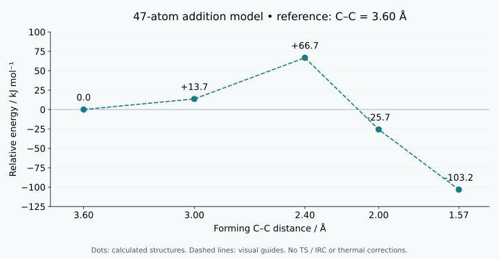
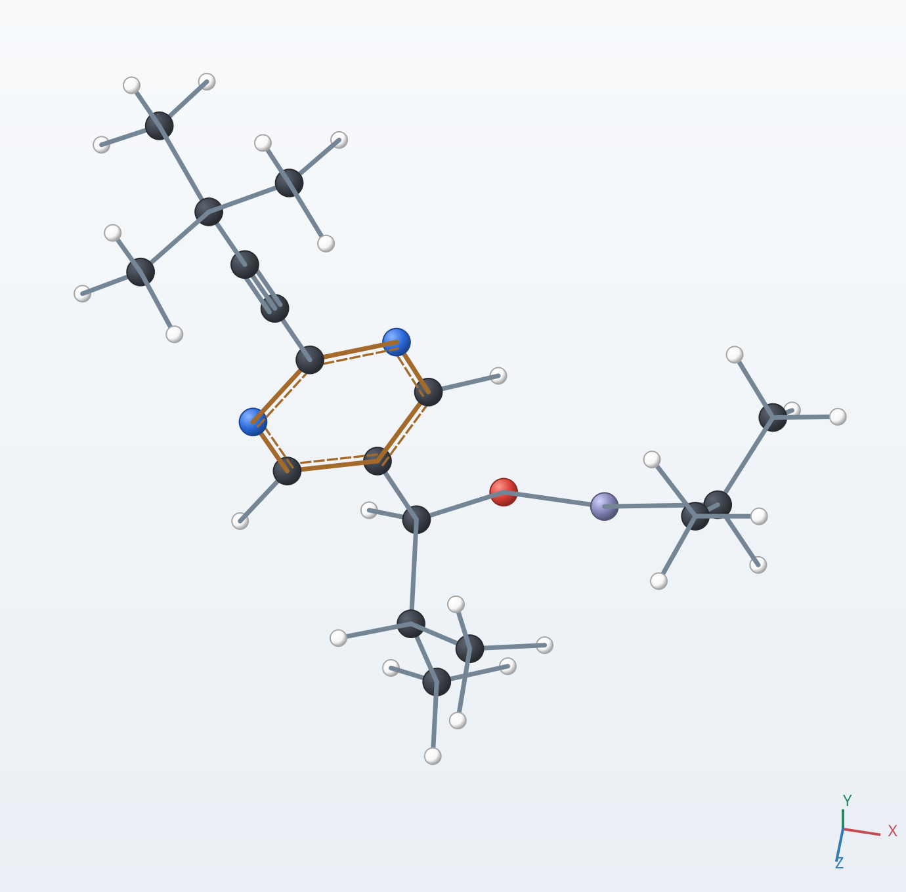
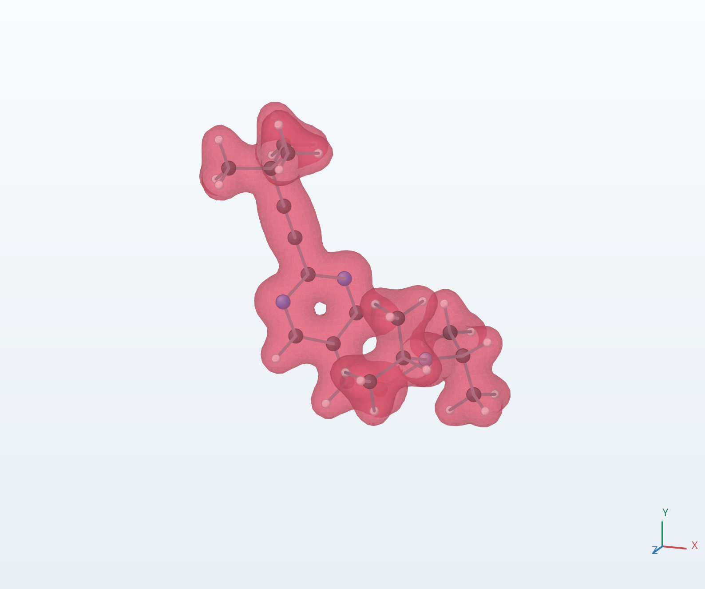
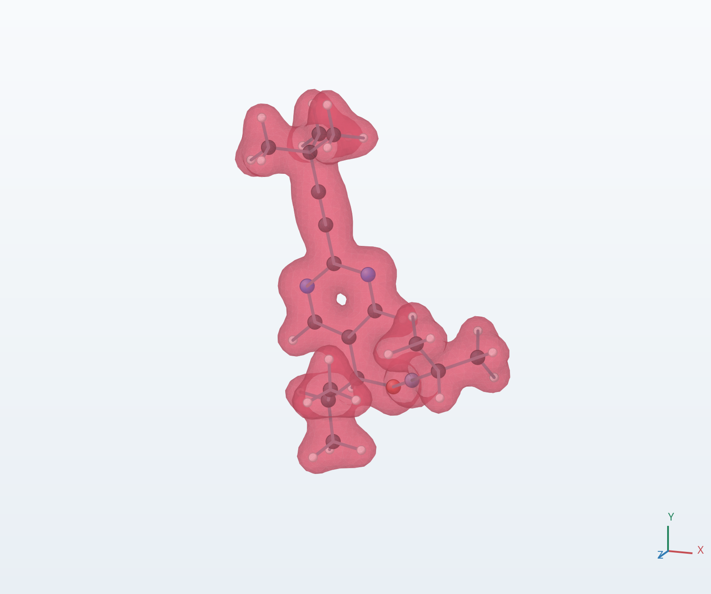
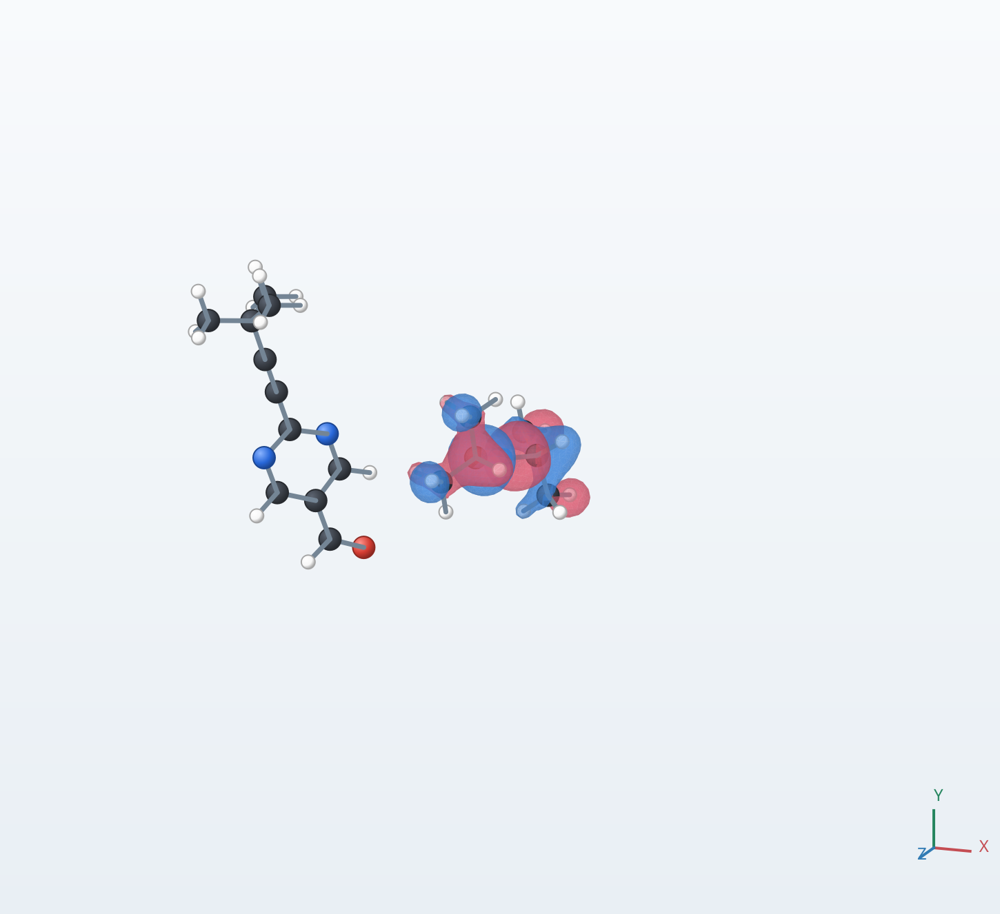
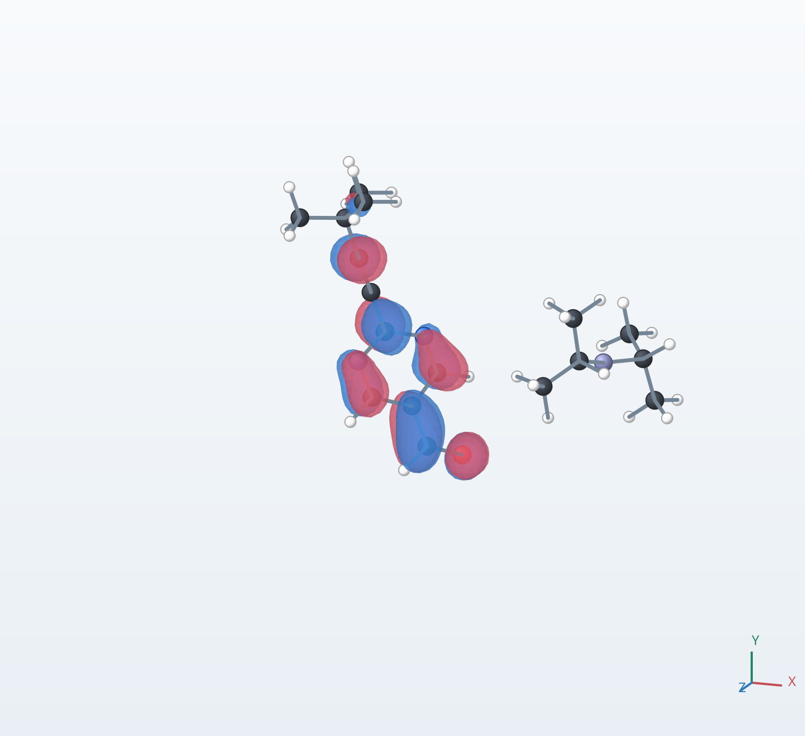
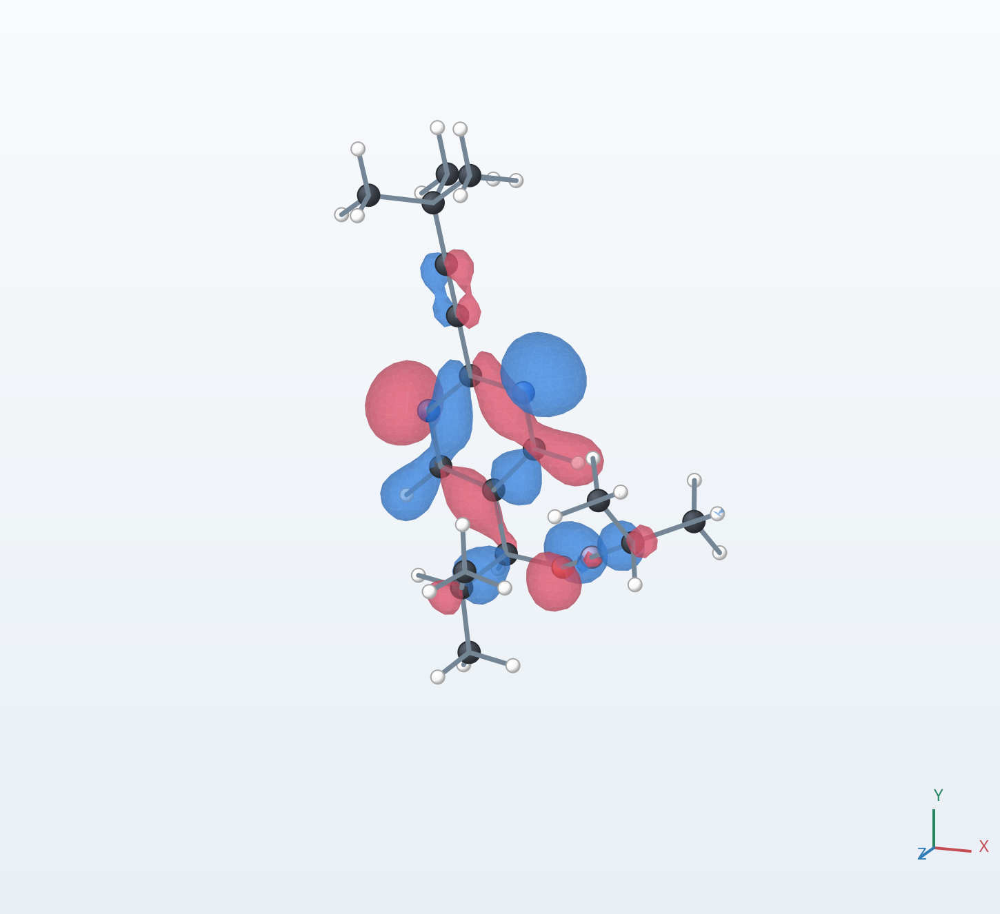
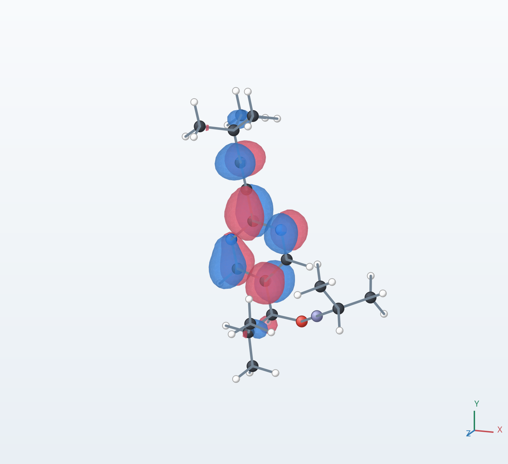

# Planning and calculating a Soai addition model with Codex

[Home](../index.html) / Calculation case study

This case study follows a calculation planned and coordinated by Codex, using MolForma to build and edit molecules and display results, and NWChem to perform quantum chemistry calculations. Codex also assembled the explanatory movie. The user and Codex discussed the model, computing budget and presentation throughout the work.

The subject is the addition of diisopropylzinc to a pyrimidine aldehyde in the Soai reaction. A **47-atom model without an autocatalyst** was used for constrained geometry optimizations and electronic-state calculations. Its endpoint is the zinc alkoxide before workup.

The calculation produced a structure with a new C–C bond and stereogenic carbon, and allowed comparison of energies and electronic states. It does not predict autocatalysis, enantiomeric amplification or the R/S product ratio.

Production calculations completed on November 8, 2026. The movie's workup explanation was revised on November 9, 2026.

## Plan and choice of model

The aim was to explain the approach of separated molecules, structural changes during addition, electron density and molecular orbitals within a local PC's computing budget. Simplified 13- and 21-atom models were considered first. The final 47-atom model retains the pyrimidine ring, its substituent and the newly formed stereogenic carbon.

| Component | Composition | Atoms, including hydrogen |
| --- | --- | ---: |
| 2-(tert-Butylethynyl)pyrimidine-5-carbaldehyde | C11H12N2O | 26 |
| Diisopropylzinc, Zn(iPr)2 | C6H14Zn | 21 |
| Total | C17H26N2OZn | 47 |

iPr denotes isopropyl. The system was treated as a neutral, closed-shell singlet.

A separate 73-atom structure from the literature was also examined to support discussion of autocatalysis. It was not added as a catalyst to this 47-atom calculation, and its energy was not combined with these points on one reaction curve. The final 47-atom movie focuses on the addition step.

## Roles of Codex, MolForma and NWChem

| Participant or program | Role in this case |
| --- | --- |
| User | Specified the computing budget, model scope and movie content, and discussed continuation and explanatory revisions |
| Codex | Planned models, settings and execution order; operated tools; managed jobs; adjusted unsuccessful optimizations; checked results; edited the movie |
| MolForma | Built molecules, edited coordinates, prepared NWChem input, and displayed structures, density and orbitals |
| NWChem | Optimized structures, calculated energies and electronic states, and exported CUBE and MOLDEN files |

MolForma was operated through MCP. Production continuation jobs used saved inputs and NWChem launched from the terminal. The movie's application walkthrough shows a pilot calculation on an initial structure and its results, distinguished from the converged production calculations.

For the underlying operations, see [MCP server](../mcp.md), [Calculation settings](../features/calculation.md) and [Result viewer](../features/results.md).

## Calculation method

### Electronic structure and execution settings

| Setting | Value |
| --- | --- |
| Program | NWChem 7.3.1 |
| Functional and dispersion correction | PBE-D3(BJ) |
| Basis | def2-SVP, spherical harmonics |
| Coulomb approximation | RI-J, Weigend Coulomb fitting auxiliary basis |
| Solvent | SMD toluene |
| Production integration grid | fine; medium was also used during initial exploration |
| SCF thresholds | energy, density and gradient each set to 1e-7 |
| Geometry convergence thresholds | NWChem defaults |
| Execution | 12 MPI processes, one OpenMP/BLAS thread each, one job at a time |

Production runs used a local PC with an AMD Ryzen 7 2700X. The 12 MPI processes include the data-server process used by this NWChem configuration. Available memory was monitored as well as parallelism.

### How toluene was included

SMD represents the solvent as a continuum surrounding the 47-atom solute, with the dielectric constant and other properties of toluene. No individual toluene molecules were placed around the solute.

The solvent polarization responds self-consistently to the solute charge distribution. A cavity–dispersion–solvent-structure contribution is also included. The output records a toluene dielectric constant of 2.3741. This model was applied to both geometry optimization and electronic-state calculations.

The solvent block in the actual input is:

```text
cosmo
  do_gasphase false
  do_cosmo_smd true
  solvent toluene
end
```

`do_gasphase false` skips a separate preliminary gas-phase calculation. Specific coordination geometries, collisions and motion of individual toluene molecules are outside this model.

### Constrained geometry optimizations

The chosen coordinate is the distance between aldehyde carbon C2 and carbon C28 of the transferring isopropyl group. These labels refer to the atom order used in this calculation and its display.

The product was optimized first. The C–C distance was then increased through 2.0, 2.4, 3.0 and 3.6 Å. At each point, other degrees of freedom were optimized while maintaining this distance. An electronic-state single-point calculation followed on the converged coordinates. This explores a constrained path along one distance; it is not an IRC traced from a transition state.

The movie presents the structures in reverse order:

```text
Calculation: product → 2.0 → 2.4 → 3.0 → 3.6 Å
Display: separated → approach → 3.6 → 3.0 → 2.4 → 2.0 Å → product
```

The separated structure was made by rigidly translating the zinc reagent away from the 3.6 Å structure. Its C–C distance is about 7.65 Å and its O–Zn distance is 6.50 Å. It received a single-point calculation without an independent geometry optimization.

## Progress and convergence adjustments

Not every initial optimization converged. Initial exploration and searches with selected atoms fixed were followed by internal-coordinate distance constraints. A free torsion across the alkyne was explicitly included among the internal coordinates. Converged structures and saved orbitals were carried forward to subsequent jobs.

The early unconverged 2.0 and 2.4 Å trials were not adopted as final points. The 3.6 Å run reached a four-hour execution limit and was resumed from its checkpoint before convergence was confirmed.

| Optimization | Accepted run history | NWChem wall time |
| --- | --- | ---: |
| Addition product | Internal coordinates with the free torsion; converged in 13 steps | About 39 min |
| C–C 2.00 Å | Internal distance constraint; converged in 46 steps | About 2 h 9 min |
| C–C 2.40 Å | Internal distance constraint; converged in 47 steps | About 2 h 26 min |
| C–C 3.00 Å | Internal distance constraint; converged in 54 steps | About 3 h 4 min |
| C–C 3.60 Å | Resumed after a timeout at 68 steps; converged after 7 additional steps | About 20 min after resuming, plus about 4 h before the stop |

These are measured times for the accepted optimization runs. Earlier exploratory and unsuccessful trials and image preparation are excluded. Subsequent electronic-state/output calculations took about 28–30 seconds when reusing saved orbitals; the rigidly separated structure took about 119 seconds. These timings are not estimates for calculations started from arbitrary initial guesses.

The accepted sequence comprises 11 completed jobs: five geometry optimizations and six electronic-state calculations. Optimization convergence, normal completion and agreement between optimized and electronic-state coordinates were checked.

## Results and relative energies

The graph uses the **C–C = 3.60 Å associated structure as its reference**. The energy of that 47-atom structure is subtracted from each total energy reported by NWChem, followed by conversion from Hartree to kJ/mol.

```text
Reference energy = −2625.336036506255 Hartree
Relative energy [kJ/mol]
  = (structure energy [Hartree] − reference energy) × 2625.499638
```

| Structure | Energy / Hartree | Relative energy / kJ mol⁻¹ |
| --- | ---: | ---: |
| C–C 3.60 Å | −2625.336036506255 | 0.0 |
| C–C 3.00 Å | −2625.330837457282 | +13.7 |
| C–C 2.40 Å | −2625.310626072071 | +66.7 |
| C–C 2.00 Å | −2625.345816550713 | −25.7 |
| Addition product, C–C about 1.57 Å | −2625.375357221712 | −103.2 |
| Separated structure, C–C about 7.65 Å; outside the graph | −2625.314147071661 | +57.5 |



**Figure 1.** The same five calculated points shown in the movie. Dashed lines are visual guides, not energies calculated at every intermediate position. The separated structure appears in the table but is not the graph's zero.

The energies include D3(BJ) and SMD solvent corrections. Vibrational zero-point, thermal and entropy corrections were not added. The wording “free energy” in NWChem's solvation output does not mean that a full reaction Gibbs energy was evaluated thermochemically. **+66.7 kJ/mol is not an established activation free energy, and −103.2 kJ/mol is not an experimental heat of reaction.**

### Changes in bond distances

| Distance | Associated structure, C–C 3.60 Å | Addition product |
| --- | ---: | ---: |
| Forming C–C | 3.600 Å | 1.565 Å |
| Aldehyde-derived C–O | 1.237 Å | 1.393 Å |
| O–Zn | 2.260 Å | 1.829 Å |
| Transferring carbon C28–Zn | 2.009 Å | 3.317 Å |

These distances are consistent with formation of a C–C bond, conversion of C=O to C–O and transfer of the isopropyl group. They were measured from calculated coordinates, rather than inferred from image appearance alone.



**Figure 2.** The product before workup, displayed in MolForma. C is gray, H white, N blue, O red and Zn purple. Displayed bond lines are not themselves the results of a quantum bond-order analysis.

## Reading the electron density and frontier orbitals

Density was exported as CUBE and orbitals as MOLDEN for six structures and displayed in MolForma. Each structure has 180 electrons and 90 occupied orbitals. HOMO 90 and LUMO 91 are selected independently at each structure.

### Electron density

<div class="case-figures">
  <figure><figcaption>Associated structure: C–C 3.60 Å</figcaption></figure>
  <figure><figcaption>Addition product: C–C about 1.57 Å</figcaption></figure>
</div>

Both total-density isosurfaces use 0.04 e/bohr³. They allow qualitative comparison of distribution shapes as the structure changes, but are not difference-density plots showing accumulation and depletion. These surfaces alone do not quantify charge transfer or bond order. Evidence for bond formation should be read together with the coordinate-derived distances above.

### HOMO and LUMO of the separated structure

<div class="case-figures">
  <figure><figcaption>Separated HOMO: mainly on the zinc reagent</figcaption></figure>
  <figure><figcaption>Separated LUMO: mainly on the aldehyde component</figcaption></figure>
</div>

HOMO is the highest-energy occupied orbital and LUMO the lowest-energy empty orbital. These are orbitals of the entire two-component, 47-atom system. Their dominant displayed regions are on the zinc reagent and aldehyde component, respectively. This offers a qualitative clue consistent with addition involving electron donation from the zinc reagent to the aldehyde.

“HOMO-to-LUMO donation” describes interaction and mixing of occupied and empty orbitals. This calculation has not quantified their contributions or the charge transferred, and does not observe a particular electron entering the displayed LUMO.

### Orbitals of the addition product

<div class="case-figures">
  <figure><figcaption>Product HOMO</figcaption></figure>
  <figure><figcaption>Product LUMO</figcaption></figure>
</div>

Orbital isosurfaces use ±0.03 bohr<sup>−3/2</sup>. Red and blue indicate the wavefunction's sign, not excess or missing electrons; the overall sign of an orbital is arbitrary.

Orbital shapes and dominant locations change with structure. However, selecting each structure's HOMO and LUMO does not continuously track one orbital. The LUMO at each point remains empty. The information obtained supports a visual, electronic explanation of the known addition step; it does not explain autocatalysis or predict an R/S ratio.

## Zinc alkoxide and the alcohol after workup

The calculation ends at a zinc alkoxide with an O–Zn linkage. Its relationship to the O–H alcohol shown in a conventional reaction scheme can be expressed by a schematic workup:

```text
Ar–CH(iPr)–O–Zn–iPr  →  Ar–CH(iPr)–O–H
                      aqueous / acidic workup
```

Ar denotes the substituted pyrimidine ring and iPr isopropyl. Hydrogen is supplied to oxygen and zinc passes into other chemical species, retaining the carbon skeleton and configuration at the stereogenic carbon. Zinc-containing byproducts and stoichiometric coefficients are omitted.

Water and acid are not present in the 47-atom calculation. The workup at the end of the movie is an explanatory scheme, not a calculated pathway or electronic-state sequence.

## Movie scope and validation

The revised movie is 5 minutes 50.5 seconds, 1920×1080 at 24 fps, with Japanese captions and no audio. It includes the application walkthrough, approach and addition, mirror-image configurations, six electronic states, interpretation and schematic workup.

| Movie element | Relationship to calculation |
| --- | --- |
| Approach of separated molecules | Rigid translation for display; intermediate approach positions were not all calculated |
| Atomic motion during addition | Converged calculated structures with display interpolation between them |
| Energy graph | Five calculated points from the associated structure to product; dashed lines are guides |
| Density and orbitals | Six static ground states; transitions between images are editorial effects |
| R/S comparison | A calculated structure and its reflection, not separate reaction paths or a yield prediction |
| Workup to alcohol | Explanatory chemical scheme |

Coordinates and occupancies were cross-checked between CUBE, MOLDEN and calculation logs. All 8,412 movie frames passed a decoding check. Visual inspection sampled 44 frames spanning all 11 chapters and the 10 chapter boundaries.

## Beyond this calculation

Reaction rates and activation free energies require transition-state and IRC validation and appropriate thermochemical treatment. Difference densities, atomic charges and bond-order analyses would be needed to investigate redistribution and donation more quantitatively.

Additional intermediate single-point calculations could make the electronic-state movie more detailed. Calculations on interpolated coordinates must still be distinguished from an optimized pathway. Autocatalysis and enantiomeric amplification require a catalyst-containing model and a separate investigation of the reaction cycle.

[Home](../index.html) · [MolForma result viewer](../features/results.md) · [NWChem calculation settings](../features/calculation.md)
