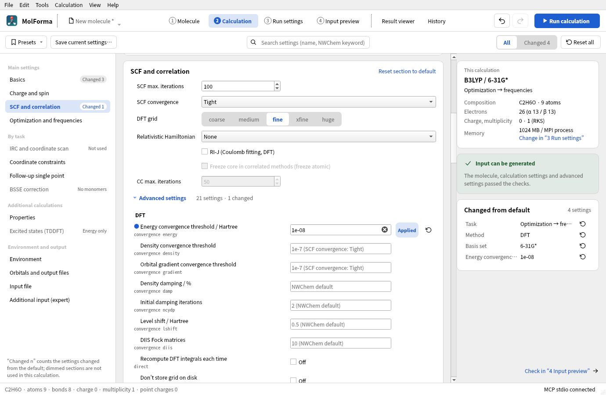
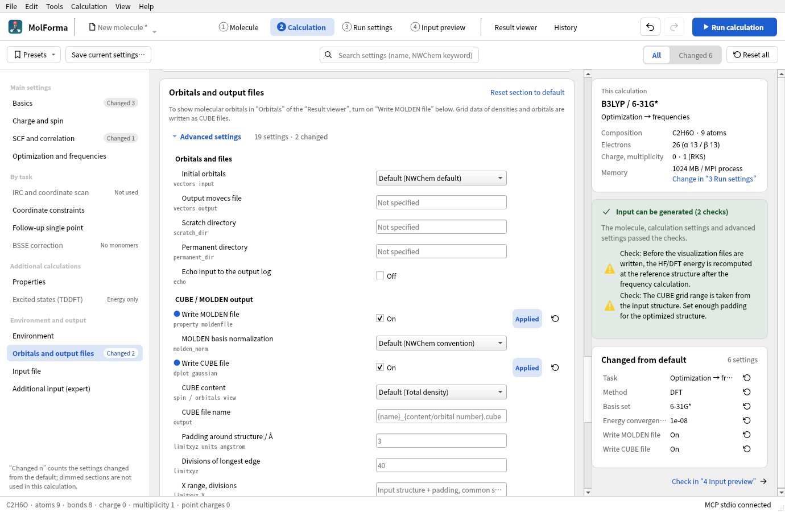

# Advanced settings and CUBE/MOLDEN output

This page describes the “Advanced settings” of each section of “2 Calculation” and the settings that write CUBE and MOLDEN files after the calculation. The basic settings are described in “[“2 Calculation”](calculation.md)”, and viewing the written files in “[“Result viewer”](results.md)”.

## Advanced settings (“Advanced settings” in each section)

The 8 groups and 56 settings passed directly to NWChem blocks are set by opening “Advanced settings” (followed by the number of settings and of changes) below the card of the related section. “SCF and correlation” has “HF / reference SCF”, “DFT” and “MP2 / CCSD”; “Optimization and frequencies” has “DRIVER optimization” and “Frequencies, thermochemistry”; “Environment” has “COSMO”; and “Orbitals and output files” has “Orbitals and files” and “CUBE / MOLDEN output”. “Orbitals and output files” contains only advanced settings, so they are open from the start. Settings not used in the current calculation are hidden; “Also show settings not used in this calculation (n)” shows them. “Changed n” in the left list, “Reset section to default”, “Reset all”, and the “Changed” filter and the search at the top also cover the advanced settings.



**Figure 1** The advanced settings of “SCF and correlation”. The row with the energy convergence threshold set to 1e-08 gets a blue dot before its name and the state “Applied”. Empty fields show the values actually used (such as “1e-7 (SCF convergence: tight)”).

Each row has the setting name with its NWChem keyword below it, a value field, a state (“Applied”, “Pending”, “Error”; blank when not set) and a reset-to-default button. Changed settings have a blue dot before the name, and settings not used in the current calculation have dimmed names. An empty value field shows in light text the value actually used and where it comes from (for example “1e-7 (SCF convergence: Tight)”, “0.00045 (optimization convergence: Normal)”, “0.3 (NWChem default)”).

Clicking a row or working in its field shows the name, keyword, state and description in “Selected advanced setting” on the right, with the default (the value used when the field is blank), the current value and the calculations that use it. Below that, an excerpt of the input block that the setting is written to is shown with the setting's line highlighted (when the field is blank or pending, this is stated instead), followed by “Reset to default” and “Show in input” (which shows the line in “4 Input preview”). “Orbitals and output files” shows the CUBE and MOLDEN files written after the calculation. The check results of the advanced settings are part of the check-result card on the right; clicking a row that contains a setting name shows that row (pending settings are shown too). Copying the full input and saving the `.nw` file are done in “4 Input preview”.

| Group (section) | Settings |
| --- | --- |
| HF / reference SCF (5 settings, SCF and correlation) | Wavefunction convergence `thresh`, integral screening `tol2e`, `direct`, `diis` and `diisbas` for closed-shell RHF only. Also applies to the reference SCF of MP2/CCSD |
| DFT (9 settings, SCF and correlation) | Separate energy/density/gradient convergence, damping percentage and initial damping iterations, level shift, number of DIIS Fock matrices, `direct`, `grid nodisk` |
| MP2 / CCSD (7 settings, SCF and correlation) | Explicit number of frozen occupied orbitals, MP2 `tight` and per-process `scratchdisk`, CC `thresh`, `tol2e`, `diisbas` and `nodisk` |
| DRIVER optimization (8 settings, Optimization and frequencies) | `gmax`, `grms`, `xmax`, `xrms`, `trust`, `eprec`, XYZ output of each structure, optimization in Cartesian coordinates (`noautoz`) |
| Frequencies, thermochemistry (4 settings, Optimization and frequencies) | 1–20 temperatures, `fd_delta` of the numerical Hessian, `hessian thresh` of the analytic Hessian, XYZ output of the vibrational modes |
| COSMO (4 settings, Environment) | Surface tessellation `minbem`, initial polyhedron `ificos`, dielectric screening `screen`, surface charge width `zeta` |
| Orbitals and files (6 settings, Orbitals and output files) | Initial orbitals from atomic densities / one-electron Hamiltonian / existing movecs, input and output movecs, `scratch_dir` and `permanent_dir`, `echo` |
| CUBE / MOLDEN output (13 settings, Orbitals and output files) | Enabling CUBE and MOLDEN, density, orbital, spin and orbital number, CUBE name, grid range and divisions, MOLDEN normalization |

Numbers accept exponent notation such as `1e-8` / `1D-8`. A blank value or “Default” removes the explicit setting and uses the calculation settings above or NWChem's default. When a value is committed, its type, finiteness, range and consistency with the method are checked, and only valid settings are used to generate the input. Invalid values in progress can be saved to the project, but no input can be written while a setting in use has an error. Per-setting reset buttons, section and global resets, and the shared undo/redo are supported. Ctrl+S also commits the value being edited before saving.

### Scope and precedence

- Explicit SCF/DFT/CC thresholds, frozen orbital counts and optimization thresholds take precedence over the basic settings. For DRIVER, the individual thresholds are written after the preset directive such as Normal or Tight. A frozen orbital count of 0 turns off the frozen core, and counts that leave too few correlated electrons are rejected.
- Values that do not apply to the current calculation, for example DFT values kept after switching to HF, become “Pending” and are not written to the input. They are applied again when you switch back to a method or task that uses them. The finite-difference step of the numerical Hessian and the accuracy of the analytic Hessian switch by the same rule.
- Optimization displacements, the trust radius and the finite-difference step are in Bohr, gradients in Hartree/Bohr and energies in Hartree. They do not change when the coordinates are switched between Å and Bohr. Temperatures are given in K.
- Optimized structures use `<calculation name>_opt` and vibrational modes `<calculation name>_vib` as the file name prefix. The XYZ files are generated when NWChem itself runs the calculation.
- Input movecs name a file where the calculation runs; MolForma does not read it. Compatibility with the atom order and basis set has to be checked at run time. When you use existing movecs, specify a different output movecs file to avoid NWChem's default behavior of reusing the input file as the output. Identity through path aliases or symbolic links is not checked.
- movecs paths are quoted, so paths with spaces work. NWChem's startup directory settings use a different syntax, so `scratch_dir` / `permanent_dir` are written without quotes, and paths containing spaces, colons or quotes are rejected. Each directory must exist where the calculation runs. “3 Run settings” creates relative directories inside the job. Environment variable expansion, per-host or per-MPI-rank locations and multiple directories are not supported.
- While a candidate is shown or a cleanup is running, editing and output are disabled. Changing advanced settings never moves the molecule's coordinates or fixed atoms.

### Saving advanced settings and compatibility

Only explicit settings are saved in `document.nwchem.advanced`. Merely opening the advanced settings does not add default values to the project. Unknown advanced fields are kept, reported as unsupported and excluded from the output. The old-format `job.sections` and the project's run and result references are kept as well.

User presets include the advanced settings except “Orbitals and files” and “CUBE / MOLDEN output”. When a built-in or old-format preset has no advanced settings, applying it clears these overrides so that the preset's basic settings take effect. The orbital, storage location, echo and visualization file output settings and unknown fields are kept, and the whole preset application can be reverted with a single undo.

The advanced settings do not offer custom keyword input, fine cache tuning of semi-direct SCF, RODFT/CDFT and fractional occupations, arbitrary orbital occupations, TCE, relativistic Hamiltonians, distance and angle constraints, scans, transition states, IRC, MD, periodic systems and the like. Old-format settings are not converted to these NWChem directives automatically. Neither NWChem nor Python is needed to edit or save advanced settings or to generate input.

References: [HF](https://nwchemgit.github.io/Hartree-Fock-Theory-for-Molecules.html), [DFT](https://nwchemgit.github.io/Density-Functional-Theory-for-Molecules.html), [MP2](https://nwchemgit.github.io/MP2.html), [CCSD](https://nwchemgit.github.io/CCSD.html), [DRIVER](https://nwchemgit.github.io/Geometry-Optimization.html), [Hessians and frequencies](https://nwchemgit.github.io/Hessians-and-Vibrational-Frequencies.html), [COSMO](https://nwchemgit.github.io/COSMO-Solvation-Model.html), [Scratch directory](https://nwchemgit.github.io/Scratch_Dir.html).

## Writing CUBE and MOLDEN files from the GUI

1. In the left list of “2 Calculation”, select “Orbitals and output files”. The “CUBE / MOLDEN output” settings are shown from the start.
2. Turn on “Write CUBE file”, “Write MOLDEN file” or both. Both can be written at the same time.
3. For CUBE, choose from “Total density (Alpha + Beta)”, “Alpha density”, “Beta density”, “Spin density (Alpha − Beta)” and “Molecular orbitals”. For a molecular orbital, choose Alpha/Beta and HOMO/LUMO/a number. Numbers start at 1. Beta orbitals are used with UHF/UKS.
4. Check the post-calculation `property` and `dplot` directives in “4 Input preview”, then run the calculation with “Run calculation” (F5) in the header.
5. When it finishes, open the job with “View results” in the run panel (“Calculation → Run status and log”) and choose the CUBE or MOLDEN file in the file list; it is loaded and displayed automatically.



**Figure 2** “Write MOLDEN file” and “Write CUBE file” turned on in “Orbitals and output files”.

The CUBE grid covers the minimum and maximum coordinates of the input structure along each axis plus 3 Å of padding, with the same grid spacing on all axes. By default the longest edge is divided into 40 intervals (41 points), and the other axes extend from the center with the same spacing to cover their range (no grid points are wasted for elongated molecules). You can change the padding and the number of divisions, or give “minimum maximum divisions” for each of X/Y/Z. The range is always in Å, independent of the display units of the coordinate table and the output units of the NWChem geometry. The grid is limited to 2 million points, and an invalid range, number of divisions or file name blocks writing the input. The grid range stays as determined from the input structure even after an optimization, so allow enough padding.

MOLDEN writes `<calculation name>.molden`, and CUBE writes `<calculation name>_<content/orbital number>.cube`. The CUBE name can be changed to a plain file name with the extension `.cube` or `.cub`. Both are saved in the `permanent_dir` of “Orbitals and files”, or directly in the job folder if it is not set. Saving the input set also records the output location in `run.json`, so the Result viewer lists files in the permanent directory too. Before a local run, conflicts with existing output are checked.

For the MOLDEN basis normalization, choose “NWChem convention” (default) or “Unnormalized (NONE)”. **Choose NONE when exporting to programs that expect standard MOLDEN coefficients.** The NWChem convention embeds primitive normalization factors in the basis coefficients. Reading those coefficients as standard MOLDEN applies the factors twice and changes orbital shapes and amplitudes. NONE writes the input basis coefficients unchanged; it does not disable molecular orbital normalization. MolForma's result viewer supports both conventions.

The orbitals and densities written are those of the HF/KS reference wavefunction; MP2/CCSD correlated densities and natural orbitals are not supported. After a frequency calculation, the HF/DFT energy is recomputed at the reference structure and its orbitals are written. HOMO/LUMO numbers are determined from the electron count, multiplicity, ECPs and spin; fractional occupations and excited states are not handled. Specifying an orbital number that does not exist (for example with a minimal basis set) causes an error when NWChem runs. CUBE output is one file with one content per calculation, and GUI output for structures containing ghost centers is not supported.

NWChem writes the files themselves. NWChem 7.3.1 writes an orbital CUBE as a single scalar field with a positive atom count, rather than Gaussian's multiple-orbital representation with a negative atom count and an orbital-number list. Check the file name and generated input for the orbital number and spin. Coordinates are in Bohr, densities in electrons/bohr³ and orbital amplitudes in bohr⁻³ᐟ².

The settings are saved in the project and support the shared undo/redo, resets and reuse from History. When output is turned off, the grid, orbital and other settings are kept as pending and used again when it is turned back on. Applying a calculation preset keeps the output settings. Opening a MOLDEN file shows molecular orbitals from the basis set and MO coefficients. Molecular orbital CUBE files can be used as well.

References: [NWChem DPLOT](https://nwchemgit.github.io/DPLOT.html), [Properties / MOLDENFILE](https://nwchemgit.github.io/Properties.html#moldenfile).

## Validating the advanced settings

The `advanced` Qt Test checks setting types and value ranges, applied and pending states, the precedence of thresholds, the differences between HF and DFT, frozen orbitals, analytic/numerical Hessians, temperatures, paths, the preservation of unknown fields, presets, the display within sections (expanding and collapsing, unused settings, changed settings), search, navigation from the check results, resets, undo/redo, candidates, Ctrl+S, and quitting with a field focused. The regular CTest run needs neither NWChem nor the network.

Optional inputs for testing with a real NWChem and screenshots can be generated. Use an output path without spaces or colons.

```sh
QT_QPA_PLATFORM=offscreen MOLFORMA_ADVANCED_ARTIFACTS=/tmp/molforma-advanced \
  ./build/test_advanced engineArtifacts
```

The orbital-loading test `vectors_details.nw` is used after running `files_details.nw`, which saves the orbitals.

On 2026-10-22, 9 advanced-setting inputs were confirmed to finish normally with NWChem 7.3.1 (2 MPI processes, 1 OMP/OpenBLAS thread each). They include HF DIIS and integral accuracy, separate DFT convergence, damping and grid, MP2/CCSD, optimization → analytic frequencies, MP2 numerical frequencies, COSMO, storage locations, and writing and rereading movecs. The temperatures 100/298.15/350 K, a numerical finite-difference step of 0.003 Bohr and the XYZ generation were confirmed to take effect as well. Saving and rereading the initial orbitals gave the same SCF energy, −74.945628203255 Hartree. The Qt Tests of the advanced and calculation settings are also verified under AddressSanitizer.

## Validating the CUBE and MOLDEN output settings

The `output` Qt Test checks compatibility with output turned off, task generation for HF/DFT/MP2 and after frequencies, the checks of HOMO/LUMO, spin and orbital numbers, the checks of grids and file names, saving, presets and undo, conflicts of output locations, result lists for files inside permanent and in external locations, and agreement between GUI operations and the input preview. The regular CTest run needs neither NWChem nor MPI.

Where NWChem and MPI are available, the following runs 15 generated cases, loads both formats and saves PNG images of the settings screen. It checks atomic numbers, coordinates, grid bounds, point counts and data counts, and compares CUBE values with values recomputed from the MOLDEN orbital coefficients. Cases include spherical/Cartesian s–g bases, NWChem/NONE normalization, ROHF/UHF Alpha, Beta and spin densities, and ECPs. The convention for reading NONE output is supplied explicitly from the generating input.

```sh
QT_QPA_PLATFORM=offscreen MOLFORMA_OUTPUT_ARTIFACTS=/tmp/molforma-output \
  ./build/test_output realEngineArtifacts
```

On 2026-10-23, CUBE and MOLDEN generation and loading were confirmed with NWChem 7.3.1 (2 MPI processes, 1 OMP/OpenBLAS thread each) for four cases: the HF electron density of water, the UKS/PBE Beta HOMO of the water cation, the reference HF density of MP2, and the density of H₂ after optimization + numerical frequencies. A relative permanent directory combined with an output movecs path containing spaces also worked. The atomic coordinates in both H₂ files match the optimized structure. All 10 CTest suites and the AddressSanitizer checks of output, execution and results (with leak detection for external libraries disabled) passed.

On 2026-10-29, all 15 cases passed generation and numerical comparison with NWChem 7.3.1. An independent check with PySCF 2.12.1 recomputed orbitals and densities from 22 MOLDEN files and compared them with 207,550 values in 66 CUBE files. Including coordinate-header rounding, the L2 relative error was at most 3.3×10⁻⁵; the largest MO orthonormality error (the maximum difference between CᵀSC and the identity matrix) was 5.3×10⁻¹⁰. Primitive normalization factors were removed from NWChem-convention coefficients before the independent calculation. Omitting that conversion gives incorrect results with a standard MOLDEN reader; NONE output agreed without conversion. This check does not guarantee compatibility with every program or with untested bases and NWChem versions.

See also: [“2 Calculation”](calculation.md), [“Result viewer”](results.md), the list of pages in “[Features](../features.md)”.
