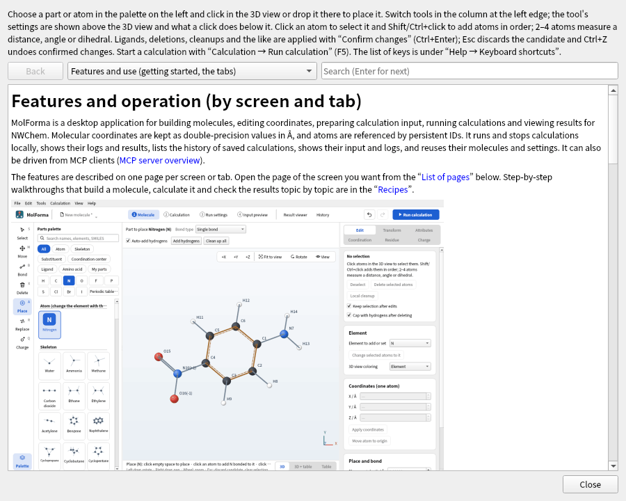

# Whole application

- **Common building blocks**: Every tab is built from the same parts: a top row (toolbar), white cards, switches (segments for up to 5 choices; underlined tabs for more, as in the details of the result viewer; tabs are never placed inside tabs), buttons (blue for the main action of the page, red outline for delete and trash, blue text with an arrow for moving to another tab), check-result cards (a heading such as “Input can be generated” or “Ready to run” and items), calculation summary cards, log and file views (switch, file name, follow, copy), tables (no grid lines; numbers monospaced and right-aligned) and the controls at the top right of the 3D view.
- **One place to edit each value**: Other tabs show the value and lead there with a link such as “Change in “2 Calculation””. Total charge, multiplicity, whether external point charges go into the input, the coordinate output unit, and MOLDEN and CUBE output are set in “2 Calculation”; memory in “3 Run settings”; and the table of formal charges, unpaired electrons and atom names with “Attributes” in the coordinate table of “1 Molecule”.
- **Status bar**: A single line at the bottom of the window. Normally it shows a summary of the molecule being edited (formula · atoms · bonds · charge · multiplicity · point charges); during a temporary message it shows only that sentence (the summary is hidden, and nothing overlaps when the display at the right end changes). In the result viewer and history, the summary starts with “Molecule being edited:” so that it is not mistaken for the shown result. The right end shows the state of the running or last calculation (click it for the run panel) and similar information.
- **Notation**: Energies are written in Eh (= hartree) on screen (the column names of the history CSV stay as before for compatibility). Labels use sentence case. Words in a list are joined with “, ” (or “and”), and items of a summary are separated by “ · ” with a space on each side. An action that creates one file is named “Export …”, one that reads from a file “Import …” or “Load …”, one that creates a job folder “Save as job”, one that runs the checks again “Recheck”, the view that fits the whole molecule “Fit to view”, and fixing atoms “Fix selected atoms” and “Unfix”. Tabs are named by number and tab name in text and in links alike (in text in quotes, as “2 Calculation”; a link to another tab reads Check in “4 Input preview”). Only the workflow steps in the header show the number as a round badge. The minus sign of values meant to be read, such as negative energies, is “−” (U+2212); the table cells of the result viewer use “-” so that copied values stay numbers.
- **Recent files**: “File → Recent files” lists up to 10 files you opened or saved, newest first (stored in the app settings). Missing files cannot be chosen. “Clear list” clears it.
- **Display language (Japanese, English)**: The windows, messages, guide and manual can be shown in Japanese or English. By default MolForma follows the system language (Japanese in a Japanese environment, English otherwise); “Language (after restart)” in “Edit → Preferences…” fixes it to 日本語 or English (it takes effect after a restart). The environment variable `MOLFORMA_LANGUAGE` (`ja` / `en`), when set, takes precedence. Messages of the cleanup and result-loading workers and of MCP responses use the same language. The contents of projects, jobs and NWChem input are the same whatever the display language. The English translations are in `assets/translations/en.json`, and a test (`translations`) checks that every Japanese string in the source is covered by the translation and has a translation.
- **Language of Qt dialogs**: Qt's standard dialogs and buttons, such as message boxes and file dialogs, follow the display language as well. In Japanese, Qt's translations (`qt6-translations` on Arch Linux, `qt6-translations-l10n` on Debian/Ubuntu, etc.) are used when installed; without them, the standard buttons such as 保存 (Save), 変更を破棄 (Discard), キャンセル (Cancel) and 閉じる (Close) are still shown in Japanese.
- **New**: “File → New” creates an empty unsaved project and does not ask about saving until you edit it (the run settings are the defaults from “Preferences”). It also resets the view to the front. The default file name when saving is the molecular formula (e.g. `C2H6O.molforma.json`).
- **Load errors**: For a file that cannot be opened, the file name and the reason are shown. For XYZ, the number and text of the offending line are shown.
- **Copying and pasting XYZ**: “File → Copy whole molecule as XYZ” copies the whole molecule, and “Edit → Copy selection as XYZ” (Ctrl+C) the selected atoms (the whole molecule if nothing is selected). “File → Replace with pasted XYZ…” makes a candidate that replaces the current structure, and “Edit → Paste XYZ as fragment” (Ctrl+V) a candidate that adds it beside the current molecule.
- **Drag and drop**: Dropping a structure file, a project or NWChem/Gaussian input on the window opens it (asking about unsaved changes). Dropping XYZ, MOL, SDF, PDB, ENT or mmCIF (also gzip-compressed) on the coordinate table makes a candidate that replaces the structure instead of opening it. `.out`, `.log`, CUBE, MOLDEN and folders open in the result viewer. Dropping a part from the palette of “1 Molecule” places it on the molecule as before.
- **Autosave and recovery**: In interactive sessions, while there are unsaved changes, a copy of the project is saved every minute to the data folder (`~/.local/share/MolForma/autosave/` on Linux). Saving or exiting normally deletes the copy. If a copy from a session that ended abnormally remains, the next start shows its save time, original file and molecule and asks whether to “Recover”, “Discard” or “Decide later”. A recovered molecule opens as an unsaved project, so save it under a name. Copies in use by other MolForma windows are left untouched. `--mcp-gui` sessions autosave but do not ask about recovery (`--mcp` and `--screenshot` are not covered).
- **Guide and manual**: “Help → Guide and manual” (F1) shows these “[Features](../features.md)” pages, the [recipes by topic](../recipes.md) (16 recipes with screenshots) and the MCP description, built into the executable (no installed documentation files are needed). The English interface shows this English manual. Links between the pages can be followed, and “Back” returns to the previous page. Clicking a link under “Practice data” of a recipe saves a copy of that file where you choose and opens it (a part file goes to “My parts”). Pressing Enter in the search field moves to the next match.
- **Desktop integration**: `cmake --install` installs the launcher (`share/applications/molforma.desktop`), the icon (`molforma` in `share/icons/hicolor`) and the MIME types for projects (`*.molforma.json`) and NWChem input (`*.nw`) (`share/mime/packages/molforma.xml`). Updating the system databases may need `update-desktop-database` / `update-mime-database`. The window icon uses the same design. `LICENSE` (GNU GPL version 2; MolForma is version 2 or later), `NOTICE` and `README.md` are installed in `share/molforma`.

**Figure 1** “Help → Guide and manual” (F1). You can follow links between pages and return with “Back”.

**Figure 2** The window with the display language set to Japanese (shown: “1 Molecule”). Choose it in “Language (after restart)” of “Edit → Preferences…”.

## Tests

Use `ctest --test-dir build --output-on-failure`.

- Generating and reloading all 101 templates, round trips of the 4 projects in `tests/fixtures/`.
- Invalid XYZ, isotopes, adding hydrogens, attaching, numeric dimensions, refusing fixed atoms and ring bonds.
- Peptide composition, termini, replacement and caps; coordination distances and bidentate site conditions.
- Converting water to TIP3P point charges.
- Adding hydrogens to all templates including aromatic rings, bond order estimation for XYZ, rotational symmetry numbers.
- SMILES, cleanup with fixed atoms, SDF/PDB round trips.
- GUI click placement, Delete/Esc, building from a sequence, confirming and discarding candidates, Undo/Redo, keeping the original state on failure.
- The workflow in the header linked to the tabs, showing input errors, the two-row layout in narrow windows, the arrangement of the 3D view and coordinate table in “1 Molecule” (3D / 3D + table / table) and updating a hidden table, the tool settings row on the 3D view (the 3D view does not move with tools or candidates), the sequence and measurement display on the 3D view, the selection and candidate lists, the tile layout of the palette, the colors of the dark theme.
- Click selection and adding with Shift+click, unified deletion (removing hydrogens, capping), the candidate banner and the atom counts of the difference, the key list, Ctrl+C/V, syncing the trackball and sliders, zooming at the cursor position, label selection, fixes and search from diagnostics, the run state in the status bar, composition and notes in history, the vibration animation summary, colors derived from the palette.
- Showing skeleton thumbnails and placing after search, distinct names of residue states, updating My parts thumbnails and HiDPI display.
- Replacing and deleting capped residues and switching termini, part replacement.
- Point groups (C2v, C3v, Td, D∞h, D2h, D6h, Cs, Oh, Ih, D2d, C∞v, C2, C1, Ci) and symmetrization, Z-matrix references and values, conformer search and superposition.
- Input generation and checks for solvent, relativistic, RI-J, properties, transition-state search, IRC, constraints, scans, BSSE, follow-up calculations and additional input, round-trip import of NWChem input, Gaussian input, multi-frame XYZ.
- Reading scans, IRC, properties, BSSE and solvation from results, translation/rotation detection, the path table, ΔE, measurements, comparison, warnings on the termination state, summary cards and switching the action panel of the result viewer, the ΔE column of history, loading results when a calculation ends.
- Display styles, hiding, measurement display, hydrogen bonds, recent files, drag and drop, autosave and recovery, the built-in manual. The tests switch the app settings and data folder to temporary directories and do not write to the user's settings files.
- English interface: every Japanese string in the sources is marked for translation and has an English translation with the same `%1` placeholders, and the window built in English (all tabs and the right-hand pages of “1 Molecule”) shows no Japanese (`translations`).

CTest has 14 series, `core`, `editor`, `coordinates`, `calculation`, `advanced`, `execution`, `input_preview`, `results`, `history`, `output`, `molden`, `rendering`, `translations` and `mcp`, and each `tests/test_*.cpp` is one executable. The dated records in each section give the number of series and cases at that time. Starting under X11 and saving the screen after installing to a separate directory, as well as SMILES generation by the worker, cleanup that keeps fixed atoms and the error response to invalid SMILES, were also checked.

`tests/fixtures/` holds 4 example project files. Screenshots can be regenerated with `--screenshot`.

See also: [MCP server overview](ai.md), the list of pages in “[Features](../features.md)”.
