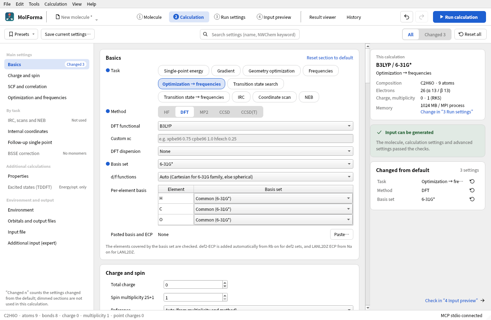
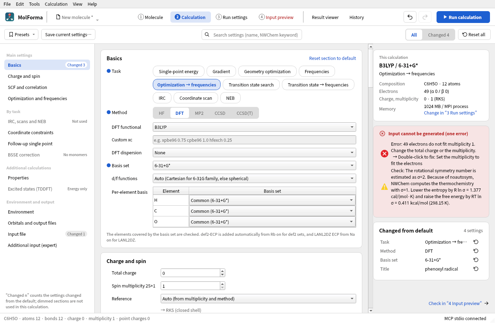
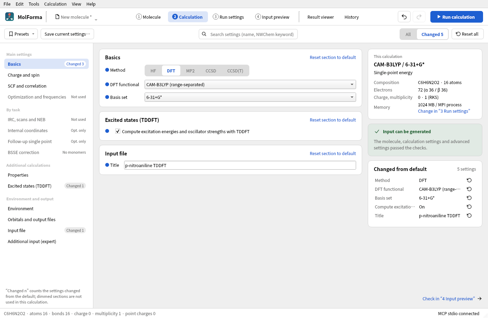

# “2 Calculation”

The list on the left shows the sections (“Basics”, “Charge and spin”, “SCF and correlation”, “Optimization and frequencies”, “IRC, scans and NEB”, “Internal coordinates”, “Follow-up single point”, “BSSE correction”, “Properties”, “Excited states (TDDFT)”, “Environment”, “Orbitals and output files”, “Input file”, “Additional input (expert)”), the middle shows the settings of each section, and the right shows the calculation summary, the input check results and the settings changed from their defaults. Selecting a section in the list moves to its settings, and scrolling the settings moves the selection in the list along. The list shows the number of settings changed from their defaults (“Changed n”) and dims the sections that the current task and method do not use (“Not used”, “Opt. only”, “No monomers”, “DFT only”, “Energy/opt. only”); the section headings show the same reason. In a narrow window the list is hidden. Settings changed from their defaults have a blue dot before the name. Task, method, DFT grid and solvent model are chosen with buttons (over MCP they can still be set through choice fields such as `nwchem_task`, as before).

RI-J, TDDFT, follow-up calculations and relativistic settings remain editable so they can be disabled after a method or task change makes them incompatible. Diagnostic navigation and fixes target the same settings in either display language.



**Figure 1** Ethanol, B3LYP/6-31G* “Optimization → frequencies”. The list on the left moves to a section; the summary of the calculation, the check result and the settings changed from default appear on the right.

Changes to the settings are recorded in the shared undo/redo history (“Undo” and “Redo” in the header). Conflicting settings are kept as work in progress, but while errors remain, the input cannot be generated, copied or saved. While a candidate is shown or a cleanup is running, the settings cannot be changed, and the top of the tab shows why.

## Supported calculations

| Item | Coverage |
| --- | --- |
| Method | HF, DFT, MP2, CCSD, CCSD(T) |
| Task | Single-point energy, gradient, geometry optimization, frequencies, optimization → frequencies, transition state search, transition state search → frequencies, IRC, coordinate scan (relaxed, rigid; one- or two-dimensional), NEB (reaction path between two structures). The CCSD methods support closed-shell RHF single-point energies only. A DFT single-point energy can add TDDFT (excited states), and a DFT optimization can optimize an excited state with TDDFT |
| Reference | Auto, RHF/RKS, UHF/UKS, ROHF. Auto uses a restricted reference for singlets, ROHF for open-shell HF and an unrestricted reference for open-shell DFT/MP2. An ROHF reference for DFT/MP2 is not supported |
| DFT | B3LYP, PBE, PBE0, BLYP, BP86, B3PW91, BHLYP, TPSS, SCAN, r²SCAN, M06-L, M06, M06-2X, PW6B95, CAM-B3LYP, ωB97X-D3 and a custom xc line. No dispersion correction, D3, D3(BJ); coarse/medium/fine/xfine/huge grids; RI-J (Weigend Coulomb fitting) |
| Basis set | STO-3G, 3-21G, 6-31G, 6-31G*, 6-31G**, 6-31+G*, 6-31++G**, 6-311G**, 6-311+G**, 6-311++G**, cc-pVDZ/TZ/QZ, aug-cc-pVDZ/TZ, def2-SVP/SVPD/TZVP/TZVPP/TZVPD/QZVP, LANL2DZ (ECP), all-electron basis sets for relativistic calculations x2c-SVPall/TZVPall, cc-pVDZ-DK/cc-pVTZ-DK, SARC-ZORA/SARC-DKH. Per-element basis sets, bases and ECPs pasted in NWChem's format. d/f functions as Auto, spherical harmonics or Cartesian |
| Relativistic | ZORA (DFT only), Douglas–Kroll–Hess (DKH2), X2C. Used with all-electron basis sets in HF/DFT |
| Convergence | SCF max. iterations and convergence (NWChem default, Normal, Tight, Very tight), optimization max. iterations and Normal/Tight/Loose, CC max. iterations, frozen core for correlated calculations |
| Environment | COSMO for HF/DFT (dielectric constant or solvent name), SMD for DFT (solvent name). A UHF reference with HF is rejected because NWChem's COSMO does not support it; use ROHF or UKS. Optional output of the saved point charges |
| Properties and spectroscopy | Mulliken and ESP/RESP charges, NMR shielding and J couplings (spin–spin coupling constants), polarizability, normal Raman, ESR g/A tensors, ORD β and ESP/field CUBE. ECD is requested with TDDFT. See the requirements below |
| Composite calculations | Single point with another method or basis set after an optimization or transition state search, BSSE (counterpoise) correction with bonded molecules as monomers, constrained and added internal coordinates, fragment initial orbitals, custom additional input |
| Output | Calculation name, title, memory per MPI process, Å/Bohr. The finished `.nw` is copied and saved in “4 Input preview” |

The element coverage of the basis sets is checked against a fixed list built from the per-element entries of the NWChem 7.3.1 library files. The basis set files themselves are not bundled. STO-3G covers H–I, 3-21G H–Cs, 6-31G/6-31G** H–Zn, 6-31G* H–Kr, 6-31+G*, 6-31++G**, 6-311+G** and 6-311++G** H–Ca, and 6-311G** H–Ca, Ga–Kr and I. cc-pVDZ/TZ/QZ cover H–Kr (except K), aug-cc-pVDZ/TZ H–Kr (except K and Ca), the def2 family H–La and Hf–Rn, and LANL2DZ H, Li–La, Hf–Bi and U–Pu. The selected library must be available where the calculation runs.

In the “Per-element basis” table you can choose a different basis set for each element in the molecule (for example 6-31G* for the organic ligands and def2-TZVP or LANL2DZ for the metal only). When such assignments exist, `*` is not used and a line such as `Fe library "def2-tzvp"` is written for each element (NWChem treats a second library for the same element as an addition, not a replacement). Ghosts get the basis set of their element. Assignments for elements not in the molecule are kept but not used in the output. `basis spherical / cartesian` applies to all elements, so a warning is shown when the per-element basis sets differ in their d-function convention.

Bases and ECPs that are not in the library are pasted with “Paste…” of “Pasted basis and ECP” in “Basics”, in NWChem's format (as the [Basis Set Exchange](https://www.basissetexchange.org/) writes them with the format “NWChem”). A basis is lines “element shell” (`Pt S` and so on; shells S, P, D, F, G, H, I, SP, L) with lines of numbers below them (exponent and coefficients); an ECP is lines “element nelec n”, “element ul” or “element shell” with lines of three numbers (power of r, exponent, coefficient). Comments (`#`), the heading lines `BASIS "ao basis" …` and `ECP`, and `END` are skipped; any other line (another NWChem directive, for example) is an error with its line number. The dialog shows the elements and core electrons it read before they are applied. A pasted element takes its pasted basis instead of the common or per-element one (its ghosts the same shells, as `bqPt S`); the `basis` block writes its shells as pasted and the other elements as `element library "…"`. An element with a pasted basis takes no ECP unless one is pasted (the library's ECPs belong to the library's bases). The `nelec` of a pasted ECP counts in the checks of electrons and multiplicity and makes frequencies numerical. Bases and ECPs of elements not in the molecule are kept but not written. A follow-up single point uses library bases only. Importing an NWChem input also reads shells and ECPs that are not `library` entries as pasted ones. NWChem judges the contents (correct coefficients, fitting the element) when it runs. On 2026-11-11 an input of water at B3LYP/6-31G* with STO-3G pasted for H alone completed normally in NWChem 7.3.1.

“Auto” for “d/f functions” writes 6-31G, 6-31G* and 6-31G** as Cartesian (6d), matching the definitions of these basis sets, and all others as spherical harmonics (5d, 7f) (the same convention as Gaussian's defaults). The spherical-harmonics setting of earlier projects and user presets is carried over as an explicit choice. A warning is shown when you explicitly choose a type that differs from the convention. Use “Auto” when comparing with literature values.

For the def2 family, `def2-ecp` is assigned automatically, removing 28 electrons for Rb–Xe, 46 for Cs–La and 60 for Hf–Rn; for LANL2DZ, `lanl2dz ecp` is assigned, removing 10 electrons for Na–Cu, 18 for Zn, 28 for Ga–Ag, 36 for Cd, 46 for In–La, 60 for Hf–Au, 68 for Hg and Tl, and 78 for Pb, Bi and U–Pu (the `nelec` of the NWChem ECP library). ECPs are attached to real atoms only, and the electron count is corrected before the α/β electron counts and the multiplicity are checked for consistency. Ghosts have a nuclear charge of 0 and get an explicit basis set such as `bqC library C ...`. `freeze atomic` for correlated calculations is off by default. When it is on, the number of orbitals frozen by NWChem's per-atom rules is shown, and settings that leave too few correlated electrons are rejected. ECP centers and ghosts are excluded from the frozen core.

Dispersion corrections can be chosen only for the combinations for which NWChem 7.3.1 writes Grimme's published parameters. D3(BJ) for the M06 family and D3 for SCAN and r²SCAN are rejected because NWChem has no parameters for them, and D3(BJ) for B3PW91 and D3 for PW6B95 because NWChem's values do not match the published ones. ωB97X-D3 already includes D3 and is used without a correction. “Custom xc” takes the `xc` line of the DFT block as one line of letters, digits, `_`, `.`, `+`, `-` and spaces (for example `xpbe96 0.75 cpbe96 1.0 hfexch 0.25`). NWChem checks the names at run time, and no dispersion correction can be chosen. On 2026-10-24, inputs with every added functional and every allowed dispersion correction were confirmed to finish normally with NWChem 7.3.1.

Frequencies use an analytic HF/DFT Hessian by default, and a numerical Hessian for MP2, ROHF, ECPs, COSMO, and DFT with meta-GGA, range-separated or custom xc functionals (NWChem has no analytic Hessian for meta-GGA and range-separated functionals and switches to finite differences automatically). You can also choose the numerical Hessian manually. Frequency analysis with fixed atoms, ghosts or external point charges, and COSMO with ghosts, are not supported. Because the coordinates are written with `noautosym`, NWChem computes the thermochemistry with a rotational symmetry number σ=1. MolForma estimates σ as the number of rotations in the point group that “Point group and symmetrize” finds (tolerance 0.05 Å, up to 200 atoms; isotopes and mass assignments count as distinct kinds, ghosts are left out; linear molecules: 2 for D∞h, 1 for C∞v); if σ>1, a warning shows the corrections to the entropy (−R ln σ) and the free energy (+RT ln σ, 298.15 K). When frequencies follow an optimization, the two `task` lines are written in order. SCF convergence is 1e-5 for Normal, 1e-7 for Tight (default) and 1e-9 for Very tight, applied to `thresh` for HF and to energy/density/gradient for DFT. “NWChem default” writes none of these and uses NWChem's default thresholds (a warning is shown because they can be too loose for frequency calculations). The CC convergence threshold is 1e-7. Individual thresholds set in the advanced settings of “SCF and correlation” override the corresponding values.

## Saving, presets and compatibility

- NWChem-specific settings are saved in `document.nwchem`. `geometry_units` is shared with the export of the coordinate table. The total charge and multiplicity are those of the molecule (`document.charge` / `document.multiplicity`), so changes made in “1 Molecule” are reflected too. The formal charges of the atoms and the total charge of the calculation are kept apart, and a warning is shown when they differ.
- Projects without NWChem settings show HF/STO-3G as the initial settings. Unknown fields are kept when saving. Fixed-atom flags are written to NWChem.
- Point charges are not written by default. When you enable them on this tab or in “1 Molecule → Charge”, they are written to `bq units angstrom`. Point-charge coordinates are written explicitly in Å, regardless of the molecule's output units.
- Built-in presets are HF/STO-3G, B3LYP-D3(BJ)/def2-SVP optimization + frequencies, and frozen-core MP2/cc-pVDZ. Applying a preset can be reverted with a single undo. The tooltip of the description field lists the changes before you apply it. Presets do not change the molecule, charge, multiplicity, calculation name, title, memory, units or unknown fields. All other basic settings, including the reference, solvent model, dielectric constant and the output of external point charges, are replaced by the preset's values. Saved and removed user presets are stored in the local QSettings.
- The title and calculation name take effect when the entry is committed. The characters and length of the calculation name and line breaks, quotes and the like in the title are checked so that no other NWChem directive can slip in. The input preview is read-only.

Turning on “Excited states (TDDFT)” writes a `tddft` block (`nroots`, `notriplet` for closed shells when triplets are not requested, and `cis` for the Tamm–Dancoff approximation) and `task tddft energy`. Open shells (UKS) give unrestricted excited states without the singlet/triplet separation. TDDFT in NWChem 7.3.1 stops with meta-GGA functionals (TPSS, SCAN, r²SCAN, the M06 family, PW6B95), so they are rejected.

With the task “Optimization” and TDDFT turned on, the structure of the excited state numbered in “Excited state to optimize (optimization)” is optimized (excited-state optimization). The `tddft` block adds `civecs`, `target n` and `grad` (`root n`), and the task is `task tddft optimize` (without `civecs` NWChem stops with “singlet vectors absent”). Each step solves the excited states again and optimizes with the analytic gradient of that state, so if the states change order during the optimization, it follows the other state of that number. Closed shells follow singlet excited states only (it cannot be combined with “Also triplets”; a triplet's structure can be optimized as the ground state of multiplicity 3); open shells (UKS) number the unrestricted excited states. It cannot be combined with transition-state searches or frequencies, nor write CUBEs of excited states (compute a single point at the optimized structure). The optimization steps of the log (`@` lines) are excited-state total energies, shown under “Optimization” in the Result viewer. On 2026-11-11 the lowest singlet excited state of ethylene (B3LYP/6-31G*) converged in 5 steps in NWChem 7.3.1. Excited-state gradients are also computed to write the density or difference density of an excited state in “Orbitals and output files” ([Writing densities of excited states](advanced.md#writing-densities-of-excited-states)). Combinations with CAM-B3LYP, ωB97X-D3, COSMO and dispersion corrections have been tested in real runs.

Running calculations and MPI launch settings are in “3 Run settings”; output is viewed in the “Result viewer”. TCE, MD, periodic systems and QM/MM are out of scope (the directives they need can be written in the additional input). You can edit settings and generate input without an NWChem installation. The input check does not guarantee convergence or the validity of the physical model.

## Solvents, relativity and RI-J

- The solvent models are “COSMO” and “SMD (DFT, named solvent)”. For the solvent, choose “Dielectric constant (COSMO only)” or one of water, methanol, ethanol, 1-propanol, 1-butanol, acetonitrile, acetone, DMSO, DMF, THF, 1,4-dioxane, diethyl ether, ethyl acetate, dichloromethane, chloroform, nitromethane, pyridine, benzene, toluene, n-hexane and cyclohexane; the NWChem SMD solvent code (`h2o`, `acetntrl`, `dcm` and so on) is written to the `cosmo` block as `solvent`. With a named solvent, COSMO also uses the dielectric constant from the same table. SMD adds `do_cosmo_smd true` and gives the solvation free energy including the non-electrostatic (CDS) terms. SMD in NWChem 7.3.1 is DFT-only, so combining it with HF is rejected (a real run stops with “cosmo-smd can be used only with dft and sodft”). Frequencies in solvent use a numerical Hessian.
- Relativistic Hamiltonians are written to the `relativistic` block as `zora on`, `douglas-kroll dkh` or `x2c on`. NWChem's ZORA is DFT-only, so choose DKH or X2C for HF (a real run stops with “ZORA available only for DFT”). Combining them with an ECP is rejected because the core would be treated twice, and a warning is shown when a non-relativistic basis set is used for Kr and heavier elements. ZORA total energies cannot be compared directly with non-relativistic, DKH or X2C energies. Frequencies with a relativistic Hamiltonian use a numerical Hessian.
- RI-J (DFT) writes `weigend coulomb fitting` (H–La, Hf–Rn; the same basis set on ghost centers) to `basis "cd basis"` and approximates the Coulomb term. Total energies differ slightly from a regular calculation, and frequencies use a numerical Hessian.

## Transition states, IRC, constraints and scans

- “Transition state search” is DRIVER's `task … saddle`. Start from a structure with negative curvature along the reaction coordinate, and check with “Transition state search → frequencies” that there is exactly one imaginary frequency.
- “IRC (reaction path from a transition state)” uses NWChem's Gonzalez–Schlegel method (the `mepgs` block and `task … mepgs`): it first computes the Hessian of the transition state, then follows the path both forward and backward up to “IRC points (per direction)” (`maxmep`). The step size (`stride`) is in mass-weighted coordinates, amu½·Bohr. If the points run out before a minimum is reached, NWChem ends with an error, so specify the number of points with a margin. NWChem 7.3.1 does not judge a minimum reached until the path length (stotal) exceeds 1 amu½·Bohr, so on a side where the minimum is close to the transition state it keeps taking small steps after reaching it, stops at the point limit with “mepgs: could not optimize”, and the other direction is not computed (the points so far can be seen in “Path / scan”). Then compute the remaining direction alone with “IRC direction” (both, forward only, backward only; `forward` / `backward` in `mepgs`). It cannot be used for structures with fixed atoms or ghosts.
- “Internal coordinates” are used in geometry optimizations, transition state searches and relaxed scans, not in IRC (nor is “Optimization convergence”: IRC takes only the iteration count). They optimize with the distances, angles and dihedrals of 2–4 atoms selected in order in “1 Molecule” held at the values in the table (they are written as `bond`, `angle` and `torsion` with `constant` in `zcoord`, and `noautoz` is then dropped). The dihedral sign follows the same definition as MolForma's measurements. NWChem cannot handle internal coordinates together with fixed atoms (Cartesian constraints) (it stops with “cartesian constraints+internals”), so constraints cannot be combined with fixed atoms or ghosts. A coordinate with “Fixed” off in the table is not held at a value but added to the internal coordinates NWChem makes itself (autoz): it is written in `zcoord` without value and `constant`, as `torsion 3 1 2 4`, and NWChem includes it in the optimization's coordinates under a name such as `User001`. Use it to name a free torsion, or a distance autoz does not choose, among the coordinates of the optimization. Deleting an atom of a constrained or added coordinate also deletes the coordinate.
- “Coordinate scan” computes the distance, angle or dihedral chosen with “Use selected atoms” at evenly spaced points (2–50) from the start value to the end value. Each point is a named geometry (`geometry scanN`) that starts from coordinates in which the side of the atoms selected last has been moved. A relaxed scan (“Optimize the other coordinates at each point (relaxed scan)”) holds the scan coordinate fixed with `zcoord` and optimizes the rest; a rigid scan computes single-point energies. The `title` of each point reads `MolForma scan k/n`, and the Result viewer reads the energy and structure of each point from it. Relaxed scans cannot be combined with fixed atoms or ghosts either.
- Choosing a second coordinate with “Use selected atoms” of “Scan coordinate 2 (2D)” makes a two-dimensional scan, the grid of the values of both coordinates (each point of coordinate 2 for each point of coordinate 1; “Clear” goes back to one dimension). It has at most 400 points in all. Each point starts from the structure with coordinate 1 and then coordinate 2 moved to their values, with coordinate 1 set again where coordinate 2 changed it; combinations that cannot take both values (two angles that turn the same atom, for example) are errors. A relaxed scan holds both coordinates with `zcoord` (`mfscan`, `mfscan2`), and the `title` reads `MolForma scan k/n bond 1 2 = 1.5 and torsion 3 1 2 6 = 60`. “Path and scan” of the Result viewer shows it as a two-dimensional map of ΔE in colors. On 2026-11-11 a scan of ethane's C–C distance × H–C–C–H dihedral (3 × 3 points, relaxed, HF/STO-3G) completed normally in NWChem 7.3.1 and its results were read.

### NEB (reaction path between two structures)

The task “NEB” finds the path between two structures, such as a reactant and a product, with NWChem's nudged elastic band method (the `neb` block and `task … neb`). The structure of “1 Molecule” is the start (`geometry`) and the structure set as “End of the NEB” in “IRC, scans and NEB” is the end (`geometry endgeom`). NWChem starts from “images” on the straight line between the two and optimizes the images between them while both ends stay fixed.

1. Have the start in “1 Molecule” (for example an optimized reactant, taken in with “Apply as candidate” in the result viewer).
2. Set the end with “End of the NEB”. “From a file…” takes a structure file (the last frame of an XYZ) or the last structure of an NWChem output, “Result viewer structure” the structure shown in the result viewer (an optimized product, for example), and “Current structure as end” records the current structure of “1 Molecule” as the end (edit the molecule back into the start afterwards). Ends from a file or the result viewer are fitted onto the start (Kabsch), so that no rotation or translation of the whole molecule is left. Each of them sets the task to NEB.
3. “Swap start and end” exchanges the structure of “1 Molecule” with the end, so that the end can be checked and edited in the 3D view. Press it again to go back (undo also does).
4. Check the number of images (both ends included, `nbeads`, default 10), the spring constant (`kbeads`, default 1 a.u.), the maximum steps (`maxiter`, default 50) and the step size (`stepsize`, default 0.1), and run.

The end is stored in the calculation settings (`neb_end`) as coordinates by stable atom ID, and only structures with the same atoms in the same order are accepted. Atoms added after the end was set are an error (“no position”), and the end of a deleted atom goes with it. An end equal to the start is an error; atoms that come within 0.5 Å of each other on the first, straight path are noted (checked up to 300 atoms). NEB cannot be combined with fixed atoms or ghosts, TDDFT, property calculations, the follow-up single point, the BSSE correction, CUBE or MOLDEN output, or a restart. MolForma writes `print_shift 1`, so that NWChem prints the path of every step into the log (the job folder also keeps `name.nebpath_000001.xyz` and so on; the result viewer's file list leaves them out). The result appears in “Path / scan” of the result viewer, where a transition-state search can be prepared from the highest structure ([Result viewer](results.md)). NWChem's NEB ends normally also when it stops at the maximum steps; such a path still shows where the highest point lies. The convergence thresholds are NWChem's defaults. Importing an NWChem input also reads `geometry endgeom` and the `neb` block.

On 2026-11-11, with NWChem 7.3.1 (2 MPI processes), the input MolForma generated for HCN → HNC at HF/STO-3G (5 images, 3 steps) ended normally and its path was read from the log (`tests/fixtures/nwchem/hcn_neb`). A run carried to convergence was not checked.

## Fragment initial orbitals

“Fragment initial orbitals” in “Charge and spin” divides the molecule into fragments (the parts around each metal of a polynuclear complex, for example), computes the molecular orbitals of each fragment first, and starts the whole from them side by side (NWChem's `vectors input fragment`). SCF calculations of polynuclear and open-shell complexes that converge poorly can start from the electron configurations of their parts.

1. Select the atoms of the first fragment in “1 Molecule” and press “Add selected atoms”. Its charge is the sum of the formal charges of its atoms (oxidation numbers for coordination centers), its multiplicity the lowest that fits its electrons.
2. Add the others in the same way, and finally make the remaining atoms one fragment with “Add the remaining atoms”. Edit the charges and multiplicities in their cells.
3. When every atom is in exactly one fragment, the charges add up to the total charge and the unpaired electrons (multiplicity − 1) to those of the whole, the input can be generated.

The input adds a `geometry fragN` for each fragment and, before the tasks of the calculation, writes for each fragment `set geometry fragN`, `charge`, a `dft` (or `scf`) block with `mult` and `vectors input atomic output name_fragN.movecs`, and `task dft energy`; then `set geometry geometry`, the total `charge` and a block with `vectors input fragment name_frag1.movecs …`. The method, basis, functional and so on keep the values of the blocks before, and open-shell calculations (UKS, UHF, ROHF) compute the fragments the same way. NWChem's fragment initial orbitals work only when the open shells of the fragments add up to those of the whole (closed shells, or high spin such as a triplet from two doublets); otherwise it stops with “open shell mismatch”. So antiferromagnetic (broken-symmetry) initial orbitals, a singlet from two doublets, cannot be made. It cannot be combined with ghost centers, coordinate scans, IRC, NEB, BSSE corrections or the initial molecular orbitals of the details. A restarted calculation uses the orbitals of its job and computes no fragments (“Continue” leaves out the fragment tasks that finished). Deleting atoms takes them out of their fragments, and fragments without atoms are deleted.

On 2026-11-11 inputs with fragment initial orbitals of two methanes (B3LYP/6-31G*) completed normally in NWChem 7.3.1, and two methyl radicals (doublets) gave the initial orbitals of a triplet (a singlet from two doublets stops with “open shell mismatch”).

## Input of a restarted calculation

A project made with “Prepare to continue”, “Prepare a transition-state search with this Hessian” or “Prepare frequencies that reuse the Hessian” in “History” records the job it restarts from in `document.nwchem.restart`, and the top of the tab shows that job and “Release restart” (see [Restarting and carrying over calculations](history.md#restarting-and-carrying-over-calculations) for the actions and conditions).

- The input begins with `restart name` instead of `start` and contains no `geometry` or `constraints`. The basis, method, `driver` and other blocks are written again from the current settings, so changes of iteration limits and convergence criteria take effect.
- “Continue” leaves out the task lines that the original job finished. “Transition-state search with its Hessian” adds `clear` and `inhess 2` to `driver`; “Reuse its Hessian” writes `reuse` and `mass atom-number mass` lines for isotopes and masses into `freq` and runs `task … frequencies` (without `numerical`).
- Checks: the molecule (coordinates, isotopes, fixed atoms) and constraints are as they were when the restart was prepared, the task fits the kind of restart (a transition-state search, or frequencies), no input movecs is given, and the finished tasks are still the first tasks. Otherwise an error is shown, and “→ Double-click to fix” can release the restart.
- Coordinate scans, IRC and BSSE-corrected calculations cannot be restarted. The restart appears under “Changed from default” as “Restart from”, where its button releases it too. It is not part of presets.
- MCP’s `set_nwchem` cannot set `restart` (only release it with an empty object). Restarts are prepared from a job of the history.

## Properties, BSSE and follow-up single point

- Of the “Properties”, Mulliken charges, NMR shielding constants (GIAO, `shielding`) and the static polarizability (`aoresponse 1 0.0`) are computed with one `property` block and `task … property`, and ESP and RESP charges with `esp` (`restrain`) and `task esp`.
- “NMR J couplings (spin–spin coupling constants, DFT)” computes the indirect spin–spin coupling constants (the sum of the Fermi-contact, spin-dipole and paramagnetic/diamagnetic spin-orbit terms, Hz). NWChem does not compute J couplings for closed-shell restricted calculations (RKS; “not calculated for RHF”), so the end of the input writes `unset prop:*`, for closed shells `odft` (UKS) in a `dft` block, `spinspin` in `property` and `task dft property` (the tasks before stay closed-shell). “Atom pairs of the J couplings” are by default the pairs of H, F and P (`spinspin number-of-pairs atom atom …`, the pairs that split ¹H and ¹⁹F NMR); “All atom pairs” writes `spinspin` alone. It takes a response calculation per nucleus, so many pairs and nuclei take time. The last level of the calculation must be DFT, ghost centers cannot be combined, and at most 2000 pairs are allowed. Results appear in the table of “Properties” and as multiplets of the NMR spectrum in the Result viewer. On 2026-11-11 NWChem 7.3.1 gave ¹J(C,H) 152 Hz, ²J(H,F) 49 Hz and ¹J(C,F) −184 Hz for CH₃F at B3LYP/6-31G* (experiment 149, 46 and −162 Hz), and the J couplings of ethane. With a follow-up single point they use its settings. HF and DFT only. NMR and polarizability cannot be used with ROHF. When they are combined with MOLDEN output, `unset prop:*` is written before the `property` for MOLDEN so that NMR and the like are not computed twice.
- “BSSE correction” treats bonded molecules as monomers and writes a `bsse` block (`mon`, the sum of each monomer's formal charges as `charge`, `mult 1`). NWChem's BSSE module turns the partner into ghosts in each monomer calculation, so `bqX library X …` basis sets for all elements (also in `cd basis` with RI-J) are added automatically (without them it stops with “no basis on ghost atom”). It can be used for single-point energies, gradients and geometry optimizations, and only for singlets made of closed-shell monomers. It is rejected when the total charge differs from the sum of the formal charges, and in combination with solvent, TDDFT, properties, follow-up calculations, CUBE/MOLDEN or external point charges.
- The “BSSE error” and “Corrected energy” NWChem 7.3.1 prints add the errors of only the first half of the monomers (`task_bsse.F` sums the 2·nmon monomer energies with `do j = 1, nmon, 2`; with two monomers, only the first). When reading results, MolForma recomputes the correction over all the monomers from their energies after the supermolecule's (own basis, then the full one); when it differs from NWChem's, it warns and uses the recomputed correction and corrected energy (also for “Energy of the calculation” and ΔE in “History”). From the sum of the monomers in their own bases, the “Properties” tab also shows the interaction energy (corrected and uncorrected).
- “Follow-up single point” computes a single-point energy after an optimization or transition state search with another method, functional, dispersion correction or basis set (common to all elements). NWChem keeps settings in the runtime database, so `unset scf:*` and `unset dft:*` (`unset mp2:*` and `unset ccsd:*` for correlated calculations) are written before the follow-up calculation so that the CAM parameters and dispersion correction of the first settings do not carry over. Solvent, relativistic Hamiltonian and RI-J are used as they are. If the main calculation uses an ECP and the follow-up does not, it is rejected because the ECP would remain. The follow-up settings are checked by the same rules, and their errors are shown prefixed with “Follow-up single point: ”.

## Additional spectroscopy and property grids

Version 1.1.0 adds the following controls under Properties and Excited states (TDDFT). Settings are saved in the project, and incompatible combinations are reported before input generation. Run NWChem to produce the required data, then open it in the [Result viewer](results.md).

| What to display | Control | Main requirements and output |
| --- | --- | --- |
| ¹H/¹³C NMR | Properties → NMR shielding (GIAO) | Final theory level HF/DFT. The chart targets singlet diamagnetic molecules and requires a reference shielding calculated at the same level |
| J splitting of NMR | Properties → NMR J couplings (spin–spin coupling constants, DFT) | Final theory level DFT. Together with the shielding, the Result viewer draws first-order multiplets of equivalent nuclei |
| Normal Raman | Properties → Normal Raman (closed-shell DFT frequencies) | Closed-shell DFT frequencies or optimization → frequencies. Excitation wavelength defaults to 532 nm (range 100–5000 nm). Activities are read from the log or `.normal` |
| ESR/EPR | Properties → ESR g and A tensors (doublet DFT / ZORA) | Multiplicity 2, unrestricted DFT and ZORA. The log contains g shifts and hyperfine A tensors. Choose nuclei and microwave frequency in the viewer |
| ECD | Excited states (TDDFT) → ECD rotatory strengths (cdspectrum) | Enable TDDFT for a DFT single point. Writes length-gauge rotatory strengths for the excited states |
| ORD (β) | Properties → ORD (GIAO, closed-shell HF/DFT) | Closed-shell HF/DFT. Start < end within 100–5000 nm, 2–50 points. Defaults to 400–700 nm at 7 points, with a response calculation at each uniformly spaced wavelength |
| ESP and field magnitude | Properties → Electrostatic potential CUBE / Electric-field magnitude CUBE | Final theory level HF/DFT. Padding defaults to 4 Å (0.5–20 Å), points per axis to 50 (5–100). These grids are separate from ESP atomic charges |

Normal Raman cannot be combined with a follow-up single point, TDDFT, BSSE or ghost centers. ESR excludes follow-up single points and ghosts. ORD excludes follow-up single points, BSSE, scans, IRC and ghosts. Property grids exclude BSSE and ghosts; property calculations in general exclude scans and IRC. The usual method, solvent and basis validation still applies.

Reimporting generated input supports normal Raman, ESR with both g shifts and hyperfine coupling requested, ECD, uniformly spaced ORD wavelengths and ESP/field grids. It does not reconstruct arbitrary response calculations or nonuniform ORD wavelength series. See the [Result viewer](results.md) for display approximations and units.

## Additional input (custom keywords)

In “Additional input (expert)”, “Before tasks” adds NWChem directives that MolForma does not handle (for example `set cphf:maxiter 50`, `task dft property`) verbatim just before the task line, and “End of input” adds them at the very end of the input. The content is not checked, so verify it in the input preview. `task shell` and `python` blocks, which can launch external programs, are rejected. Like the executable, launcher and environment variables, the additional input cannot be changed over MCP, and calculations started over MCP run only with the additional input set by the user. It is not included in presets.

## Importing NWChem and Gaussian input

Opening a `.nw` file with “File → Open…” imports the first Cartesian `geometry` (`units`, with Bohr also as the output unit of the coordinates, `bq` ghosts, `mass`, continuation lines with `\` and `;` separators), `charge`, the multiplicity, reference and SCF convergence from `scf`/`dft` (`thresh` and `convergence` at the Normal, Tight or Very tight values become that setting, none means NWChem default, and other values are listed), `xc` (custom xc if it does not match a listed functional), dispersion correction and grid, `basis` (library names in the list, per element, RI-J through `cd basis`, spherical/cartesian), `cosmo` (dielectric constant, solvent name, SMD), `relativistic`, `tddft` (`task tddft optimize` with the `root` of `grad` is an excited-state optimization), basis and ECP lines that are not `library` entries (pasted bases and ECPs), `spinspin`, the `ccsd`, `driver` and `mepgs` iteration counts, `property`, `esp`, `bsse`, `mepgs`, `fix atom` in `constraints`, and the `task` combination (optimization + frequencies, transition state search, IRC and so on; `numerical` on frequencies selects the numerical Hessian). Calculation settings after the first task (follow-up calculations), the second and later geometries, `zcoord` and other blocks are not imported and are listed. Z-matrix geometries are rejected. The run settings use the defaults from Preferences.

Gaussian input (`.gjf` / `.com`) skips Link0, the route and the title, and imports the charge, multiplicity and Cartesian coordinates (supporting `C(Fragment=1)`, atomic numbers and the freeze-flag column). Inputs that use a Z-matrix or variables are rejected. The method and basis set of the route are not imported.

References: [HF](https://nwchemgit.github.io/Hartree-Fock-Theory-for-Molecules.html), [DFT](https://nwchemgit.github.io/Density-Functional-Theory-for-Molecules.html), [MP2](https://nwchemgit.github.io/MP2.html), [CCSD](https://nwchemgit.github.io/CCSD.html), [ECP](https://nwchemgit.github.io/ECP.html), [Optimization](https://nwchemgit.github.io/Geometry-Optimization.html), [Frequencies](https://nwchemgit.github.io/Hessians-and-Vibrational-Frequencies.html), [COSMO](https://nwchemgit.github.io/COSMO-Solvation-Model.html), [TASK](https://nwchemgit.github.io/TASK.html).

## Diagnostics, changes and search

“This calculation” on the right shows the method, basis set, task and solvent, the composition, the electron count (α/β), charge and multiplicity (reference) and the memory (the same card as “This input” in “4 Input preview”). The memory is set in “3 Run settings”, which “Change in “3 Run settings”” opens. The card below it shows whether the input can be generated (in the same form as in “3 Run settings” and “4 Input preview”; it includes the checks of the advanced settings and, when there are no errors, adds “The molecule, calculation settings and advanced settings passed the checks.” This check follows edits immediately and does not depend on files outside MolForma, so there is no “Recheck”) and lists the errors and warnings one by one. Clicking a row moves to the corresponding setting (for an advanced setting, to its row); rows with a suggested fix (a mismatch of multiplicity and electron count, an unavailable dispersion correction, the task for TDDFT, the solvent name or method for SMD, the method for ZORA, the method for RI-J and so on) are fixed by double-clicking. When “Reference” is Auto, the reference that will be used (such as “→ RKS (closed shell)”) is shown under the field.



**Figure 2** The phenoxyl radical (49 electrons) with multiplicity 1. Double-clicking the error row changes the multiplicity to one that matches the electron count (2).

“Changed from default” lists the changed settings in the same words as the screen (the card is as tall as its rows and scrolls beyond 12 rows). Clicking a row moves to that setting, and the button at the right end resets only that setting to its default (except the additional input). Changed advanced settings appear in the same list (with “(pending)” after the value when the current calculation does not use them), and clicking one shows its row. “Reset section to default” in a section heading also resets the advanced settings of that section. Both can be reverted with “Undo”. The full NWChem input is shown through “Check in “4 Input preview””.

The “Presets” menu at the top applies built-in and saved presets. The tooltip of each item lists the settings that applying it changes, in the form “setting: current → after applying”, and applying can be reverted with “Undo”. “Save current settings…” saves a preset, and “Remove saved preset” in the menu deletes one. With the “All” / “Changed” (with count) switch at the top, “Changed” shows only the settings and advanced-setting rows changed from their defaults. “Reset all” resets the calculation settings and advanced settings to their defaults (the calculation name, title, coordinate output units, additional input, charge and multiplicity are kept; a single “Undo” reverts it). The search field completes the names of calculation settings and advanced settings: a calculation setting moves to its field, and an advanced setting (also searchable by NWChem keyword) opens the advanced settings of its section and moves to its row.



**Figure 3** Choosing “Changed” at the top shows only the settings changed from default (TDDFT of p-nitroaniline).

## Validating the calculation settings

The `calculation` Qt Test checks input generation, combinations of method, reference and task, electron counts, the element coverage of basis sets, ECPs, ghosts, fixed-atom numbers, isotopes, units, point charges, invalid input values, save compatibility, presets, undo/redo, synchronization between tabs, operation control during candidates, the detection of unused sections, the list of changed settings with its filter and its resets of single settings and whole sections, reading pasted bases and ECPs with their input and electrons, internal coordinates that are not held, the grid of two-dimensional scans and coordinates that cannot hold together, the input of fragment initial orbitals with the checks of charges and unpaired electrons, the input of J couplings and excited-state optimizations, and reading them back from NWChem input. The regular CTest run uses neither NWChem nor the network.

Optional inputs for testing with a real NWChem and screenshots can be generated.

```sh
QT_QPA_PLATFORM=offscreen MOLFORMA_CALCULATION_ARTIFACTS=/tmp/molforma-calculation \
  ./build/test_calculation engineArtifacts
```

On 2026-10-24, 18 generated inputs were run with NWChem 7.3.1 and all finished normally: solvent (SMD, COSMO with a named solvent), ZORA, DKH and X2C, RI-J, properties (Mulliken, ESP/RESP, NMR and polarizability combined with MOLDEN), transition state search → frequencies (HCN⇄HNC with one imaginary frequency at −1227 cm⁻¹), IRC (both directions converged), constrained optimization (dihedral 115.000° and distance 1.4500 Å kept, also with Bohr output), relaxed and rigid scans, BSSE (water dimer, and monomers of more than 16 atoms that use continuation lines), follow-up single point (no dispersion correction left over), additional input and the huge grid.

On 2026-10-22, 23 generated inputs were confirmed to finish normally with NWChem 7.3.1 (2 MPI processes, 1 OMP/OpenBLAS thread each). They include HF, five DFT functionals with dispersion corrections, MP2, CCSD, CCSD(T), open-shell HF/DFT, def2-ECP, frozen core, ghosts, isotopes and fixed atoms, Å/Bohr, point charges, COSMO, and analytic/numerical frequencies. The B3LYP-D3(BJ)/def2-SVP preset for water completed the optimization and the frequency analysis, with frequencies of 1638.93 / 3791.78 / 3886.86 cm⁻¹. The tests of the calculation tab are also run under AddressSanitizer.

CCSD(T) is tested with water/6-31G. In this environment, CCSD(T) of H₂/STO-3G with the minimal basis set ran into an MPI communication error during NWChem's triples step. The input check does not detect such problems specific to the run environment or engine.

## Worked examples

### Counterpoise (BSSE) correction of the water dimer

1. Place the water skeleton, add a second water on the +X side with “File → Add fragment from file…” or “Add fragment from SMILES…” (`O`), and confirm it.
2. Select a hydrogen of one water and then the oxygen of the other, and set the H···O distance to about 1.95 Å with the dimension in “Edit” (as they are separate, unbonded molecules, the whole water selected last moves). “View → Show hydrogen bonds” shows the dashed line.
3. In “2 Calculation”, choose the method and basis set, and turn on “Counterpoise correction per monomer (BSSE)” in “BSSE correction”. The two monomers are shown.
4. Run it with “Run calculation”, and check the BSSE correction and the corrected energy in “Properties” or the summary of the “Result viewer”. If you choose geometry optimization, it optimizes with BSSE-corrected gradients.

See also: [Advanced settings and CUBE/MOLDEN output](advanced.md), [recipe 5 Chains and conformers](../recipes/butane_conformers.md), [recipe 10 Ions and radicals](../recipes/phenoxyl_radical.md), [recipe 13 Transition states and reaction paths](../recipes/sn2_transition_state.md), the list of pages in “[Features](../features.md)”.
