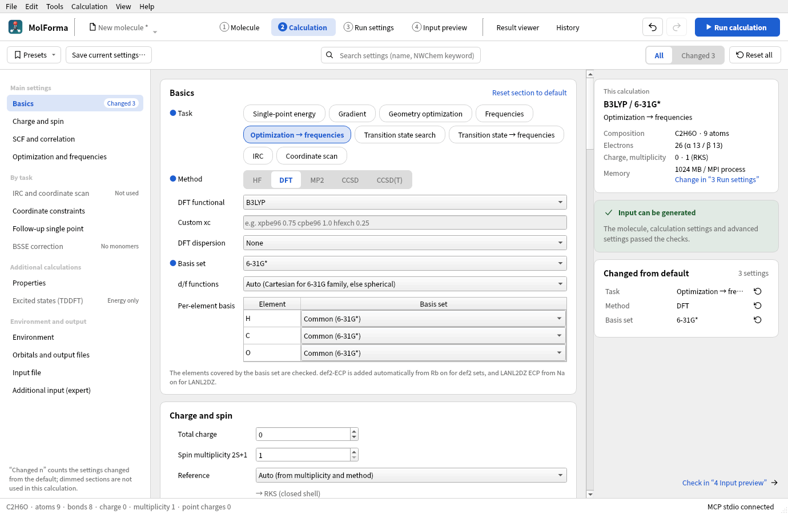
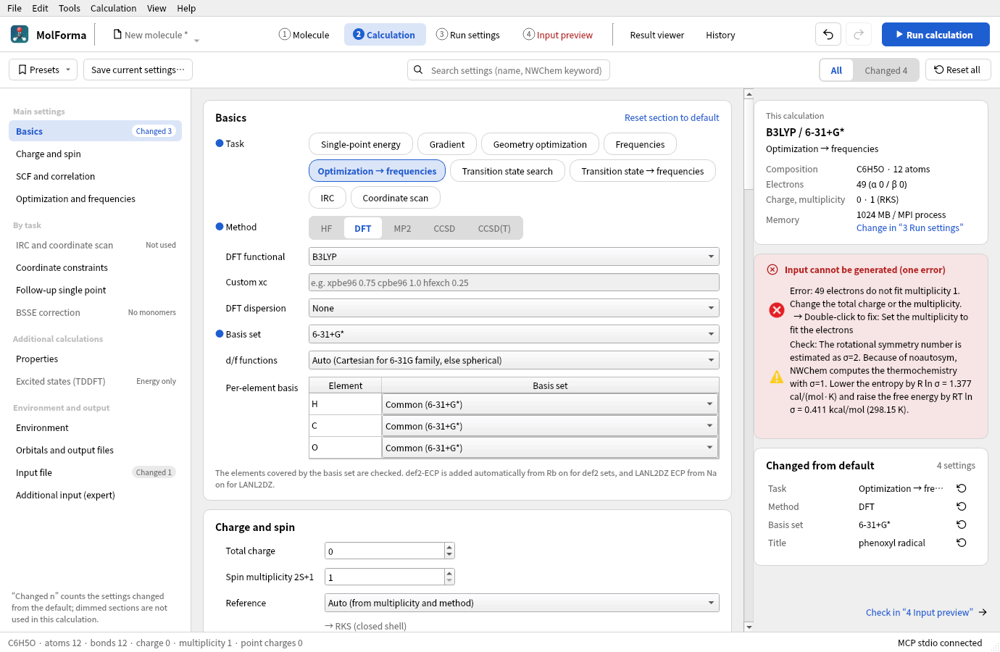
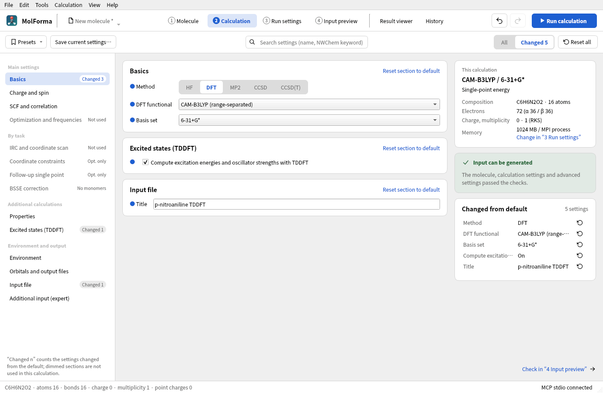

# “2 Calculation”

The list on the left shows the sections (“Basics”, “Charge and spin”, “SCF and correlation”, “Optimization and frequencies”, “IRC and coordinate scan”, “Coordinate constraints”, “Follow-up single point”, “BSSE correction”, “Properties”, “Excited states (TDDFT)”, “Environment”, “Orbitals and output files”, “Input file”, “Additional input (expert)”), the middle shows the settings of each section, and the right shows the calculation summary, the input check results and the settings changed from their defaults. Selecting a section in the list moves to its settings, and scrolling the settings moves the selection in the list along. The list shows the number of settings changed from their defaults (“Changed n”) and dims the sections that the current task and method do not use (“Not used”, “Opt. only”, “No monomers”, “DFT only”, “Energy only”); the section headings show the same reason. In a narrow window the list is hidden. Settings changed from their defaults have a blue dot before the name. Task, method, DFT grid and solvent model are chosen with buttons (over MCP they can still be set through choice fields such as `nwchem_task`, as before).

RI-J, TDDFT, follow-up calculations and relativistic settings remain editable so they can be disabled after a method or task change makes them incompatible. Diagnostic navigation and fixes target the same settings in either display language.



**Figure 1** Ethanol, B3LYP/6-31G* “Optimization → frequencies”. The list on the left moves to a section; the summary of the calculation, the check result and the settings changed from default appear on the right.

Changes to the settings are recorded in the shared undo/redo history (“Undo” and “Redo” in the header). Conflicting settings are kept as work in progress, but while errors remain, the input cannot be generated, copied or saved. While a candidate is shown or a cleanup is running, the settings cannot be changed, and the top of the tab shows why.

## Supported calculations

| Item | Coverage |
| --- | --- |
| Method | HF, DFT, MP2, CCSD, CCSD(T) |
| Task | Single-point energy, gradient, geometry optimization, frequencies, optimization → frequencies, transition state search, transition state search → frequencies, IRC, coordinate scan (relaxed, rigid). The CCSD methods support closed-shell RHF single-point energies only. A DFT single-point energy can add TDDFT (excited states) |
| Reference | Auto, RHF/RKS, UHF/UKS, ROHF. Auto uses a restricted reference for singlets, ROHF for open-shell HF and an unrestricted reference for open-shell DFT/MP2. An ROHF reference for DFT/MP2 is not supported |
| DFT | B3LYP, PBE, PBE0, BLYP, BP86, B3PW91, BHLYP, TPSS, SCAN, r²SCAN, M06-L, M06, M06-2X, PW6B95, CAM-B3LYP, ωB97X-D3 and a custom xc line. No dispersion correction, D3, D3(BJ); coarse/medium/fine/xfine/huge grids; RI-J (Weigend Coulomb fitting) |
| Basis set | STO-3G, 3-21G, 6-31G, 6-31G*, 6-31G**, 6-31+G*, 6-31++G**, 6-311G**, 6-311+G**, 6-311++G**, cc-pVDZ/TZ/QZ, aug-cc-pVDZ/TZ, def2-SVP/SVPD/TZVP/TZVPP/TZVPD/QZVP, LANL2DZ (ECP), all-electron basis sets for relativistic calculations x2c-SVPall/TZVPall, cc-pVDZ-DK/cc-pVTZ-DK, SARC-ZORA/SARC-DKH. Per-element basis sets. d/f functions as Auto, spherical harmonics or Cartesian |
| Relativistic | ZORA (DFT only), Douglas–Kroll–Hess (DKH2), X2C. Used with all-electron basis sets in HF/DFT |
| Convergence | SCF max. iterations and convergence (NWChem default, Normal, Tight, Very tight), optimization max. iterations and Normal/Tight/Loose, CC max. iterations, frozen core for correlated calculations |
| Environment | COSMO for HF/DFT (dielectric constant or solvent name), SMD for DFT (solvent name). A UHF reference with HF is rejected because NWChem's COSMO does not support it; use ROHF or UKS. Optional output of the saved point charges |
| Properties | Mulliken charges, ESP and RESP charges, NMR shielding constants (GIAO), static polarizability. Computed at the last level of theory |
| Composite calculations | Single point with another method or basis set after an optimization or transition state search, BSSE (counterpoise) correction with bonded molecules as monomers, internal-coordinate constraints, custom additional input |
| Output | Calculation name, title, memory per MPI process, Å/Bohr. The finished `.nw` is copied and saved in “4 Input preview” |

The element coverage of the basis sets is checked against a fixed list built from the per-element entries of the NWChem 7.3.1 library files. The basis set files themselves are not bundled. STO-3G covers H–I, 3-21G H–Cs, 6-31G/6-31G** H–Zn, 6-31G* H–Kr, 6-31+G*, 6-31++G**, 6-311+G** and 6-311++G** H–Ca, and 6-311G** H–Ca, Ga–Kr and I. cc-pVDZ/TZ/QZ cover H–Kr (except K), aug-cc-pVDZ/TZ H–Kr (except K and Ca), the def2 family H–La and Hf–Rn, and LANL2DZ H, Li–La, Hf–Bi and U–Pu. The selected library must be available where the calculation runs.

In the “Per-element basis” table you can choose a different basis set for each element in the molecule (for example 6-31G* for the organic ligands and def2-TZVP or LANL2DZ for the metal only). When such assignments exist, `*` is not used and a line such as `Fe library "def2-tzvp"` is written for each element (NWChem treats a second library for the same element as an addition, not a replacement). Ghosts get the basis set of their element. Assignments for elements not in the molecule are kept but not used in the output. `basis spherical / cartesian` applies to all elements, so a warning is shown when the per-element basis sets differ in their d-function convention. Custom basis sets or ECPs that are not in the library are not supported.

“Auto” for “d/f functions” writes 6-31G, 6-31G* and 6-31G** as Cartesian (6d), matching the definitions of these basis sets, and all others as spherical harmonics (5d, 7f) (the same convention as Gaussian's defaults). The spherical-harmonics setting of earlier projects and user presets is carried over as an explicit choice. A warning is shown when you explicitly choose a type that differs from the convention. Use “Auto” when comparing with literature values.

For the def2 family, `def2-ecp` is assigned automatically, removing 28 electrons for Rb–Xe, 46 for Cs–La and 60 for Hf–Rn; for LANL2DZ, `lanl2dz ecp` is assigned, removing 10 electrons for Na–Cu, 18 for Zn, 28 for Ga–Ag, 36 for Cd, 46 for In–La, 60 for Hf–Au, 68 for Hg and Tl, and 78 for Pb, Bi and U–Pu (the `nelec` of the NWChem ECP library). ECPs are attached to real atoms only, and the electron count is corrected before the α/β electron counts and the multiplicity are checked for consistency. Ghosts have a nuclear charge of 0 and get an explicit basis set such as `bqC library C ...`. `freeze atomic` for correlated calculations is off by default. When it is on, the number of orbitals frozen by NWChem's per-atom rules is shown, and settings that leave too few correlated electrons are rejected. ECP centers and ghosts are excluded from the frozen core.

Dispersion corrections can be chosen only for the combinations for which NWChem 7.3.1 writes Grimme's published parameters. D3(BJ) for the M06 family and D3 for SCAN and r²SCAN are rejected because NWChem has no parameters for them, and D3(BJ) for B3PW91 and D3 for PW6B95 because NWChem's values do not match the published ones. ωB97X-D3 already includes D3 and is used without a correction. “Custom xc” takes the `xc` line of the DFT block as one line of letters, digits, `_`, `.`, `+`, `-` and spaces (for example `xpbe96 0.75 cpbe96 1.0 hfexch 0.25`). NWChem checks the names at run time, and no dispersion correction can be chosen. On 2026-10-24, inputs with every added functional and every allowed dispersion correction were confirmed to finish normally with NWChem 7.3.1.

Frequencies use an analytic HF/DFT Hessian by default, and a numerical Hessian for MP2, ROHF, ECPs, COSMO, and DFT with meta-GGA, range-separated or custom xc functionals (NWChem has no analytic Hessian for meta-GGA and range-separated functionals and switches to finite differences automatically). You can also choose the numerical Hessian manually. Frequency analysis with fixed atoms, ghosts or external point charges, and COSMO with ghosts, are not supported. Because the coordinates are written with `noautosym`, NWChem computes the thermochemistry with a rotational symmetry number σ=1. For molecules of up to 60 atoms without isotopes or mass assignments, MolForma estimates σ by counting the rotations that map the molecule onto itself as a permutation of its atoms; if σ>1, a warning shows the corrections to the entropy (−R ln σ) and the free energy (+RT ln σ, 298.15 K). When frequencies follow an optimization, the two `task` lines are written in order. SCF convergence is 1e-5 for Normal, 1e-7 for Tight (default) and 1e-9 for Very tight, applied to `thresh` for HF and to energy/density/gradient for DFT. “NWChem default” writes none of these and uses NWChem's default thresholds (a warning is shown because they can be too loose for frequency calculations). The CC convergence threshold is 1e-7. Individual thresholds set in the advanced settings of “SCF and correlation” override the corresponding values.

## Saving, presets and compatibility

- NWChem-specific settings are saved in `document.nwchem`. `geometry_units` is shared with the export of the coordinate table. The total charge and multiplicity share the existing `job.charge` / `job.multiplicity`, so changes made in “1 Molecule” are reflected too. The formal charges of the atoms and the total charge of the calculation are kept apart, and a warning is shown when they differ.
- NWChem settings are not inferred from the method, basis set or detail sections of an old-format `job`. Projects without NWChem settings show HF/STO-3G as the initial settings. Old-format settings, unknown fields, and run and result references are kept when saving. Old-format constraints, scans, FMO/CP/SAPT, relativistic settings, occupation numbers and the like are not converted; if such advanced settings exist, the screen points this out. Fixed-atom flags are written to NWChem.
- Point charges are not written by default. When you enable them on this tab or in “1 Molecule → Charge”, they are written to `bq units angstrom`. This is independent of the old-format QM/MM flag. Point-charge coordinates are written explicitly in Å, regardless of the molecule's output units.
- Built-in presets are HF/STO-3G, B3LYP-D3(BJ)/def2-SVP optimization + frequencies, and frozen-core MP2/cc-pVDZ. Applying a preset can be reverted with a single undo. The tooltip of the description field lists the changes before you apply it. Presets do not change the molecule, charge, multiplicity, calculation name, title, memory, units or unknown fields. All other basic settings, including the reference, solvent model, dielectric constant and the output of external point charges, are replaced by the preset's values. Saved and removed user presets are stored in the local QSettings.
- The title and calculation name take effect when the entry is committed. The characters and length of the calculation name and line breaks, quotes and the like in the title are checked so that no other NWChem directive can slip in. The input preview is read-only.

Turning on “Excited states (TDDFT)” writes a `tddft` block (`nroots`, `notriplet` for closed shells when triplets are not requested, and `cis` for the Tamm–Dancoff approximation) and `task tddft energy`. Open shells (UKS) give unrestricted excited states without the singlet/triplet separation. TDDFT in NWChem 7.3.1 stops with meta-GGA functionals (TPSS, SCAN, r²SCAN, the M06 family, PW6B95), so they are rejected; geometry optimization with TDDFT (excited-state gradients) is not covered either. Combinations with CAM-B3LYP, ωB97X-D3, COSMO and dispersion corrections have been tested in real runs.

Running calculations and MPI launch settings are in “3 Run settings”; output is viewed in the “Result viewer”. TCE, MD, periodic systems and QM/MM are out of scope (the directives they need can be written in the additional input). You can edit settings and generate input without an NWChem installation. The input check does not guarantee convergence or the validity of the physical model.

## Solvents, relativity and RI-J

- The solvent models are “COSMO” and “SMD (DFT, named solvent)”. For the solvent, choose “Dielectric constant (COSMO only)” or one of water, methanol, ethanol, 1-propanol, 1-butanol, acetonitrile, acetone, DMSO, DMF, THF, 1,4-dioxane, diethyl ether, ethyl acetate, dichloromethane, chloroform, nitromethane, pyridine, benzene, toluene, n-hexane and cyclohexane; the NWChem SMD solvent code (`h2o`, `acetntrl`, `dcm` and so on) is written to the `cosmo` block as `solvent`. With a named solvent, COSMO also uses the dielectric constant from the same table. SMD adds `do_cosmo_smd true` and gives the solvation free energy including the non-electrostatic (CDS) terms. SMD in NWChem 7.3.1 is DFT-only, so combining it with HF is rejected (a real run stops with “cosmo-smd can be used only with dft and sodft”). Frequencies in solvent use a numerical Hessian.
- Relativistic Hamiltonians are written to the `relativistic` block as `zora on`, `douglas-kroll dkh` or `x2c on`. NWChem's ZORA is DFT-only, so choose DKH or X2C for HF (a real run stops with “ZORA available only for DFT”). Combining them with an ECP is rejected because the core would be treated twice, and a warning is shown when a non-relativistic basis set is used for Kr and heavier elements. ZORA total energies cannot be compared directly with non-relativistic, DKH or X2C energies. Frequencies with a relativistic Hamiltonian use a numerical Hessian.
- RI-J (DFT) writes `weigend coulomb fitting` (H–La, Hf–Rn; the same basis set on ghost centers) to `basis "cd basis"` and approximates the Coulomb term. Total energies differ slightly from a regular calculation, and frequencies use a numerical Hessian.

## Transition states, IRC, constraints and scans

- “Transition state search” is DRIVER's `task … saddle`. Start from a structure with negative curvature along the reaction coordinate, and check with “Transition state search → frequencies” that there is exactly one imaginary frequency.
- “IRC (reaction path from a transition state)” uses NWChem's Gonzalez–Schlegel method (the `mepgs` block and `task … mepgs`): it first computes the Hessian of the transition state, then follows the path both forward and backward up to “IRC points (per direction)” (`maxmep`). The step size (`stride`) is in mass-weighted coordinates, amu½·Bohr. If the points run out before a minimum is reached, NWChem ends with an error, so specify the number of points with a margin. NWChem 7.3.1 does not judge a minimum reached until the path length (stotal) exceeds 1 amu½·Bohr, so on a side where the minimum is close to the transition state it keeps taking small steps after reaching it, stops at the point limit with “mepgs: could not optimize”, and the other direction is not computed (the points so far can be seen in “Path / scan”). Then compute the remaining direction alone with “IRC direction” (both, forward only, backward only; `forward` / `backward` in `mepgs`). It cannot be used for structures with fixed atoms or ghosts.
- “Coordinate constraints” (optimization) optimizes with the distances, angles and dihedrals of 2–4 atoms selected in order in “1 Molecule” held at the values in the table (they are written as `bond`, `angle` and `torsion` with `constant` in `zcoord`, and `noautoz` is then dropped). The dihedral sign follows the same definition as MolForma's measurements. NWChem cannot handle internal coordinates together with fixed atoms (Cartesian constraints) (it stops with “cartesian constraints+internals”), so constraints cannot be combined with fixed atoms or ghosts. Deleting a constrained atom also deletes its constraint.
- “Coordinate scan” computes the distance, angle or dihedral chosen with “Use selected atoms” at evenly spaced points (2–50) from the start value to the end value. Each point is a named geometry (`geometry scanN`) that starts from coordinates in which the side of the atoms selected last has been moved. A relaxed scan (“Optimize the other coordinates at each point (relaxed scan)”) holds the scan coordinate fixed with `zcoord` and optimizes the rest; a rigid scan computes single-point energies. The `title` of each point reads `MolForma scan k/n`, and the Result viewer reads the energy and structure of each point from it. Relaxed scans cannot be combined with fixed atoms or ghosts either.

## Properties, BSSE and follow-up single point

- Of the “Properties”, Mulliken charges, NMR shielding constants (GIAO, `shielding`) and the static polarizability (`aoresponse 1 0.0`) are computed with one `property` block and `task … property`, and ESP and RESP charges with `esp` (`restrain`) and `task esp`. With a follow-up single point they use its settings. HF and DFT only. NMR and polarizability cannot be used with ROHF. When they are combined with MOLDEN output, `unset prop:*` is written before the `property` for MOLDEN so that NMR and the like are not computed twice.
- “BSSE correction” treats bonded molecules as monomers and writes a `bsse` block (`mon`, the sum of each monomer's formal charges as `charge`, `mult 1`). NWChem's BSSE module turns the partner into ghosts in each monomer calculation, so `bqX library X …` basis sets for all elements (also in `cd basis` with RI-J) are added automatically (without them it stops with “no basis on ghost atom”). It can be used for single-point energies, gradients and geometry optimizations, and only for singlets made of closed-shell monomers. It is rejected when the total charge differs from the sum of the formal charges, and in combination with solvent, TDDFT, properties, follow-up calculations, CUBE/MOLDEN or external point charges.
- The “BSSE error” and “Corrected energy” NWChem 7.3.1 prints add the errors of only the first half of the monomers (`task_bsse.F` sums the 2·nmon monomer energies with `do j = 1, nmon, 2`; with two monomers, only the first). When reading results, MolForma recomputes the correction over all the monomers from their energies after the supermolecule's (own basis, then the full one); when it differs from NWChem's, it warns and uses the recomputed correction and corrected energy (also for “Energy of the calculation” and ΔE in “History”). From the sum of the monomers in their own bases, the “Properties” tab also shows the interaction energy (corrected and uncorrected).
- “Follow-up single point” computes a single-point energy after an optimization or transition state search with another method, functional, dispersion correction or basis set (common to all elements). NWChem keeps settings in the runtime database, so `unset scf:*` and `unset dft:*` (`unset mp2:*` and `unset ccsd:*` for correlated calculations) are written before the follow-up calculation so that the CAM parameters and dispersion correction of the first settings do not carry over. Solvent, relativistic Hamiltonian and RI-J are used as they are. If the main calculation uses an ECP and the follow-up does not, it is rejected because the ECP would remain. The follow-up settings are checked by the same rules, and their errors are shown prefixed with “Follow-up single point: ”.

## Additional input (custom keywords)

In “Additional input (expert)”, “Before tasks” adds NWChem directives that MolForma does not handle (for example `set cphf:maxiter 50`, `task dft property`) verbatim just before the task line, and “End of input” adds them at the very end of the input. The content is not checked, so verify it in the input preview. `task shell` and `python` blocks, which can launch external programs, are rejected. Like the executable, launcher and environment variables, the additional input cannot be changed over MCP, and calculations started over MCP run only with the additional input set by the user. It is not included in presets.

## Importing NWChem and Gaussian input

Opening a `.nw` file with “File → Open…” imports the first Cartesian `geometry` (`units`, `bq` ghosts, `mass`, continuation lines with `\` and `;` separators), `charge`, the multiplicity and reference from `scf`/`dft`, `xc` (custom xc if it does not match a listed functional), dispersion correction and grid, `basis` (library names in the list, per element, RI-J through `cd basis`, spherical/cartesian), `cosmo` (dielectric constant, solvent name, SMD), `relativistic`, `tddft`, the `driver` iteration count, `property`, `esp`, `bsse`, `mepgs`, `fix atom` in `constraints`, and the `task` combination (optimization + frequencies, transition state search, IRC and so on). Calculation settings after the first task (follow-up calculations), the second and later geometries, `zcoord` and other blocks are not imported and are listed. Z-matrix geometries are rejected. The run settings use the defaults from Preferences.

Gaussian input (`.gjf` / `.com`) skips Link0, the route and the title, and imports the charge, multiplicity and Cartesian coordinates (supporting `C(Fragment=1)`, atomic numbers and the freeze-flag column). Inputs that use a Z-matrix or variables are rejected. The method and basis set of the route are not imported.

References: [HF](https://nwchemgit.github.io/Hartree-Fock-Theory-for-Molecules.html), [DFT](https://nwchemgit.github.io/Density-Functional-Theory-for-Molecules.html), [MP2](https://nwchemgit.github.io/MP2.html), [CCSD](https://nwchemgit.github.io/CCSD.html), [ECP](https://nwchemgit.github.io/ECP.html), [Optimization](https://nwchemgit.github.io/Geometry-Optimization.html), [Frequencies](https://nwchemgit.github.io/Hessians-and-Vibrational-Frequencies.html), [COSMO](https://nwchemgit.github.io/COSMO-Solvation-Model.html), [TASK](https://nwchemgit.github.io/TASK.html).

## Diagnostics, changes and search

“This calculation” on the right shows the method, basis set, task and solvent, the composition, the electron count (α/β), charge and multiplicity (reference) and the memory (the same card as “This input” in “4 Input preview”). The memory is set in “3 Run settings”, which “Change in “3 Run settings”” opens. The card below it shows whether the input can be generated (in the same form as in “3 Run settings” and “4 Input preview”; it includes the checks of the advanced settings and, when there are no errors, adds “The molecule, calculation settings and advanced settings passed the checks.” This check follows edits immediately and does not depend on files outside MolForma, so there is no “Recheck”) and lists the errors and warnings one by one. Clicking a row moves to the corresponding setting (for an advanced setting, to its row); rows with a suggested fix (a mismatch of multiplicity and electron count, an unavailable dispersion correction, the task for TDDFT, the solvent name or method for SMD, the method for ZORA, the method for RI-J and so on) are fixed by double-clicking. When “Reference” is Auto, the reference that will be used (such as “→ RKS (closed shell)”) is shown under the field.



**Figure 2** The phenoxyl radical (49 electrons) with multiplicity 1. Double-clicking the error row changes the multiplicity to one that matches the electron count (2).

“Changed from default” lists the changed settings in the same words as the screen (the card is as tall as its rows and scrolls beyond 12 rows). Clicking a row moves to that setting, and the button at the right end resets only that setting to its default (except the additional input). Changed advanced settings appear in the same list (with “(pending)” after the value when the current calculation does not use them), and clicking one shows its row. “Reset section to default” in a section heading also resets the advanced settings of that section. Both can be reverted with “Undo”. The full NWChem input is shown through “Check in “4 Input preview””.

The “Presets” menu at the top applies built-in and saved presets. The tooltip of each item lists the settings that applying it changes, in the form “setting: current → after applying”, and applying can be reverted with “Undo”. “Save current settings…” saves a preset, and “Remove saved preset” in the menu deletes one. With the “All” / “Changed” (with count) switch at the top, “Changed” shows only the settings and advanced-setting rows changed from their defaults. “Reset all” resets the calculation settings and advanced settings to their defaults (the calculation name, title, coordinate output units, additional input, charge and multiplicity are kept; a single “Undo” reverts it). The search field completes the names of calculation settings and advanced settings: a calculation setting moves to its field, and an advanced setting (also searchable by NWChem keyword) opens the advanced settings of its section and moves to its row.



**Figure 3** Choosing “Changed” at the top shows only the settings changed from default (TDDFT of p-nitroaniline).

## Validating the calculation settings

The `calculation` Qt Test checks input generation, combinations of method, reference and task, electron counts, the element coverage of basis sets, ECPs, ghosts, fixed-atom numbers, isotopes, units, point charges, invalid input values, save compatibility, presets, undo/redo, synchronization between tabs, operation control during candidates, the detection of unused sections, and the list of changed settings with its filter and its resets of single settings and whole sections. The regular CTest run uses neither NWChem nor the network.

Optional inputs for testing with a real NWChem and screenshots can be generated.

```sh
QT_QPA_PLATFORM=offscreen MOLFORMA_CALCULATION_ARTIFACTS=/tmp/molforma-calculation \
  ./build/test_calculation engineArtifacts
```

On 2026-10-24, 18 generated inputs were run with NWChem 7.3.1 and all finished normally: solvent (SMD, COSMO with a named solvent), ZORA, DKH and X2C, RI-J, properties (Mulliken, ESP/RESP, NMR and polarizability combined with MOLDEN), transition state search → frequencies (HCN⇄HNC with one imaginary frequency at −1227 cm⁻¹), IRC (both directions converged), constrained optimization (dihedral 115.000° and distance 1.4500 Å kept, also with Bohr output), relaxed and rigid scans, BSSE (water dimer, and monomers of more than 16 atoms that use continuation lines), follow-up single point (no dispersion correction left over), additional input and the huge grid.

On 2026-10-22, 23 generated inputs were confirmed to finish normally with NWChem 7.3.1 (2 MPI processes, 1 OMP/OpenBLAS thread each). They include HF, five DFT functionals with dispersion corrections, MP2, CCSD, CCSD(T), open-shell HF/DFT, def2-ECP, frozen core, ghosts, isotopes and fixed atoms, Å/Bohr, point charges, COSMO, and analytic/numerical frequencies. The B3LYP-D3(BJ)/def2-SVP preset for water completed the optimization and the frequency analysis, with frequencies of 1638.93 / 3791.78 / 3886.86 cm⁻¹. The tests of the calculation tab are also run under AddressSanitizer.

CCSD(T) is tested with water/6-31G. In this environment, CCSD(T) of H₂/STO-3G with the minimal basis set ran into an MPI communication error during NWChem's triples step. The input check does not detect such problems specific to the run environment or engine.

## Worked examples

### Counterpoise (BSSE) correction of the water dimer

1. Place the water skeleton, add a second water on the +X side with “File → Add fragment from file…” or “Add fragment from SMILES…” (`O`), and confirm it.
2. Select a hydrogen of one water and then the oxygen of the other, and set the H···O distance to about 1.95 Å with the dimension in “Edit” (as they are separate, unbonded molecules, the whole water selected last moves). “View → Show hydrogen bonds” shows the dashed line.
3. In “2 Calculation”, choose the method and basis set, and turn on “Counterpoise correction per monomer (BSSE)” in “BSSE correction”. The two monomers are shown.
4. Run it with “Run calculation”, and check the BSSE correction and the corrected energy in “Properties” or the summary of the “Result viewer”. If you choose geometry optimization, it optimizes with BSSE-corrected gradients.

See also: [Advanced settings and CUBE/MOLDEN output](advanced.md), [recipe 5 Chains and conformers](../recipes/butane_conformers.md), [recipe 10 Ions and radicals](../recipes/phenoxyl_radical.md), [recipe 13 Transition states and reaction paths](../recipes/sn2_transition_state.md), the list of pages in “[Features](../features.md)”.
