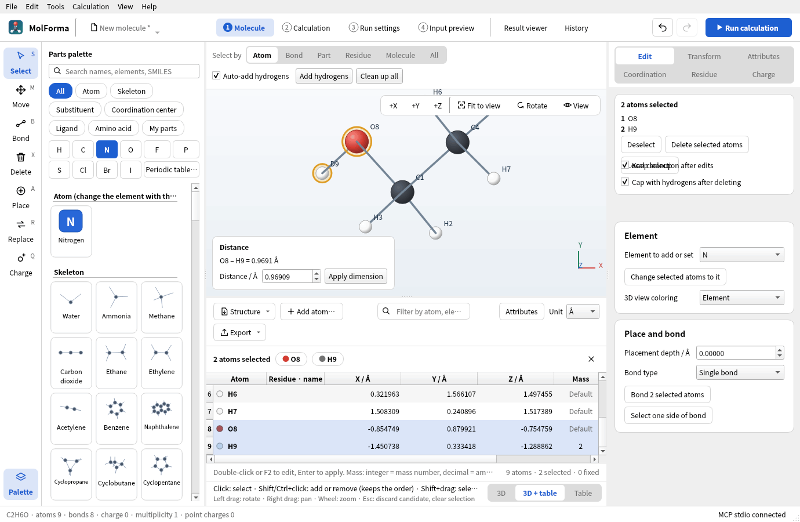
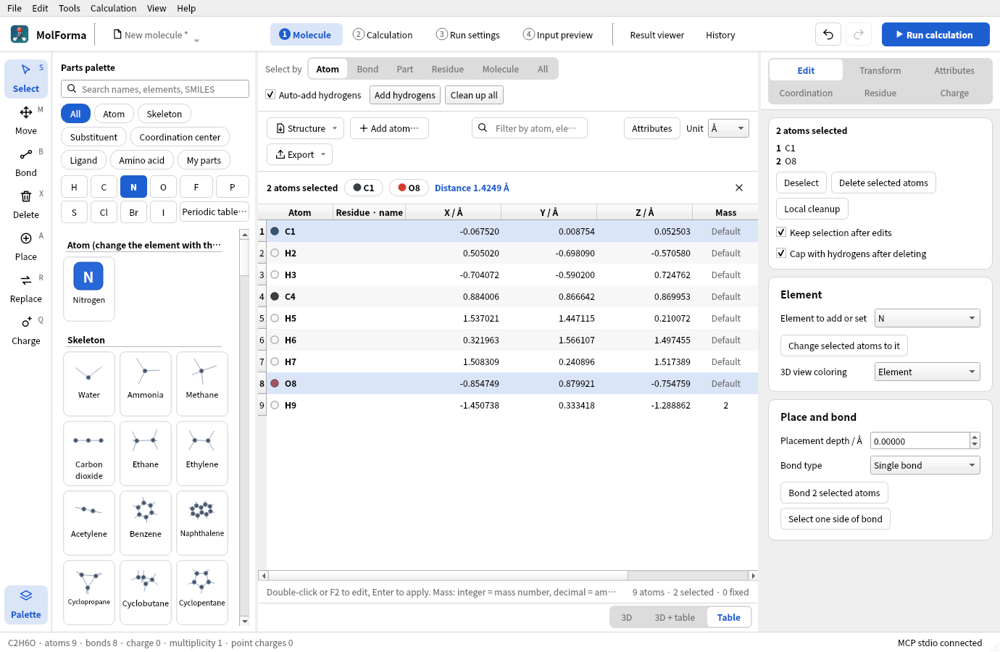

# Coordinate table (“1 Molecule”)



**Figure 1** The “3D + table” layout (ethanol-OD). Rows of the table and atoms of the 3D view share the selection, and the distance of the two chosen atoms appears at the lower left of the 3D view. H9 in the mass column is deuterium (2).

- A table of atom coordinates and attributes, shown below the 3D view of “1 Molecule” (or in its place). Switch the layout with “3D”, “3D + table” and “Table” at the right end of the strip below the 3D view, or with “View → 1 Molecule layout” (also available from the other tabs; it opens “1 Molecule”). The layout is remembered in the app settings (default “3D”). In “3D + table”, drag the border to change the heights (initially 3D:table = 6:4; the dragged position is remembered in the app settings). The table keeps at least 4 rows (also when the operation row above it wraps in a narrow width), and in a narrow window the 3D view shrinks instead. The molecule data, selection, candidates and undo/redo are the same as in “1 Molecule”, and selecting a table row selects the atom in the 3D view and vice versa (when none of the rows of atoms chosen in the 3D view shows, the table scrolls to them). “Attributes” in the operation row shows the formal charge, unpaired electron and atom name columns for editing (“Edit → Coordinate table (with attribute columns)” shows the table with the same columns open; whether the columns are shown is remembered in the app settings). Numbers in the coordinate table are shown right-aligned with 6 decimal places; cells being edited and the saved values keep their full precision.
- The “Atom” column of the table shows the same numbered name as the 3D view (`C14`) in the element's color; fixed atoms have a lock mark and dimmed coordinates. Editing the cell changes the element symbol. Atoms that belong to residues, such as in peptides, show `GLY 2 · CA` in the “Residue · name” column. A blank mass shows “Default”. The column numbers of the table (`column` of MCP's `ui_edit_cell`) are as before: 0 element, 1–3 X/Y/Z, 4 mass, 5 ghost, 6 fixed, then 7 residue, 8 candidate change, and the attribute columns 9 formal charge, 10 unpaired electrons, 11 atom name.
- The filter field in the operation row shows only the rows whose numbered atom name, element or residue name contains the text. The filter affects only the display; it does not change what selection, output and editing apply to. Below the table, the numbers of atoms, selected atoms and fixed atoms (and shown rows while filtering) are displayed.
- The selection bar shows the selected atoms (up to 3 atoms, with their residues for up to 2) and Deselect (×); only in the “Table” layout (without the 3D view) does it also show the distance, angle or dihedral when 2–4 atoms are selected (with the 3D view, they appear in its measurement box). Fixing, ghosting, deleting and moving selected atoms to the origin are done on the right-side pages beside the table (“Edit”, “Transform”, “Attributes”). The “Ghost” and “Fixed” columns of the table can be toggled directly per row. The Delete key in the table is the same as deletion in “1 Molecule” (it follows the “Cap with hydrogens after deleting” setting and shows a candidate). While the table is visible (“3D + table”, “Table”), “Coordinates (one atom)” on “Edit” is hidden (you edit the same values in the table cells).
- When there is a candidate, an amber bar appears in place of the selection bar and the table shows the coordinates of the candidate read-only. The “Change” column marks the atoms added or moved relative to the current structure, and “Changed” filters the table to those rows. Atoms are compared by ID. However, for replacements in which all atoms get new IDs, such as loading a structure or pasting XYZ, when one element sequence matches the start of the other (reloading the same structure, appending atoms at the end), atoms are compared by their order, and differences below 0.001 Å (the 3-decimal precision of PDB) count as the same position. This comparison is also used for the marks in the 3D view of “1 Molecule” and for the added, removed and moved counts in the candidate bar.
- With no atoms, “Import structure…”, “Paste XYZ…” and “Add atom…” are shown instead of the table. Dropping an XYZ, MOL, SDF, PDB, ENT or mmCIF file on the table creates a replacement candidate, like “Import structure…” (other files, and drops on the 3D view or other tabs, open in the window as before).
- Cells are edited individually: element, X/Y/Z, mass number or amu, ghost, fixed, and the attribute columns (formal charge −99 to 20, unpaired electrons 0 to 8, atom name). The element accepts the 118 elements H–Og plus D/T, and input such as `@C`. Changing the element clears a mass set for the old element. NaN, infinity, unknown elements and duplicate atoms are refused with an error, and the cell reverts to its value. A failed edit reaches neither the history nor the molecule.
- The coordinate table, atom properties panel and MCP atom property edits use the same validation. Isotope mass numbers absent from the database are rejected when edited. Supply a positive finite custom mass in amu instead. Atom names are limited to 16 characters without control characters.
- The display units are Å/Bohr (1 Bohr = 0.529177210903 Å). Switching units or moving the camera does not change physical coordinates. Values are shown with 14 significant digits, and only the edited cell is read back, so the precision of the other coordinates is preserved.
- The add-atom dialog takes one atom in the same units as the table. Choose the element with the buttons for common elements (H, C, N, O, F, P, S, Cl, Br, I, D, T), from the list or with “Periodic table…”; entering X/Y/Z shows the nearest atom and its distance. Bonds and hydrogens are not added automatically. The “Structure” menu in the operation row has “Import structure file…”, “Replace with pasted XYZ…”, “Sort atoms” (By element, By residue, Selected atoms first; this changes the order in the table and in the NWChem coordinates, and can be undone) and “Delete all atoms”. Deleting selected atoms, deleting all atoms, importing a structure file and pasting XYZ are shown as candidates to confirm or discard. Changing the coordinates of fixed atoms, deleting them and replacing the structure are refused.
- To move one atom to the origin, use “Align (origin, +X, XY)” on “Transform” (in the “3D” layout, “Move atom to origin” in “Coordinates (one atom)” does the same). It translates the whole molecule and the point charges, and is refused if a fixed atom would move.
- XYZ / MOL / SDF / Mol2 / CML / PDB / ENT / mmCIF (`.cif` / `.mmcif`) can be read as structures (Mol2 and CML through Open Babel). The other formats Open Babel can read are not opened, since their readers can crash on files received from others. For PDB and mmCIF, choose MODEL/ALTLOC; for multi-frame XYZ (such as optimization trajectories), choose the frame to load (default: the last one). mmCIF files are read from their atom table (`_atom_site`), with the author's residue numbers and chain names (`auth_seq_id`, `auth_asym_id`) that PDB files also use; chain names longer than one character are kept. Bonds and bond orders come from the distances and the geometry as for PDB, so an mmCIF file gives the same structure as the PDB file of the same entry (with the coordinates at the precision of the mmCIF file). Small-molecule CIF files (fractional coordinates) and compressed files (`.cif.gz`) cannot be read; decompress the latter before opening them. NWChem input (`.nw`) and Gaussian input (`.gjf` / `.com`) can also be opened ([Importing NWChem and Gaussian input](calculation.md#importing-nwchem-and-gaussian-input)). Export formats are XYZ, SDF, MOL, Mol2, CML, PDB and Gaussian input. Replacing the structure by loading or pasting keeps the run and result information and the calculation settings of the project, and settings that reference old atoms are held. Bonds are taken over from the input structure. For XYZ, bonds are perceived from distances, and Open Babel assigns double, triple and aromatic bond orders from the geometry. XYZ has no charges, so for ions set the formal charges before adding hydrogens. Bonds to metals and ghosts stay single bonds. “File → Replace with pasted XYZ”, “From SMILES” and “Replace the existing molecule” in “Build from sequence” also replace only the structure and keep the calculation settings, run settings and project information. XYZ input and output are in Å regardless of the table's display unit. `@element` and a mass in the fifth column are MolForma extensions that general XYZ readers may not support. To save fixing, bonds, residues, point charges and the like, use the project format. XYZ frame and PDB/mmCIF MODEL/ALTLOC selection is shared by File → Open, structure import from the coordinate table, and adding a fragment from a file. Cancelling a selection dialog aborts that import.



**Figure 2** The “Table” layout. Without the 3D view, the distance, angle or dihedral of two to four chosen atoms appears in the selection bar above the table.

## NWChem output

The “Export” menu in the operation row copies the NWChem geometry block or XYZ (always Å), or writes it to a file (“Export …”, `.nw` / `.xyz`). The unit of the NWChem coordinates is independent of the display unit of the table and is set with “Coordinate units” in “2 Calculation” (saved in `document.nwchem.geometry_units`, with undo/redo support); the menu item names show the current unit.

- Writes `geometry units angstrom` or `geometry units au`. Å output states `angstrom_to_au` explicitly so that the conversion matches Bohr output.
- `nocenter noautosym` creates the input with the given atom order and coordinate frame. Geometry optimizations and transition state searches without fixed atoms, ghosts or internal-coordinate constraints omit `noautoz` and optimize in NWChem's automatic internal coordinates (autoz). In B3LYP/6-31G* tests, they converged to the same minimum as Cartesian coordinates in fewer iterations (benzoic acid 29→12, ethanol 12→5, glycine 21→16, biphenyl 22→10, water dimer 34→26). When internal coordinates cannot be built, as for linear molecules, NWChem switches to Cartesian coordinates automatically. For weak complexes that converge poorly and similar cases, you can switch with “Optimize in Cartesian coordinates (noautoz)” in the advanced settings of “Optimization and frequencies” in “2 Calculation”. All other calculations (single-point energy, frequencies only, IRC, etc.) and optimizations with fixed atoms or ghosts use Cartesian coordinates with `noautoz` (because NWChem cannot handle Cartesian fixing and internal coordinates together). When internal-coordinate constraints or relaxed scans are set in “2 Calculation”, `zcoord` is written to handle the constraints.
- Coordinates, masses and point charges are written in the shortest notation that reads back as the same double value (`0.758`, not a 17-digit form such as `0.75800000000000001`). NWChem's automatic symmetrization and editing periodic boundary conditions are not supported (to symmetrize a structure, use “Tools → Point group and symmetrize”).
- Isotope mass numbers are converted to amu with the isotope data of Open Babel C++ and written as NWChem `mass`. Mass numbers are never written as actual masses. Arbitrary masses can be given as decimals; isotopes that are not in the database need an explicit mass.
- Ghosts are written as centers with zero nuclear charge, such as `bqC`. `basis` needs an explicit basis assignment such as `bqC library C <basis-name>`, and a note on this is added at the end of the exported fragment. Formal charges of atoms are not turned into NWChem nuclear charge specifications.
- Fixed flags are converted to `fix atom` in `constraints` with the atom numbers at export. In geometry optimizations, ghost centers are fixed as well: an unfixed ghost, which has no nucleus, is pulled toward real atoms together with its basis functions, and the optimization does not converge. The leading `clear` removes earlier fixing conditions, so when you insert this into existing input, add the other constraints you need to the same block.

The export from the table is an **input fragment of the coordinates and fixed atoms**. Create the complete calculation input in “2 Calculation” and check it in “4 Input preview”. Export is disabled while there is an unconfirmed candidate. Calculations are run with “3 Run settings”, and output is viewed in the “Result viewer”. Existing NWChem input can be imported with “File → Open”. Using the table does not require an NWChem installation.

Input specification references: [Cartesian coordinate input](https://nwchemgit.github.io/Cartesian-coordinate-input.html), [Geometry keywords](https://nwchemgit.github.io/Keywords-for-the-GEOMETRY-directive.html), [Constraints](https://nwchemgit.github.io/Constraints.html), [Basis sets](https://nwchemgit.github.io/Basis.html).

## Testing the coordinate table

`ctest --test-dir build --output-on-failure` runs the existing core/editor regression tests and coordinates. coordinates checks unit conversion and precision, per-cell rollback, isotopes, ghosts and fixing, selection sync, adding atoms (element buttons, nearest atom), candidates and undo/redo, the candidate comparison (by ID and by atom order, the change column and its filter), file drops, the display without atoms, the residue column, the filter and the selection bar (measurements only in the “Table” layout, no operation buttons), bulk fixing and ghosting through the right-side pages, showing and hiding “Coordinates (one atom)”, opening and closing the parts palette and the number of table rows in a narrow window, “View → 1 Molecule layout”, the export menu, switching layouts with the 3D view, invalidated references and the preserved envelope when the structure is replaced, saving the output unit, and fixed atom numbers after sorting.

For optional visual checks and checks with a real NWChem, the following command produces screenshots and test input for NWChem (STO-3G, water plus a carbon ghost, deuterium, fixed oxygen). Regular CTest runs do not need NWChem.

```sh
QT_QPA_PLATFORM=offscreen MOLFORMA_COORDINATE_ARTIFACTS=/tmp/molforma-coordinates \
  ./build/test_coordinates nwchemExportAndSettings
```

In the check on 2026-10-22, the Å and Bohr inputs above were run with NWChem 7.3.1; fixed atom 4 and the zero-nuclear-charge `bqC` were recognized, and the SCF energies were −74.945716644654 and −74.945716644653 Hartree, respectively.

See also: [recipe 9 Complexes of molecules and BSSE](../recipes/benzene_water.md), [recipe 15 Isotopes and atom order](../recipes/isotopes.md), the list of pages in “[Features](../features.md)”.
