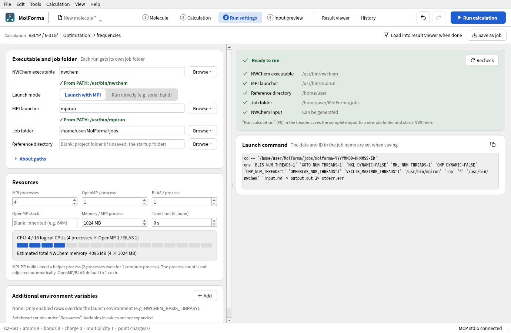
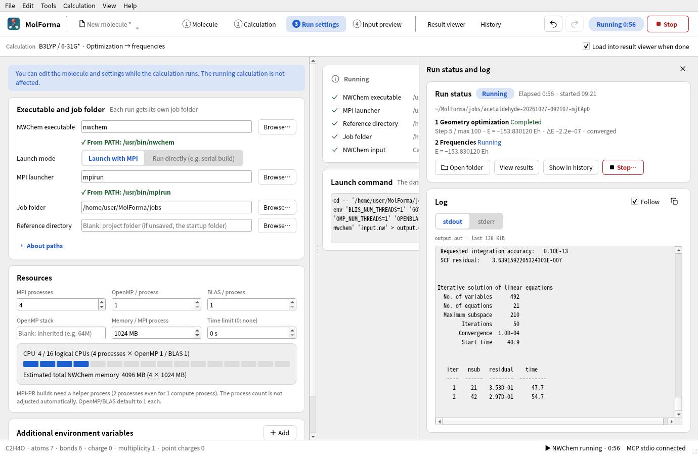

# “3 Run settings”

Sets how NWChem and MPI are launched and saves the run as a job. At the top are the target calculation (one line with method, basis set and task), “Load into result viewer when done” and “Save as job”; on the left the settings (“Executable and job folder”, “Resources”, “Additional environment variables”); on the right the pre-run check and “Launch command”. You start a calculation with “Run calculation” (F5) in the header and stop it with “Stop” in the header (this tab has no duplicate buttons). The state and log of the running or last calculation appear in the run panel (below), which opens over any tab. Specify each executable by name (searched in PATH) or by path; for a name, the location found in PATH is shown below the field (for a path, only in the check card on the right; if it is not found, the reason also appears below the field). Opening a project never starts a run.



**Figure 1** “3 Run settings”. Below the executable and MPI launcher fields appears where PATH found them, and the resources show how many of this PC's logical CPUs are used.

- **Pre-run check**: Lists the NWChem executable, the MPI launcher (when launching with MPI), the reference directory, the job folder, NWCHEM_BASIS_LIBRARY (when set) and the NWChem input, one per line with the location or result found, followed by any other errors and checks. The card title reads “Ready to run”, “Cannot run (n problems)” and so on, in the same form as the checks on the other settings tabs. “Recheck” checks again.
- **Resources**: Shows the logical CPUs used (from processes and threads) as squares, one per logical CPU of this computer (red when exceeded), and the estimated total NWChem memory (processes × memory per process).
- **Run panel (run status and log)**: Shown on the right side of the window over the tabs (in “1 Molecule” it covers the position of the right-hand pages without hiding the 3D view, the controls above it or the layout switch; in this tab it starts below the row with the target calculation, “Load into result viewer when done” and “Save as job”), and opens when a calculation starts. You can open it from any tab with “Running” in the header, the run status in the status bar, “Calculation → Run status and log” (Ctrl+Shift+L), “Show run status and log” in “History” or “Show run status and log” in this tab; closing it does not stop the calculation. “Run status” shows the state of the saved or run job (Running, Finished, Stopped, Failed, Saved only), the elapsed time (plus the start time while running), the job folder, “Open folder”, “View results”, “Show in history” and, while running, “Stop…” (which asks for confirmation, like “Stop” in the header). While running, it shows each `task` of the input (geometry optimization, frequencies, etc.) as done, running or waiting; during an optimization it shows the latest step, energy and ΔE from the “@” lines of the log, and whether Gmax, Grms, Xmax and Xrms meet NWChem's thresholds. Below that is the log (stdout and stderr). The log of the running job is only read; the files are not modified.
- **Editing during a run**: You can edit the molecule and settings while a calculation runs; the changes do not affect a calculation already started (this tab says so too).



**Figure 2** The run panel during a calculation (acetaldehyde). It shows the state of each task, the optimization steps with whether the convergence criteria are met, and the log. The header shows the elapsed time and “Stop”.

| Item | Behavior |
| --- | --- |
| NWChem executable | Default `nwchem`. Before a local run, the file and its execute permission are checked |
| Launch mode | MPI or direct. MPI runs `mpirun/mpiexec -np <processes> <NWChem> input.nw` |
| MPI launcher, MPI processes | Default `mpirun` with 2 processes. Give the process count including MPI-PR helper processes; it is not adjusted automatically |
| OpenMP / BLAS | Threads per process. Default 1 each. Leave the OpenMP stack blank to inherit it, or give a value such as `64M` |
| Memory | NWChem `memory` (`document.nwchem.memory_mb`). Set here and shown in the summaries of “2 Calculation” and “4 Input preview”. The estimated total (multiplied by the process count) is shown. Not an RSS limit |
| Time limit | In seconds; 0 means no limit. When reached, the run is stopped |
| Job folder | Default `~/MolForma/jobs`. Each run gets its own folder named from the calculation name, date and time (local time) and a random ID. Times in `run.json` are recorded in UTC |
| Reference directory | Base for finding relative input movecs. If blank, the project's directory, or the app's working directory for an unsaved project |
| Environment variables | Only enabled rows override the parent environment. Disabled rows are saved but not applied. Names, values and duplicates are checked |

Some MPI-PR builds do not work with 1 MPI process. Specify an NWChem executable and an MPI launcher from the same MPI environment. The UI shows MPI processes and OpenMP/BLAS threads separately, and warns about parallelism beyond the number of logical CPUs and about nested parallelism. Process limits and CPU binding also depend on the MPI configuration. References: [NWChem FAQ](https://nwchemgit.github.io/FAQ.html), [Memory](https://nwchemgit.github.io/Memory.html), [Open MPI mpirun](https://docs.open-mpi.org/en/main/man-openmpi/man1/mpirun.1.html).

## Environment and paths

- `OMP_NUM_THREADS`, `OPENBLAS_NUM_THREADS`, `GOTO_NUM_THREADS`, `MKL_NUM_THREADS`, `BLIS_NUM_THREADS` and `VECLIB_MAXIMUM_THREADS` are set from dedicated fields. `OMP_DYNAMIC` and `MKL_DYNAMIC` are set to FALSE. The environment variable table rejects duplicate entries for these and for `OMP_STACKSIZE`.
- When `NWCHEM_BASIS_LIBRARY` is given in the table, it is converted to an absolute path relative to the project location and a trailing `/` is added. Other values are passed as strings, without shell or environment variable expansion. Usually you can rely on the basis set configuration of the parent environment and NWChem's `.nwchemrc`. [NWChem Getting Started](https://nwchemgit.github.io/Getting-Started.html)
- The actual working directory is a new job folder each time. Only relative input movecs in the advanced settings are resolved to absolute paths from the reference directory; relative scratch and permanent paths are relative to the job folder. Relative output movecs are relative to permanent, or to the job folder itself when they start with `./`. Output subdirectories inside the job folder are created. Relative output paths that leave the job folder with `../` are rejected. Use absolute paths for locations outside the job folder.
- A run is refused if an output movecs, CUBE or MOLDEN file already exists, or if an external scratch/permanent directory still holds files with the same calculation name. Prepare external directories beforehand. An output movecs file with the same name as the job's input, log or run record is also refused.
- The process is started by `QProcess` with a program name and an argument array; no shell is started. The command field shows POSIX shell notation for review only. Before saving, the date/time and ID are placeholders.

## Saving, running and stopping

“Save as job” (saving the complete input) works even without NWChem installed. It does not copy the executable or referenced movecs files. To run in another environment, prepare the paths, MPI and basis library for that environment.

“Run calculation” saves the same complete input before launching and creates these files:

| File | Contents |
| --- | --- |
| `input.nw` | The complete NWChem input that is run, with relative input movecs paths resolved |
| `project.molforma.json` | A copy of the project with the molecule, calculation settings, advanced settings and run settings at launch |
| `run.json` | Executable, arguments, overriding environment variables, working directory, SHA-256 of the input, times, state, exit code. The full parent environment is not recorded |
| `output.out` / `stderr.err` | Full stdout/stderr, saved directly from the process |

Calculations run asynchronously. Running and saving the complete input are disabled while a candidate is shown or a cleanup is running. After launch the run uses the confirmed copy; editing the molecule or settings, or loading another project, does not affect a running calculation. When the calculation ends, the molecule, coordinates and existing result references are not changed either. The screen shows the last 128 KiB of stdout and stderr; “Open folder” gives access to the full text.

Stopping and the time limit first request termination and kill the process if it does not respond within 2 seconds. On Unix the run gets its own process group, so its child processes are stopped too. Windows has neither process groups nor a termination request that console programs heed, so the forced stop after 2 seconds ends the launched process together with its descendants (`cmd.exe`, `wsl.exe`, and `mpirun` and NWChem in WSL, for example). Closing the window during a run asks you to confirm stopping. Runs do not continue in the background after the app exits.

Launch failure, nonzero exit, stop and time limit are shown and recorded separately. “Exit code 0” means that the process ended normally. When a job that ended normally is loaded into the result viewer, the optimization convergence, calculation energy, number of imaginary frequencies and number of excited states read from the log are shown in one line in “Run status” of the run panel and in the status bar. See the log for the details of each task.

The settings are saved in `document.nwchem_execution` and support the shared Undo/Redo, Ctrl+S and reloading. In “Edit → Preferences” (with the same cards and environment variable table as this tab) you can save to the app settings the defaults for the executable, launch mode, MPI launcher, MPI processes, threads, OpenMP stack, job folder, time limit and additional environment variables, as well as whether to load a water molecule at startup (off by default, so the app starts with a new, empty state), the 3D rendering method and the display language (both take effect after a restart). The defaults are used for new projects and when opening structure files other than projects (XYZ, SDF, PDB, etc.); settings saved in a project are not changed. “Load current run settings” imports the values of the project being shown. Ctrl+S also commits an entry being typed in the environment variable table. Unknown fields are preserved. Applying a calculation preset does not change the run settings.

Currently each window runs one calculation at a time. Queues of multiple jobs with completion notifications, SSH, Slurm/PBS, arbitrary extra MPI arguments, monitoring runs after a restart, and restarts from the NWChem database are not supported. An optimized structure can be brought in with “Apply as candidate” in the “Result viewer”. The MPI-PR build configuration and the contents of the basis library are not detected automatically.

You can start a calculation from any tab with “Run calculation” in the header or “Calculation → Run calculation” (F5) (if it cannot start, “3 Run settings” opens and shows the reason in the check card). The “Calculation” menu also has stop, save as job, open result file and history. When a calculation ends (finished, failed, stopped or time limit), the result is shown in the run status at the right of the status bar (the summary of a log loaded into the result viewer also appears on the left); if MolForma is in the background, the taskbar alerts you, and a desktop notification is shown where supported. With “Load into result viewer when done” enabled (on by default, saved in the app settings), a job folder that ended normally is loaded into the result viewer. The tab does not switch. The log field of the run panel appends only what has been added to the file, so a text selection is not lost (it shows up to the last 128 Ki characters). New lines are shown while “Follow” is on (the default) or while the field is scrolled to the end. The log switch (stdout, stderr), file name, follow and copy are the same as in the file area of “History” (the switch sits below the heading so that the names stay readable in a narrow panel). The state and elapsed time of the running or last calculation are always shown in the status bar at the bottom of the window; clicking it opens the run panel. While running, the header also shows the elapsed time and “Stop”. “Stop” always asks for confirmation, wherever you press it.

## Run settings verification

The Qt Test `execution` uses a test process written in C++ to check the arguments, environment and working directory, the frozen copy of the input, protection of paths and existing files, save compatibility, launch failure, nonzero exit, stop, time limit and termination of Unix child processes, the log size limit, Undo/Redo, candidates, Ctrl+S while editing, shutdown, each item of the pre-run check, progress read from the running log (task stages, DRIVER steps and convergence criteria), opening, closing and placement of the run panel, “Stop…” and the header display, and the text below the executable field (only for names found in PATH). Regular CTest needs no NWChem, MPI or network.

Where NWChem is available, the following optional test checks an MPI run from the tab, stopping a calculation midway, and screenshots.

```sh
QT_QPA_PLATFORM=offscreen MOLFORMA_EXECUTION_ARTIFACTS=/tmp/molforma-execution \
  MOLFORMA_EXECUTION_ENGINE=/usr/bin/nwchem ./build/test_execution realEngineArtifacts
```

On 2026-10-22, NWChem 7.3.1 was launched with 2 MPI processes, 1 OpenMP/BLAS thread each and 256 MB of memory per process, and an HF/STO-3G calculation of water was confirmed to complete with exit code 0 and an SCF energy of −74.945628203255 Hartree. A DFT/cc-pVTZ optimization and frequency job was stopped after the DFT module started, and it was confirmed that on Linux no child processes with the job folder as working directory remained. All 6 CTest suites and the AddressSanitizer check of the run settings tests passed.

See also: [“History”](history.md), [recipe 1 Building from atoms and bonds](../recipes/atoms_and_bonds.md), the list of pages in “[Features](../features.md)”.
