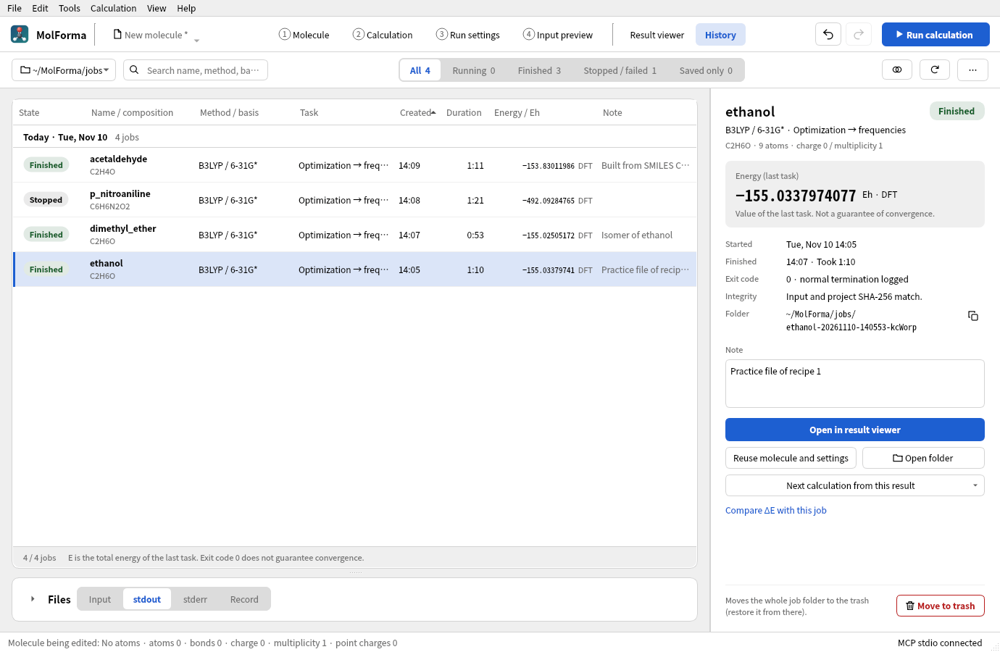
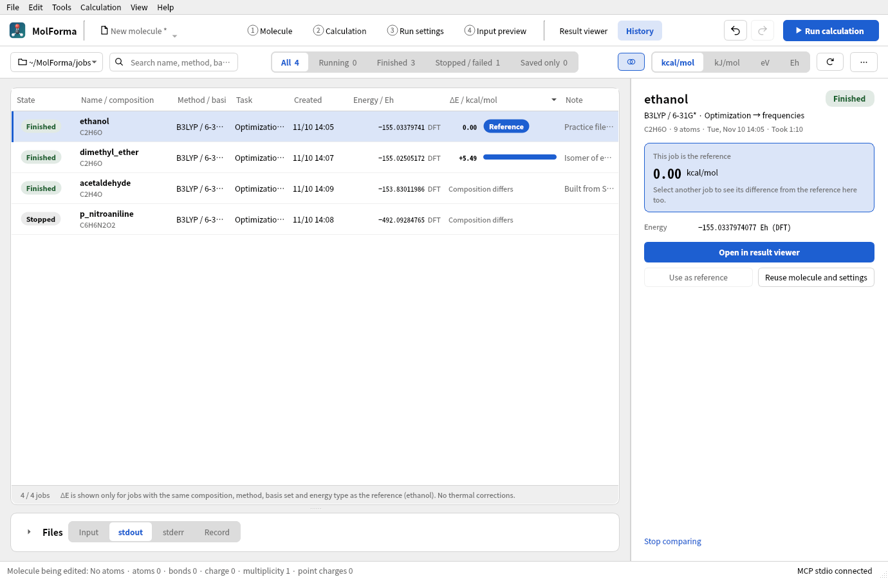

# “History”

“History” reads the jobs you saved or ran (“Save as job”, “Run calculation”) from the `run.json` files directly under the job folder. After a restart, choosing the same folder restores the list. By default it uses the folder of “3 Run settings”. The job folder button at the top shows the path and whether it is “(same as 3 Run settings)” or a “(chosen folder)” (when the toolbar does not fit on one row, the caption “Job folder” and this note move into the tooltip, the search field narrows and “Compare ΔE” shows only its icon); another folder chosen with “Choose folder…” in its menu is remembered in the app settings. “Back to the “3 Run settings” folder” returns to following it. Viewing the history does not change the molecule being edited, candidates, Undo or the unsaved state of the project.

**Figure 1** “History” lists the calculations in the job folder and shows the details, note and actions such as “Open in result viewer” and “Reuse molecule and settings” of the chosen job on the right.

- **List**: Shows the state (a colored label), the calculation name and composition (the molecular formula at calculation time; a job left with the default calculation name “molforma” is listed by its title), method and basis set (the functional name for DFT, HF for Hartree–Fock), task, creation time (local time), duration, the calculation energy (Eh, with the method) and the note. Sorted by creation time, the list is divided by day (“Today”, “Yesterday” or the date, with the count); sorted by another column header, it is not divided. Rows without a value go last whatever the sort order. Search covers the name, method, basis set, task, composition, note, folder and state. The switch at the top filters by state (All, Running, Finished, Stopped / failed, Saved only; each count is the number of jobs matching the search). “Running” includes unconfirmed jobs, and “Stopped / failed” includes interrupted, no-process and unreadable records. Sorting and refreshing keep the selection by folder, and actions on rows hidden by the filter are disabled.
- **Selected job (right)**: Shows the calculation name and state; method, basis set and task; composition, atom count, charge and multiplicity (read from the project saved with the job); the calculation energy and its kind (last task, frequency reference structure, BSSE-corrected, or last value in the log tail); start, end and duration; the exit code and whether normal termination was logged; the integrity check; run errors; warnings; the folder (its path can be copied); the note; and the actions. The note is saved to `memo.txt` in the job's folder shortly after you stop typing or when you move to another field (it is not covered by the integrity hashes; up to 1000 characters). The CSV also contains the composition and note.
- **Running jobs**: When you select a job running in this window, it shows, instead of the energy, the same progress as the run panel (done, running and waiting for each task; the latest geometry optimization step with the Gmax, Grms, Xrms and Xmax values and thresholds) with the elapsed time. You can use “Stop this calculation” (with confirmation), “Open log so far” (result viewer) and “Show run status and log” (run panel). While a job runs, the reuse, note and trash actions are hidden.
- **Files (below the list)**: “Input”, “stdout”, “stderr” and “Record” switch between the fixed copies made at calculation time, and you can copy the shown file. The input is `input.nw` itself, not regenerated from the current edits. Logs show their last 128 KiB; with “Follow” on, they refresh every second while shown. Full logs are available through “Open folder”. The arrow left of the heading expands and collapses the section (in the same way as the other cards; collapsed at first so the list is wider; the state is remembered in the app settings). In windows narrower than 1250 px, the right-hand column is hidden until you select a job so the list is wider, stays narrow after you select one, and the list shows “Task” under “Method / basis”.
- “Open in result viewer” or double-clicking a row opens the results of the selected job. “Show in history” in the run panel selects the job shown there.
- “Reuse molecule and settings” validates the saved `project.molforma.json` and then opens it as a new unsaved project. If there are unsaved edits, the usual save/discard/cancel dialog appears. Reuse is not possible while a candidate or cleanup is pending. The input and project of the original job are never overwritten; to run again, “Run calculation” starts a new job. The coordinates loaded are the molecule before the calculation. To take the optimized structure, follow with “Open in result viewer” → “Apply as candidate”.
- **Continuing and next calculations**: a job that did not end (failure, stop, timeout and the like) shows “Prepare to continue”, and a job that ran shows “Next calculation from this result” (a transition-state search with its Hessian, frequencies that reuse the Hessian, carrying over the molecular orbitals). Items that cannot be used give the reason in their tooltip ([Restarting and carrying over calculations](#restarting-and-carrying-over-calculations)).
- **Calculations run elsewhere**: when the folder of a “Saved only” job holds an `output.out` that came back, “Register the result of a run elsewhere” is shown. “Import a calculation run elsewhere…” in the “…” menu at the top registers the output of an NWChem run made without MolForma as a new job ([Import calculations run elsewhere](#import-calculations-run-elsewhere)).
- “Export list as CSV…” in the “…” menu at the top exports all shown rows with the current filter and sort order. Times are written in UTC ISO format, numbers with `.` as the decimal point, in UTF-8. Strings that could be read as formulas get a leading `'`.
- “Stop this calculation” stops, after confirmation, the calculation running in this window and calculations that another window or an earlier session started and whose supervisor is running ([Keep calculations running after the window closes](execution.md#keep-calculations-running-after-the-window-closes)). A record without a supervisor (run with an earlier version, for example) cannot be stopped. “Move to trash” moves, after confirmation, the whole folder of the selected job to the OS trash. Running and unconfirmed jobs and broken run records are excluded (“Interrupted, no process” jobs can be moved).
- **Repairing records**: When there are “Interrupted, no process” jobs, a bar above the list shows their count and calculation names; “Repair record” there changes all those records to “Interrupted (record repaired)” and computes the calculation energy from the log. You can also repair only the selected job with “Repair record” on the right. A folder without trash support gives an error; MolForma does not switch to permanent deletion.
- **Comparing ΔE**: “Compare ΔE”, or “Compare ΔE with this job” on the right, adds a column with the difference (ΔE) from the reference job and sorts by ΔE. The unit is kcal/mol, kJ/mol, eV or Eh, shown as a number and a bar; the reference row reads “Reference”. ΔE is shown only for jobs with the same composition, method (including the DFT functional), basis set and kind of energy (with or without BSSE correction, etc.) as the reference; other jobs show the reason (such as “Basis set differs”). Running and unconfirmed jobs show “Shown when finished”, “Interrupted, no process” jobs “Shown after repair”, and jobs without an energy “No energy recorded”. The right side shows the difference for the selected job in all four units, with both energies and the kind of value compared. Thermal corrections (zero-point energy, etc.) are not included. While comparing, the “Files” section is collapsed; “Use as reference” changes the reference and “Stop comparing” returns to the normal list.
- **Folders without jobs**: For a folder with no jobs (or one that is missing or unreadable), guidance with “Choose folder…” and “Back to 3 Run settings folder” replaces the list, and the number of jobs (up to 2000) in the folder of “3 Run settings” is shown.

**Figure 2** ΔE compared with ethanol as the reference. Dimethyl ether, also C2H6O, is +5.49 kcal/mol; jobs with another composition show why there is no value.

The list shows the state as a short label (Saved only, Starting, Running, Stopping, Finished, Failed, Stopped, Timed out, Unconfirmed, No process, Interrupted, Unreadable); the detailed state (“Input saved”, “Finished (code 0)”, “Run failed”, “Stopped”, “Not confirmed running (recorded: running)”, “Interrupted, no process”, “Interrupted (record repaired)”, “Record unreadable”, etc.) appears in the tooltip of the row and of the label on the right. `run.json` records the host name, boot ID (Linux), process ID and process start time of the run. A calculation left recorded as `starting` / `running` / `stopping` by another window or an earlier session is marked “Interrupted, no process” only when it was recorded on the same PC and its process can be shown to have ended (the PID no longer exists, has been reused by another process, or the PC has restarted); otherwise (another PC, an old record without process information, or still running) it is “Unconfirmed”. Exit code 0 does not mean convergence or success of all tasks. The energy in the list is the value found at the end of the calculation by dividing the whole log by task and stored in `summary` of `run.json` (the SCF, DFT, MP2, CCSD or CCSD(T) total energy of the last task; for a frequency task the value of the reference structure, for BSSE the corrected value). Running jobs, and older jobs without this record, show the last total energy within the last 128 KiB of the log. It is not necessarily a converged value. If there is no such value, `—` is shown.

Newly saved `run.json` files also contain a summary of the calculation settings, the base directory of the original project and the SHA-256 of the project. Reuse is refused when the input or project does not match. Older version 1 records are read too; when the settings summary is missing, it is taken from the fixed copies. When an old record has no project hash, only the input is checked, and this is shown. The hashes are there to detect external edits and corruption; they are not signatures of authenticity.

Reuse keeps the original reference directory and resolves a relative executable path from the original base. The new job is saved in the parent folder of the selected job. If an old record cannot restore the original location of a relative executable path, reuse is refused. External movecs, basis set, scratch and permanent directories are neither copied nor guessed for the new location. Check in the run settings that they exist and are writable before running again. Not supported: converting a calculation whose input was edited by hand back to the original settings, and operating the computer a job runs on over SSH.

The list is built by scanning the jobs directly under the folder one at a time in the event loop, and the scan can be stopped or switched to another folder. The limit is 2000 jobs or 20000 folders; when it is reached, a partial list and a limit message are shown. Subfolders are not scanned recursively, and jobs reached through symbolic links are excluded. `run.json` is parsed up to 256 KiB, the input and project up to 8 MiB each. Folders with broken records remain as error rows, and the rest of the history is still read. Folders that hold only an arbitrary NWChem output do not appear in the list; open them directly in the “Result viewer”, or register them as jobs with “Import a calculation run elsewhere…”.

## Restarting and carrying over calculations

NWChem leaves the state of a calculation (structure, molecular orbitals, the optimizer’s Hessian, the progress of a numerical Hessian) in the database of the job folder (`name.db`) and the files beside it. MolForma copies them into a new job folder and writes an input that begins with `restart` to go on. The original job is not changed.

| Action | Jobs it is for | The new calculation |
| --- | --- | --- |
| Prepare to continue | Jobs that ended by failure, stop, timeout or interruption and left their database | Restarts at the task that did not end: an optimization from the structure and Hessian it stopped at, a numerical Hessian after the displacements already done |
| Prepare a transition-state search with this Hessian | Jobs whose frequency calculation ended normally | A transition-state search from that structure and Hessian (`clear` and `inhess 2` in `driver`) |
| Prepare frequencies that reuse the Hessian | The same | Frequencies and thermochemistry for other temperatures or isotopes without computing the Hessian again (`reuse` in `freq`) |
| Prepare a recalculation from its molecular orbitals | Jobs that left their molecular orbital file | An ordinary calculation (not a `restart`) with that job’s `.movecs` as the initial orbitals; the structure and task may change |

Preparing opens a new unsaved project with the molecule and settings of the original job at the last structure of its log, and shows the job it restarts from and “Release restart” at the top of “2 Calculation”. “Run calculation” starts it as a new job.

- **Input**: a restart input contains no `geometry`. The structure, constraints and molecular orbitals are those of the database, and the structure shown in “1 Molecule” is the last one printed in the log (it can be one step behind the database).
- **What can change**: iteration limits, convergence criteria, memory, SCF settings and the like. Changing the molecule (coordinates, isotopes, fixed atoms), the internal-coordinate constraints, the calculation name or `permanent_dir` stops the input from being generated. “Reuse the Hessian” lets only isotopes and masses change, written as `mass` lines of `freq` by atom number. Temperatures are set in the details of “Optimization and frequencies”.
- **Finished tasks**: if the optimization of an “Optimize → Frequencies” job ended, the restart input begins with the frequency task. Changing what precedes the finished tasks (task, properties, outputs) breaks the correspondence, and no input is generated. Tasks may be added after them.
- **Release restart**: makes it an ordinary calculation from the structure shown (as “Prepare a new calculation” of the “Result viewer” does).
- **Not available for**: coordinate scans, IRC and BSSE-corrected calculations, calculations whose `permanent_dir` or `scratch_dir` is outside the job, and jobs run with an earlier version that left no database.
- The files copied are those whose names begin with `name.` (without the scratch files of integrals and grids and the viewing files such as CUBE and MOLDEN). For large molecules the molecular orbital file is tens of megabytes.
- A restart is not guaranteed to reproduce the result of the original calculation. After changing the NWChem version or the number of processes, check that the energy of the first step matches the last value in the original log.

### Continue a stopped optimization

1. Select the stopped, timed-out or failed job in “History” and press “Prepare to continue” (right after the run, the run panel has the same button).
2. Review the iteration limit and convergence criteria in “2 Calculation” and the time limit in “3 Run settings”.
3. Press “Run calculation”. Check in the run panel that the energy of the first step equals that of the last step of the original job.

## Import calculations run elsewhere

- **A saved job run on another computer**: bring `output.out` back into the original job folder, select the job and press “Register the result of a run elsewhere”. The log gives whether it ended normally, the energy, the duration (the wall time NWChem printed) and the cause of a failure, and the job is recorded as “Finished” or “Interrupted”. If you brought the whole job folder back to another place, choose its `output.out` with “Import a calculation run elsewhere…”: the folder is copied into the job folder and registered.
- **A run made without MolForma**: choose the NWChem output (`.out`, `.log`) with “Import a calculation run elsewhere…”. A new job folder is made, with the output as `output.out` and the input of the same name (`.nw`; else the only `.nw` in the folder) as `input.nw`. Files named after the output or after the calculation name of the input (molecular orbitals, the database and the like) are copied too. The molecule and settings come from the input (the same extent as [importing NWChem input](calculation.md#importing-nwchem-and-gaussian-input)); if the input cannot be read, only the first structure of the log is used.
- An imported job works with “Reuse molecule and settings”, “Open in result viewer” and “Compare ΔE” like any other. It has no record of the executable or command, and its run settings are the defaults of Preferences. Settings that could not be read from the input are lost on reuse, so check the original input (“Input” under “Files”).
- Importing does not change the original files. Only the files directly in the folder are considered, and symbolic links are not copied.

## Thermal corrections and reaction energy diagrams

Select a job and choose “Thermal corrections and reaction energy profile…” from the More menu. Add further selected jobs, then specify stage names, electronic-energy jobs, thermal-correction jobs and coefficients. Components with the same stage name are summed. Add or reorder stages, choose the reference, and select Hartree, kcal/mol or kJ/mol.

Choose E, E + ZPE, H or G. H adds the printed enthalpy correction, which already includes ZPE, once; G additionally subtracts T × S. Missing corrections at the requested temperature or mismatched composition/charge/multiplicity are refused. The view identifies corrections from another job, imaginary frequencies, inconsistent calculation settings and unbalanced stage compositions/charges. A frequency scale factor, the entropy of low-frequency modes and the standard state (1 atm or 1 mol/L) can be chosen as described in “[Thermochemistry corrections and rate constants](#thermochemistry-corrections-and-rate-constants)”. Solvent and calculation settings are recorded from the original job.

Up to 200 results and 200 stages are supported. JSON saves imported values, provenance, conditions and stages for reopening. CSV exports stage values; PNG exports the diagram. A normal termination marker does not establish scientific validity: check the structures and correction sources.

### Thermochemistry corrections and rate constants

NWChem prints the thermochemistry of harmonic oscillators, a rigid rotor and an ideal gas at 1 atm. The second row of the comparison applies the following corrections to E + ZPE, H and G. With the defaults (scale 1, harmonic oscillator, 1 atm) NWChem's printed values are used unchanged. MolForma computes the corrections from the frequencies in the log; NWChem is not run. The message below the tables names the corrections in effect.

- **Frequency scale** (0.5–1.5, default 1): one factor multiplies every wavenumber used for the ZPE, the thermal vibrational energy and the vibrational entropy. Separate factors for different quantities, such as one for ZPE and one for fundamentals, are not supported.
- **Entropy**: the treatment of the vibrational entropy of low-frequency modes; it changes G only. “Quasi-RRHO (Grimme)” takes each mode's entropy as w·S(harmonic oscillator) + (1 − w)·S(free rotor) with w = 1/(1 + (ν₀/ν)⁴); the free rotor's moment of inertia μ = h/(8π²cν) is limited by B_av = 10⁻⁴⁴ kg m² to μ′ = μ·B_av/(μ + B_av). “Quasi-harmonic (Truhlar)” raises wavenumbers below the cutoff ν₀ to ν₀ in the harmonic-oscillator entropy. ν₀ defaults to 100 cm⁻¹ (10–500). Both correct the entropy alone: the ZPE and the thermal energy (H) remain those of harmonic oscillators.
- **Standard state**: “1 mol/L (solution)” adds RT·ln(R′T·c°/p°) to G of each component (R′ = 0.0820574 L atm mol⁻¹ K⁻¹; +1.894 kcal/mol at 298.15 K). ΔG changes for stages that change the number of molecules (association, dissociation); E, E + ZPE and H do not change. The “Label (record only)” field beside it is free text and is not used for the conversion (a label of “1 atm” or “1 mol/L” follows the choice).

The corrections replace only the vibrational contributions in NWChem's printed values: corrected = printed − harmonic oscillators (the wavenumbers NWChem used) + model (the scaled wavenumbers). Translational and rotational contributions remain NWChem's. The wavenumbers are those of NWChem's thermochemistry: the projected frequencies without translations, rotations and imaginary modes (for a log whose input has `set vib:scalefreq`, multiplied by that factor; the scale chosen here applies on top of it). Imaginary modes are ignored by the corrections too, and the warnings remain. The replaced difference uses CODATA 2018 constants. NWChem 7.3.1 uses a gas constant of 1.9863 cal mol⁻¹ K⁻¹ among others, so its printed values are about 0.05% below the same formulas with CODATA constants, and this difference remains in the corrected values. Comparison JSON saved before the wavenumbers were recorded still evaluates with the default settings; only choosing a scale or entropy correction asks to add the jobs again.

With G, the table shows exp(−ΔG/RT) relative to the reference stage and, for stages with ΔG > 0, the Eyring rate constant k = (k_B·T/h)·exp(−ΔG‡/RT); the CSV includes them with the correction settings. They are not shown for E, E + ZPE or H. The transmission coefficient is 1: tunnelling, recrossing and diffusion control are not included. Make the reactants (their sum for several molecules) the reference stage. The unit is s⁻¹ for a unimolecular step and L mol⁻¹ s⁻¹ for a bimolecular step evaluated at the 1 mol/L standard state. When two transition states compete from the same reactants, the ratio of their rates is the ratio of their exp(−ΔG/RT), r = exp(−ΔΔG‡/RT) (disfavoured/favoured), and the enantioselectivity is ee = (1 − r)/(1 + r). Example: ΔΔG‡ = 1.0 kcal/mol at 298.15 K gives r = 0.185 and ee = 69%.

### Build a comparison

1. Select the first job in History and open “Thermal corrections and reaction energy profile…” from More. Use “Add job…” to select other saved job folders.
2. Choose stage names and electronic-energy jobs in the table. Change the thermal-correction job only when using frequencies from another calculation; check composition, charge, multiplicity and the suitability of the geometries.
3. For a stage with multiple molecules, use “Add component” with the same stage name and the required coefficient. Use “Add stage” for the next intermediate or other state.
4. Choose E, E + ZPE, H or G, temperature, units and reference. Do not add ZPE again to H or G. If needed, choose the frequency scale, the entropy treatment and the standard state. Check warnings and use “Save…” for the JSON comparison, “CSV…” for the values and “PNG…” for the chart.

## Verifying history

The `history` Qt Test checks new and old fixed copies, moved folders, SHA-256 mismatches, broken records, read limits, links, energies from the log tail and from partial lines, the summary of the whole log (tasks, BSSE, frequencies) and the process information in the run record, detection of ended processes (vanished or reused PID, another PC) and record repair (including the bar that prompts it), atom count, charge and multiplicity of the saved project, which jobs ΔE can compare (composition, method, basis set, kind of energy), CSV, stopping a scan and changing the folder, day dividers, per-state counts and filtering, search, numeric sorting and keeping the selection, the details on the right and saving notes, ΔE comparison (reference, units, order, reasons for not showing), the progress of running jobs and stopping with confirmation, folders without jobs and returning to the folder of “3 Run settings”, the one-row toolbar in narrow windows, protection of unsaved work and Save as on reuse, candidate protection, moving to the result viewer, and the restrictions on what can go to the trash. The normal tests use a native fake executable and need no NWChem, MPI or network.

On 2026-10-23, CTest for all 9 series and the AddressSanitizer check of 13 history cases (including initialization, shutdown and optional screen output) passed. Images of the history page were also checked.

After the page was rebuilt on 2026-10-25, CTest for all 13 series (normal and without VTK) and the AddressSanitizer checks of `history`, `execution`, `mcp` and `output` passed. With jobs made by real NWChem (finished, stopped, timed out, failed, saved only, and water jobs with the same settings for comparing ΔE), the list, comparison, running-job and no-job pages were checked in both light and dark color schemes.

See also: [“Result viewer”](results.md), [recipe 14 From a result to the next calculation](../recipes/reuse_result.md), the list of pages in “[Features](../features.md)”.
