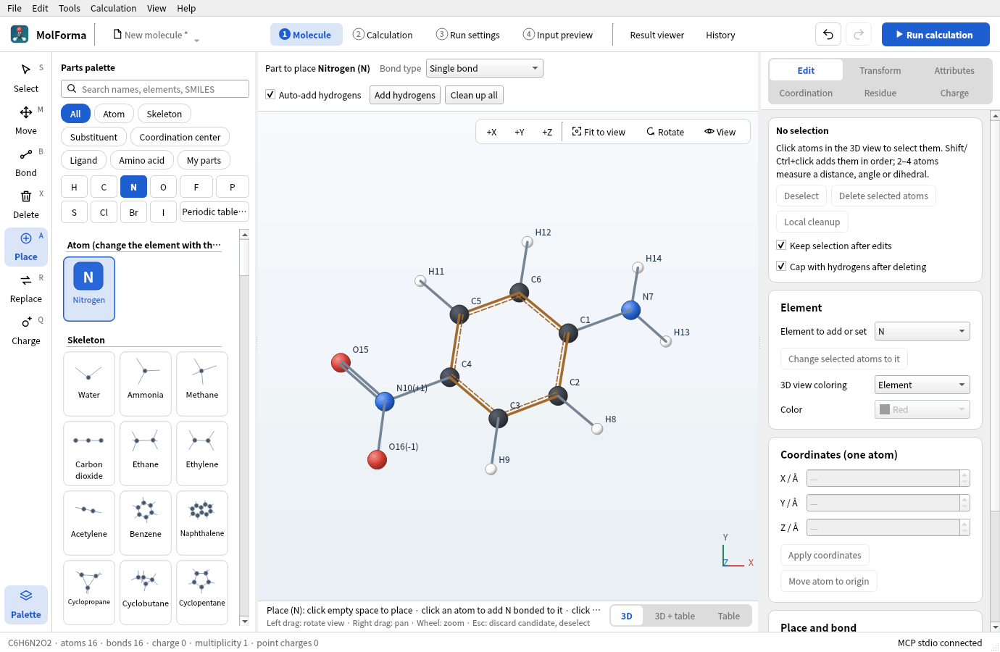
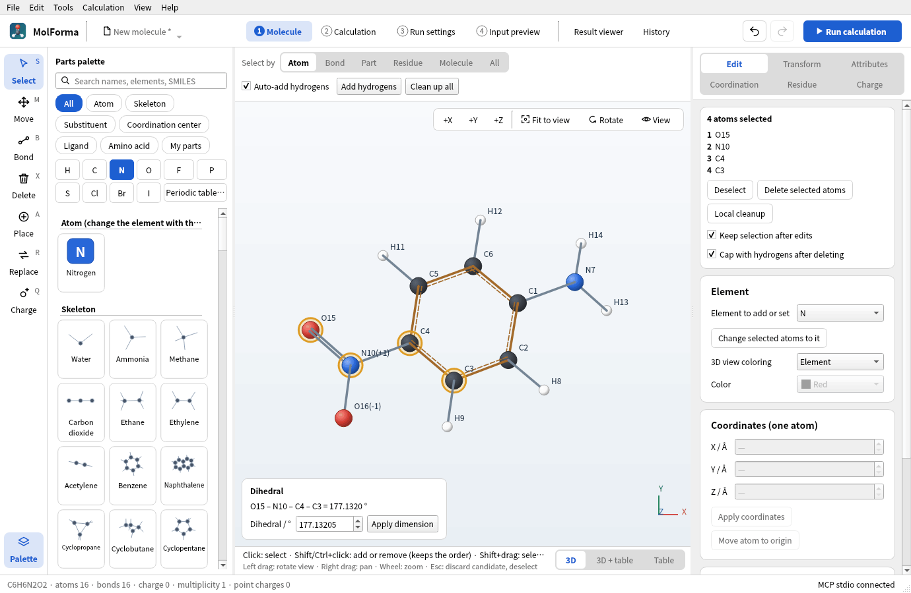
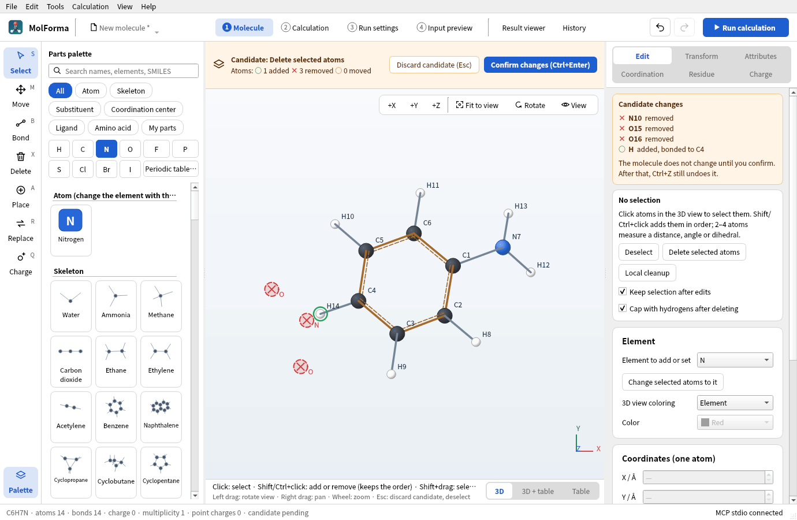
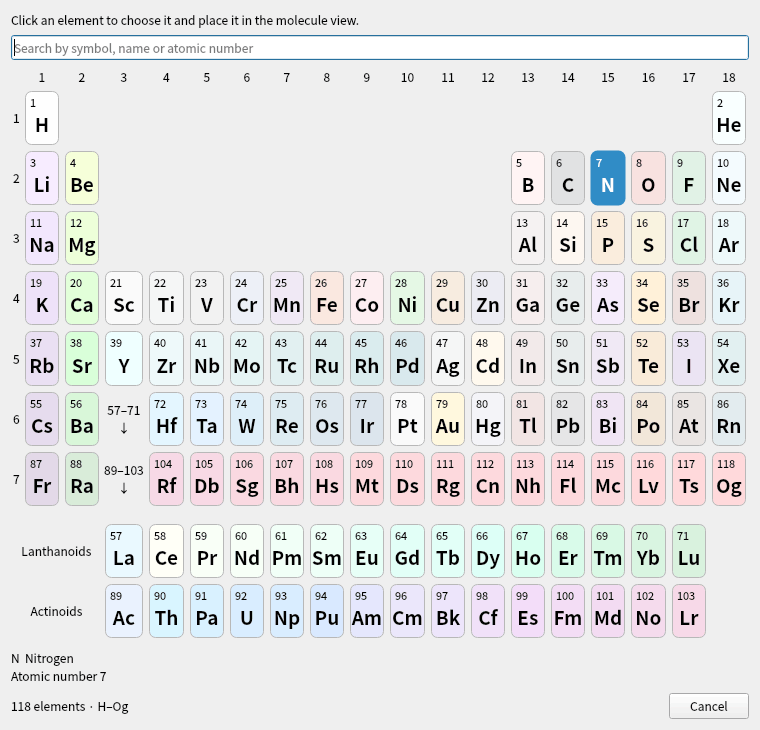

# “1 Molecule”: layout, tools and selection

“1 Molecule” is the window where you build molecules. This page describes its layout, the tools and parts palette, selection, deletion, candidates, view and keys, and the atom palette and periodic table. The pages from “Edit” to “Charge” on the right are described in “[Right-side pages of “1 Molecule”](molecule_pages.md)”, and the table shown below (or instead of) the 3D view in “[Coordinate table](coordinates.md)”.

**Figure 1** After pressing “N” in the palette. The tool becomes “Place”; the part to place and the bond type appear above the 3D view, and what a click does appears below it.

## Window layout

- **Header**: The file name is at the left (click it for New, Open, Recent files, From SMILES and Save), the workflow in the middle (“1 Molecule” – “4 Input preview”, “Result viewer” and “History”), and “Undo”, “Redo” and “Run calculation” (F5) at the right (while a calculation runs, “Running” with the elapsed time and “Stop” replace “Run calculation”). The tabs “2 Calculation” – “4 Input preview” have no undo, redo or tab-switching buttons of their own; use those in the header. The workflow buttons switch tabs (as do Ctrl+1–Ctrl+6) and highlight the open tab in color. “4 Input preview” turns red when the input cannot be generated, with the reason in its tooltip. In a narrow window, the workflow moves to a second header row.
- **“1 Molecule”**: The tool column is at the left edge, with the parts palette to its right (collapse it with “Palette” below the tool column; collapsing widens the 3D view and the coordinate table, and the state is remembered in the app settings. It opens for the “Place” and “Replace” tools, for “Open ligand palette” and when saving to My parts), the 3D view in the middle, and the pages “Edit”, “Transform”, “Attributes”, “Coordination”, “Residue” and “Charge” on the right. The row above the 3D view shows the current tool's settings (“Select by”, “Bond type”, the part to place, “Keep tool after placing a part”, “Cap with hydrogens after deleting”, the charge to place) and “Auto-add hydrogens”, “Add hydrogens” and “Clean up all”. When there is a candidate, the same row switches to confirming or discarding it. The row height does not change with candidates or tools, so the 3D view keeps its size and position (except when you switch to a tool whose settings wrap to two lines in a narrow window).
- **Overlays on the 3D view**: The peptide sequence is at the top left (per chain in residue-number order, with terminal caps at the ends as in “ACE 0 · ALA 1 · … · NME 4”; click a residue to select its atoms; with 25 or more residues, the first 24 are shown), +X/+Y/+Z, “Fit to view”, “Rotate” and “View” at the top right, and the distance, angle or dihedral of 2–4 atoms selected in order, with an input to change the dimension, at the bottom left. When the 3D view is narrow, the top-right buttons show only icons and the sequence moves below them. The two lines below the 3D view show what a click does with the current tool and the mouse controls (what does not fit is cut off with “…”, and the tooltip shows the full text).
- **Display options**: “View” at the top right of the 3D view is the same as the “View” menu and toggles hydrogen display (H), numbers, labels, the display style, measurements and more. “Rotate” opens sliders for the left–right, up–down and in-plane rotation angles.

## Tools and parts palette

- **Tools**: Choose a tool in the column at the left edge (Select, Move, Bond, Delete, Place, Replace, Charge; each tool's key is shown in its corner), with “Edit → Choose tool”, or with keys in “1 Molecule” (S, M, B, X, A, R, Q; in input fields they type characters). The row above the 3D view shows the current tool's settings, and below the 3D view appear what a click does with the current tool and the name of the element or part to place. Clicking a part or atom in the palette switches to the “Place” tool. While the “Replace” tool is active, however, it stays and replaces with the chosen element or part. Going back to “Place” or “Replace” after the “Select” tool highlights and uses the palette item chosen before.
- **Place tool**: Places what you chose in the palette, depending on where you click. An atom goes into empty space or is joined to the clicked atom with a bond of the “Bond type” (clicking a hydrogen replaces that hydrogen; clicking a bond inserts the atom into it). An inserted atom goes where covalent radii and a tetrahedral angle put it (for example C–O 1.42 Å, C–O–C 109.5°), and the smaller fragment moves outward; in a ring, or with fixed atoms on both sides, nothing else moves and the atom sits off the bond line (on it the force field could not open the angle). Skeletons, amino acids and terminal caps go into empty space or attach to an atom or hydrogen. A substituent replaces the clicked hydrogen (it cannot be placed in empty space). A coordination center goes into empty space with its coordination sites; the element placed is the item highlighted in the palette (the first one right after a category change). A ligand coordinates to a purple number (open site) of a coordination center; clicking empty space places it as a separate molecule.
- **Bond tool**: Choose the bond type (“Single bond” to “Delete bond”) with “Bond type” above the 3D view (the same setting as “Bond type” on the “Edit” page; it is also shown for the “Place” tool, which uses it when joining an atom to an atom). Setting a bond to the type it already has makes no change and no history entry. Bond changes use the same operation from the editing panel, bond tool, menus, shortcuts and context menu. With automatic hydrogen completion enabled, the hydrogen count is adjusted too; with it disabled, only the requested bond changes.
- **Move tool**: Dragging an atom moves it with its hydrogens (dragging a selected atom moves the whole selection and its hydrogens) along with the cursor, and releasing commits the move as one edit. If fixed atoms are involved, nothing moves and the reason is shown on release. Alt-drag rotates.
- **Placing ligands one after another**: With a ligand chosen in the “Place” tool, clicking the next open site confirms the candidate of the previous ligand and makes the next one a candidate.
- **When the tool switches back**: Placing one part such as a skeleton, substituent or amino acid (including a ligand placed on its own) returns to the “Select” tool and clears the palette highlight (turn on “Keep tool after placing a part” to keep placing). Placing atoms, coordination centers and ligands on open sites, and all other tools, continue until you switch.
- **Common elements**: The palette buttons H, C, N, O, F, P, S, Cl, Br and I make that element ready to place with the “Place” tool (the button of the chosen element is highlighted in color). The list of the “Atom” category also shows the chosen element and these elements.
- **Categories and layout**: The buttons at the top of the palette (All, Atom, Skeleton, Substituent, Coordination center, Ligand, Amino acid, My parts) switch the category. The element buttons (H, C, N, …) and “Periodic table…” choose the center element under “Coordination center” (non-metals such as S, P and Xe join the top of the list) and, from the part categories such as Skeleton or Substituent, switch to “Atom” and choose that element. “My parts” shows “Save selected atoms…”, “Load…” and “Remove from list” above the parts (removing a part from the list does not delete its file; without parts, it explains how to add some). Parts and atoms are laid out as tiles with a structure thumbnail and a name (up to two lines; the full name is in the tooltip); headings and the Build 3D from SMILES “…” item take a full row.
- **Order in “All”**: Without a search, atoms, skeletons, substituents, ligands, amino acids, terminal caps, coordination centers (metals) and My parts are listed in this order under headings.
- **Palette search**: An element symbol or atomic number puts that element at the top of the list (“N” gives nitrogen; under “Coordination center”, as a coordination center). Elements can also be found by their Japanese name (such as 窒素) or English name. Part names and SMILES find parts too, and when a string that matches no part can be read as SMILES, Build 3D from SMILES “…” appears (it makes a candidate placed beside the current molecule). Enter in the search field chooses the first item.
- **From SMILES**: An input field with examples makes a candidate that replaces the current molecule. If the SMILES cannot be read, the reason is shown, and “Edit SMILES…” lets you enter it again.

## Selection, deletion, candidates, view and keys

- **Selection**: Clicking an atom selects only that atom (or its group when “Select by” is Part, Residue, Molecule or All). Shift/Ctrl+click adds to or removes from the selection, and the selection order is used for measuring distances, angles and dihedrals and for changing dimensions. Shift/Ctrl-drag selects a region (Ctrl adds to the selection), Ctrl+A selects all and Esc clears the selection. “Select by” is chosen above the 3D view with the Select and Move tools, and the Delete and Replace tools use the same unit (when it is not Atom, it is shown in the description below the 3D view).
- **Selection box**: The top of the “Edit” page lists the selected atoms in selection order (residue atoms as “ALA 1 · CA”), up to 8 atoms, with “Deselect”, “Delete selected atoms”, “Local cleanup” (refines only the selected atoms with a force field and shows a candidate), “Keep selection after edits” (on by default) and “Cap with hydrogens after deleting”. Operations on the selected atoms (delete, fix, ghost, to origin, translate and so on) are only on the right-side pages; the selection bar of the coordinate table shows only the selected atoms and Deselect.
- **Operations on the selection**: Buttons that act on selected atoms (delete, bond, apply coordinates, dimensions, rotate and so on) stay disabled until the required number of atoms is selected, and their tooltips say how many to select. With no atoms selected, the coordinate and dimension fields on the right show “—” instead of keeping the values of previously selected atoms.
- **Deletion**: “Delete selected atoms” on the “Edit” page, the Delete key, the Delete tool and the context menu perform the same deletion and show it as a candidate. Hydrogens bonded only to the deleted atoms are removed as well, and when “Cap with hydrogens after deleting” is on (one setting shared by the selection box of the “Edit” page and the Delete tool; on by default), deleting heavy atoms adds hydrogens to the atoms whose bonds were cut (not when only hydrogens are deleted). When the total charge matched the sum of the formal charges (with the oxidation numbers of coordination centers, if any) before the deletion, it follows the new sum (deleting a Na⁺ coordination cluster takes it from +1 back to 0, for example). The Delete key in the coordinate table performs the same deletion.
- **Candidates**: Changes that are not yet confirmed are shown in amber in the row above the 3D view (where the tool settings are; it does not cover the view or change the size of the 3D view), with the operation name and the numbers of added, removed and moved atoms, using the same marks as the 3D view (added: green circle, removed: red × at the old position, moved: orange circle). The top of the “Edit” page lists up to 8 atoms to be removed or added. Ctrl+Enter confirms and Esc discards (from any tab). On tabs other than “1 Molecule”, the same bar appears below the tabs. The tooltips of “Undo” and “Redo” and the “Edit” menu show the name of the operation concerned.
- **Undo and redo**: Undo/redo is shared by the molecule and the settings of all tabs. When there is nothing to undo or redo, the buttons and menu items are disabled (“Confirm changes” is also enabled only while there is a candidate). Undoing or redoing shows the operation name in the status bar and, when it changes another tab than the current one (for example a basis set change undone from “1 Molecule”), adds the tab name as in (in “2 Calculation”).
- **View**: Left-drag rotates about the vertical and horizontal axes of the screen (trackball), with no rotation bias that depends on the orientation. A file with a three-dimensional structure opens viewed from an oblique direction, as in the result viewer (planar molecules and new molecules are viewed from the front). After an edit, the view is refitted only when the molecule extends beyond the view; otherwise the view does not move (so that the atom you click next stays in place). “+Z” shows the whole molecule viewed from the front (+Z direction), and “Fit to view” (F) fits the whole molecule without changing the orientation. The rotation sliders (“Rotate” at the top right of the 3D view) follow mouse operations and +X/+Y/+Z, and touching a slider does not make the view jump. The wheel zooms around the cursor position. The controls at the top right of the 3D view (+X/+Y/+Z, “Fit to view”, “Rotate”, “View”) are in the same order in the result viewer.
- **Labels**: “View → Labels” chooses the atoms that show their element symbol and number (All, Heavy atoms, Selected atoms, None), and “View → Show numbers” whether serial numbers are shown (the same choices are in “View” at the top right of the 3D view). Each label is placed at the upper right, lower right, upper left or lower left of its atom, wherever it does not overlap other labels or atoms. Labels that do not fit are dropped, keeping those of selected atoms, coordination centers, heavy atoms and atoms in front first. The result viewer has the same choices (saved separately).
- **Keys**: Delete (deletes the selected atoms; with no selection, the status bar says so), Ctrl+A (select all), Ctrl+C (copy the selected atoms, or the whole molecule, as XYZ), Ctrl+V (add the XYZ on the clipboard as a fragment beside the current molecule), 1/2/3 (bond order of 2 selected atoms), H (show hydrogens) and F (fit to view) work only while “1 Molecule” has the focus; in input fields they do what the field normally does. Ctrl+Enter, Esc, Ctrl+1–Ctrl+6 (switch tabs), Ctrl+Z/Y and so on work everywhere. “Help → Keyboard shortcuts” lists all of them with where they apply, and the mouse controls.
- **Center of rotation and mirroring**: “Rotate selection” and “Mirror in plane” on the “Transform” page use, by default, an axis or plane through the center of the selected atoms (the mean of their coordinates), so the molecule changes its orientation in place. Setting “Rotation/mirror center” to “Origin” uses the coordinate origin. “Make a mirrored copy” places the copy 6 Å from the original molecule in the +X direction, mirrored in place.
- **Response with large molecules**: Each edit, undo or selection updates only the visible tab and the coordinate table; a hidden coordinate table and the other tabs (“2 Calculation” – “4 Input preview”) are brought up to date when they are shown (and before MCP reads or operates the GUI). The red tab name and description of “4 Input preview” follow input errors even while it is hidden. On a 2160-atom water cluster, select all takes about 0.1 s, and editing coordinates or undoing about 0.1 s (previously about 13 s and about 1 s). Undo keeps up to the last 100 operations.
- **Colors**: The accent color of the selected tool, the open tab, “Run calculation”, the category buttons and so on is MolForma's own blue (#1D5FD1 in light themes, #2F6FE4 in dark themes) and does not follow the desktop selection color. The backgrounds, text and lines of the header, the tool column and the overlays on the 3D view, the candidate banner, error text and the coloring of the input preview are derived from the Qt palette so that they stay readable in dark themes. The candidate banner is pale amber in light themes and dark amber in dark themes. The background of the 3D view stays light (only when nothing is shown does it take the window color in dark themes).

**Figure 2** Choosing four atoms in order shows the dihedral and a field to change it at the lower left of the 3D view (two atoms give a distance, three an angle).

**Figure 3** Choosing the nitro group (N10, O15, O16) and pressing “Delete selected atoms” makes the deletion a candidate. The atoms to delete get red crosses and the capping hydrogen a green circle; the molecule does not change until “Confirm changes”.

## Atom palette and periodic table

When the palette category in “1 Molecule” is “Atom” or “All”, “Periodic table…” opens a Qt periodic table dialog. Click an element among the 18 groups and 7 periods, or in the lanthanide/actinide rows below. You can search by Japanese name, English name, element symbol or atomic number; cells that do not match keep their position and are dimmed. The arrow keys move between cells, Enter/Space chooses and Esc cancels. When the search matches a single element, Enter in the search field also chooses it.

**Figure 4** The dialog opened with “Periodic table…”. You can search by symbol, Japanese or English name, or atomic number.

The chosen element is shown in the palette with its colored symbol, its name and its atomic number, and can be placed by clicking or dragging in the molecule view. Choosing in the periodic table alone does not change the molecule, and placing supports undo/redo. The added elements Fr–Og are handled throughout: changing elements, coordinate input, saving projects, XYZ, NWChem coordinate output, and reading structures from NWChem logs, CUBE and MOLDEN files.

The elements covered are H–Og (atomic numbers 1–118), which have official names in the [NWChem element table](https://github.com/nwchemgit/nwchem/blob/master/src/geom/periodic.fh). The provisional elements Uue and Ubn (119, 120) are not covered. **Recognizing an element is separate from basis set support.** If the molecule contains elements that the built-in basis sets of “2 Calculation” do not support (such as Fr–Og), generating the calculation input is refused as before. Input of arbitrary basis sets or ECPs that are not in the library is not implemented.

H–Rn use the bundled element data (properties, isotopes); the masses, covalent radii, colors and English names of Fr–Og come from the element data of Open Babel 3.2.1. The radii of heavy elements include estimated and substitute values, so bond perception and placement are approximate. The masses are database reference values; standard atomic weights of superheavy elements and force-field support for all elements are not guaranteed.

See also: [recipe 1 Building from atoms and bonds](../recipes/atoms_and_bonds.md), [recipe 3 Substituted aromatics](../recipes/aromatic_substitution.md), [recipe 16 Your own parts (My parts)](../recipes/my_parts.md), the list of pages in “[Features](../features.md)”.
