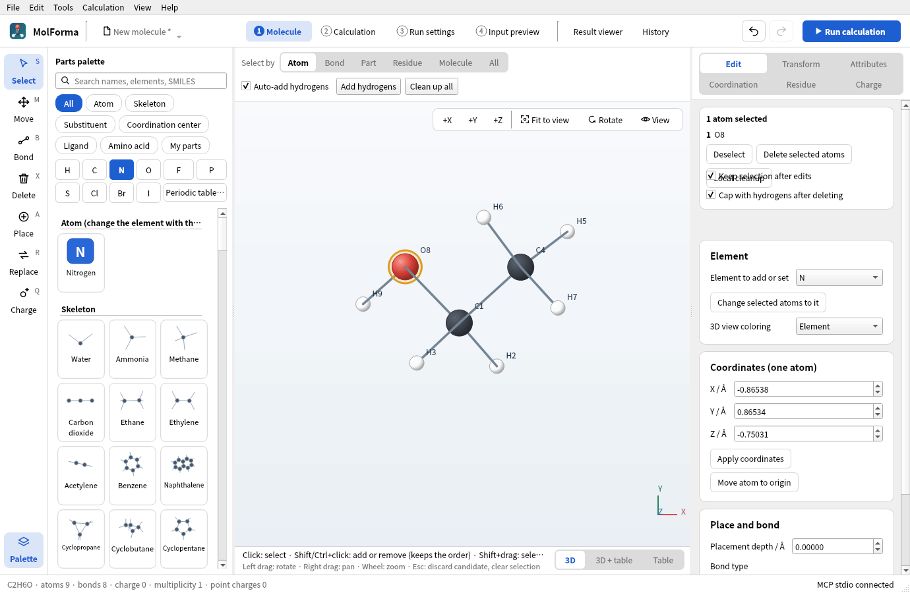
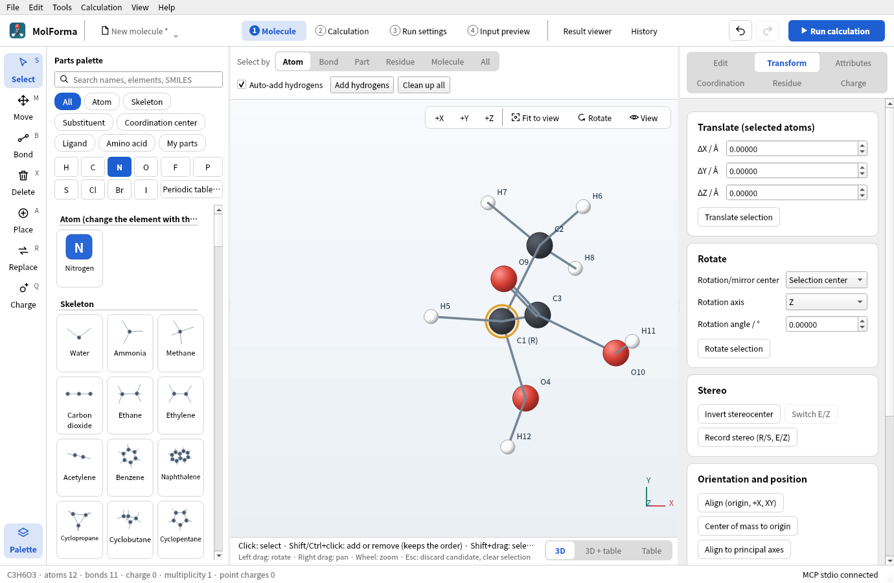
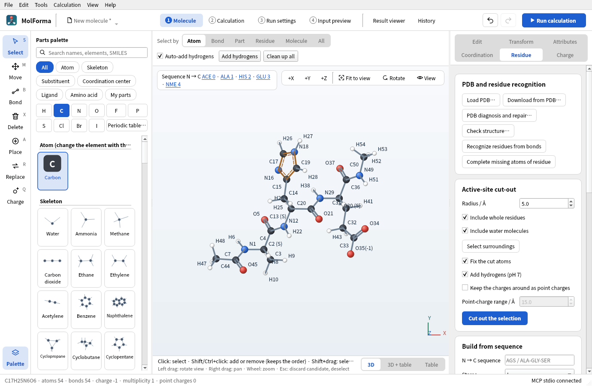
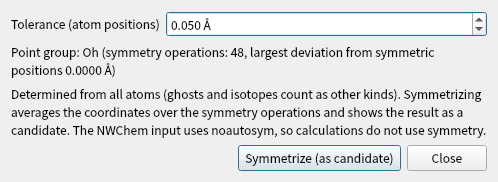

# Right-side pages of “1 Molecule” and NWChem support

The right side has six pages, “Edit”, “Transform”, “Attributes” (atom attributes, ghosts and fixing only), “Coordination”, “Residue” and “Charge”, chosen with the switch at the top (there are no further tabs inside the pages). Each page groups its operations into cards, with buttons side by side. Frequently used operations have blue buttons (ligand placement, building from a sequence, adding point charges), and the less used “Site directions” opens with the arrow in its heading. What remains are the calculation settings passed directly to NWChem and the operations that build elements, coordinates, hydrogens and stereochemistry. Bond orders, residue names, coordination sites and oxidation states are not written directly to the molecular QM input of NWChem, but they are used to prepare the initial structure.

| Tab, item | Purpose |
| --- | --- |
| Edit: change element, XYZ of one atom and move to origin (in the “3D” layout), placement depth | Create the elements and coordinates passed to the calculation |
| Edit: bond type, bond 2 atoms, select one side of a bond, delete with hydrogen capping | Structure preparation that derives hydrogen counts and what moves from the bond graph |
| Transform: translate, rotate, invert stereocenter, switch E/Z, record R/S and E/Z | Create and check stereoisomers. A recorded R/S is shown in the atom's label in the 3D view (“C1 (S)”) and E/Z in the middle of the double bond (“(E)”); the status bar names what was recorded. The stereo labels themselves are not written to the NWChem input |
| Transform: align orientation, move the center of mass, principal axes, mirror and mirrored copy, duplicate | Create initial coordinates, isomers and complexes. For the whole molecule (no selection), “Center of mass to origin” and “Align to principal axes” move the point charges too, as “Align (origin, +X, XY)” does |
| Attributes: formal charge, unpaired electrons, apply attributes | Attributes for adding hydrogens and for the chemical structure. Shown as separate from the total charge and spin multiplicity of the calculation |
| Attributes: isotope or arbitrary mass, make ghost and remove ghost | Writes `mass`, `bq<element>` and the basis |
| Attributes: fix selected atoms, unfix | Protection during editing and `constraints / fix atom` in optimizations. Sets or clears fixing explicitly even when fixed and unfixed atoms are mixed. The context menu of the 3D view uses the same names |
| Distance, angle and dihedral constraints, scans | Set in “Coordinate constraints” and “IRC and coordinate scan” of “2 Calculation” (written to NWChem's `zcoord`). Distances and angles are changed and measured in “1 Molecule” |
| “Structure → Sort atoms” of the coordinate table (By element, By residue, Selected atoms first); saving, loading and “Remove from list” for “My parts” in the palette | Organize the output atom order and reuse structures |
| “Clean up all” above the 3D view, “Local cleanup” in the selection box of “Edit” (selected atoms only), “Tools → Regenerate 3D” | Initial structure preparation with Open Babel. Separate from the NWChem calculation |
| Coordination: coordination geometry, center–donor distance, site number, place, replace and move ligands, swap 2 sites, individual site directions | Create the initial structure of complexes. Check the candidate and confirm it |
| Coordination: auxiliary input of oxidation states and applying them | Notes that the total charge and multiplicity of the calculation are set separately in “2 Calculation” |
| Residue: recognition, completing missing atoms, building from a sequence, L/D, side-chain states, N/C-terminal states | Prepare the atoms, hydrogens, protonation states and conformation of peptides. Recognition from the bond graph matches standard amino acids by elements and connections (not by bond orders guessed from an XYZ file), also recognizes ACE and NME caps at the chain ends, and sets formal charges (COO−, NH3+, Lys, Arg, HIP histidine) and side-chain states (HID, HIE, HIP, charged or neutral Asp and Glu, …) from the hydrogens present. A total charge follows the new value as described for the Charge page (also for recognition in “PDB diagnosis and repair…”) |
| Residue: adding at either end, mutating residues, applying terminal states, deleting, reconnecting, backbone and side-chain dihedrals | Edit the composition and the initial conformation. Mutation uses the state of the amino acid chosen in the palette (“Histidine (HIP, +1)” and so on), keeps the backbone N, Cα, C and O (and the internal-coordinate constraints and scan coordinate on them), and puts the backbone amide hydrogen into the peptide plane (opposite the previous C=O); adding an ACE cap does the same. The total charge follows as when adding residues. Reconnecting needs a C–N distance of 1.1–1.7 Å; otherwise it gives the present distance and how to close it with a dimension |
| Residue: selecting from the list, selecting atoms without residue, manual registration | Select and manage large structures |
| Fragment assignment (FMO/Counterpoise/SAPT0), fragment charge and multiplicity, BDA:BAA | No UI to create or edit them (they cannot be converted to NWChem input). The counterpoise correction is set with “BSSE correction” in “2 Calculation” (monomers per bonded molecule, NWChem's `bsse` block). FMO and SAPT0 are not supported |
| Residue: PDB loading, diagnosis and repair, “Check structure…”, exporting the atom table as CSV | The CSV stores the output atom number, element, atom name and residue |
| Edit: 3D view coloring (element, residue; “Element” card) | Check the structure |
| Charge: display of the total charge and multiplicity, applying the sum of formal charges as the total charge | The values are set in “2 Calculation”; this page shows them and leads there with Change in “2 Calculation”. With coordination centers, “Use oxidation and formal charges (n)” counts their oxidation numbers (aid) in place of their formal charges |
| Charge: point charge coordinates and charges, list, add, update and delete, TIP3P conversion, export to a file | Prepare an external electrostatic field. The TIP3P conversion is checked as a candidate |
| Charge: whether external point charges go into the NWChem input, list of point charges (explains how to add them when there are none) | Set under “Environment” in “2 Calculation” (writes `bq units angstrom`) |
| Charge: electron count and consistency, whether input can be generated, input check | Shows the electron count with ECPs and ghosts taken into account, the α/β electron counts, errors and checks, and whether “Input can be generated”; Check in “4 Input preview” goes there |

Atom properties use the same validation as the coordinate table and MCP. Mass numbers absent from the isotope data are rejected during editing; custom masses must be positive finite values entered as decimals.

**Figure 1** The “Edit” page. The chosen atoms with “Deselect”, “Delete selected atoms” and “Local cleanup” are at the top, followed by the cards for element, coordinates and bonds.

**Figure 2** The “Transform” page. “Record stereo (R/S, E/Z)” shows the assigned R/S in the atom labels (“C1 (R)”).

![The “Coordination” page with Co of trans-[Co(en)₂Cl₂]⁺ chosen: the cards for geometry, distance and oxidation state and for placing ligands](images/molecule_pages/03_coordination.png)

**Figure 3** The “Coordination” page. Set the geometry, center–donor distance and oxidation state of a coordination center, and place ligands from the palette at its sites.

**Figure 4** The “Residue” page builds peptides from a sequence, adds, replaces and deletes residues, and diagnoses and repairs PDB files. The sequence appears at the upper left of the 3D view.

![The “Charge” page of [Na(H₂O)₄]⁺ with TIP3P point charges: the molecular charge card and the list of three external point charges with buttons to add, update and delete](images/molecule_pages/05_charge.png)

**Figure 5** The “Charge” page shows the total charge, multiplicity and electron count, and lists and edits external point charges. The values of the total charge and multiplicity are set in “2 Calculation”.

Adding hydrogens first assigns aromatic bonds as single and double bonds (a Kekulé structure) and then counts valences. When a pyrrole- or imidazole-type nitrogen has lost its hydrogen, the hydrogen is put back on the nitrogen rather than on a carbon. Ions such as O²⁻, S⁻ and H⁻ are treated with valences that match their charge.

The charge settings cannot be changed while a candidate is shown or a cleanup is running. Applying the sum of formal charges does not guess the multiplicity. Deleting atoms, adding fragments, placing a coordination center, placing or exchanging ligands, changing a geometry or oxidation number, recognizing, adding or mutating residues, changing terminal states and building from a sequence keep a total charge that matched the value the structure suggests (the sum of formal charges, with oxidation numbers for coordination centers) in step with the new value (placing Co(III) gives 3; two chlorides then bring it to 1). A total charge that did not match stays (building from a sequence with “Replace the existing molecule” gives the new sum). Changing atom attributes, elements or bonds does not change the total charge. With coordination centers, the checks of “2 Calculation” and “Check structure…” compare the total charge with this value. External point charges are not added to the electron count or the total charge of the molecule. Writing point charges is off by default; enabling it is saved in the project and supports undo/redo. This is a fixed external electrostatic field, not an NWChem QM/MM calculation with a force field, topology and QM/MM boundary.

The counterpoise (BSSE) correction, distance, angle and dihedral constraints and coordinate scans that NWChem can run are set in “2 Calculation”. FMO and SAPT0 are not supported. Basis sets, ECPs and methods are also set in “2 Calculation”.

Unknown fields of existing projects are kept when saving and are not converted to NWChem input.

References: [NWChem coordinates, masses and ghosts](https://nwchemgit.github.io/Cartesian-coordinate-input.html), [fixed atoms](https://nwchemgit.github.io/Constraints.html), [geometry optimization](https://nwchemgit.github.io/Geometry-Optimization.html), [external point charges](https://nwchemgit.github.io/Bq.html), [counterpoise example](https://nwchemgit.github.io/Python.html).

The `editor` Qt Tests verify that the “Attributes” page has only atom attributes, ghosts and fixing (including where sorting, My parts, local cleanup and 3D regeneration went), that fixing and point-charge operations in the UI reach the generated input, that the Charge page follows changes of the total charge, multiplicity and point-charge output setting made in “2 Calculation”, and they check the restrictions during candidates, undo/redo and keeping unknown fields when saving. Running `test_editor nwchemMoleculeControls` with `MOLFORMA_MOLECULE_ARTIFACTS=/tmp/molforma-molecule` saves screenshots of each page.

## Structure tools (Tools menu)

- **Point group and symmetrization**: “Tools → Point group and symmetrize…” shows the point group as a Schoenflies symbol (C1, Cs, Ci, Cn, Cnv, Cnh, Dn, Dnh, Dnd, S2n, T, Td, Th, O, Oh, I, Ih, C∞v, D∞h) within a given tolerance (default 0.05 Å), together with the largest deviation from the symmetric positions. Ghosts, isotopes and atoms with a specified mass count as separate kinds, and up to 200 atoms are analyzed. “Symmetrize (as candidate)” averages the coordinates over the symmetry operations found and makes the exactly symmetric structure a candidate. It is refused if a fixed atom would move. Because the point-group detection of Open Babel misidentifies water as Cs and methane as C3v, the search for and classification of symmetry operations are MolForma's own implementation. The NWChem input uses `noautosym`, so calculations do not use symmetry.
- **Z-matrix**: “Tools → Z-matrix (internal coordinates)…” shows internal coordinates in atom number order as a table (each atom references earlier atoms, preferring bonded atoms and avoiding collinear references). Editing a distance, angle or dihedral cell moves that atom's side (beyond the bond) and applies the change to the molecule; Undo reverts it. “Copy text” gives the text in `H 1 0.960000 2 104.5000` format. A Z-matrix cannot be read as input.
- **Regenerate 3D**: “Tools → Regenerate 3D” rebuilds the 3D coordinates from the bonds and shows the result, refined with a force field, as a candidate.
- **Conformer search**: “Tools → Conformer search…” rotates rotatable bonds at random, optimizes the conformers with MMFF94 (UFF where it cannot be used), removes duplicates with a heavy-atom RMSD below 0.25 Å and lists them by energy. The chosen conformer becomes a candidate (the most stable one when the search was started over MCP). If only conformers identical to the current structure are found (for example in molecules without rotatable bonds), no candidate is made and the status bar says so. It runs in a separate process and can be cancelled. Molecules with fixed atoms, metals or ghosts are not supported. This is a force-field conformer search and does not guarantee the most stable conformer at the quantum-chemical level.
- **Structure check**: “Tools → Check structure…” (the same as “Check structure…” on the “Residue” page of “1 Molecule”) checks the atom and bond counts, the formal charges against the charge setting, the combination of electron count and multiplicity, and the bond order sums. It also shows the number of open sites at coordination centers, and any difference between the charge setting and the total charge expected from the oxidation states (auxiliary) of coordination centers and the formal charges of ligands. If there are no problems, it shows “No problems found.”
- **Structure comparison and superposition**: “Tools → Compare and superpose structures…” compares the molecule with another structure file (the same atoms in the same order) and shows the RMSD of the coordinates as they are, the RMSD after Kabsch superposition (all atoms and non-hydrogen atoms) and the largest deviation. “Superpose onto it (candidate)” moves the whole current molecule to the position and orientation of the compared structure. “Compare” in the result viewer performs the same calculation.

**Figure 6** The dialog of “Tools → Point group and symmetrize…” (SF₆, point group Oh).

## Worked examples

### Ala–Gly–Ser

1. Open a new molecule and enter `AGS` as the sequence in “Residue”.
2. Set the N-terminus to protonated and the C-terminus to COO−, and press “Build from sequence”.
3. Check that the candidate is **C8H15N3O5, 31 atoms, formal charge 0**, and confirm it.
4. In “2 Calculation”, choose the method, basis set and task (e.g. HF / STO-3G, single-point energy). The total charge is 0, the same as the sum of formal charges.
5. Check the input in “4 Input preview” and start the calculation with “Run calculation” in the header.

### Tetrahedral zinc complex

1. Choose Zn in the coordination-center palette.
2. In “Coordination”, set the geometry to tetrahedral, the distance to 2.3 Å and the oxidation state to 2.
3. Click empty space to place the center.
4. Choose chloride in the ligand palette, and place and confirm it on sites 1–4 in turn.
5. In “Charge and spin” of “2 Calculation”, set the total charge of the calculation to −2 and the multiplicity to 1 (also shown on the “Charge” page of “1 Molecule”).

See also: [recipe 2 Coordination compounds](../recipes/cobalt_complex.md), [recipe 6 Stereochemistry](../recipes/stereochemistry.md), [recipe 7 Peptides](../recipes/capped_peptide.md), [recipe 12 Solvated clusters and point charges](../recipes/hydrated_sodium.md), the list of pages in “[Features](../features.md)”.
