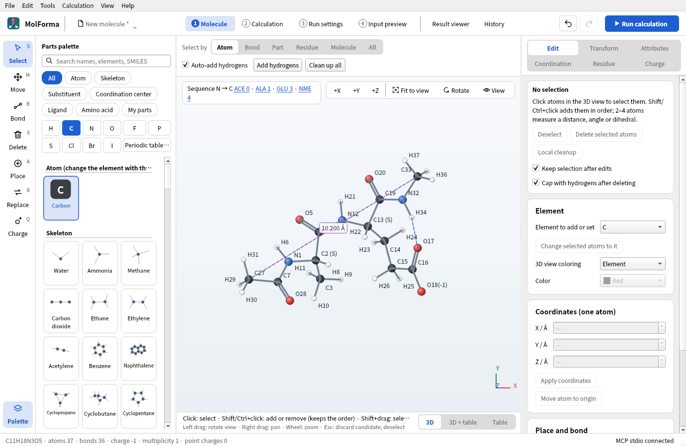
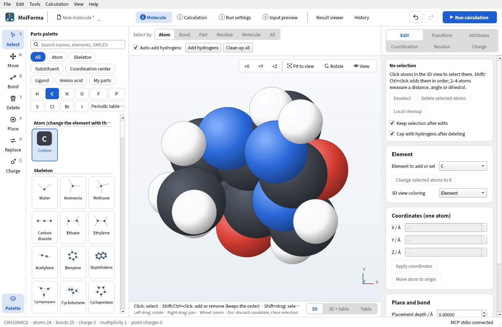

# 3D rendering

- The molecule editor and the result viewer use the same rendering component. Builds that detect a Qt6-compatible VTK embed a C++ VTK scene in `QVTKOpenGLNativeWidget`. There is no runtime dependence on Python or PyVista.
- Only when OpenGL 3.2 is unavailable and rendering falls back from VTK to QPainter does each 3D view show “Rendering: QPainter (CPU) · simplified, OpenGL unavailable” at its top left (this also follows a later switch caused by a failed initialization). The current renderer is shown in “Help → About MolForma”, and you can also choose QPainter under “3D rendering (after restart)” in “Preferences”. VTK rendering does not guarantee that a hardware GPU is used.
- Atoms are drawn together as GPU glyphs. Isosurfaces are kept as separate meshes for the positive and negative parts, and their vertices and normals are updated only when the shape changes. Normals are computed per vertex from the gradient of the grid values, so the shading hides the edges between triangles. Rotation, zoom, pan, opacity, toggling the positive/negative parts and selection do not rebuild isosurfaces. The meshes are also kept when a redisplayed result frame uses the same shared mesh. Orbital evaluation and isosurface generation still run in a separate, cancellable process.
- Orthographic projection and the coordinate transforms used for editing are shared, and camera operations do not change physical coordinates. Double and triple bonds, aromatic dashes and coordination-bond arrows update only small drawing-only coordinates so that they stay visible from the current direction. The displayed atom radii are limited to the same on-screen range as before.
- Labels, selection outlines, fixed marks, ghosts, the small handles of hidden hydrogens, coordination sites, terminal handles, point charges and coordinate axes are drawn in a Qt 2D layer. This layer always appears in front of the 3D shapes. Mouse, keyboard and drag-and-drop input is handled by the existing editing code.
- Translucent surfaces request up to 16 depth-peeling passes; MSAA is disabled and FXAA is used. Where many surfaces overlap, or with drivers that do not support it, transparency compositing has limits. Even with OpenGL, software implementations such as llvmpipe are not as fast as a hardware GPU. Isosurfaces are limited to 500,000 triangles. The QPainter path evenly decimates surfaces with more than 150,000 triangles.
- QPainter rendering is used with `MOLFORMA_RENDERER=painter`, in builds without VTK, on Qt's offscreen/minimal platforms and when the OpenGL context fails to initialize. The QPainter path also caches the camera matrix, atom colors and bond endpoint lookups, but large isosurfaces are limited by CPU rendering.
- “View → Display style” switches between Ball and stick (default), Stick, Space-filling (CPK, Open Babel van der Waals radii), Wireframe and Backbone (Cα trace). In Stick and Wireframe, each bond is colored by the atoms at its two ends, and multiple bonds are drawn as a single line. Backbone (Cα trace) draws each chain of a protein as a thick line through its Cα atoms (P of nucleic acids, C4′ of residues without it) and leaves out the other atoms of polymer residues. The line takes the colors of the atoms it runs through, so “Chain” in “3D view coloring” gives each chain its color. Residues whose Cα atoms lie 4.3 Å or more apart (8 Å for nucleic acids) are not joined, so gaps in a structure show. Ligands, ions, water and atoms not registered in residues are drawn as balls and sticks. The Cα atoms of the backbone carry labels only when selected. The chosen style is saved in the app settings and does not affect the molecule data or calculations.
- “View → Hide selected atoms” (Ctrl+Shift+H) hides atoms temporarily, and “Show all atoms” (Ctrl+Shift+U) shows them again. This is a display-only setting: hidden atoms are still saved, used in calculations and included when a selection is expanded to its unit. Hidden atoms cannot be selected by clicking.
- “View → Show measurement of selection in view” (Ctrl+M) keeps the distance, angle or dihedral of 2–4 atoms selected in order on the view, as a purple dashed line with its value. The value follows atom movements and disappears when one of the atoms is deleted. “Clear measurements in view” removes them. Measurements are not saved in the project.
- “View → Show hydrogen bonds” draws blue dashed lines between an H bonded to N, O or F and another N, O or F (H···Y 1.5–2.6 Å, X–H···Y at least 120°; up to 5000 atoms). This is a guide based on distance and angle, not an energetic criterion.



**Figure 1** The blue dashed line of “View → Show hydrogen bonds” (H34···O17) and a distance kept with “Show measurement of selection in view” (purple dashed line, C27–C33).



**Figure 2** “View → Display style → Space-filling (CPK)” (caffeine, no labels).

Regular CTest runs need no display server and test the QPainter path together with editing, candidates and undo. The VTK path can be tested separately for display positions and click coordinates, translucency, isosurface retention during rotation and PNG capture.

```sh
xvfb-run -a env QT_QPA_PLATFORM=xcb MOLFORMA_REQUIRE_VTK=1 \
  MOLFORMA_RENDER_ARTIFACTS=/tmp/molforma-rendering ./build/test_rendering
```

Compare rendering performance with the same display environment, view size and shapes. The following optional benchmark rotates 10,000, 50,000 and 100,000 triangles in an 800×600 view and prints the median and the 95th percentile of 30 frames after a warm-up. The times are not used to pass or fail the test. Under Xvfb the values usually reflect software OpenGL; to assess a real GPU, run it on the actual display.

```sh
MOLFORMA_RENDER_BENCHMARK=1 ./build/test_rendering rotationBenchmark
MOLFORMA_RENDERER=painter MOLFORMA_RENDER_BENCHMARK=1 ./build/test_rendering rotationBenchmark
```

Measured on 2026-10-23 with an NVIDIA GeForce GTX 1060 6GB, NVIDIA 580.178.04, Qt 6.12.0, VTK 9.7.1 and xcb, using a sphere colored by sign, opacity 150/255 and 3 atoms, and compared with the QPainter path of the same build (including its caching optimizations). The roughly 16.7 ms of the VTK path corresponds to the 60 Hz sync of this display and does not represent the processing time of the GPU itself.

| Triangles | QPainter median | VTK median |
| --- | --- | --- |
| 10,000 | 22.29ms | 16.71ms |
| 50,000 | 63.17ms | 16.72ms |
| 100,000 | 111.69ms | 16.71ms |

For 100,000 triangles, the 95th percentile was 126.60 ms with QPainter and 17.74 ms with VTK. Results vary with the overlap of shapes, the resolution, the GPU and the driver.

See also: [“1 Molecule”: layout, tools and selection](molecule.md), [“Result viewer”](results.md), the list of pages in “[Features](../features.md)”.
