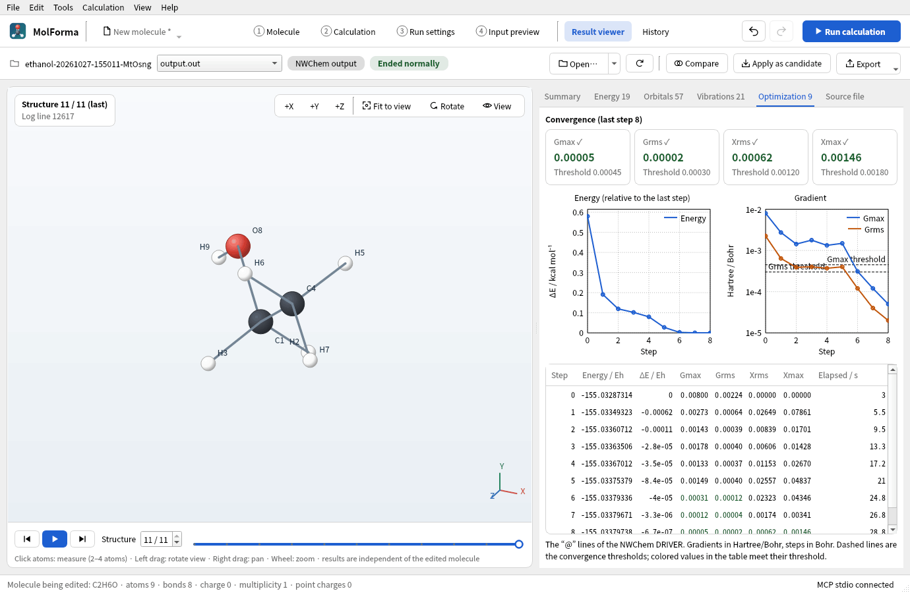
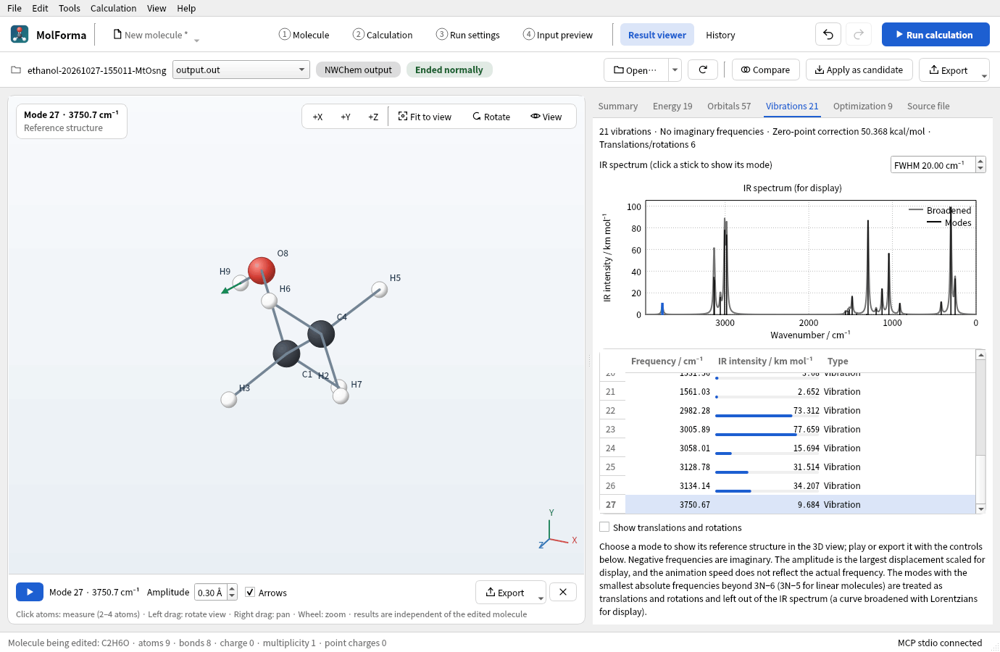
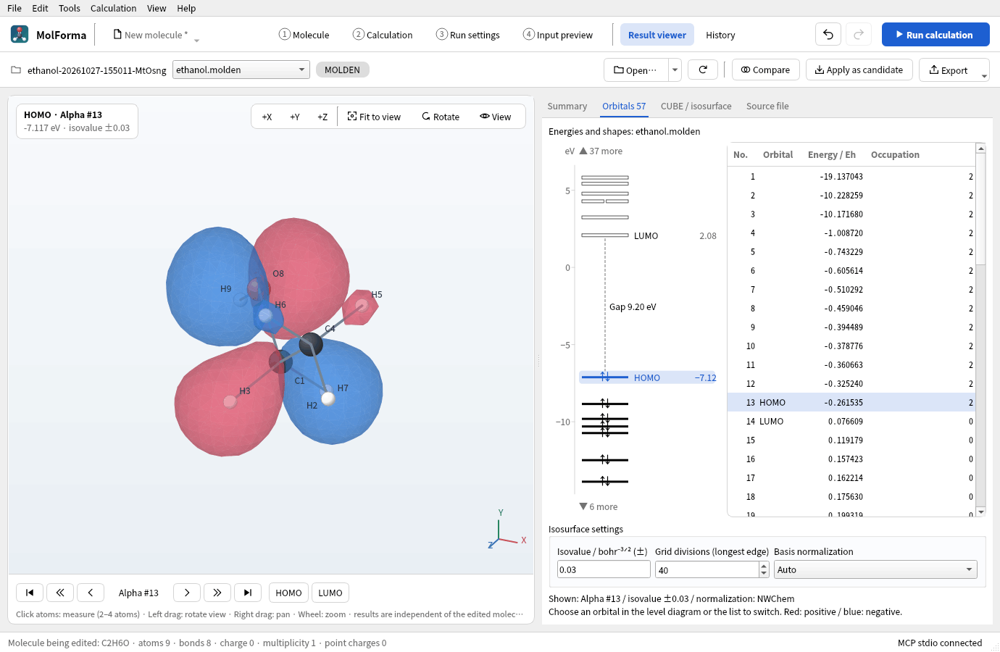

# “Result viewer”

Load a single result file with “Open…” in the top bar, or list the matching files of a folder with “Open job folder…” in its ▾ menu. From the left, the bar shows the job folder name (the full path in the tooltip), the file list, the format (NWChem output, MOLDEN, CUBE, XYZ) and “Ended normally” if the NWChem log ended normally (without a record of normal termination, or on an error, only the warning above the detail tabs says so), and on the right “Open…”, “Reload”, “Cancel”, “Compare”, “Apply as candidate” and “Export” (only “Open…” while nothing is open). When the window is too narrow for one line, “Compare”, “Apply as candidate” and “Export” become icons only (with their names in tooltips). Loading, cancellation, errors and the result of “Compare” are shown in the message area below the detail tabs on the right; when there is nothing to show, the area is closed (opening and closing it does not move the top edge of the detail tabs). “View results” in the run panel opens the job folder shown there. `output.out` is selected first if present; otherwise the first supported file is opened, including in a folder containing only XYZ files. Only the top level of the folder is scanned. In addition, the CUBE and MOLDEN output paths recorded in MolForma's `run.json` (at most 2) are included in the list. Outputs in permanent subfolders or at absolute paths can be chosen too, but there is no recursive scan.


**Figure 1** The job folder of the ethanol “optimization → frequencies”. Pressing a card of the “Summary” opens the corresponding detail tab.

The file list is grouped by kind: logs, structures, CUBE, MOLDEN. The per-mode, per-step XYZ files written by NWChem `freq animate` (`…m-001.s-001.xyz` etc.) are combined into a single item “Vibration animation …: mode N (K frames)”; choosing it loads all steps joined as one structure sequence (play it with the play button below the 3D view). Choosing another file in the list starts loading it at once and updates the 3D view and details when done. Choosing again while loading cancels the previous load and shows the file chosen last. On failure, the previous display is kept and the reason is shown in the message area below the detail tabs.

Vibration animation files are also combined in the cancellable reader process. “Reload” rereads the original XYZ files and includes added or removed steps. If a source file or the list of steps changes during loading, the result is rejected and the previous display is kept. The combined size is limited to 64 MiB.

| Format | Shown content |
| --- | --- |
| NWChem `.out` / `.log` | Output coordinate tables (Å / a.u.), SCF, DFT, MP2, CCSD and CCSD(T) total energies in output order, optimization convergence messages, termination and error messages (an NWChem errquit box appears in the status as “NWChem error: <message>”), projected frequencies, displacements and IR intensities, optimization “@” steps and convergence thresholds, thermochemistry (ZPE, internal energy and enthalpy corrections per temperature, entropy, Cv, symmetry number), dipole moment, orbital energies of the last orbital analysis, TDDFT excited states (energy, oscillator strength, <S²>), the points of coordinate scans (MolForma's `MolForma scan k/n` markers) and IRC (`&` lines, forward and backward), BSSE correction, COSMO solvation energy and SMD solvation free energy, Mulliken charges from PROPERTY, ESP and RESP charges, NMR shielding constants (isotropic, anisotropy), polarizability tensor |
| `.xyz` | Single and multiple structures. Frame selection and playback of structure sequences. Also concatenated NWChem `freq animate` XYZ |
| `.cube` / `.cub` | Atom coordinates and grid in Bohr, non-orthogonal grids, positive and negative isosurfaces. Orbital CUBE files with a negative atom count and data IDs, selection among multiple data sets with `NVAL` |
| `.molden` / `.mld` / `.molde` | `[Atoms]` (Angs / AU), `[GEOMETRIES] XYZ`, `[GEOCONV] energy`, symmetry, energy, occupation and Alpha/Beta from `[MO]`, `[FREQ]`, `[FR-COORD]`, `[FR-NORM-COORD]`, `[INT]` |

The display is independent of the molecule being edited. Loading files, rotating, zooming, switching frames and playing vibrations do not change the project, fixed atoms, candidate or undo history. All result coordinates are converted to double-precision Å, and bonds are inferred from interatomic distances. The viewer's results, isosurfaces and playback state are not saved in the project. Existing result reference fields are preserved as before.

The 3D view is laid out like the one in “1 Molecule”. “+X”, “+Y”, “+Z”, “Fit to view”, “Rotate” and “View” (labels) at the top right control the viewpoint and labels. “Rotate” pops up the sliders “Left–right”, “Up–down” and “In-plane” (−180 to 180 degrees), which follow mouse operations and +X/+Y/+Z. Only the viewing direction of the structure and isosurfaces changes; the coordinates of saved structures are not affected. The top left shows what is displayed (the structure number with its source line and title, the molecular orbital's name, energy and isovalue, the vibrational mode, the CUBE data and grid).

The control bar below the 3D view changes with what is shown. For structure sequences it has “First structure”, “Play structures”, “Last structure”, the structure number and a timeline (select by clicking, dragging or arrow keys); for the points of coordinate scans and IRC, the timeline draws each point's energy as a line with ΔE relative to the minimum (kcal/mol). For MOLDEN molecular orbitals it has orbital navigation buttons and “HOMO”/“LUMO”; for vibrations, mode playback, amplitude, displacement arrows, export and a “×” that returns to the structure sequence. The control bar keeps its height when its page changes (at narrow widths it wraps by group into 2 rows), so the 3D view does not change size.

Loading, done, cancelled and error messages appear in a fixed-height area at the bottom of the result viewer. Even when the number of message lines changes as you switch orbitals, the 3D view and the arrow buttons do not move up or down. Long paths and full error texts can be scrolled, read and copied within the area.

Choose a vibration in the mode table or by its stick in the IR spectrum, and play it with the play button below the 3D view. Negative frequencies are imaginary. Imaginary frequencies below −10 cm⁻¹ are shown in red as significant (smaller negative values are often numerical noise of modes with frequencies close to zero). The amplitude is a display value to which the largest atomic displacement is normalized, and the playback speed is not proportional to the actual frequency. Modes without displacements are shown as numbers only. “Export shown structure as XYZ…” under “Export” in the bar writes the selected frame to XYZ, or the reference structure of the vibration while one is shown. “Export 3D view as PNG…” writes the current structure view to PNG.

CUBE positive isosurfaces are shown in red and negative ones in blue. You can change the isovalue, data number, positive/negative display and opacity. Values are in the units recorded in the file; electron density, orbitals, electrostatic potential and so on are not identified automatically. Coordinates and grid use Bohr, as in the Gaussian CUBE files that NWChem writes. The extension that uses a negative grid count to mean Å, and dummy centers with atomic number 0, are rejected. Each axis needs at least 2 points. Isosurfaces are generated with marching cubes. On each face of a cube, the points where the isosurface crosses the edges are joined; a face that can be joined in two ways is resolved by the value at the bilinear saddle point (asymptotic decider), so it matches the face of the neighboring cube and the surface has no gaps. Each edge point is computed once and shared with the neighboring triangles; with VTK the surface is kept as a mesh of shared vertices and drawn with OpenGL (about one third as many triangles as the earlier marching tetrahedra). The QPainter path draws in depth order, so intersections and overlaps of transparent surfaces are approximate. See “[3D rendering](rendering.md)” for details.

Loading and isosurface generation run in a separate process of the same C++ executable and stop on cancel, on switching to another file and when the window closes. On failure or cancellation the previous result is kept. A file whose size, modification time or link target changed during loading is not accepted. Update the log of a running calculation with “Reload” (the log is followed automatically in the run panel and in “History”). With “Load into result viewer when done” enabled in “3 Run settings”, the job folder is loaded when the calculation ends. “Normal termination marker found” does not guarantee that all tasks succeeded or converged. Optimization convergence, the calculation energy, the number of imaginary frequencies and so on are shown in “Summary” (MCP's `get_app_state` returns them in one line in its `message`, also in headless mode, along with the termination state; imaginary frequencies are given as the total and the significant number, as in “2 imaginary frequencies (1 below −10 cm⁻¹)”). If the NWChem log has no record of normal termination or an error is detected, a warning appears above the detail tabs, and “Show end of log” jumps to the end of “Source file”. The detail tabs (Energy, Orbitals, Vibrations, Optimization, Excited states, Path / scan, Properties, CUBE / isosurface, Source file) appear only when the loaded file has data for them, and their names include a count (records, orbitals, vibrations excluding translations and rotations, optimization steps, excited states, path points). When nothing is open, “Summary” describes the files that can be opened, and the 3D view controls (+X/+Y/+Z, Fit to view, Rotate, View) and the structure switching below the 3D view are hidden. View, rotation and measurement controls are disabled until a structure is open. Energies and structures are each listed in output order; a one-to-one mapping to optimization steps is not assumed. The calculation energy (“Energy” in “Summary”) is found by splitting the log by task, and is the value of the last task. For a frequency task it is the value of the reference structure (because a numerical Hessian then prints the energies of displaced structures), and for a BSSE correction it is the corrected value.

Loading limits are 128 MiB per file, 2000 atoms per structure, 2000 structures and 200,000 atoms in total, 2 million CUBE grid points and 4 million values over all data sets, and 500,000 isosurface triangles. Exceeding a limit gives an explicit error. If an isosurface is too large, change the isovalue in “CUBE / isosurface” and reopen the file, or use a smaller grid. “Source file” shows the last 128 KiB.

“Summary” shows cards with the formula of the last structure, the calculation energy, geometry optimization (convergence, step count, number of criteria met by the last step), imaginary frequencies (their number and values, and how many are below −10 cm⁻¹), HOMO–LUMO gap (eV, per spin), dipole moment (Debye), excited states, coordinate scan and IRC, isosurface and structure sequence. Pressing a card opens the corresponding detail tab. Below them follow the thermochemical corrections per temperature and the Gibbs correction G = H − TS (computed by MolForma; add it to the electronic energy), other results (BSSE, solvation, polarizability, etc.), the log state and warnings, and the result files in the same folder (switch with “Open”). The “Optimization” tab shows the last step's Gmax, Grms, Xrms and Xmax next to the convergence thresholds, the energy change relative to the last step (kcal/mol) and log plots of Gmax and Grms (dashed lines are the convergence thresholds), and a step table (values that meet the thresholds are colored). The displacements (Xrms, Xmax) are not judged at the first step, nor counted among the criteria in “Summary”. The “Excited states” tab shows a list of the states and an absorption spectrum for display, made by broadening the oscillator strengths with Gaussians (FWHM in eV), on a wavelength or energy axis. Orbitals from a log have only energies and occupations; showing their shapes requires MOLDEN.



**Figure 2** The “Optimization” tab: the four convergence criteria of the final step, graphs of the energy and gradient (dashed lines are the thresholds) and the table of steps.

“Apply as candidate” applies the coordinates of the shown structure (the reference structure while a vibration plays) to the molecule in “1 Molecule” as a candidate and switches to “1 Molecule”. It accepts only results whose atom count and order, elements and ghosts match, and refuses results in which a fixed atom has moved by more than 0.001 Å (to guard against results in a different coordinate frame). Atom IDs, bonds, residues and calculation settings are not changed, and the molecule is not changed until “Confirm changes”. The RMSD and largest displacement are shown in the status bar.

The “Path / scan” tab shows the points of a coordinate scan (value, energy, ΔE relative to the minimum / kcal mol⁻¹) or of an IRC (reaction coordinate s / amu½·Bohr with the transition state at 0, positive forward and negative backward, ΔE relative to the transition state) as a table and a plot; selecting a row shows that point's structure. The “Properties” tab shows a table of per-atom Mulliken, ESP and RESP charges and NMR shielding constants and anisotropies, plus the polarizability (a.u. and ų), BSSE correction and solvation energy. NMR values are absolute shielding constants; chemical shifts need the difference from a reference compound computed under the same conditions.

The “Energy” tab shows total energies (Eh, 10 decimals) and ΔE relative to the selected row in kcal/mol, kJ/mol, eV, Hartree and cm⁻¹ (the default reference is the last row). Differences between rows of different methods are meaningless. The “Vibrations” tab labels the 6 modes with the smallest absolute frequencies (5 for linear molecules) as “Translation/rotation” and the other negative frequencies as “Imaginary” (when all 3N modes are present). Translations and rotations are left out of the list by default (IR intensity “—”) and are shown with “Show translations and rotations”. The number and values of imaginary frequencies in the summary also exclude them. IR intensities in the mode table are also shown as bars with lengths relative to the strongest mode. The IR spectrum is a display curve that broadens the IR intensities, excluding translations, rotations and imaginary modes, with Lorentzians of the given FWHM, drawn with higher wavenumbers on the left. Clicking a stick selects that mode, and the stick of the selected mode is highlighted. “Arrows” below the 3D view overlays the displacements of the selected mode on the reference structure (the longest arrow is three times the amplitude); under “Export”, “Export vibration as image sequence…” writes one period as 24 PNG images and “Export vibration as multi-frame XYZ…” writes it as a 24-frame XYZ.



**Figure 3** The O–H stretch (3750.7 cm⁻¹) chosen in the “Vibrations” tab with “Arrows” on. You can also choose a mode by clicking its bar in the IR spectrum.

Clicking atoms in the result 3D view (2–4 atoms) shows the distance, angle or dihedral in the area at the bottom left of the 3D view; “Pin” keeps it on screen (“Clear” removes the selection and the measurements shown). Measurements are kept by atom number, so they follow switching structures and playing vibrations. They are cleared when another file is opened. “Compare” superimposes the shown structure on the molecule in “1 Molecule” and shows the RMSD and the largest deviation (same atoms in the same order).

Parsing logs of arbitrary formats is not supported. Orbital shapes can be checked with MOLDEN files or molecular orbital CUBE files written by NWChem. The vibration sections of a MOLDEN file are shown when you open a file that contains that data. It is not assumed that `MOLDENFILE` alone also writes vibration sections.

## Showing molecular orbitals from MOLDEN

The “Orbitals” tab for an NWChem log shows only orbital energies, numbered with NWChem's orbital numbers (the same numbers as in MOLDEN even if the log lists only some orbitals). If the same job folder has a MOLDEN file, “Show shape” or double-clicking an orbital row opens that MOLDEN file and shows the same orbital (the orbital with the same spin and NWChem number; the Alpha HOMO if none is selected). MOLDEN files are written with “Write MOLDEN file” under “Orbitals and output files” in “2 Calculation”. Opening a MOLDEN file with `[Atoms]`, `[GTO]` and `[MO]` shows the Alpha HOMO automatically and moves to the “Orbitals” tab. Without occupied Alpha orbitals Beta is chosen, and without occupied orbitals the first orbital. The HOMO is the highest-energy orbital with positive occupation and the LUMO the lowest-energy unoccupied orbital, determined per spin. Degenerate and arbitrary orbitals can also be chosen from the list.



**Figure 4** The MOLDEN file of the same job (the HOMO of ethanol). Choosing an orbital in the level diagram or the list switches the display.

- The level diagram on the left of the “Orbitals” tab draws, per spin, up to 6 levels below the HOMO and above the LUMO (within the range from 25 eV below the HOMO to 15 eV above the LUMO). Occupied orbitals are lines with electron arrows, unoccupied ones are boxes, and levels at nearly the same energy (degenerate orbitals) are placed side by side. With one spin, the names and energies of the HOMO and LUMO and the HOMO–LUMO gap are added. Orbitals outside the range are only counted (so that core orbitals do not squeeze the valence levels). Clicking a level selects the orbital as in the list, and hovering over it shows its number, energy and occupation. Orbitals from a log get the same diagram. The list omits the spin column when there is only one spin, and the symmetry column when all symmetry labels are the same.
- “HOMO” and “LUMO” (in the control bar below the 3D view) show that orbital of the selected spin. Clicking a list row or selecting with the up/down keys switches the display at once. If you choose again while loading, the orbital chosen last is shown. Orbital numbers appear only in the “No.” column and count from 1 for Alpha and Beta separately.
- The control bar below the 3D view has the arrow buttons “First orbital”, “Back 10 orbitals”, “Previous orbital”, “Next orbital”, “Forward 10 orbitals” and “Last orbital”. They move in list order from the shown orbital, also across the Alpha/Beta boundary. If fewer than 10 orbitals remain, they stop at the first or last orbital. The spin and number of the shown orbital appear between “Previous orbital” and “Next orbital”, and its position relative to the HOMO or LUMO (HOMO−1, etc.) and its energy at the top left of the 3D view.
- Positive orbital values are drawn in red and negative ones in blue. The overall sign of the phase is arbitrary. The default isovalue is ±0.03 bohr⁻³ᐟ², and you can change the value and redisplay. Positive/negative display and opacity are adjusted in “CUBE / isosurface”.
- The grid spans the minimum and maximum atom coordinates on each axis plus 3 Å, divides the longest edge into 40, and uses the same spacing on the other axes (the same grid as the default for CUBE files written by MolForma). It can be adjusted between 16 and 100 divisions. This is a viewing setting, independent of the CUBE grid settings for input generation.
- The normalization of the basis coefficients is identified as standard MOLDEN or the NWChem convention from the analytic self-overlap integrals of the contracted functions, and the convention used is shown. The standard convention multiplies by the primitive normalization factors, the NWChem convention uses the factors included in the coefficients, and the contracted functions are normalized. If it cannot be identified, the shape is not shown and you choose the convention and redisplay.
- NWChem's `molden_norm none` can produce valid files whose unnormalized contractions prevent automatic identification (confirmed with cc-pVQZ). Choose “Standard MOLDEN” in the reader's normalization control in this case. See [CUBE and MOLDEN output](advanced.md) for the output convention to use when exchanging files with other programs.
- The isovalue and the number of grid divisions apply to the selected orbital when committed with Enter or by leaving the field. The normalization applies when its selection changes.
- s, p and sp, Cartesian 6d/10f/15g and real spherical harmonic 5d/7f/9g functions are supported. The basis function order of the MOLDEN convention is used. Shapes cannot be shown for STO, h and higher functions or complex orbitals, or when basis functions or coefficients are missing or inconsistent. Structure and orbital information is shown as far as possible, with the reason.

Orbital evaluation and isosurface generation run in a separate native C++ process; neither NWChem, Python nor CUBE generation is needed. Cancelling loads and rejecting stale results work as for normal result loading. The number of the shown orbital is stated explicitly, and if recomputation fails, the previous display is kept. When you switch to another structure frame or vibration of the MOLDEN file, the surface is not overlaid at positions different from the orbital's reference structure. The molecule being edited, Undo and the source file are not changed.

Orbital evaluation reuses Gaussian exponentials and coordinate powers along each axis, which makes it faster without lowering the grid density. The grid is split by x slices among several threads (each grid point's value is the same regardless of the split). Shown isosurfaces are kept in memory up to about 64 MiB, and returning to the same orbital, isovalue, grid divisions and normalization shows them again without recomputation. Beyond the limit, the oldest cache entries are released. The cache is discarded when the file's path, link target, size, modification time or metadata change time changes, when the file is reopened, and on “Reload”. Orbitals not yet shown or released from the cache take time to compute. In addition, what was read from a MOLDEN or CUBE file (the MO coefficients, the grid values) and the grid values of computed orbitals are kept in a temporary folder until the window is closed (up to about 512 MiB): showing another orbital, isovalue or dataset does not read the file again, and changing the isovalue of the same orbital does not compute it again. The same information as above tells whether the file is the same, and “Reload” reads it from the file.

Limits are 4000 basis functions, 10,000 primitives, 100 primitives per shell and 4 million MO coefficients. If grid points × primitives exceeds 1 billion, and so does the work counted where each primitive is not 0, you are advised to reduce the divisions. Recomputing the total electron density or electrostatic potential is not supported. The total energy is shown only if MOLDEN's `[GEOCONV]` has a value; check the total energy of a regular NWChem calculation in `output.out`.

References for the conventions: [MOLDEN format](https://www.theochem.ru.nl/molden/molden_format.html), [MOLDEN normalization in NWChem](https://nwchemgit.github.io/Properties.html#moldenfile).

## Example: generating CUBE and MOLDEN files with NWChem

In the GUI, enabling CUBE and MOLDEN output under “Orbitals and output files” in “2 Calculation” generates the directives automatically. If you edit the input by hand outside MolForma, add directives like the following after the SCF/DFT orbitals are computed. The example is for HF with the calculation name `water`, the orbital file `water.movecs` and Alpha orbital 5. Adjust the calculation, orbital number, file names and spatial range to your case. For DFT, change `task scf property` to `task dft property`.

```text
property
  moldenfile
  molden_norm nwchem
end
task scf property

dplot
  vectors water.movecs
  limitxyz units angstrom
    -3 3 24
    -3 3 24
    -3 3 24
  spin alpha
  orbitals view; 1; 5
  gaussian
  output orbital5.cube
end
task dplot
```

Omitting `orbitals view` and specifying `spin total` produces a CUBE of the total electron density. The 24 in `limitxyz` is the number of divisions along each direction, giving 25 grid points. Choose the normalization convention to suit the program that will read the MOLDEN file. References: [NWChem DPLOT](https://nwchemgit.github.io/DPLOT.html), [NWChem Properties / MOLDENFILE](https://nwchemgit.github.io/Properties.html#moldenfile), [MOLDEN format](https://www.theochem.ru.nl/molden/molden_format.html), [VMD CUBE reader](https://www.ks.uiuc.edu/Research/vmd/plugins/molfile/cubeplugin.html).

## Result viewer verification

The Qt Test `results` checks log units, energies, termination detection and incomplete coordinate tables, projected frequencies and IR intensities, XYZ structure sequences, MOLDEN units, orbitals and vibrations, CUBE non-orthogonal grids, positive/negative isosurfaces and multiple data sets, the calculation energy per task (reference structure of frequencies, follow-up single point), invalid numbers and size limits, transfer between processes, load cancellation and rejection of stale results, preservation of the edited molecule and history, saving the reference structure during vibrations, the termination state display (normal termination in the bar, otherwise only a warning), the message area after loading (closed when empty, with a summary returned to MCP), hiding the 3D controls when nothing is open, icon-only bar buttons in narrow windows, moving to tabs from summary cards and the counts in tab names, convergence checks, the structure timeline, selecting modes from IR spectrum sticks and switching the control bar below the 3D view, and moving from a log orbital to the same orbital in the MOLDEN file of the same job. Eleven real logs of NWChem 7.3.1 (optimization and frequencies, TDDFT, properties, COSMO and SMD, CCSD(T), open shell, IRC, BSSE, scan and an error end; `tests/fixtures/nwchem`) check what the result viewer, the progress of a running job and the history summary read from them against recorded readings. Regular tests need no NWChem, MPI or network.

On 2026-10-23, all 8 CTest suites and the AddressSanitizer check of 11 result viewer tests (including initialization, cleanup and optional real-data checks) passed. Outputs generated with a real NWChem were loaded (the optimization and 9 projected vibrational modes of water, a MOLDEN file with 7 orbitals, a 25×25×25 HOMO CUBE and vibration animation XYZ files), and the screenshots were checked. For water with 6-31G, the values MP2 −76.106091880695, CCSD −76.112438787689, CCSD(T) −76.113292997246 and DFT/B3LYP −76.377870344163 Hartree were also confirmed to match the log. It was verified that a successful log and a log that failed at the MOLDEN output stage are shown differently.

## MOLDEN orbital display verification

The Qt Test `molden` checks the evaluation of s–g basis functions against analytic expressions, Cartesian normalization, the addition theorem of spherical harmonics, the standard and NWChem conventions with contracted functions, sp shells, sparse MO coefficients, HOMO/LUMO and Alpha/Beta, mismatched, duplicate and over-limit basis functions and coefficients, isosurface normals (outward on a spherical surface), worker transfer, and orbital switching, isovalue, cancellation and preservation of edits in the GUI.

The accelerated grid computation is confirmed to differ by less than 1e-12 from direct per-point evaluation, for orbitals mixing s–g Cartesian and spherical functions on different atom centers. The step sizes, stopping at the ends and crossing of spin boundaries of the arrow buttons, reuse of shown isosurfaces, recomputation on setting changes, file updates and explicit reload, and rejection of stale results after cancellation are also checked.

With optional real files, you can verify agreement with CUBE files written by NWChem and the GUI display (not run in regular CTest).

```sh
QT_QPA_PLATFORM=offscreen MOLFORMA_MOLDEN_REAL=/path/to/benzene.molden \
  MOLFORMA_MOLDEN_CUBE=/path/to/benzene_homo.cube \
  MOLFORMA_MOLDEN_BASELINE=/path/to/baseline \
  MOLFORMA_MOLDEN_REFERENCES=/path/to/references \
  MOLFORMA_MOLDEN_ARTIFACTS=/tmp/molforma-molden \
  ./build/test_molden realBenzeneArtifacts realAngularReferences
```

- `MOLFORMA_MOLDEN_REAL`: MOLDEN file for benzene/6-31G (66 orbitals, the HOMO is Alpha 21). Shows the HOMO and LUMO and saves screenshots in `MOLFORMA_MOLDEN_ARTIFACTS`.
- `MOLFORMA_MOLDEN_CUBE`: The HOMO CUBE written by NWChem for the same calculation. Compared with the grid, value range and triangles computed from the MOLDEN file.
- `MOLFORMA_MOLDEN_BASELINE`: Isosurface baselines for orbitals 1, 21, 22, 41 and 66 (`before-<number>.bin`). If they are missing, the results of that run are recorded, and later runs check for agreement. If you change the isosurface generation on purpose, empty the directory and record them again.
- `MOLFORMA_MOLDEN_REFERENCES`: `<name>.molden` for water with `spherical` (cc-pVTZ spherical), `cartesian` (cc-pVTZ Cartesian) and `g_spherical` (cc-pVQZ spherical), and `<name>_<number>.cube` for orbitals 5, 20 and 40.

The reference data can be made with MolForma. Set the molecule and basis set, enable MOLDEN output and CUBE (molecular orbital, HOMO or by number) under “Orbitals and output files” in “2 Calculation”, and run. The CUBE grid (3 Å padding, 40 divisions along the longest edge) is the same as the default of the result viewer's MOLDEN display.

On 2026-10-24, with reference data regenerated by NWChem 7.3.1 (the benzene/6-31G HOMO, and orbitals 5, 20 and 40 of water with each of the 3 basis sets), the isosurfaces computed from MOLDEN matched the CUBE files in grid, sign and triangle count, with every vertex within 0.001 Å. Recording and reproducing the isosurface baselines were also confirmed. The original job files were not modified.

See also: [“History”](history.md), [3D rendering](rendering.md), [recipe 14 From a result to the next calculation](../recipes/reuse_result.md), the list of pages in “[Features](../features.md)”.
