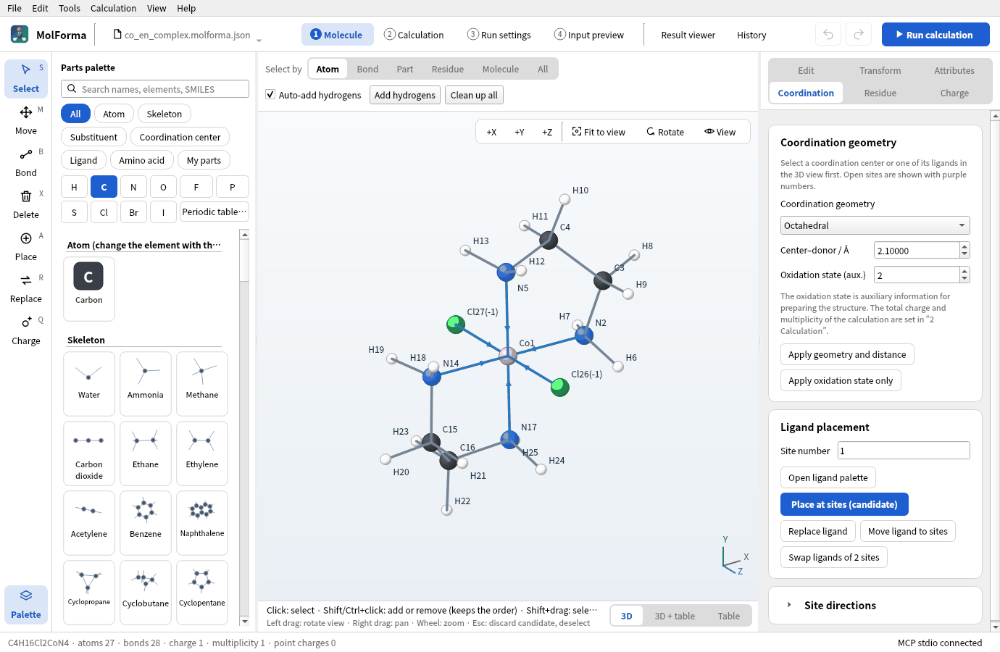
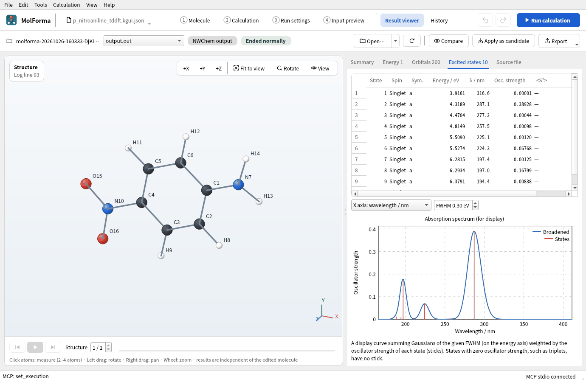

# MolForma

MolForma is a desktop molecular editor, input builder and result viewer for the quantum chemistry program NWChem. Build a molecule by placing parts, choose the calculation, run NWChem and check the optimized structure, vibrations, orbitals and spectra, all in one window. It is written in Qt6 / C++20, and its interface and manual are in English and Japanese.



## What it does

- **Build molecules**: Place atoms, skeletons, substituents, ligands and amino acids with a click, and set bond types, distances, angles and dihedrals by value. It also handles coordination centers and geometries, peptides from a sequence (with terminal caps and side-chain states), recording and inverting stereo (R/S, E/Z), isotopes, external point charges and your own parts (My parts). You can also start from SMILES, structure files (XYZ, MOL, SDF, PDB and others) or NWChem and Gaussian inputs.
- **Clean up with force fields**: Open Babel force fields (MMFF94, UFF) clean up the shape and search conformers. Edits are shown as candidates and confirmed after you check them.
- **Calculation and NWChem input**: Choose HF, DFT, MP2 or CCSD(T), basis sets, charge and multiplicity, optimization, frequencies, transition-state search, IRC, coordinate scans, solvents (COSMO, SMD), relativistic methods, properties, BSSE correction, TDDFT and more, and MolForma writes a checked NWChem input.
- **Run and results**: Run and stop NWChem locally and follow its progress and log. The result viewer shows the optimization, animated vibrations and IR spectra, isosurfaces of molecular orbitals and densities, excited states and absorption spectra, and scan and IRC paths, and brings structures into the next calculation.
- **History**: List saved calculations, compare energies of jobs with the same settings and reuse their molecules and settings.
- **Operated by AI**: A built-in MCP server lets AI clients such as Claude Code edit molecules and run calculations.



## Documentation

| Page | Contents |
| --- | --- |
| [Features and coverage](features.md) | The layout, what each tab (“1 Molecule” to “4 Input preview”, result viewer, history) does, coverage and limitations |
| [Recipes by topic](recipes.md) | Sixteen recipes that build a molecule, calculate it with NWChem and check the results (ethanol, a metal complex, a peptide, BSSE correction, a radical, a transition state and more), with screenshots and practice data |
| [MCP server](mcp.md) | Operation from AI clients (registering in Claude Code and Codex, the tools, safety restrictions) |

The same manual is in the app under “Help → Guide and manual” (F1).

## Getting and building

The source code is in the [GitHub repository](https://github.com/hnakada123/MolForma). Build it with Qt6 (Widgets), Eigen3, Open Babel 3, CMake 3.21 or later and a C++20 compiler. With RDKit C++ and VTK, strict stereo and residue recognition and VTK 3D rendering are enabled too. Calculations need NWChem (and, for MPI builds, the matching MPI launcher). Python is not needed at run time. See the README of the repository for the steps.

```sh
cmake -S . -B build -G Ninja -DCMAKE_BUILD_TYPE=Release
cmake --build build -j 4
./build/molforma
```

## License

MolForma is distributed under GPL-2.0-or-later.
