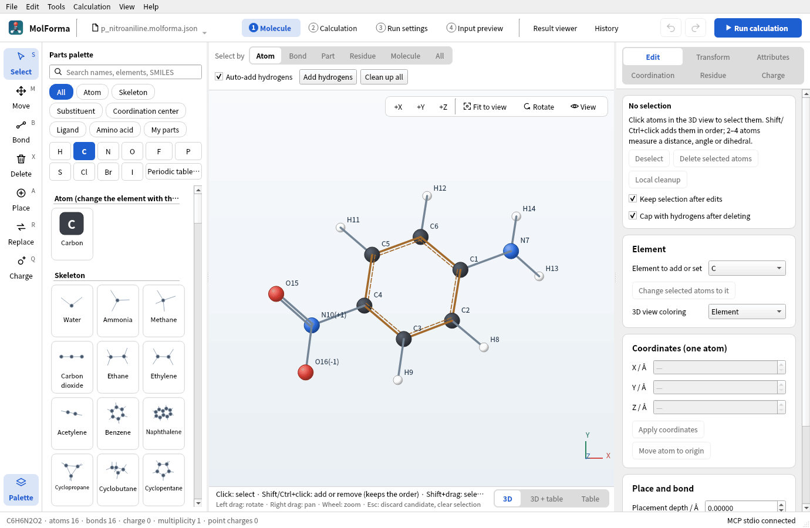
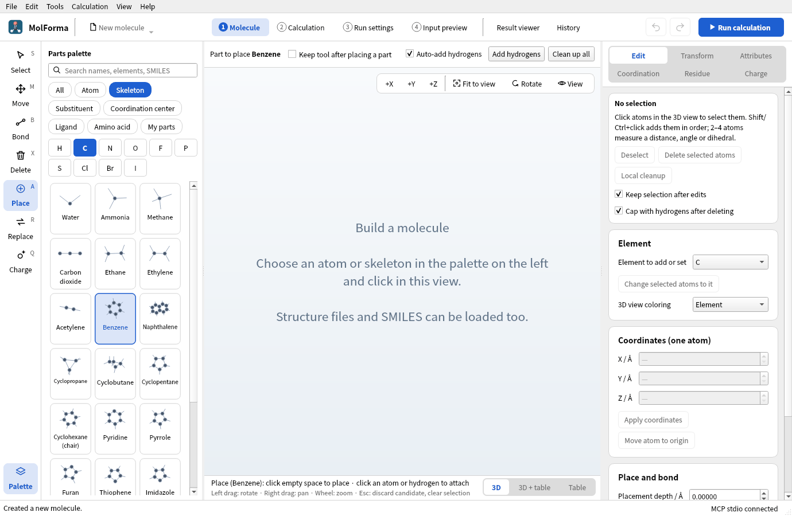
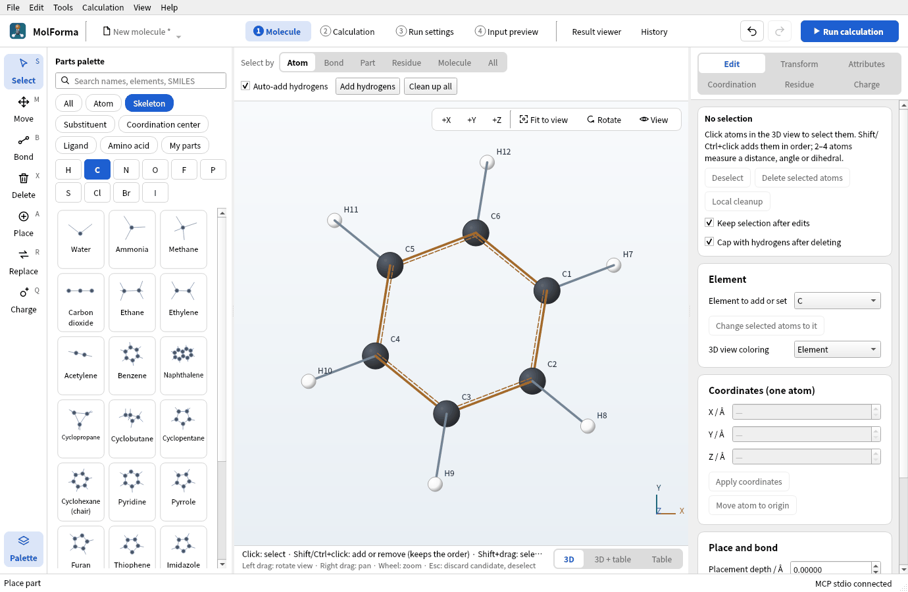
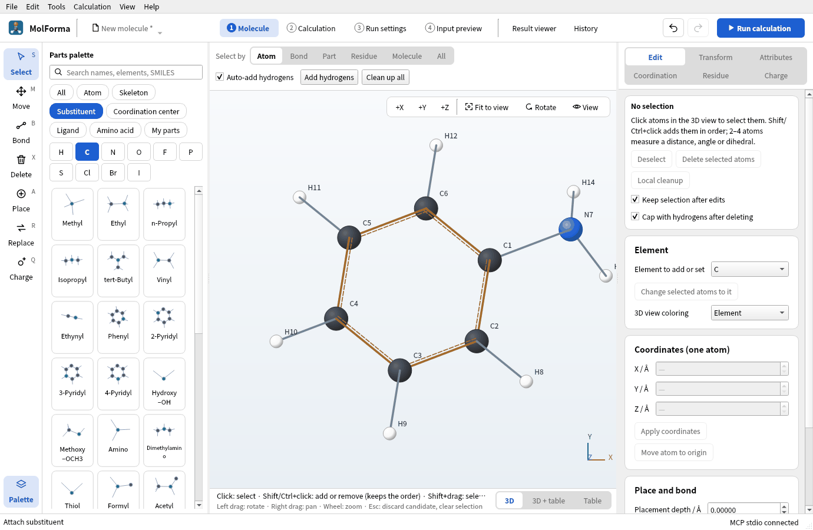
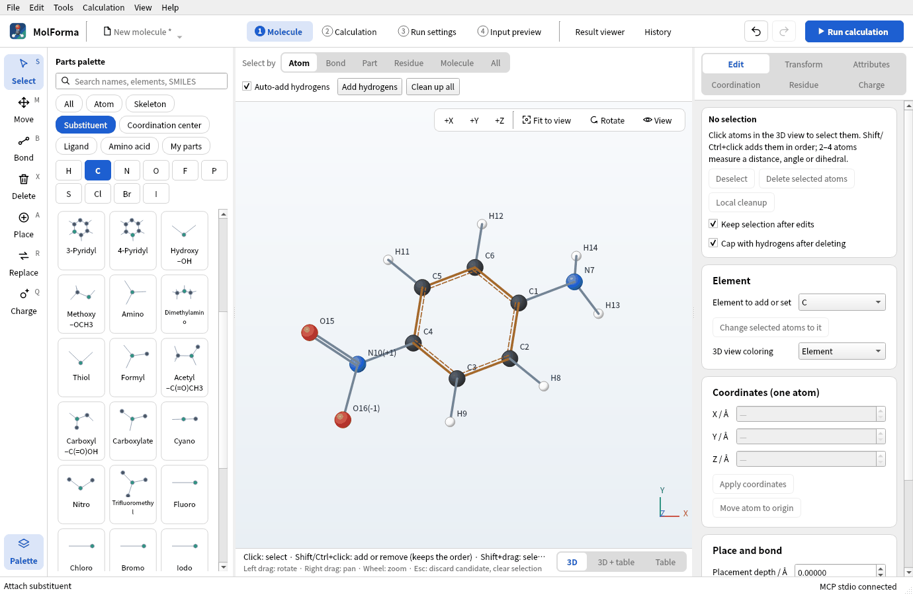
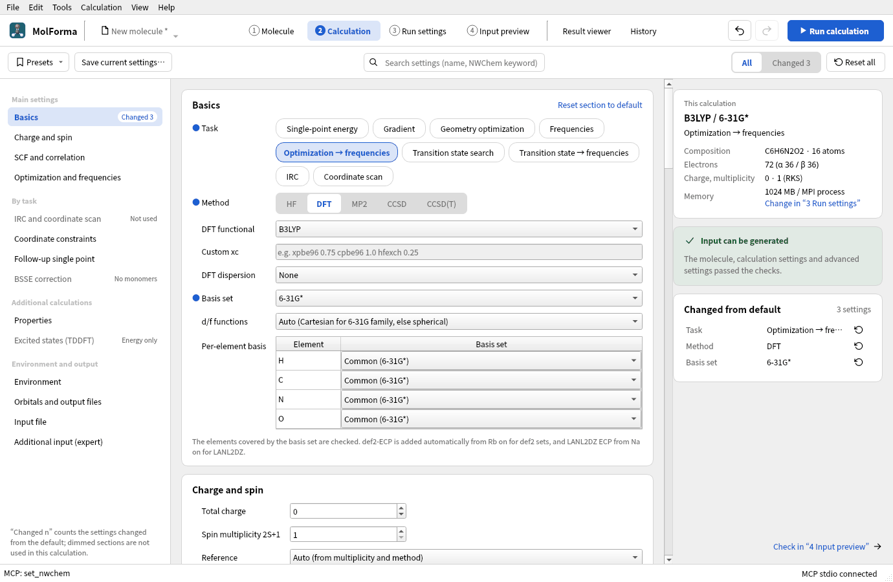
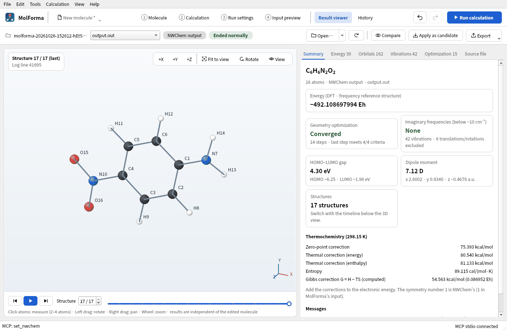
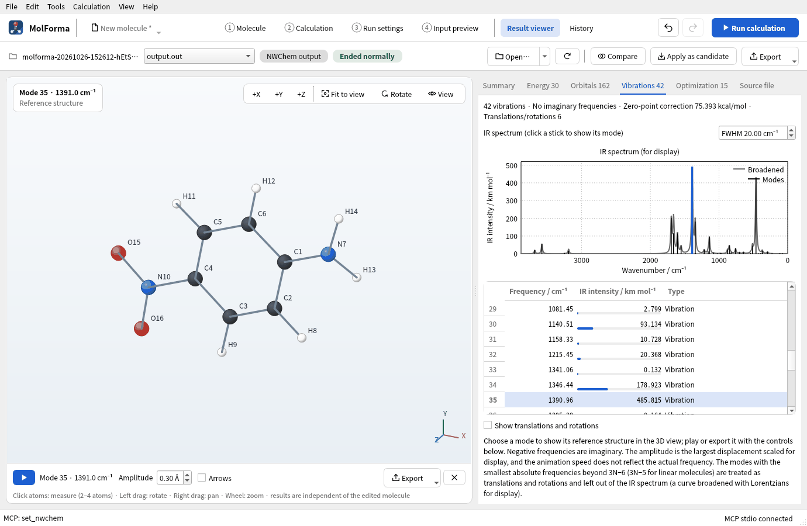

# Recipe 3 Substituted aromatics (p-nitroaniline)

Put substituent templates on the benzene skeleton to make p-nitroaniline. A substituent replaces the hydrogen you click, so the hydrogen you choose decides ortho, meta or para. Optimize and compute frequencies with B3LYP/6-31G*, and compare the energy with the o- and m-isomers built the same way.

| What you build | Details |
| --- | --- |
| Molecule | p-Nitroaniline C₆H₆N₂O₂ (16 atoms, charge 0, singlet); o- and m-isomers for comparison |
| Features | Skeleton and substituent templates, the tool after placing a part, atom numbers, cleanup |
| Calculation | B3LYP/6-31G*, optimization → frequencies (optimization for the o- and m-isomers) |
| Run time | About 35 minutes (6 MPI processes, mostly the analytic Hessian of the frequencies) |
| Practice data | [`p_nitroaniline.kgui.json`](../../recipes/samples/p_nitroaniline.kgui.json), [`o_nitroaniline.kgui.json`](../../recipes/samples/o_nitroaniline.kgui.json), [`m_nitroaniline.kgui.json`](../../recipes/samples/m_nitroaniline.kgui.json) |

## 1. Place benzene

1. Start an empty molecule with “File → New”.
2. Choose the category “Skeleton” at the top of the parts palette and click “Benzene”. The tool becomes “Place”.

   

   **Figure 1** Choosing “Benzene” in “Skeleton” switches to the “Place” tool.

3. Click in empty space in the 3D view. Benzene (C6H6 · 12 atoms) is placed and the tool returns to “Select”. Placing one part (skeleton, substituent, …) returns to selection; to keep placing, turn on “Keep tool after placing a part” above the 3D view.

   

   **Figure 2** The placed benzene: ring carbons C1 to C6, hydrogens H7 to H12. A part just placed is shown selected.

In the labels, the ring carbons are C1–C6 and their hydrogens H7–H12. If no numbers are shown, turn on “View → Show numbers”.

## 2. Add the amino and nitro groups

1. Choose the category “Substituent” and click “Amino”. Under the 3D view: “Place (Amino): click the hydrogen to replace (or drop on it)”.
2. Click hydrogen H7 of benzene. H7 becomes NH2: aniline (C6H7N · 14 atoms). Substituents go on hydrogens only; clicking empty space does not place them.

   

   **Figure 3** Clicking H7 with “Amino” replaces that hydrogen with NH2: aniline.

3. Choose “Nitro” and click H10, the hydrogen of the carbon three steps around the ring from C1 (C4, para). You get C6H6N2O2 · 16 atoms; the labels show the formal charge “(+1)” on N and “(−1)” on one O (one resonance structure of the nitro group). The total charge stays 0.

   

   **Figure 4** p-Nitroaniline (C6H6N2O2 · 16 atoms), with the para hydrogen H10 replaced by “Nitro”.

4. Press “Clean up all”, look at the candidate and press “Confirm changes”.

A hydrogen next to the amino carbon (C2, C6) gives the ortho isomer, two steps away (C3, C5) the meta isomer. Undo a misplaced group with Ctrl+Z. To exchange a placed substituent for another, choose the new substituent in the palette, choose “Replace” (R) in the left column and click the atom where the old substituent is attached (N for the amino group); the exchange is a candidate.

## 3. Set up the calculation

1. In “Basics” of “2 Calculation”, set the task to “Optimization → frequencies”, the method to “DFT” (B3LYP) and the basis set to “6-31G*”.

   

   **Figure 5** “2 Calculation” with the task, method and basis set chosen.

2. Check total charge 0 and multiplicity 1 (→ RKS (closed shell)).

## 4. Run and look at the results

Run with “Run calculation” (F5) in the header. The frequency task (analytic Hessian) takes longer than the optimization; the run panel marks each task as done, running or waiting.

**Figure 6** “Summary” of the “Result viewer” after the run.

**Figure 7** The strongest IR band (NO2 symmetric stretch, 1391 cm⁻¹) chosen in the “Vibrations” tab.

### Results

| Item | Value |
| --- | --- |
| Energy of the calculation | −492.108697994 Eh |
| Optimization | Converged in 14 steps; no imaginary frequencies (42 vibrations) |
| Dipole moment | 7.12 D (large through charge transfer from amino to nitro) |
| Main IR bands | NO₂ symmetric stretch 1391 cm⁻¹ (strongest), NH₂ stretches 3579 and 3682 cm⁻¹ |
| Zero-point correction | 75.39 kcal/mol |

Compared with the o and m isomers optimized under the same conditions (for the p isomer, the energy of the optimization part of optimization → frequencies):

| Isomer | Energy of the calculation | Relative to o | Dipole moment | Optimization |
| --- | --- | --- | --- | --- |
| o-Nitroaniline | −492.109508350 Eh | 0 | 4.74 D | 15 steps |
| p-Nitroaniline | −492.108697994 Eh | +0.51 kcal/mol | 7.12 D | 14 steps |
| m-Nitroaniline | −492.104968503 Eh | +2.85 kcal/mol | 5.65 D | 11 steps |

In the o isomer a hydrogen of the amino group comes within 1.91 Å of an oxygen of the nitro group, an intramolecular hydrogen bond. The p isomer is stabilized by resonance (charge transfer) from the amino to the nitro group, which also gives it the largest dipole moment. The m isomer lacks this resonance and is highest in energy. The optimizations of o and m took about 14 and 8 minutes with 8 processes.

The optimized structure is used for the excited states (TDDFT) of [recipe 14](reuse_result.md).

## Troubleshooting

- **“Click or drop on the hydrogen to replace.”**: The substituent was clicked on empty space or a carbon. Click on the hydrogen to replace.
- **After pressing an element button (C, N, O, …), substituents are gone**: The element buttons switch the palette to “Atom”. Choose the category “Substituent” again.
- **A part is not in the palette**: Text left in the search field above the palette shows only the parts containing it. Clear the search field.
- **The formal charges of the nitro group**: N(+1) and O(−1) write the nitro group as one resonance structure and add up to 0. The calculation uses the total charge of “2 Calculation” (0).

See also: tools and parts palette in “[Features and coverage](../features.md)”, [recipe 14 From a result to the next calculation](reuse_result.md).
