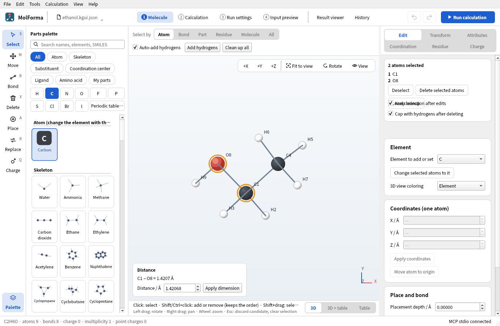

# Recipe 1 Building from atoms and bonds (ethanol)

Build a molecule with the element buttons and the “Place”, “Bond” and “Delete” tools only, without skeleton or substituent templates. One carbon becomes methane; clicking one of its hydrogens with carbon and another with oxygen gives ethanol in three clicks. Then run a B3LYP/6-31G* optimization and frequencies, and, as variations, build acetaldehyde and dimethyl ether.

| What you build | Details |
| --- | --- |
| Molecule | Ethanol C₂H₆O (9 atoms, charge 0, singlet) |
| Features | Placing atoms and replacing hydrogens, auto-added hydrogens, cleanup, measuring distances and angles, deletion, bond types, inserting an atom into a bond |
| Calculation | B3LYP/6-31G*, optimization → frequencies |
| Run time | About 2 minutes (4 MPI processes) |
| Practice data | `docs/recipes/samples/ethanol.kgui.json` (cleaned-up starting structure and settings) |

## 1. Place one carbon

1. Start an empty molecule with “File → New”.
2. Press “C” among the element buttons of the parts palette on the left. The tool in the left column becomes “Place”, and “Part to place Carbon (C)” and “Bond type” appear above the 3D view.
3. Check that “Auto-add hydrogens” above the 3D view is on and “Bond type” is “Single bond”. A double bond left from earlier work would give ethylene in the next step.
4. Click once in empty space in the 3D view. Carbon gets four hydrogens: methane (CH4 · 5 atoms). The first atom goes to the origin wherever you click.

The numbers in the labels (C1, H2, …) are the order of the coordinate lines in “4 Input preview”; they are renumbered from 1 whenever atoms are added or deleted. When you work by number, look at the numbers again after each step.

## 2. Replace hydrogens with carbon and oxygen

What the “Place” tool does depends on where you click:

| Clicked on | Result |
| --- | --- |
| Empty space | A new atom there (a separate, unbonded molecule) |
| A hydrogen | The chosen element replaces it, in the direction of the old bond |
| Another atom | A bond grows from it (replacing one of its hydrogens if it has one) |
| A bond | The atom is inserted between the two atoms (used in the variations) |

1. With “C” still chosen, click one of the hydrogens (H2, for example). You get ethane (C2H6 · 8 atoms); the new carbon gets its hydrogens too.
2. Press “O” and click a hydrogen on the first carbon C1. You get ethanol (C2H6O · 9 atoms), with one hydrogen added to the oxygen.

The status bar at the bottom shows the formula, atom and bond counts, charge and multiplicity (`C2H6O · 9 atoms · 8 bonds · charge 0 · multiplicity 1`). Each click is one “Undo” (Ctrl+Z), so a misplaced atom is undone step by step.

## 3. Clean up and check

Adding hydrogens puts them in free directions only, so the dihedrals (the methyl group, the O–H) are whatever came out.

1. Press “Clean up all” above the 3D view. The force-field result appears as a **candidate** in the amber bar (“Candidate: Clean up structure”).
2. Look at it and press “Confirm changes” (Ctrl+Enter), or “Discard candidate” (Esc).
3. Choose “Select” (S) in the left column, click C1 and then Shift+click O8. The bottom left of the 3D view shows “Distance C1 – O8 = 1.4207 Å”. Three atoms in turn give the angle (at the second atom), four give the dihedral.

Entering a value and pressing “Apply dimension” moves the side of the atom chosen last so that the distance, angle or dihedral takes that value ([recipe 5](butane_conformers.md)).

## 4. Set up the calculation

1. Open “2 Calculation” in the header.
2. In “Basics”, set the task to “Optimization → frequencies” and the method to “DFT”. Keep the default DFT functional “B3LYP” and set the basis set to “6-31G*”.
3. In “Charge and spin”, check total charge 0 and spin multiplicity 1. “→ RKS (closed shell)” appears under the reference.
4. Check that the check card on the right says “Input can be generated”.

## 5. Run and look at the results

1. In “4 Input preview”, check that `geometry` has 9 atoms and the input ends with the two lines `task dft optimize` and `task dft frequencies`.
2. Before the first run, check the NWChem executable, the MPI process count and the job folder in “3 Run settings” (“Ready to run”).
3. Press “Run calculation” (F5) in the header. The run panel (“Run status and log”) opens on the right with the optimization steps and their convergence tests (Gmax, Grms, …), then the frequency task.
4. When it ends, the result is loaded into the “Result viewer” and the status bar says “Calculation finished:” followed by the convergence, the energy (E = −155.033797408 Eh) and the number of imaginary frequencies (0).
5. In the “Summary” of the “Result viewer”, check the optimization (converged, steps), imaginary frequencies, HOMO–LUMO gap, dipole moment and thermochemistry. The “Vibrations” tab has the IR spectrum and the mode table; choose a row and press play under the 3D view to animate it.

### Results

| Item | Value |
| --- | --- |
| Energy of the calculation | −155.033797408 Eh (reference structure of the frequencies) |
| Optimization | Converged in 8 steps |
| Imaginary frequencies | None (21 vibrations; 6 translations and rotations excluded) |
| Bond lengths | C–O 1.425 Å, C–C 1.520 Å, O–H 0.969 Å |
| O–H stretch | 3751 cm⁻¹ (unscaled) |
| Dipole moment | 1.56 D |
| HOMO–LUMO gap | 9.20 eV |
| Zero-point / Gibbs correction (298.15 K) | 50.37 / 34.45 kcal/mol |

Ethanol has conformers with the OH turned differently (anti and gauche). Changing the H–O–C–C dihedral and optimizing again from another start is a good exercise.

## Variations: deletion, bond types and insertion

### Acetaldehyde (delete two hydrogens, make a double bond)

1. From ethanol of step 2 (before cleanup is fine), choose “Delete” (X) in the left column and click the O–H hydrogen. Deletion is a candidate; press “Confirm changes”. Deleting only a hydrogen adds no capping hydrogen, even with “Cap with hydrogens after deleting” on.
2. Delete one hydrogen of C1 the same way and confirm. You get C2H4O · 7 atoms.
3. Choose the “Bond” (B) tool, set “Bond type” above the 3D view to “Double bond”, and click C1 and then O. The atoms are already bonded, so only the bond order changes (with the focus in the 3D view, choosing the two atoms and pressing “2” does the same).
4. Changing the order does not change the bond length; tidy it with “Clean up all”.

### Dimethyl ether (insert an atom into a bond)

1. Build ethane (C2H6) with “File → New” and the first half of steps 1 and 2. Set “Bond type” back to “Single bond”.
2. Press “O” and click on the C–C bond line. Oxygen goes between the two carbons: C2H6O · 9 atoms.
3. The inserted atom goes where covalent radii and a tetrahedral angle put it (C–O 1.42 Å, C–O–C 109.5°), and the smaller fragment moves outward. “Clean up all” brings C–O–C to about 111.5°. In a ring bond, nothing else moves and the atom sits off the bond line; widen the ring with “Clean up all”.

## Troubleshooting

- **No hydrogens are added**: “Auto-add hydrogens” above the 3D view is off. Choose atoms (or nothing, for all) and press “Add hydrogens” to fill in missing hydrogens.
- **A new atom appeared instead of replacing a hydrogen**: Clicking just beside a hydrogen hits empty space and places a separate molecule. Undo with Ctrl+Z and click on the hydrogen.
- **You get ethylene or acetylene**: “Bond type” is still double or triple; placed atoms are bonded with it too.
- **The “4 Input preview” tab name is red**: The input cannot be generated; the tooltip or the checks of “2 Calculation” give the reason. Right after deleting a hydrogen the electron count is odd and does not match multiplicity 1.
- **Cleanup says no force-field parameters are available**: Bond orders or formal charges are chemically odd. Check valences with “Tools → Check structure…”.

See also: tools, palette, selection, deletion and candidates in “[Features and coverage](../features.md)”, [recipe 5 Chains and conformers](butane_conformers.md), [recipe 15 Isotopes](isotopes.md).
