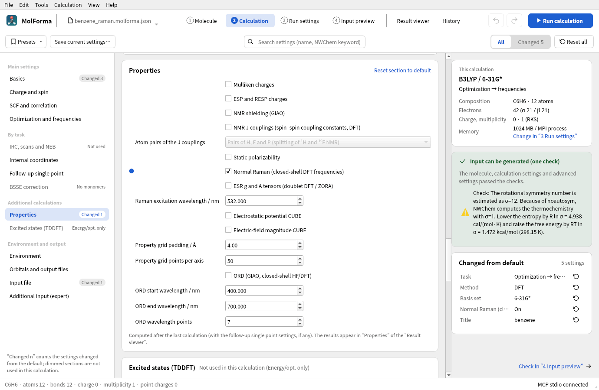
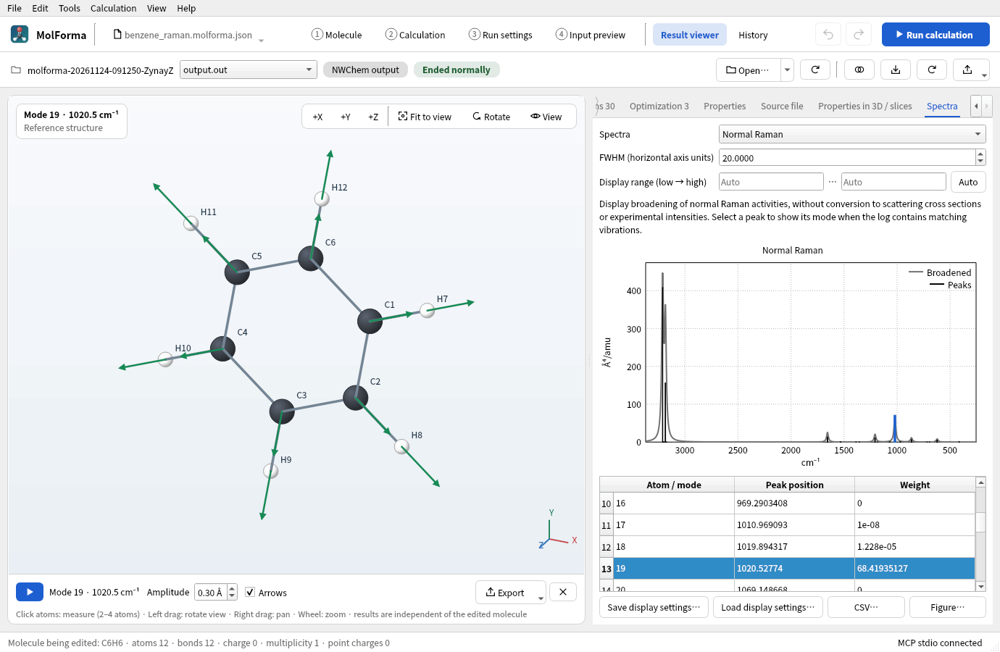
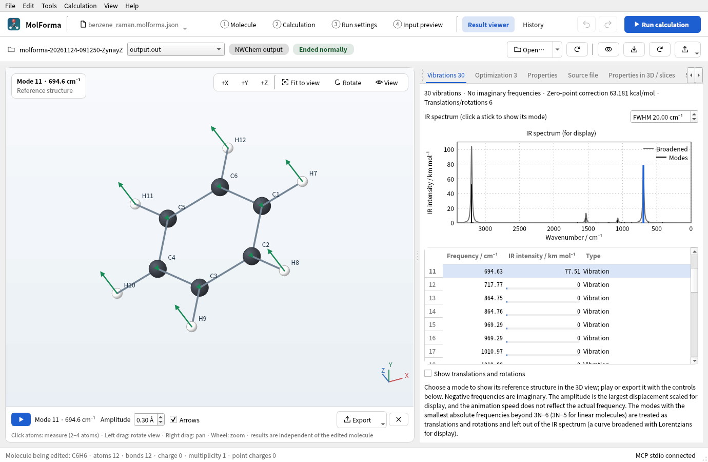

# Recipe 18 Calculating normal Raman and comparing with experiment (benzene)

Calculate the normal Raman spectrum of benzene at B3LYP/6-31G* and put it next to the IR spectrum of the same calculation to see the “rule of mutual exclusion”: in a molecule with a center of symmetry, no vibration appears in both Raman and IR. Compare with published experimental frequencies, and consider what a scale factor can and cannot fix, and how the calculated “Raman activity” differs from the measured “intensity”.

| What you build | Details |
| --- | --- |
| Molecule | Benzene C₆H₆ (12 atoms, charge 0, singlet) |
| Features | Skeleton template, normal Raman (excitation wavelength), the result viewer's “Spectra” (Raman activities) and “Vibrations” (IR intensities), showing a mode from a peak |
| Calculation | Gas phase, B3LYP/6-31G*, optimization → frequencies → normal Raman (excitation wavelength 532 nm) |
| Run time | About 60 minutes (8 MPI processes: optimization about 20 seconds, frequencies about 3 minutes, Raman about 57 minutes) |
| Computer | AMD Ryzen 7 2700X (8 cores, 16 threads), 32 GB of memory, NWChem 7.3.1 on Linux; run on 2026-11-24 through MolForma MCP |
| Practice data | [`benzene_raman.molforma.json`](../../recipes/samples/benzene_raman.molforma.json) (benzene placed from the part, with the calculation settings) |

The practice file holds the structure and the calculation settings only, without results or run settings. To run the calculation yourself, check NWChem, MPI and the job folder in “3 Run settings”.

## 1. Place benzene

1. Start an empty molecule with “File → New”.
2. In the part palette, choose the category “Skeleton”, click “Benzene”, then click an empty spot of the 3D view. Benzene, C6H6 · 12 atoms, is placed (as in figures 1 and 2 of [recipe 3](aromatic_substitution.md)).

The benzene as placed is a flat regular hexagon. The calculation starts with an optimization, so neither “Clean up all” nor adjusting bond lengths is needed.

## 2. Choose the calculation settings

1. In “Basics” of “2 Calculation”, set the task to “Optimization → frequencies”, the method to “DFT” (B3LYP) and the basis set to “6-31G*”. Check total charge 0 and multiplicity 1 (→ RKS (closed shell)).
2. Under “Properties”, turn on “Normal Raman (closed-shell DFT frequencies)”. Keep “Raman excitation wavelength / nm” at the default 532 nm (a green laser).

   

   **Figure 1** Calculation settings with normal Raman turned on under “Properties”.

3. In “4 Input preview”, check that `task dft optimize` and `task dft frequencies` are followed by `response 1 0.0856…` in a `property` block (the photon energy of 532 nm in Eh), `normal` in a `raman` block, and `task dft raman`.

Normal Raman works with closed-shell DFT and the task “Frequencies” or “Optimization → frequencies”. It cannot be combined with HF or MP2, open shells, follow-up single points, TDDFT or BSSE ([Calculation settings](../features/calculation.md)). The excitation wavelength is that of the light whose polarizability is calculated. Benzene absorbs in the ultraviolet, far from 532 nm, so it can be treated as normal (non-resonant) Raman. Resonance Raman is not calculated.

## 3. Run and show the Raman spectrum

1. Run with “Run calculation” (F5). After the optimization and frequencies, NWChem's Raman step computes the Hessian again, then calculates the polarizability at two structures displaced along each vibration in opposite directions and takes the Raman activity from their difference. This step takes most of the time.
2. When the run has finished, open the job with “View results” of the run panel (or “Open in result viewer” in “History”) and choose the “Spectra” tab on the right. For a log with Raman activities the kind is “Normal Raman” and the FWHM is 20 cm⁻¹. The horizontal axis is the wavenumber (cm⁻¹, larger to the left), the vertical axis the Raman activity (Å⁴/amu).
3. In the peak table, select the row with “Peak position” 1020.5 cm⁻¹ and “Weight” about 68 (“Atom / mode” 19). Its vibration appears in the 3D view. The row just above it, 1019.9 cm⁻¹ with a weight of almost 0, is another vibration, which appears in neither Raman nor IR. Turn on “Arrows” below the 3D view and play it with “Play selected mode”: all the carbons and hydrogens move out from the center and back together, the breathing of the ring.

**Figure 2** Normal Raman of benzene (B3LYP/6-31G*, FWHM 20 cm⁻¹) with the ring breathing selected.

“Atom / mode” in the peak table is the number of the mode in the “Vibrations” tab, and “Weight” is the Raman activity. A doubly degenerate vibration takes two rows at the same position, and the curve adds both. Activities are not converted to experimental intensities, and no depolarization ratios are calculated ([Result viewer](../features/results.md#nmr-normal-raman-and-solution-esr-spectra)). “CSV…” below the peak table writes the peaks and the curve, “Figure…” the chart.

### Results

| Item | Value |
| --- | --- |
| Energy of the calculation | −232.248651049 Eh |
| Geometry optimization | Converged (3 points in the “Optimization” tab) |
| Bond lengths | C–C 1.397 Å, C–H 1.087 Å |
| Imaginary frequencies | None (all 30 vibrations other than translations and rotations are positive; the lowest is 415.1 cm⁻¹) |
| Frequencies | 20 distinct values (10 of them doubly degenerate) |
| Vibrations with Raman activity | 7 distinct (12 vibrations) |
| Run time | Optimization 20 s, frequencies 161 s, Raman 3438 s (8 MPI processes) |

## 4. Compare with IR (mutual exclusion)

1. Open the “Vibrations” tab on the right. The IR spectrum has only four bands.
2. Select the strongest mode, at 694.6 cm⁻¹, in the table and play it: the six hydrogens move perpendicular to the ring, all in the same direction, an out-of-plane C–H bend.

**Figure 3** The “Vibrations” tab of the same job. Only four distinct vibrations have IR intensity.

Put the values of the two tabs side by side by frequency, and no vibration has both Raman activity and IR intensity. The “Weight” of a vibration that does not appear in Raman is 0 or numerical noise below 10⁻⁴.

| Appears in | Calculated frequencies / cm⁻¹ (degenerate vibrations ×2) |
| --- | --- |
| Raman only (7) | 621.9 ×2, 864.8 ×2, 1020.5, 1207.9 ×2, 1656.0 ×2, 3184.1 ×2, 3210.5 |
| IR only (4) | 694.6, 1069.2 ×2, 1531.4 ×2, 3199.8 ×2 |
| Neither (9) | 415.1 ×2, 717.8, 969.3 ×2, 1011.0, 1019.9, 1185.7, 1356.6, 1387.2, 3174.4 |

Benzene (D6h) has a center of symmetry. Vibrations symmetric with respect to it (labels with g) change the polarizability and can be Raman active; antisymmetric ones (u) change the dipole moment and can be IR active. So no vibration appears in both spectra (mutual exclusion). Some vibrations appear in neither. In a molecule without a center of symmetry, such as the ethanol of [recipe 1](atoms_and_bonds.md), the same vibrations appear in both IR and Raman.

MolForma's table of vibrations gives no symmetry labels. The labels in the next section are matched to the literature assignments by the order of the frequencies, degeneracy and activity.

## 5. Compare with experiment

The experimental values are Shimanouchi's fundamentals of benzene (Shimanouchi, 1972) as compiled in the NIST Chemistry WebBook: Raman of the liquid and IR of the gas. Calculated harmonic frequencies tend to be higher than experimental fundamentals, so the tables also give the values multiplied by **0.960** (±0.022), CCCBDB's scale factor for B3LYP/6-31G*.

| Symmetry | Type of vibration | Calculated / cm⁻¹ | ×0.960 / cm⁻¹ | Experiment (liquid Raman) / cm⁻¹ | ×0.960 − experiment | Raman activity / Å⁴ amu⁻¹ | Experimental strength, polarization |
| --- | --- | ---: | ---: | ---: | ---: | ---: | --- |
| a1g | C–H stretch | 3210.5 | 3082.1 | 3061.9 | +20.2 | 407.7 | VS, p |
| a1g | Ring stretch (breathing) | 1020.5 | 979.7 | 991.6 | −11.9 | 68.4 | VS, p |
| e1g | C–H bend | 864.8 | 830.2 | 848.9 | −18.7 | 5.5 ×2 | M, dp |
| e2g | C–H stretch | 3184.1 | 3056.7 | 3046.8 | +9.9 | 155.7 ×2 | S, dp |
| e2g | Ring stretch | 1656.0 | 1589.8 | 1596 (1606.4, 1584.6) | −6.2 | 12.7 ×2 | S, dp |
| e2g | C–H bend | 1207.9 | 1159.5 | 1178.0 | −18.5 | 10.3 ×2 | S, dp |
| e2g | Ring deformation | 621.9 | 597.0 | 605.6 | −8.6 | 4.1 ×2 | S, dp |

| Symmetry | Type of vibration | Calculated / cm⁻¹ | ×0.960 / cm⁻¹ | Experiment (gas IR) / cm⁻¹ | ×0.960 − experiment | IR intensity / km mol⁻¹ |
| --- | --- | ---: | ---: | ---: | ---: | ---: |
| a2u | Out-of-plane C–H bend | 694.6 | 666.8 | 673 | −6.2 | 77.5 |
| e1u | C–H bend | 1069.2 | 1026.4 | 1038 | −11.6 | 3.3 ×2 |
| e1u | Ring stretch and deformation | 1531.4 | 1470.2 | 1486 | −15.8 | 6.5 ×2 |
| e1u | C–H stretch | 3199.8 | 3071.8 | 3063 | +8.8 | 51.9 ×2 |

Strength and polarization of the Raman bands use the symbols of the experimental table: VS very strong, S strong, M medium, p polarized, dp depolarized. The e2g band at 1596 cm⁻¹ is observed as two bands, at 1606.4 and 1584.6 cm⁻¹. The e1u C–H stretch (3063 cm⁻¹) also splits in two in the IR of the liquid.

## 6. Assess where the calculation is useful

First check these questions yourself from the figures and tables.

1. For the seven Raman bands, find the mean absolute error before and after applying the scale factor. Which kinds of vibration does one factor not fix?
2. Experiment shows two bands, at 1606 and 1585 cm⁻¹, where the calculation has one. What is missing from a harmonic calculation?
3. The largest calculated Raman activity is that of the C–H stretch at 3210.5 cm⁻¹ (a1g, 407.7 Å⁴/amu). In experiment, the ring breathing at 992 cm⁻¹ is listed as “very strong” together with 3062 cm⁻¹. Where does the difference between activity and intensity come from?
4. Which symmetry do the experimentally polarized (p) bands have? What would the calculation need to predict that?

### An example interpretation

- **It is well suited to assignment.** The split into seven Raman bands, four IR bands and nine vibrations in neither, and which of them are degenerate, all agree with the experimental assignment. The scaled frequencies of the seven Raman bands differ from experiment by −18.7 to +20.2 cm⁻¹. The mean absolute error drops from 62.4 cm⁻¹ before scaling to 13.4 cm⁻¹ after it.
- **One scale factor has limits.** After scaling, the C–H stretches are still above experiment, and the other vibrations (992, 849 and 1178 cm⁻¹ among them) below it. Anharmonicity differs between kinds of vibration, so one factor cannot fix all of them. CCCBDB's ±0.022 amounts to about ±70 cm⁻¹ near 3000 cm⁻¹.
- **Fermi resonance is not reproduced.** The e2g fundamental at 1596 cm⁻¹ lies close to the combination of the ring breathing and the 606 cm⁻¹ vibration (992 + 606 = 1598 cm⁻¹); the two mix and split into two bands. A harmonic calculation gives one band per fundamental and shows no such splitting.
- **Polarization follows symmetry.** In experiment the two totally symmetric (a1g) bands are polarized (p) and the other Raman bands depolarized (dp). A depolarization ratio comes from the ratio of the isotropic and anisotropic parts of the polarizability derivative tensor, but NWChem's normal Raman output and MolForma deal with the activity only.

**Activity is not intensity.** NWChem's Raman activity is a property of the molecule, from the derivatives of the polarizability. A measured intensity also carries the fourth power of the wavenumber of the scattered light and a factor that grows as the vibrational frequency falls. With the widely used conversion I ∝ (ν₀ − νᵢ)⁴ Sᵢ / [νᵢ (1 − exp(−hcνᵢ/kT))] (ν₀ the wavenumber of the exciting light, νᵢ the scaled frequency, Sᵢ the activity; Polavarapu, 1990), at 532 nm and 298 K:

| Symmetry | Type of vibration | ×0.960 / cm⁻¹ | Activity (relative) | Converted intensity (relative) | Experimental strength |
| --- | --- | ---: | ---: | ---: | --- |
| a1g | C–H stretch | 3082 | 100 | 100 | VS |
| e2g | C–H stretch | 3057 | 76 | 77 | S |
| e2g | Ring stretch | 1590 | 6 | 17 | S (split in two) |
| e2g | C–H bend | 1160 | 5 | 21 | S |
| a1g | Ring stretch (breathing) | 980 | 17 | 88 | VS |
| e1g | C–H bend | 830 | 3 | 18 | M |
| e2g | Ring deformation | 597 | 2 | 20 | S |

Relative values take the largest as 100; a degenerate vibration counts both of its modes.

The conversion makes the low-frequency bands relatively stronger. The ring breathing (980 cm⁻¹) has 17% of the largest activity but 88% of the largest converted intensity, in line with its “very strong” band next to the C–H stretch in experiment. The ring deformation at 606 cm⁻¹ (S in experiment) goes from 2% to 20% as well. The experimental “VS” and “S”, however, describe peak heights, which also depend on the width of the bands, interactions between molecules in the liquid and the response of the instrument.

What this calculation offers is which vibrations appear in which spectrum, and a link from the observed bands to the shapes of the vibrations. It is a harmonic calculation of one molecule in the gas phase, so shifts in the liquid, Fermi resonance and the shapes and widths of bands need separate consideration.

As further exercises, compare how the activities change with a basis set that has diffuse functions, such as 6-31+G*, or see how mutual exclusion breaks down when a substituted benzene ([recipe 3](aromatic_substitution.md)) has lower symmetry. These are not calculations run for this page.

## Troubleshooting

- **Turning on “Normal Raman” gives an error in the checks:** check that the task is “Frequencies” or “Optimization → frequencies”, the method DFT and the multiplicity 1 (closed shell). It cannot be turned on together with a follow-up single point, TDDFT, BSSE or ghost centers.
- **There is no “Spectra” tab:** a run stopped before the end of the Raman step leaves no table of Raman activities in the log, and only the “Vibrations” tab appears. The `.normal` file NWChem writes also shows the activities, but it holds no structure or displacements, so its modes cannot be played.
- **The peaks are needle-thin or run together:** “FWHM (horizontal axis units)” is in cm⁻¹. Change it from the default 20 cm⁻¹ to make the chart readable. The width is for display and does not change the activities.
- **The peak table has many rows:** a doubly degenerate vibration takes two rows. Rows with activities near zero are vibrations that do not appear in Raman.
- **Imaginary frequencies or split degeneracies:** the structure may have finished its optimization off the plane. Start from the benzene of the part and check that the optimization converged.
- **The run takes long:** the Raman step calculates the polarizability twice per vibration (3N − 6 of them; 60 times for benzene). For molecules with many atoms, check the steps with a small molecule first, and check the number of MPI processes.
- **Your numbers differ from the tables:** check the form of the basis functions (6-31G* uses Cartesian 6d by default), the DFT grid, SCF convergence and the excitation wavelength. Activities depend on the basis set more than the frequencies do.

Sources: Shimanouchi, T., Tables of Molecular Vibrational Frequencies Consolidated Volume I, National Bureau of Standards, 1972 ([vibrations of benzene in the NIST Chemistry WebBook](https://webbook.nist.gov/cgi/cbook.cgi?ID=C71432&Mask=800), accessed 2026-11-24). Scale factor: [NIST CCCBDB](https://cccbdb.nist.gov/vibscale2x.asp?method=8&basis=1) (B3LYP/6-31G*, 0.960 ± 0.022, accessed 2026-11-24). From activities to intensities: P. L. Polavarapu, J. Phys. Chem. 94, 8106 (1990), [doi:10.1021/j100384a024](https://doi.org/10.1021/j100384a024). See [NWChem Raman](https://nwchemgit.github.io/Properties.html#raman) for the calculation method.

Related: [All recipes](../recipes.md), [Recipe 3 Substituted aromatics](aromatic_substitution.md), [Recipe 11 Main-group molecules](main_group.md) (degenerate vibrations), [Recipe 17 Calculating NMR and comparing with experiment](ethanol_nmr.md), [Calculation settings](../features/calculation.md), [Result viewer](../features/results.md).
