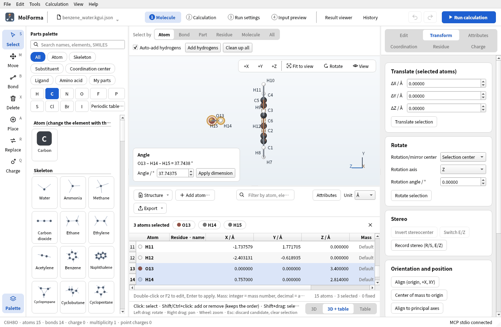

# Recipe 9 Complexes of molecules and BSSE (benzene–water)

Align benzene with the origin and the XY plane, put the oxygen of a water molecule 3.40 Å straight above the ring center, and point both hydrogens toward the ring. The two molecules are not bonded, so MolForma can treat each as a monomer. Compute the interaction with MP2/6-31G*, correcting the basis set superposition error (BSSE) with the counterpoise method.

| What you build | Details |
| --- | --- |
| Molecule | Benzene–water dimer C₆H₈O (15 atoms, charge 0, singlet) |
| Features | A second molecule in empty space, selecting by molecule, Align to principal axes, editing cells of the coordinate table (3D + table), distances between molecules with dimensions, BSSE correction (counterpoise) |
| Calculation | MP2/6-31G*, single-point energy, BSSE correction |
| Run time | About 20 seconds (6 MPI processes) |
| Practice data | `docs/recipes/samples/benzene_water.kgui.json` |

## 1. Align benzene with the origin and the XY plane

1. Start with “File → New” and place “Benzene” from the category “Skeleton” in empty space.
2. Set “Select by” above the 3D view to “Molecule” and click an atom of benzene. The whole molecule (12 atoms) is selected.
3. Press “Align to principal axes” under “Orientation and position” on the “Transform” page on the right. The center of mass goes to the origin, the ring into the XY plane and its normal along Z (the carbons' Z in the coordinate table becomes 0.000000).

## 2. Place the water and set its position

1. Clear the selection (Esc), and click “Water” of the category “Skeleton” into empty space away from benzene. It is a second, unbonded molecule (C6H8O · 15 atoms · 14 bonds).
2. Choose “3D + table” at the right end of the strip under the 3D view to show the coordinate table. The water atoms are O13, H14 and H15.
3. Double-click the X, Y and Z cells of the table, enter the values and press Enter:

   | Atom | X | Y | Z |
   | --- | --- | --- | --- |
   | O13 | 0 | 0 | 3.40 |
   | H14 | 0.757 | 0 | 2.814 |
   | H15 | −0.757 | 0 | 2.814 |

   The oxygen sits 3.40 Å straight above the ring center and both hydrogens point to the ring (smaller Z). Each cell edit is one “Undo”.
4. Look from the side with “+X” to check that the water is right above the ring.

Instead of entering coordinates, you can choose two unbonded atoms (a benzene carbon and the water oxygen, for example) and set their distance with “Apply dimension”; between separate molecules, the whole molecule of the atom chosen last moves. “View → Show hydrogen bonds” draws dashed lines for X–H···Y (X, Y = N, O, F) that meet the criteria.

## 3. Set up the BSSE correction

1. In “Basics” of “2 Calculation”, set the task to “Single-point energy”, the method to “MP2” and the basis set to “6-31G*”.
2. In “BSSE correction” in the list on the left, turn on “Counterpoise correction per monomer (BSSE)”. It shows “2 monomers: C6H6, H2O (charges from the formal charges of the atoms)”.
3. In “4 Input preview”, check the `bsse` block with `mon m1 1 2 … 12` (benzene) and `mon m2 13 14 15` (water), and the lines such as `bqC library C "6-31g*"` added to `basis` to compute each partner as ghosts.

The BSSE correction takes the bonded molecules as monomers. All monomers must be closed shell, and the total charge must equal the sum of formal charges. It cannot be combined with solvents, TDDFT, properties, the follow-up single point, CUBE/MOLDEN output or external point charges. With the task “Geometry optimization”, it optimizes with BSSE-corrected gradients.

## 4. Run and look at the results

Run with “Run calculation” (F5). NWChem computes the dimer, then each monomer in its own basis and in the dimer basis (with the partner as ghosts). The “Energy” card in the “Summary” of the “Result viewer” shows the corrected value, and the “Properties” tab shows the BSSE correction and the interaction energy against the sum of the monomers in their own bases (corrected and uncorrected).

### Results

| Calculation | MP2 energy |
| --- | --- |
| Dimer | −307.692764769 Eh |
| Benzene (own basis / dimer basis) | −231.487186463 / −231.488803294 Eh |
| Water (own basis / dimer basis) | −76.199007153 / −76.200399241 Eh |
| BSSE correction | 0.003008919 Eh (1.888 kcal/mol) |
| Corrected energy | −307.689755851 Eh |

| Interaction energy | kcal/mol |
| --- | --- |
| Uncorrected (dimer − sum of monomers) | −4.12 |
| Corrected (counterpoise) | −2.24 |

The uncorrected value overestimates the binding by what each monomer gains from borrowing its partner's basis functions (the BSSE). 6-31G* is a small basis without diffuse functions, so the corrected binding is weaker than accurate literature values (about −3.3 kcal/mol).

The “BSSE error” (0.001616831 Eh) and “Corrected energy” NWChem 7.3.1 prints include the correction of only the first monomer (benzene). When reading the result, MolForma recomputes the correction from the monomer energies, warns “The BSSE error NWChem printed, 0.001616831 Eh, sums only some of the monomers; …” and shows the correct values.

## Troubleshooting

- **The section says “No monomers”**: There is only one molecule. Place the water again in empty space (clicking a hydrogen bonds it to that atom).
- **“Monomer charges for the BSSE correction come from the formal charges of the atoms.”**: Make the total charge the sum of formal charges (“Use formal charges as total” on the “Charge” page).
- **Table cells cannot be edited**: Not while a candidate is shown. Confirm or discard it first.

See also: the coordinate table and properties, BSSE and follow-up single point in “[Features and coverage](../features.md)”, [recipe 12 Solvated clusters and point charges](hydrated_sodium.md).
