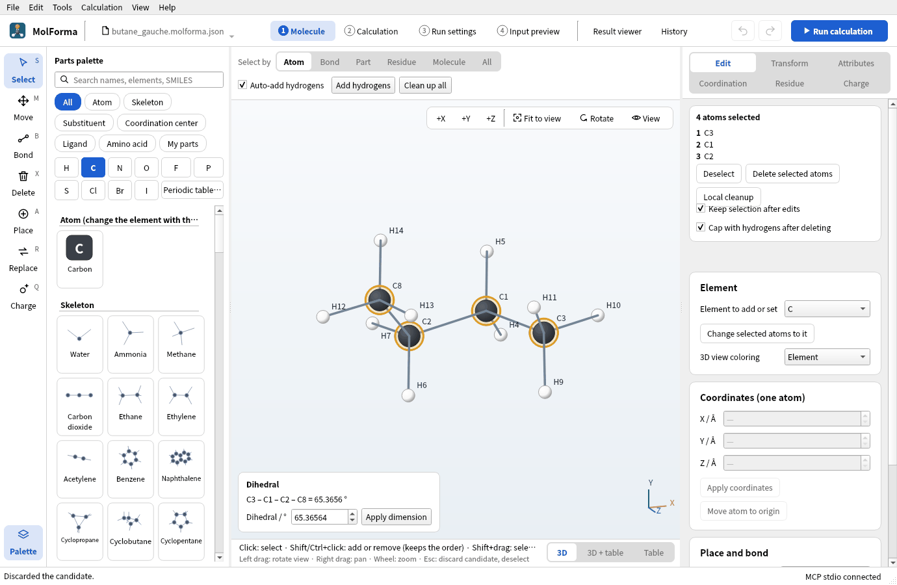
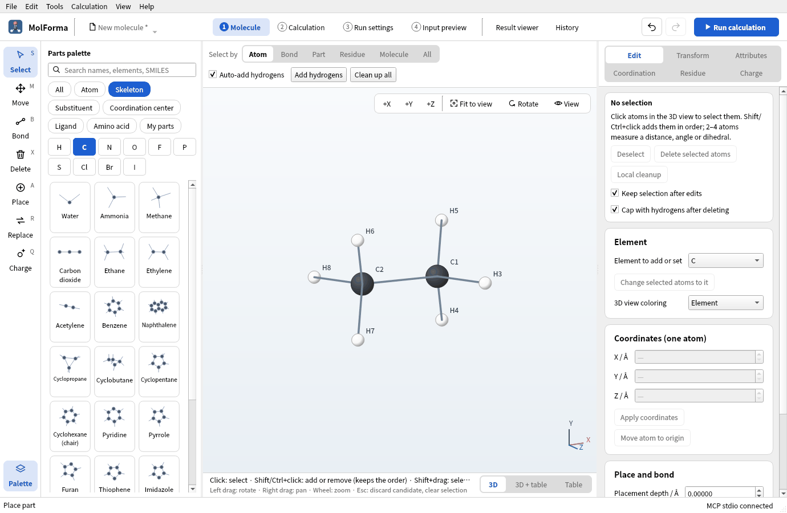
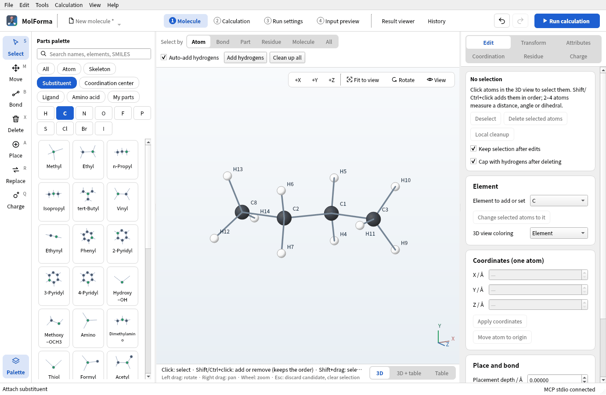
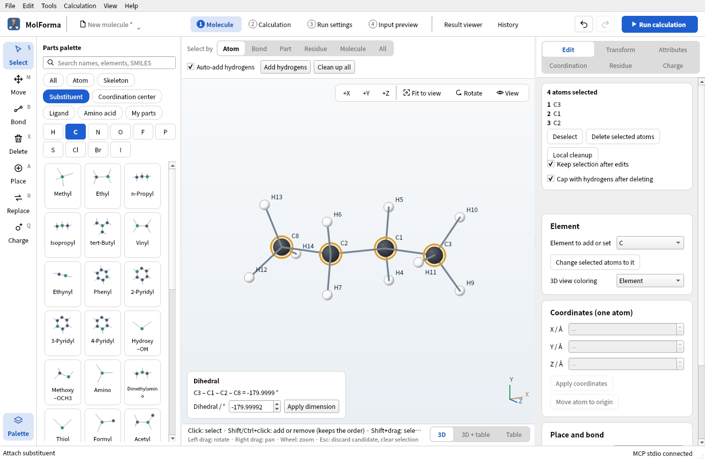
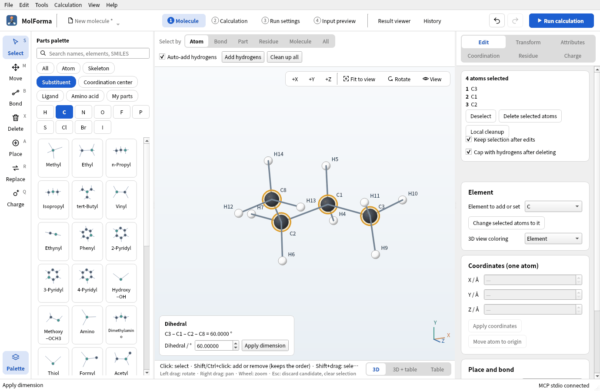
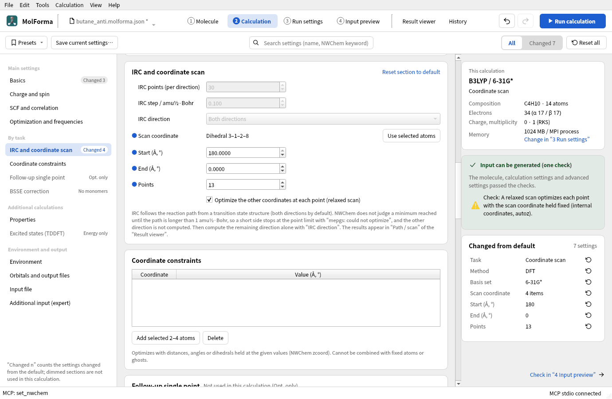
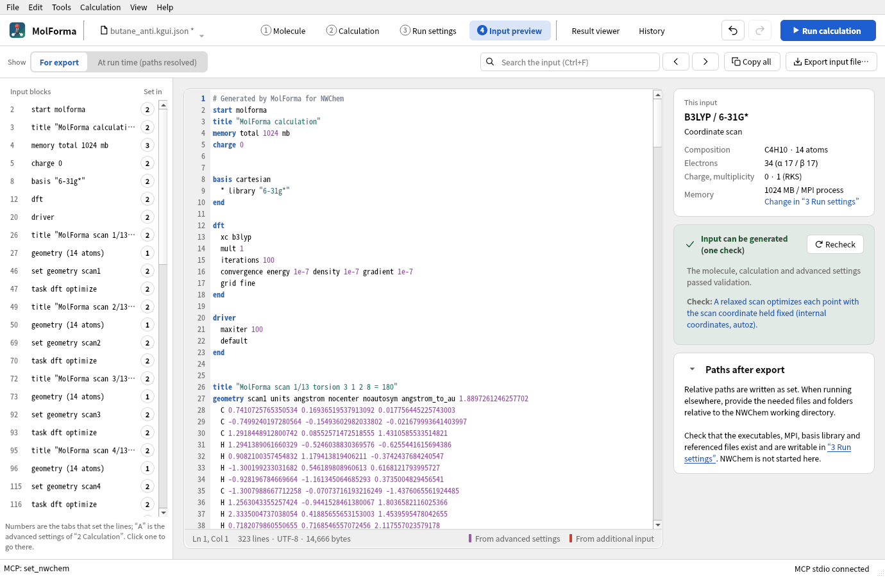
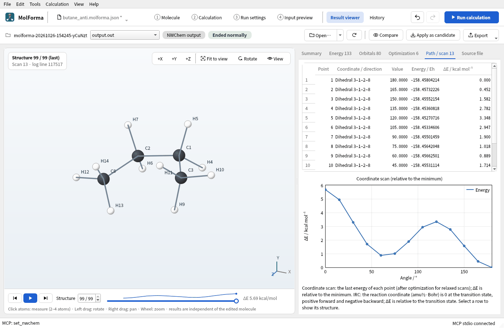

# Recipe 5 Chains and conformers (anti and gauche n-butane)

Put two methyl groups on ethane to make n-butane, choose four atoms in order to measure the dihedral, and enter values to make the anti (180°) and gauche (60°) conformers. Save each in its own file, and finally turn the central C–C dihedral from 180° to 0° in a relaxed scan to get the energy curve of the conformers.

| What you build | Details |
| --- | --- |
| Molecule | Anti and gauche conformers of n-butane C₄H₁₀ (14 atoms) |
| Features | Where substituents go, choosing four atoms and measuring the dihedral, setting dimensions by value, Save as, coordinate scan (relaxed), “Path / scan” in the Result viewer |
| Calculation | B3LYP/6-31G*, relaxed scan (dihedral 180° → 0°, 13 points) |
| Run time | About 92 minutes (2 MPI processes, alongside other runs; about 7 minutes per point) |
| Practice data | [`butane_anti.kgui.json`](../../recipes/samples/butane_anti.kgui.json), [`butane_gauche.kgui.json`](../../recipes/samples/butane_gauche.kgui.json), [`butane_scan.kgui.json`](../../recipes/samples/butane_scan.kgui.json) (with the scan settings) |

## 1. Build n-butane from ethane

1. Start with “File → New” and place “Ethane” from the category “Skeleton” in empty space (C1, C2 and H3–H8).

   

   **Figure 1** “Ethane” from the category “Skeleton” placed.

2. Choose “Methyl” in the category “Substituent” and click one hydrogen of C1 (H3, for example). You get propane.
3. Choose “Methyl” again and click the hydrogen of C2 that lies across the C1–C2 bond from that hydrogen (dihedral about 180°). You get n-butane (C4H10 · 14 atoms), starting close to anti. A hydrogen on the same side starts from gauche.

   

   **Figure 2** n-Butane with a hydrogen of C1 and the opposite hydrogen of C2 replaced by “Methyl” (close to anti).

## 2. Measure the dihedral and make anti and gauche

1. With the “Select” tool, choose the carbons from one end to the other: click the first and Shift+click the next three (C3 → C1 → C2 → C8 here). The order defines the dihedral.
2. The bottom left of the 3D view shows the dihedral, “C3 – C1 – C2 – C8 = −179.9999 °” for example. In the IUPAC definition, anti is ±180° and gauche about ±60°.

   

   **Figure 3** With four atoms chosen in order, the dihedral appears at the bottom left of the 3D view. The order defines the dihedral.

3. Press “Clean up all” above the 3D view, confirm, and save as `butane_anti.kgui.json` with “File → Save as…”.
4. With the four atoms still chosen, enter 60 in “Dihedral / °” at the bottom left and press “Apply dimension”. The side of the third atom (C2) turns about the C1–C2 bond, giving gauche.

   

   **Figure 4** Entering 60 in “Dihedral / °” and pressing “Apply dimension” gives the gauche conformer.

5. “Clean up all” opens the dihedral to about 65° (the force field relieves the methyl–methyl repulsion). Save as `butane_gauche.kgui.json`.

Turning a dihedral is refused for ring bonds, where one side cannot turn alone, and for sides that contain fixed atoms.

## 3. Set up the relaxed scan

1. Keep the four carbons chosen in the order C3 → C1 → C2 → C8 and open “2 Calculation”.
2. In “Basics”, set the task to “Coordinate scan”, the method to “DFT” (B3LYP) and the basis set to “6-31G*”.
3. In “IRC and coordinate scan” in the list on the left, press “Use selected atoms”. The dihedral of the four atoms becomes the scan coordinate, with its present value as the start.
4. Set the start to 180, the end to 0 and the number of points to 13 (every 15°). Keep “Optimize the other coordinates at each point (relaxed scan)” on.
5. The changed settings on the right list the task, method, basis, scan coordinate (4 atoms), start, end and number of points.

   

   **Figure 5** The settings in “IRC and coordinate scan”: the scan coordinate, start, end and number of points.

In “4 Input preview”, each point has its own `geometry scanN` with `torsion 3 1 2 8 … constant` in `zcoord`, and `task dft optimize` appears 13 times, optimizing everything else with the dihedral held. The `title` of each point carries `MolForma scan k/13`, which the Result viewer uses to read the structure and energy of each point.

**Figure 6** The scan input: a `geometry scanN` and a `task dft optimize` for each point.

## 4. Run and look at the results

Run with “Run calculation” (F5) and open the “Path / scan” tab of the “Result viewer”: a table and a plot of the dihedral and the energy (ΔE / kcal mol⁻¹ from the lowest point). Choosing a row shows that point's structure in the 3D view.

**Figure 7** The “Path / scan” tab. Choosing a row shows that point's structure.

### Results

All 13 points converged. ΔE relative to the minimum (180°, −158.458042135 Eh):

| Dihedral | 180° | 165° | 150° | 135° | 120° | 105° | 90° | 75° | 60° | 45° | 30° | 15° | 0° |
| --- | --- | --- | --- | --- | --- | --- | --- | --- | --- | --- | --- | --- | --- |
| ΔE / kcal mol⁻¹ | 0 | 0.45 | 1.58 | 2.78 | 3.35 | 2.95 | 1.90 | 1.02 | 0.89 | 1.71 | 3.30 | 4.95 | 5.69 |

- Gauche (around 60°) is a minimum about 0.9 kcal/mol above anti (experiment about 0.7 kcal/mol). With points every 15°, the true minimum (about 65°) lies between them.
- The anti → gauche barrier (120°, methyl eclipsing H) is 3.35 kcal/mol; eclipsing the two methyl groups at 0° (syn) costs 5.69 kcal/mol.

The graph in the “Path / scan” tab shows the two valleys at 180° and 60° and the two peaks at 120° and 0°.

## Troubleshooting

- **“Use selected atoms” cannot be pressed**: 2–4 atoms are not selected. Go back to “1 Molecule” and choose them again.
- **Gauche came out with another value**: The order of the atoms decides the sign of the dihedral and which side turns. “Clean up all” after entering the value moves it to the force field's preferred value (about 65°).
- **One point of the scan is high**: Each point of a relaxed scan is optimized from a starting structure of its own. Use more points or split the range.

See also: transition states, IRC, constraints and scans in “[Features and coverage](../features.md)”, [recipe 13 Transition states and reaction paths](sn2_transition_state.md).
