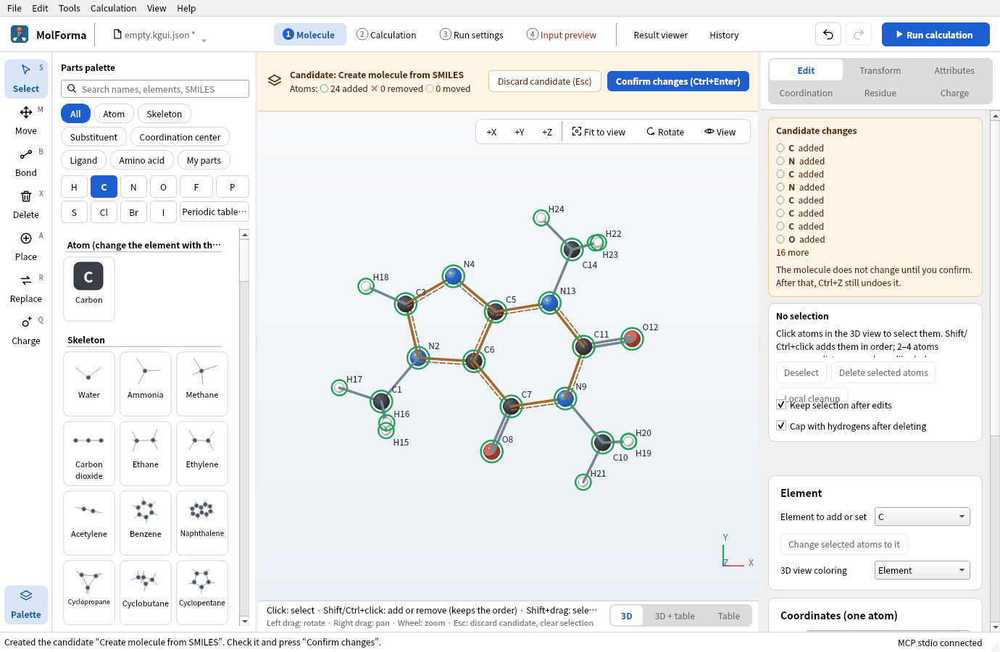

# Recipe 4 Heterocycles from SMILES and structure files (caffeine)

Fused ring systems that are not among the skeleton templates come from SMILES (a one-line structure) or from a structure file drawn in another program. Build caffeine in 3D from SMILES, then open a 2D `.sdf` without hydrogens, add the hydrogens and regenerate the 3D structure, and optimize with B3LYP/6-31G*.

| What you build | Details |
| --- | --- |
| Molecule | Caffeine C₈H₁₀N₄O₂ (24 atoms, charge 0, singlet) |
| Features | From SMILES, SMILES from the palette search, opening structure files, Add hydrogens, Regenerate 3D, heterocyclic skeleton templates |
| Calculation | B3LYP/6-31G*, geometry optimization |
| Run time | About 59 minutes (6 MPI processes, alongside other runs) |
| Practice data | `docs/recipes/samples/caffeine.kgui.json` (built from SMILES), `caffeine_2d.sdf` (2D structure without hydrogens) |

## 1. From SMILES

1. Choose “File → From SMILES…” (the file-name menu at the left of the header has it too).
2. Enter `Cn1cnc2c1c(=O)n(C)c(=O)n2C` and press “Build 3D”. Open Babel adds hydrogens, builds 3D coordinates and cleans them up with a force field (MMFF94); the result is a **candidate** (“Candidate: Create molecule from SMILES”). It runs in a separate process; for slow molecules, “Stop cleanup” above the 3D view stops it.
3. Check that the candidate is C8H10N4O2 · 24 atoms · 25 bonds and press “Confirm changes”. Aromatic bonds are drawn as a double line with a dashed side.

An unreadable SMILES gives the reason, and “Edit SMILES…” lets you correct it. To add a molecule beside the current one, use “File → Add fragment from SMILES…”. A SMILES typed into the palette search that matches no part offers “Build 3D from SMILES “…””, which makes a candidate beside the current molecule.

## 2. From a 2D structure file

Files exported from structure editors (`.sdf`, `.mol`) often have flat coordinates (z = 0) and no hydrogens.

1. Open `caffeine_2d.sdf` with “File → Open…”. The 14 heavy atoms (C8N4O2) lie in a plane.
2. Press “Add hydrogens” above the 3D view. The missing hydrogens are added: C8H10N4O2 · 24 atoms (all atoms when none is selected).
3. Choose “Tools → Regenerate 3D”. The 3D coordinates are rebuilt from the bonds and cleaned up with the force field; the result is a candidate (“Candidate: Regenerate 3D”). Check it and confirm.

Readable formats are XYZ, MOL, SDF, Mol2, CML, PDB, NWChem input (`.nw`) and Gaussian input (`.gjf`). XYZ bonds are guessed from distances; for ions, set formal charges before adding hydrogens. Reading with “Structure → Import structure file…” of the coordinate table replaces only the structure and keeps the calculation settings.

## 3. Templates or SMILES

The skeleton templates have single heterocycles (pyridine, pyrrole, furan, thiophene, imidazole, pyrimidine) and naphthalene. Molecules made from these with substituents are built from templates ([recipe 3](aromatic_substitution.md)); fused heterocycles such as the purine of caffeine and larger molecules come from SMILES or files.

## 4. Run and look at the results

1. In “2 Calculation”, set the task to “Geometry optimization”, the method to “DFT” (B3LYP) and the basis set to “6-31G*”. Total charge 0, multiplicity 1.
2. Run with “Run calculation” (F5).

### Results

| Item | Value |
| --- | --- |
| Energy of the calculation | −680.376988294 Eh |
| Optimization | Converged in 29 steps |
| Dipole moment | 3.83 D |

The fused rings are almost settled in the starting structure (3D from SMILES); most steps go into rotating the three methyl groups. Adding frequencies confirms a minimum (no imaginary frequencies).

## Troubleshooting

- **“Cannot parse the SMILES.”**: Check that brackets and ring-closure digits pair up and how aromatic atoms are written in lower case (`c`, `n`). Write charges in square brackets as in `[NH4+]`.
- **It stays flat**: Use “Regenerate 3D”. “Clean up all” only tidies the present coordinates with the force field and does not lift a flat start into 3D.
- **Regenerate 3D is refused with fixed atoms**: It rebuilds all coordinates, so fixed atoms are not allowed.

See also: structure tools and the coordinate table in “[Features and coverage](../features.md)”, [recipe 14 From a result to the next calculation](reuse_result.md).
