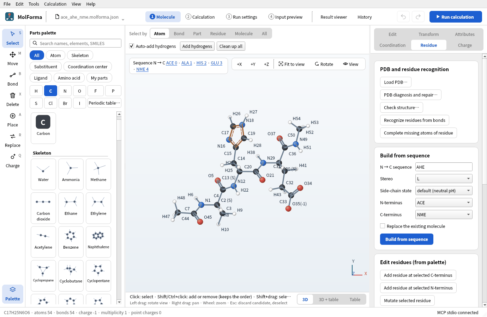
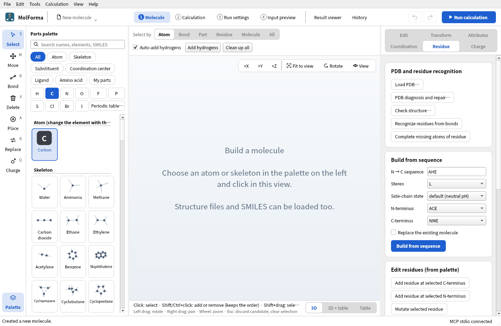
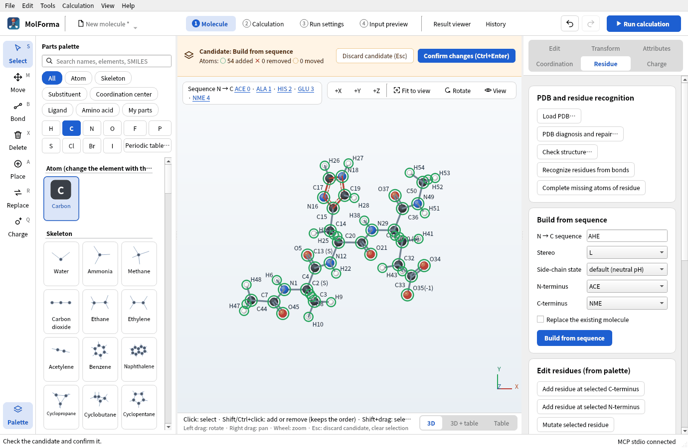
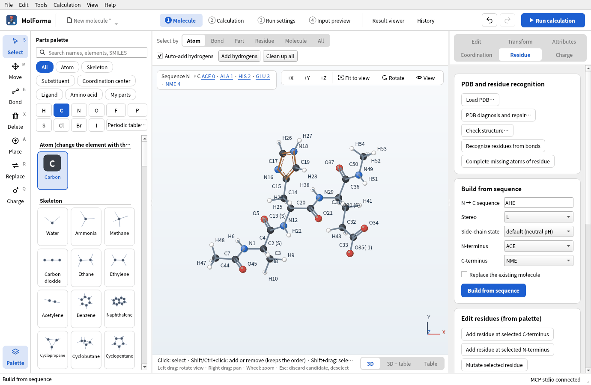
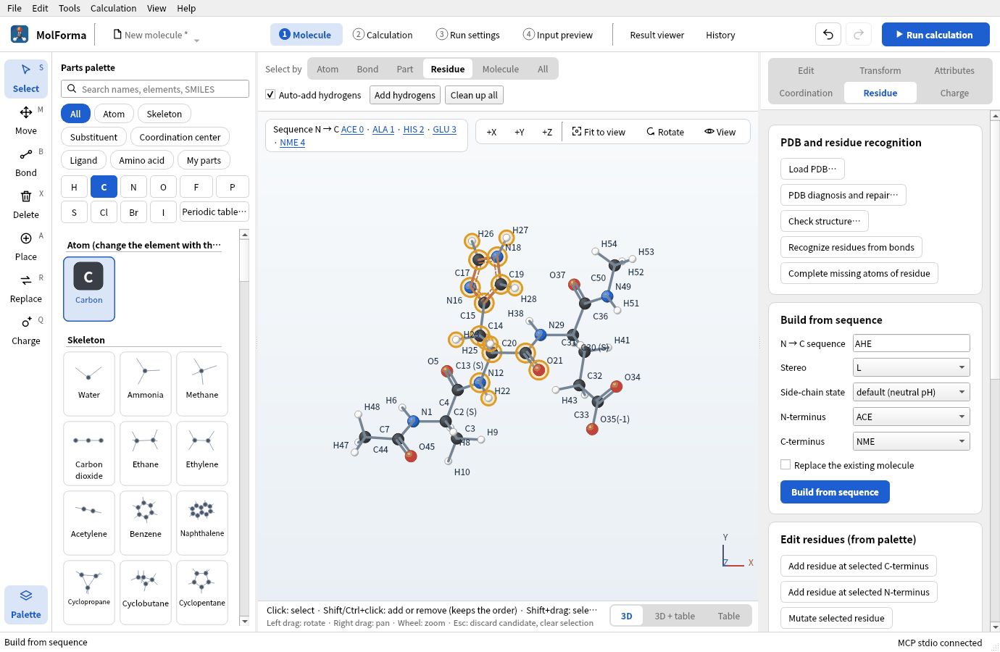
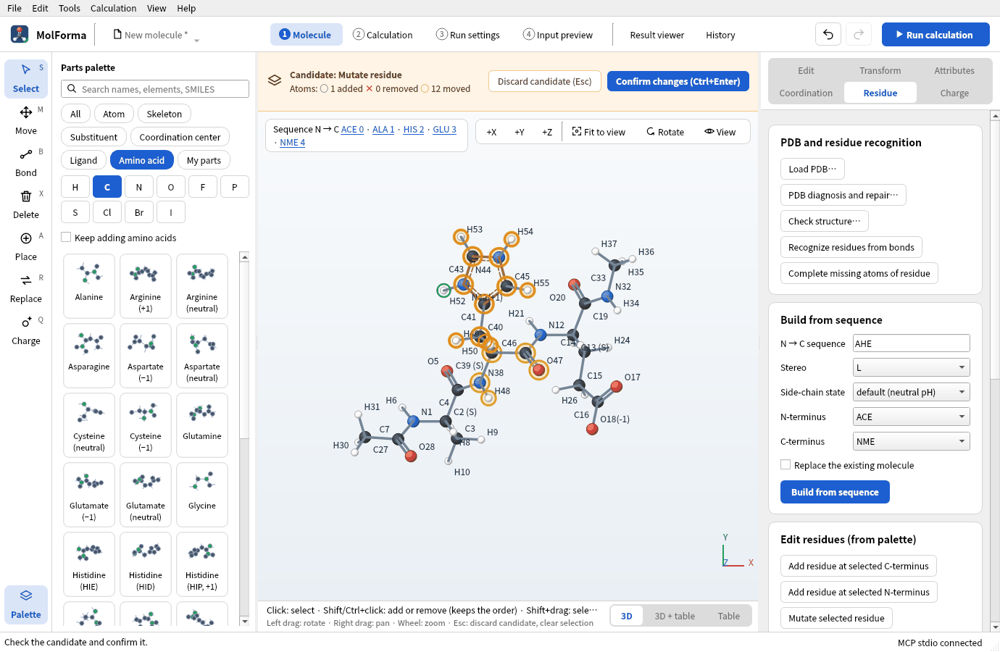
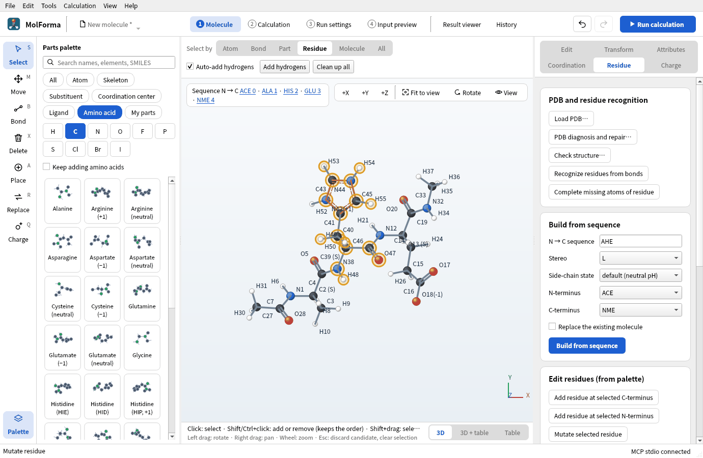
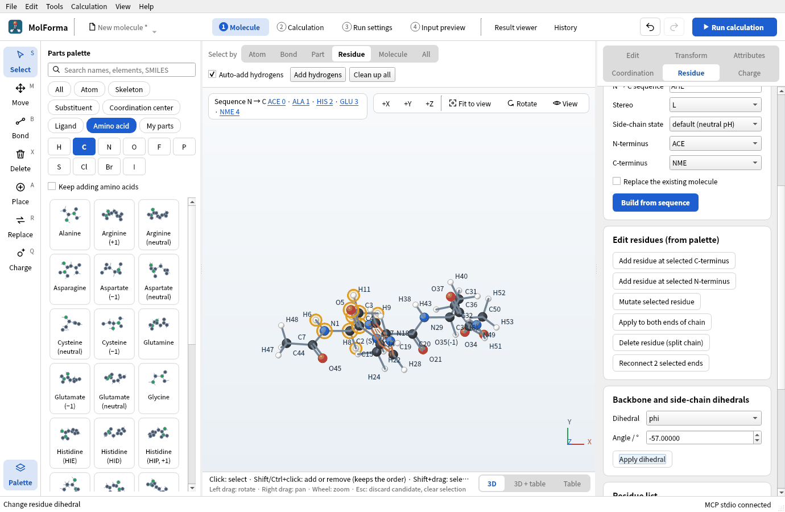
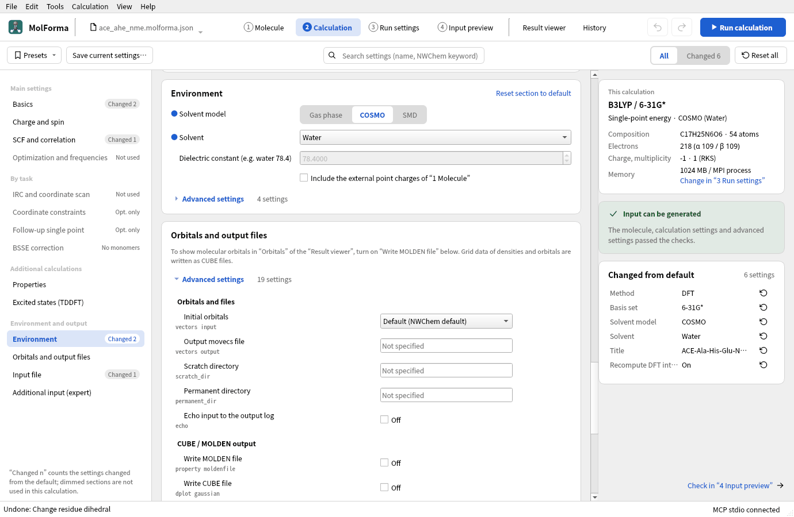
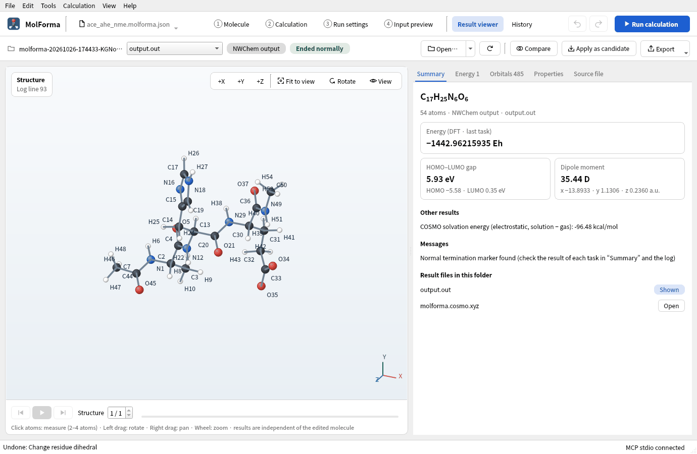

# Recipe 7 Peptides (ACE–Ala–His–Glu–NME)

Build a three-residue peptide from its one-letter sequence and cap the N-terminus with an acetyl group (ACE) and the C-terminus with an N-methylamide (NME). Choose the protonation state of His (HIE, HID, HIP) and the charged or neutral Glu and watch the total charge change, set backbone dihedrals, and finally run a B3LYP/6-31G* single point in COSMO (water).

| What you build | Details |
| --- | --- |
| Molecule | ACE–Ala–His–Glu–NME C₁₇H₂₅N₆O₆ (54 atoms, charge −1, singlet); His as HIE, Glu charged |
| Features | Build from sequence, termini and side-chain states on the “Residue” page, the sequence in the 3D view, selecting by residue, Mutate selected residue, backbone and side-chain dihedrals, Environment (COSMO) |
| Calculation | B3LYP/6-31G*, single-point energy, COSMO (water) |
| Run time | About 14 minutes (8 MPI processes, “Recompute DFT integrals each time” on) |
| Computer | AMD Ryzen 7 2700X (8 cores, 16 threads), 32 GB of memory, NWChem 7.3.1 on Linux |
| Practice data | [`ace_ahe_nme.kgui.json`](../../recipes/samples/ace_ahe_nme.kgui.json) |

## 1. Build from the sequence

1. Start an empty molecule with “File → New” and open the “Residue” page on the right.
2. Under “Build from sequence”, enter `AHE` (or `ALA-HIS-GLU`) in “N → C sequence”.
3. Set “Stereo” to L, “Side-chain state” to “default (neutral pH)”, “N-terminus” to “ACE” and “C-terminus” to “NME”. The default side-chain states are −1 for Asp and Glu, +1 for Lys and Arg, and HIE for His (proton on Nε); the tooltip of the field says so.

   

   **Figure 1** “Build from sequence” on the “Residue” page with the sequence and the terminal caps entered.

4. Press “Build from sequence”. Check that the candidate is C17H25N6O6 · 54 atoms · charge −1 and press “Confirm changes”. The total charge before building (0) matched the sum of formal charges (0), so it follows the −1 of Glu.

   

   **Figure 2** The built peptide is shown as a candidate, with the sequence above the 3D view.

   

   **Figure 3** The confirmed peptide (C17H25N6O6 · 54 atoms · charge −1).

The top left of the 3D view shows “Sequence N → C   ACE 0 · ALA 1 · HIS 2 · GLU 3 · NME 4”. Clicking a residue name selects its atoms. The α-carbon labels show the configuration “(S)” of the L-amino acids.

## 2. Change side-chain states and watch the total charge

1. Click “HIS 2” in the sequence of the 3D view, or set “Select by” above the 3D view to “Residue” and click an atom of His.

   

   **Figure 4** With “Select by” “Residue”, clicking an atom of His selects the whole residue.

2. Click “Histidine (HIP, +1)” in the category “Amino acid” of the parts palette and press “Mutate selected residue” on the “Residue” page. The backbone (N, Cα, C, O) stays and the side chain is replaced by HIP in a candidate.

   

   **Figure 5** The candidate of “Mutate selected residue”: the backbone stays, the side chain becomes HIP.

3. Confirmed, it is C17H26N6O6, and the total charge changes from −1 to **0** (it follows because it matched the sum of formal charges before).

   

   **Figure 6** Confirmed, the total charge goes from −1 to 0.

4. Mutating to “Histidine (HID)” keeps the formula of HIE and moves the proton to Nδ. Mutating Glu to “Glutamate (neutral)” raises the total charge by 1 more.

The state that goes in is that of the amino acid chosen in the palette (“Histidine (HIP, +1)” and so on). The “Side-chain state” of the “Residue” page is the state “Build from sequence” uses for all residues.

## 3. Change backbone dihedrals

1. Choose a residue (ALA 1, for example) and, under “Backbone and side-chain dihedrals” on the “Residue” page, set “Dihedral” to phi and “Angle / °” to −57, then press “Apply dihedral”.

   

   **Figure 7** “Backbone and side-chain dihedrals” on the “Residue” page: choose the dihedral and the angle, and apply.

2. Set psi of the same residue to −47. These are the φ and ψ of an α-helix. omega (the peptide bond, normally 180°) and the side-chain chi1–chi5 work the same way.

Residues are added at the ends with “Add residue at selected C-terminus” and “Add residue at selected N-terminus” on the “Residue” page, or by clicking the green “+ C” and “+ N” that appear in the 3D view while an amino acid is chosen in the palette. With “Keep adding amino acids” on, each amino acid chosen in the palette extends the same end.

## 4. Set up the calculation

1. In “Basics” of “2 Calculation”, set the task to “Single-point energy”, the method to “DFT” (B3LYP) and the basis set to “6-31G*”.
2. In “Charge and spin”, check total charge −1 and multiplicity 1.
3. In “Environment” in the list on the left, set the solvent model to “COSMO” and the solvent to “Water”. For a charged peptide, the electronic structure in a solvent is closer to reality than in the gas phase.

   

   **Figure 8** “Environment” with the solvent model COSMO and the solvent water.

4. In “Advanced settings” of “SCF and correlation” in the list on the left, turn on “Recompute DFT integrals each time”. For molecules beyond 50 atoms, the integrals NWChem keeps in the work directory can take several to more than ten GB. Turned on, they are not stored on disk, and the run does not stop on a full work disk (the practice data is saved with it on).

## 5. Run and look at the results

Run with “Run calculation” (F5). The “Summary” of the “Result viewer” shows the energy and, among the other results, the COSMO solvation energy.

**Figure 9** “Summary” of the “Result viewer”. The COSMO solvation energy is among the other results.

### Results

A single point of ACE–Ala–His(HIE)–Glu(−)–NME (54 atoms, total charge −1).

| Item | Value |
| --- | --- |
| Energy of the calculation (COSMO water) | −1442.962159354 Eh |
| Gas-phase energy at the same structure | −1442.808414957 Eh |
| COSMO solvation energy (electrostatic, solution − gas) | −96.48 kcal/mol |

With COSMO, NWChem runs two SCFs, in the gas phase and in the solvent. Most of the solvation energy is the stabilization of the carboxylate (−1) of the Glu side chain by the dielectric. The dipole moment of a charged molecule depends on the choice of origin, so it is not a quantity to compare.

## Troubleshooting

- **“Unknown one-letter residue code” or “Unknown three-letter residue code”**: Enter one-letter codes (`AHE`) or three-letter codes separated by hyphens (`ALA-HIS-GLU`).
- **The state does not change after mutating**: Choose an amino acid with a state in the palette (“Histidine (HIP, +1)” and so on) before pressing “Mutate selected residue”.
- **The total charge does not change**: If it was changed by hand before mutating or building, it does not follow. Set it with “Use formal charges as total” on the “Charge” page.
- **NWChem stops with “No space left on device” or similar**: The disk of the work directory filled up with integral files. Turn on “Recompute DFT integrals each time”, or put the “Job folder” in “3 Run settings” on a disk with more space.
- **A dihedral cannot be applied**: Dihedrals without the neighboring residue are undefined (“phi is not defined at the N-terminus.”). With ACE and NME caps, phi and psi of the end residues can be set too.

See also: [Right-side pages of “1 Molecule”](../features/molecule_pages.md) (Residue), [recipe 8 Mutating residues and editing chains](residue_mutation.md).
