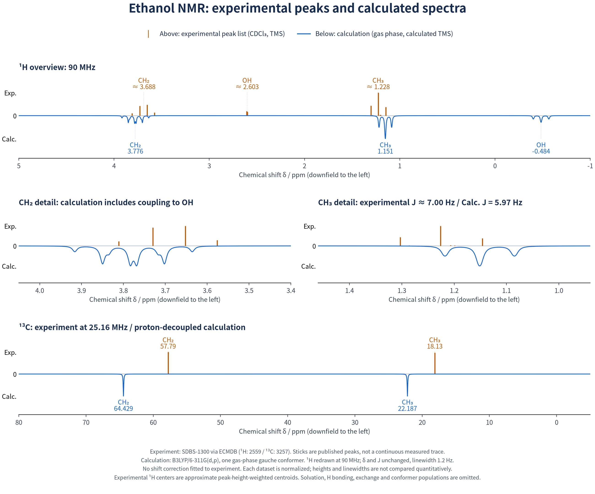
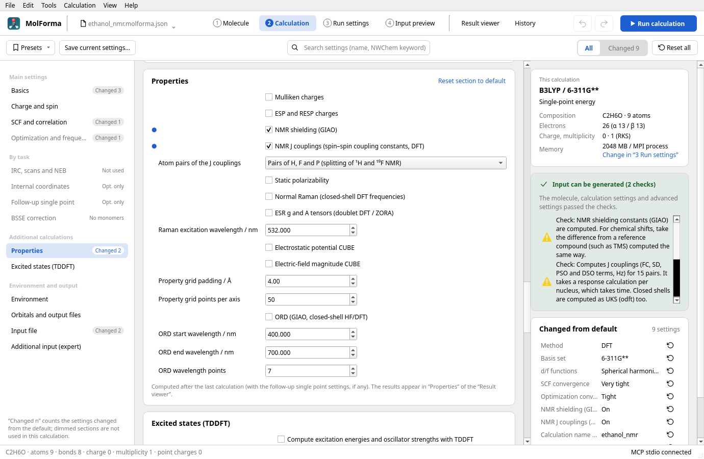
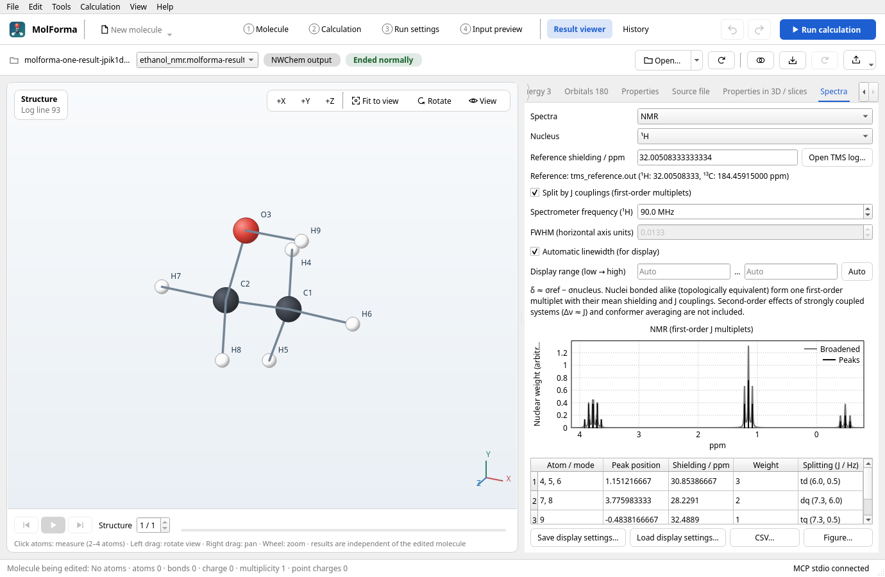

# Recipe 17 Calculating NMR and comparing with experiment (ethanol and TMS)

Calculate the ¹H and ¹³C NMR spectra of ethanol and obtain chemical shifts relative to a calculated reference, TMS (tetramethylsilane). Display J-coupling splittings, compare with published experimental peaks, and assess what the calculation helps explain and where this model falls short.

| What you build | Details |
| --- | --- |
| Molecules | Ethanol CH₃CH₂OH (9 atoms) and TMS Si(CH₃)₄ (17 atoms), both neutral singlets |
| Features | Build from SMILES, apply an optimized structure, NMR shielding, J couplings, reference shielding, spectrum display and export |
| Calculation | Gas-phase B3LYP/6-311G(d,p), GIAO shieldings, and H–H J couplings of ethanol |
| Run record | Run on 2026-11-12 with NWChem 7.3.1 (Linux) through MolForma MCP; the instructions below perform the same operations in the interface |
| Run time | J couplings cost more than shieldings alone. For a class, start from the optimized structure and allow time for the calculation; open the completed results below for comparison if time is limited |
| Practice files | [Optimized ethanol and its NMR settings](../../recipes/samples/ethanol_nmr.molforma.json), [Initial TMS and its optimization/shielding settings](../../recipes/samples/tms_nmr.molforma.json) |

The practice projects above contain structures and settings, not calculation logs or execution settings. To run your own calculation, check NWChem, MPI and the job folder in “3 Run settings”. The basis name `6-311G**` is equivalent to `6-311G(d,p)` in this recipe.

## Open the completed results (no recalculation needed)

**[Download the result file with automatic display (1.58 MB)](https://github.com/hnakada123/MolForma/releases/download/ethanol-nmr-data-v2/ethanol_nmr.molforma-result.json)** · [SHA-256](https://github.com/hnakada123/MolForma/releases/download/ethanol-nmr-data-v2/ethanol_nmr.molforma-result.json.sha256)

[Full set including supplementary logs and comparison figures (ZIP, 2.22 MB)](https://github.com/hnakada123/MolForma/releases/download/ethanol-nmr-data-v2/ethanol_nmr_results_v2.zip) · [ZIP SHA-256](https://github.com/hnakada123/MolForma/releases/download/ethanol-nmr-data-v2/ethanol_nmr_results_v2.zip.sha256)

The supplementary ZIP also contains NWChem inputs and output logs for ethanol and TMS, practice projects, calculated curves and peak tables as CSV, charts as PDF/PNG, and viewing instructions in English and Japanese. No NWChem rerun is needed to inspect the results.

| Individual file | What you can inspect |
| --- | --- |
| [Ethanol NMR log (.out)](https://github.com/hnakada123/MolForma/releases/download/ethanol-nmr-data-v1/ethanol_nmr.out) | Structure, shieldings, 15 H–H J couplings and ¹H/¹³C charts in MolForma. The normally terminated NMR-only job |
| [TMS reference log (.out)](https://github.com/hnakada123/MolForma/releases/download/ethanol-nmr-data-v1/tms_reference.out) | Optimized structure and reference shieldings in MolForma. Normally terminated |
| [Calculated spectra (PDF)](https://github.com/hnakada123/MolForma/releases/download/ethanol-nmr-data-v1/ethanol_nmr_calculated_400MHz.pdf) | Calculated ¹H (400 MHz) and ¹³C charts in an ordinary PDF viewer |
| [Experimental comparison (PDF)](https://github.com/hnakada123/MolForma/releases/download/ethanol-nmr-data-v1/ethanol_nmr_comparison_en.pdf) | This page's comparison figure, with calculated ¹H displayed at the experimental frequency of 90 MHz |

1. Save `ethanol_nmr.molforma-result.json` from the link above. This file works on its own. If using the ZIP, select the same file inside the extracted folder.
2. In an updated MolForma, choose “Result viewer → Open…” and open that file. **The NMR chart appears automatically. No separate TMS selection or numeric input is needed.**
3. Switch the nucleus to see ¹³C. Structure, energies, orbital energies, shieldings and J couplings are also available in their tabs.

The single result file embeds the ethanol NMR output and its matching TMS output. References are calculated from the embedded TMS, with the saved 90 MHz frequency for comparison and automatic linewidth/range. It does not depend on the original log paths; copying this file to another computer is sufficient. Missing calculation results are not inferred. Supplementary optimization/frequency logs and experimental comparison figures are separate files in the ZIP.

Older builds cannot read this result format. Update the app, or open `logs/ethanol_nmr.out` and use “Open TMS log…” to select `logs/tms_reference.out`. Raw ethanol logs do not contain the reference and still require that selection.

### Where the parameters come from

| Parameter | Source and action |
| --- | --- |
| Nucleus | Choose the nuclei to observe: ¹H for hydrogen, ¹³C for carbon. The initial choice is ¹H when hydrogen shieldings are present in the log. |
| Reference shielding | Import TMS calculated with the same method, basis and solvent conditions. MolForma averages its 12 hydrogen and 4 carbon shieldings, so no manual averaging is needed. Matching calculation conditions must be checked by the user. |
| Spectrometer frequency (¹H) | An experimental instrument setting. The experimental ¹H data in this recipe were recorded at 90 MHz, so use 90 for comparison. The default 400 MHz is sufficient to view calculated peaks. Chemical shifts in ppm stay the same; J splittings in ppm change. |
| FWHM | A display linewidth. Automatic mode uses about 1.2 Hz for ¹H multiplets and 0.10 ppm for ¹³C. These are not predictions of experimental linewidths. Turn automatic mode off only when you want to adjust the width, for example to match experiment. |
| Range | Automatically chosen to include all calculated peaks. “Auto” clears manual bounds; switching the nucleus also restores automatic bounds. |

For older builds without TMS import, or to check the values manually, use the following table. To enter a width directly in builds with “Automatic linewidth (for display)”, turn that option off first.

| Nucleus | Reference shielding / ppm | Spectrometer frequency (¹H) | FWHM / ppm | Range (low → high) |
| --- | ---: | --- | ---: | --- |
| ¹H | `32.00508333` | 90 MHz | `0.0133` | Left `-1`, right `5` |
| ¹³C | `184.45915000` | Leave at 90 MHz | `0.10` | Left `-5`, right `80` |

The automatic-display result file needs none of the following manual entries. Do not reuse these references for different calculation conditions. For manual entry, select the nucleus first, enter numbers without units, then press Enter. Use ASCII `-` for negative numbers because older builds reject the mathematical minus `−`. “Save display settings…” JSON files depend on the original log location. Use “Export → Save results in one file…” for a portable file.

The supplementary `logs/ethanol_geometry_interrupted.out` in the ZIP lets you inspect optimization and frequencies. Those stages finished before the subsequent J calculation was stopped; this is not a normally terminated log. Use the completed `ethanol_nmr.out` for the final NMR charts.

Only the hostname and NWChem build-source path have been redacted in the distributed logs. Coordinates and numerical results are unchanged. This is a viewing dataset; NWChem restart databases and orbital files are not included. See `README.en.txt` in the archive for details.

This comparison figure was made from calculated curves obtained through MolForma and published experimental peak lists. It is not a screenshot of MolForma. Experimental sticks are not a continuous measured spectrum; each dataset is normalized separately above or below the baseline.

## 1. Prepare the ethanol structure

1. Open the practice file `ethanol_nmr.molforma.json` with “File → Open…”. It contains the gauche conformer optimized at B3LYP/6-311G(d,p) used for the results below.
2. In “2 Calculation”, check charge 0, multiplicity 1, DFT, B3LYP and 6-311G**. Use spherical basis functions (5d, 7f).
3. Since the structure is already optimized, select the single-point energy task.

To build it yourself, enter `CCO` in “From SMILES…” and confirm the candidate (see [Recipe 1](atoms_and_bonds.md) for building from atoms and bonds). Run “Optimize → Frequencies” with the same method and basis. Check optimization convergence and that the internal vibrations, excluding translations and rotations, have no imaginary frequencies. Apply the final structure with “Result viewer → Apply to molecule as candidate” and confirm it ([Recipe 14](reuse_result.md)). A different conformer generated from SMILES may give different values.

For this run, ethanol optimization and frequencies used the `xfine` grid, `tight` optimization convergence and `verytight` SCF convergence (10⁻⁹). The C–C–O–H dihedral was approximately −61.52°. All 21 internal vibrations were positive, the lowest at 272.61 cm⁻¹. This establishes a locally stable conformer, not the conformer populations in solution.

## 2. Calculate shieldings and J couplings

1. Under “Properties” in “2 Calculation”, enable GIAO NMR shielding and NMR J couplings (spin–spin coupling constants, DFT).
2. For the atom pairs, choose H–F–P pairs for ¹H/¹⁹F NMR splittings. For ethanol, this selects all 15 pairs of its six hydrogen atoms.
3. Set the DFT grid to `fine` and SCF convergence to `verytight`. Keep a gas-phase environment; do not change the solvent when reproducing this calculation.
4. Check “4 Input preview” for the `shielding` and `spinspin` property calculations, then run with F5.
5. After normal completion, open the result viewer and inspect the shielding and J-coupling tables under “Properties”.

Separating optimization/frequencies from NMR lets you recalculate shieldings or J couplings without changing the structure. In this run, an `xfine` job completed optimization, frequencies and shielding before being stopped during its J calculation. A separate NMR job at `fine` then completed using the optimized geometry. The NMR values here come from that completed job.

MolForma adds the final UKS calculation required for J couplings of a closed-shell molecule. This does not mean changing the molecular multiplicity. See [Calculation settings](../features/calculation.md) for details.

## 3. Calculate TMS as the chemical-shift reference

The shielding constant σ is not the experimental chemical shift δ. Use the difference from TMS calculated under matching conditions:

**δ ≈ σ(TMS) − σ(target nucleus)**

1. Save the ethanol project and open the TMS practice file `tms_nmr.molforma.json`. To build TMS yourself, use the SMILES `C[Si](C)(C)C`.
2. Select B3LYP/6-311G**, spherical basis functions, charge 0, a singlet, gas phase, the `fine` grid and `verytight` SCF convergence. For TMS, use geometry optimization with `tight` optimization convergence.
3. Enable GIAO NMR shielding and disable J couplings, then run. TMS J couplings are unnecessary for obtaining the reference.
4. Check optimization convergence and completion of the shielding calculation. “Open TMS log…” averages the isotropic shieldings over the 12 hydrogens for ¹H and the four carbons for ¹³C, excluding Si. You can also calculate the averages from “Properties” and compare them with the values below.

| Reference | Mean TMS shielding in this run / ppm |
| --- | ---: |
| ¹H | 32.00508333 |
| ¹³C | 184.45915000 |

The TMS optimization converged; a frequency check of its minimum was omitted in this run. Ethanol and TMS shieldings used the same method, basis, grid and SCF settings. If you change those conditions, recalculate TMS under the matching conditions instead of reusing these reference values.

## 4. Display the ¹H and ¹³C spectra

The distributed single result file already includes these settings. For your own raw logs, select the reference once as below, then use “Export → Save results in one file…”. Opening that file restores the chart on subsequent visits.

1. In “History”, select the completed ethanol NMR job from step 2 and open it in the result viewer.
2. On the “Spectra” tab, choose “Open TMS log…” and select the TMS output from step 3 (`tms_reference.out` in the download). Both the ¹H and ¹³C references are imported.
3. Check that ¹H and splitting by J couplings are selected. Set the ¹H spectrometer frequency to `90 MHz` to match experiment.
4. Leave linewidth and range on automatic. At 90 MHz, the width becomes about `0.0133 ppm`. Only to fix the axis to that of the comparison figure, enter `-1` in the left range field and `5` in the right, then press Enter. Larger ppm values appear on the left.
5. Select peak-table rows to identify the CH₃, CH₂ and OH atoms.

For ¹³C, switch the nucleus. The imported reference becomes `184.45915000`, the automatic width becomes `0.10 ppm`, and the range adjusts to include the carbon peaks. In this splitting model, ¹³C is proton-decoupled, so ethanol has two carbon peaks. The frequency field specifies the ¹H frequency; do not enter the experimental ¹³C frequency of 25.16 MHz there.

Changing the display to 400 MHz leaves δ in ppm and J in Hz unchanged. The separation in ppm changes according to J / ν₀. With automatic linewidth enabled, the width follows the frequency and becomes about `0.0030 ppm` at 400 MHz.

Use the buttons on the spectrum tab to export the chart or display settings. Changing the linewidth does not change the original shieldings or J values. MolForma groups nuclei with equivalent connectivity and averages their values for first-order multiplets. This is not population-weighted conformational averaging; the two CH₂ hydrogens are grouped together too. The model omits second-order effects, OH exchange, and experimental integrals and linewidths. See the [Result viewer](../features/results.md).

## 5. Compare with experimental peaks

The experimental [¹H record](https://ecmdb.ca/spectra/nmr_one_d/2559) and [¹³C record](https://ecmdb.ca/spectra/nmr_one_d/3257) are hosted by ECMDB and originate from AIST's SDBS-1300 (accessed 2026-11-12). Both use CDCl₃ and a TMS reference; the frequencies are 90 MHz for ¹H and 25.16 MHz for ¹³C. Temperature and concentration were not available on the retrieved pages, and the records were not confirmed to use the same sample.

| Nucleus and group | Experimental δ / ppm | Calculated δ / ppm | Calculated − experimental / ppm |
| --- | ---: | ---: | ---: |
| ¹H: CH₃ | ≈1.228 | 1.151 | −0.076 |
| ¹H: CH₂ | ≈3.688 | 3.776 | +0.088 |
| ¹H: OH | ≈2.603 | −0.484 | −3.087 |
| ¹³C: CH₃ | 18.13 | 22.187 | +4.057 |
| ¹³C: CH₂ | 57.79 | 64.429 | +6.639 |

The representative experimental ¹H positions are centroids weighted by the listed peak heights, not fitted chemical shifts or integrated-area centroids. All listed peaks, including small ones, were included within 1.0–1.4 ppm for CH₃, 3.4–4.0 for CH₂ and 2.5–2.7 for OH. Differences were calculated before rounding.

Using the source's Hz values, the three main experimental CH₃ lines have a mean spacing of **about 7.00 Hz**, compared with the calculated mean CH₃–CH₂ J of **5.97 Hz**, about 15% lower. No shift offset or scaling was fitted to experiment. The calculated 3:2:1 nuclear count comes from the input structure; it does not reproduce an independently measured integral.

## 6. Assess where the calculation is useful

Use the figure and table to answer these questions first:

1. Calculate the mean absolute ¹H difference for CH₃ and CH₂. How does the assessment change when OH is included?
2. Compare the separation of the two ¹³C peaks. Can a uniform change of reference align both with experiment?
3. What does a single gas-phase molecule omit when compared with a solution experiment? Consider peak positions separately from splittings and linewidths.
4. When distinguishing unknown molecular structures, how much reliability can be established from this comparison of one molecule and five sites?

### An example interpretation

- **Useful for supporting assignments.** Both ¹H and ¹³C place CH₂ downfield of CH₃. The mean absolute ¹H difference for CH₃ and CH₂ is about 0.082 ppm. This covers only two sites; including OH with equal weight per site gives about 1.084 ppm.
- **OH is not reproduced by this model.** Its discrepancy is about 3.09 ppm. A single gas-phase conformer lacks intermolecular hydrogen bonding and solution conformer populations. Changes in splitting and linewidth due to proton exchange were not modeled either. Concentration dependence of ethanol's OH shift and hydrogen bonding have been studied [experimentally](https://doi.org/10.1016/0022-2852(58)90055-9), but this comparison does not establish that hydrogen bonding explains the entire discrepancy.
- **Insufficient for precise ¹³C prediction.** The mean absolute difference is about 5.35 ppm. The peak separation is 39.66 ppm experimentally versus 42.24 ppm calculated, so a common offset cannot remove both errors.
- **Numerical convergence and agreement with experiment differ.** For the same ethanol geometry, shielding changes between `fine` and `xfine` were about 0.0001 ppm or less. Within this check, a finer grid alone is unlikely to resolve the discrepancies. Grid convergence of J couplings was not tested.

The value of this calculation is in linking peaks to atoms and identifying which observations an isolated-molecule model explains and which call for environmental effects. Ethanol was supplied as the input structure; the calculation did not independently identify an unknown sample.

For further work, match solvent conditions, consider population-weighted conformers with [Conformer sets](../features/molecule_pages.md), and investigate hydrogen bonding to neighboring molecules for OH. Validate methods or corrections against other molecules and independent experiments. These extensions were not performed for the results on this page.

## Troubleshooting

- **The chart and peak table are empty:** first import the reference with “Open TMS log…”. For manual inputs, read the message below the settings. If it asks for a numeric `minimum`, retype the left range bound as ASCII `-1` (`-5` for ¹³C), then press Enter. You can also clear both range fields to use automatic bounds. For a `reference_ppm` message, select the nucleus and enter its reference shielding from the table. Do not include units or `…` in the input fields.
- **All peaks are displaced:** check that the reference shielding is entered and belongs to the selected nucleus. Enter the calculated TMS shielding, not its chemical shift of 0 ppm.
- **Splitting is unavailable:** the loaded log has no J couplings or their calculation has not completed. Check the J-coupling table in “Properties”.
- **The calculation takes too long:** begin with shieldings to learn peak positions, then add J couplings when time allows. “All atom pairs” is unnecessary for this recipe.
- **Your values differ:** check the conformer, basis representation, grid, SCF convergence, solvent and TMS conditions. Display frequency and linewidth do not correct differences in shielding constants.
- **OH appears at negative ppm:** this need not indicate a plotting error. In this calculation, OH is more shielded than TMS, making the difference negative. Agreement with experiment must be evaluated separately.

Sources: SDBS, National Institute of Advanced Industrial Science and Technology (AIST), [SDBS-1300](https://sdbs.db.aist.go.jp/CompoundLanding.aspx?sdbsno=1300), accessed 2026-11-12. See [NWChem NMR properties](https://nwchemgit.github.io/Properties.html#nmr-and-epr) for the calculation methods.

Related: [All recipes](../recipes.md), [Recipe 1 Building from atoms and bonds](atoms_and_bonds.md), [Recipe 14 From a result to the next calculation](reuse_result.md), [Calculation settings](../features/calculation.md), [Result viewer](../features/results.md).
