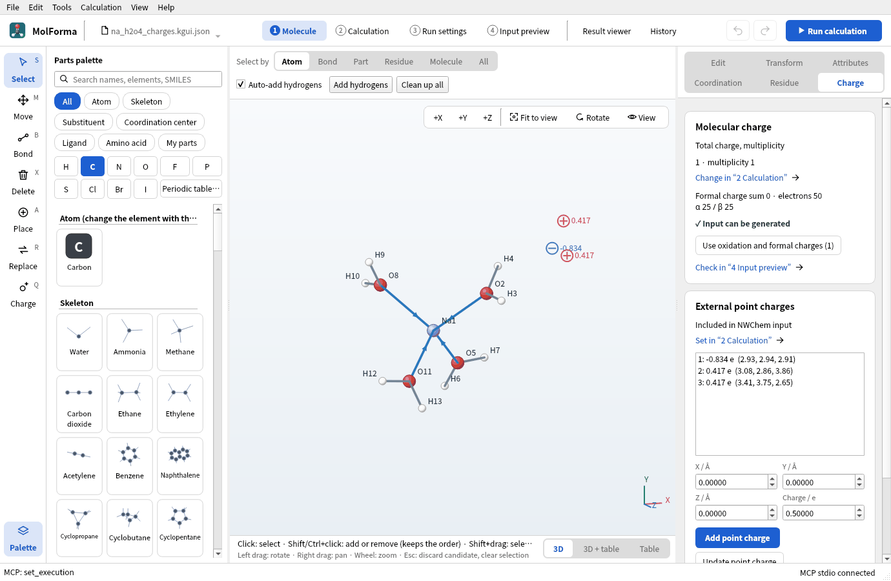
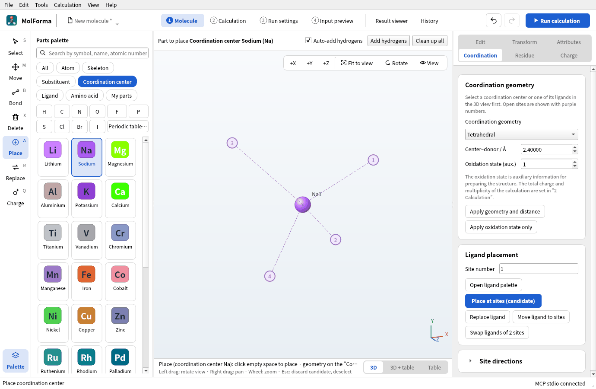
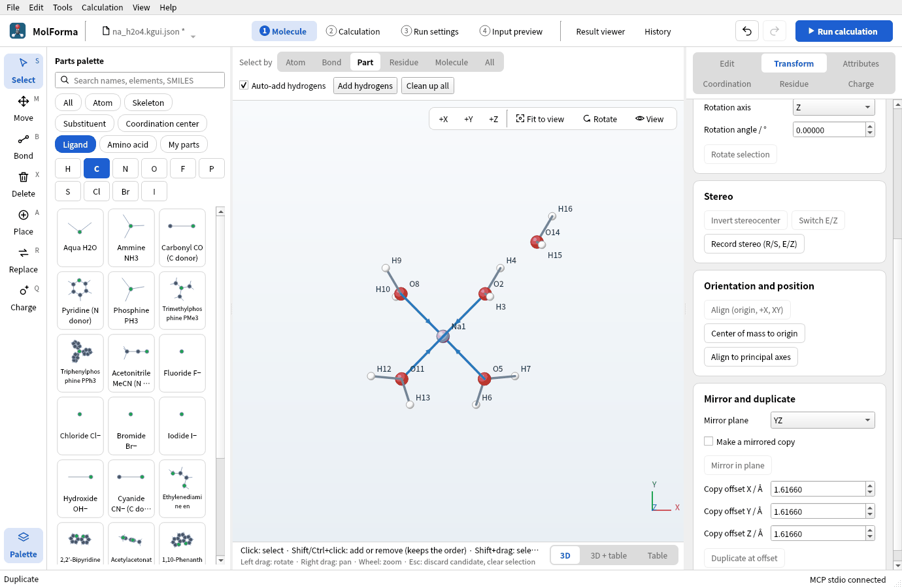
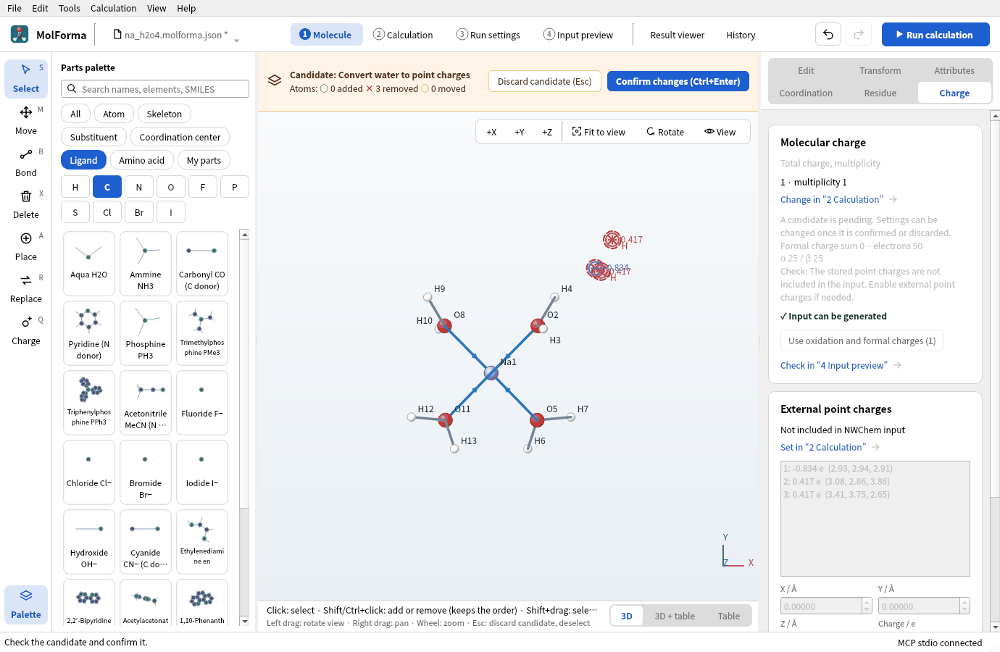
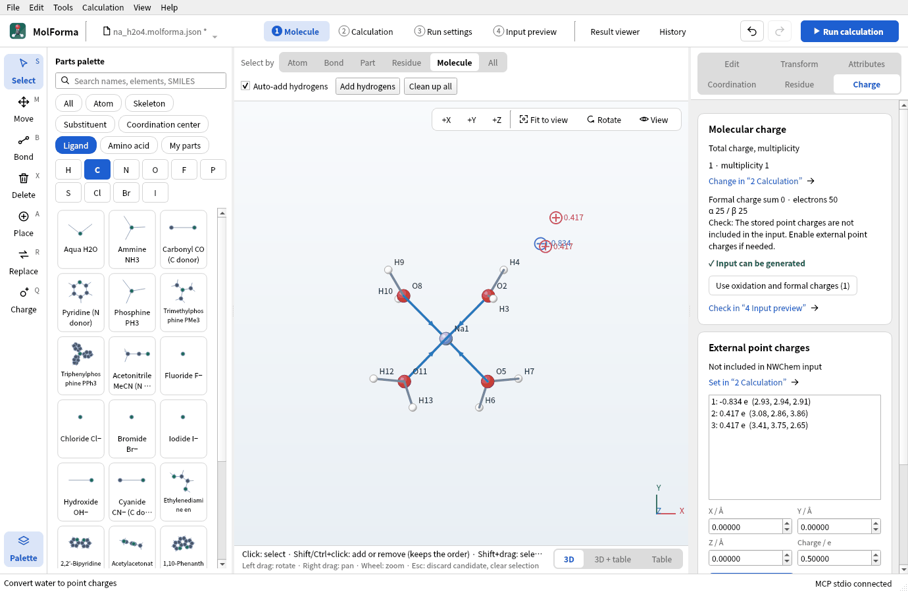
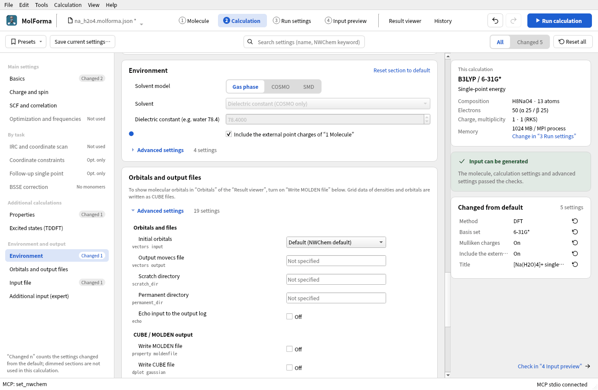
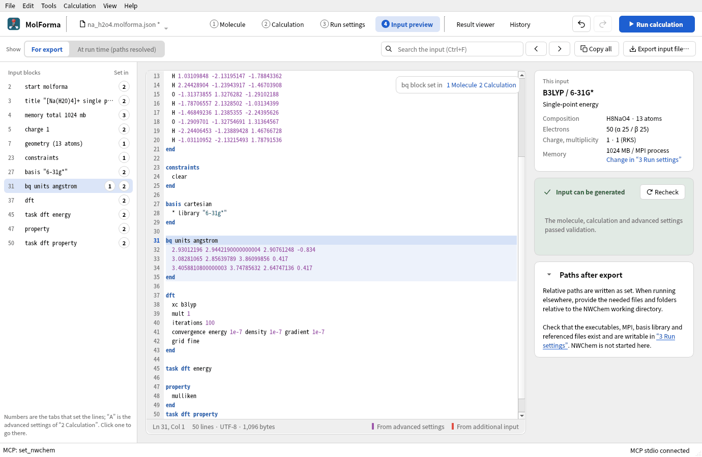
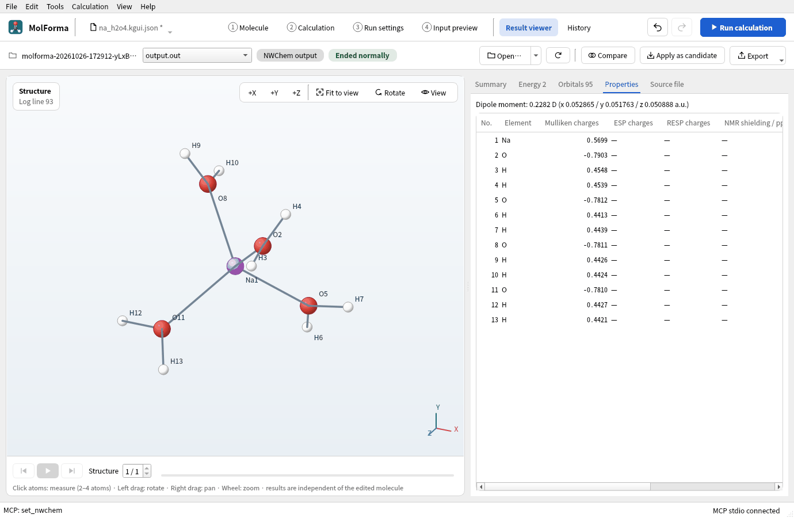

# Recipe 12 Solvated clusters and point charges (hydrated Na⁺)

Build [Na(H₂O)₄]⁺ with four waters coordinated to Na⁺, and put one more water outside the optimized cluster. Instead of treating the outer water as quantum-chemical atoms, replace it with the three TIP3P point charges (O −0.834 e, H +0.417 e) and include them in the calculation as NWChem external point charges. Compare three cases: no charges, with the charges, and the outer water as atoms.

| What you build | Details |
| --- | --- |
| Molecule | [Na(H₂O)₄]⁺ H₈NaO₄ (13 atoms, charge +1) and three TIP3P point charges for an outer water |
| Features | Na center, tetrahedral geometry, aqua ligands, selecting by part and by molecule, Duplicate at offset, Water to TIP3P charges on the “Charge” page, the point-charge list, Environment (include external point charges), Export point charges |
| Calculation | B3LYP/6-31G*, geometry optimization (no charges) and three single points |
| Run time | About 1 minute for the optimization, 10–20 seconds per single point (8 MPI processes) |
| Computer | AMD Ryzen 7 2700X (8 cores, 16 threads), 32 GB of memory, NWChem 7.3.1 on Linux |
| Practice data | [`na_h2o4.kgui.json`](../../recipes/samples/na_h2o4.kgui.json) (cluster), [`na_h2o4_charges.kgui.json`](../../recipes/samples/na_h2o4_charges.kgui.json) (with point charges), [`na_h2o5.kgui.json`](../../recipes/samples/na_h2o5.kgui.json) (outer water as atoms) |

## 1. Build and optimize [Na(H₂O)₄]⁺

1. With “File → New”, choose “Sodium” in the category “Coordination center”.
2. On the “Coordination” page, set “Coordination geometry” to “Tetrahedral”, “Center–donor / Å” to 2.40 and “Oxidation state (aux.)” to 1, and click in empty space. The total charge becomes +1.

   

   **Figure 1** Sodium placed as a tetrahedral coordination center.

3. With “Aqua H2O” of the category “Ligand”, click sites 1–4 in turn and confirm. You have H8NaO4 · 13 atoms · charge 1.

   ![[Na(H₂O)₄]⁺ confirmed with four aqua ligands; dative-bond arrows run from the water oxygens to Na](images/hydrated_sodium/02_na_h2o4.png)

   **Figure 2** Confirmed [Na(H₂O)₄]⁺ (H8NaO4 · 13 atoms · charge 1).

4. In “2 Calculation”, set the task to “Geometry optimization”, the method to “DFT” (B3LYP) and the basis set to “6-31G*”, and run.
5. When it ends, bring the optimized structure in with “Apply as candidate” in the “Result viewer” and confirm ([recipe 14](reuse_result.md)).

## 2. Put one water outside

Site 1 of the tetrahedron points along (1, 1, 1). Duplicate the water on site 1, shifted 2.8 Å (O···O, a hydrogen-bond distance) along that direction.

1. Set “Select by” above the 3D view to “Part” and click an atom of the water on site 1 (its three atoms are selected).
2. Under “Mirror and duplicate” on the “Transform” page, set “Copy offset X / Å”, “Copy offset Y / Å” and “Copy offset Z / Å” to 1.6166 each (2.8 Å ÷ √3) and press “Duplicate at offset”. One more, unbonded water appears: H10NaO5 · 16 atoms (the total charge stays +1).

   

   **Figure 3** The water on site 1 duplicated along (1, 1, 1) with “Mirror and duplicate” (seen from +Z).

3. Save this state as `na_h2o5.kgui.json` (for comparing with all five waters as atoms).

## 3. Turn the outer water into point charges

1. Set “Select by” to “Molecule” and click an atom of the outer water (the three atoms of the unbonded water are selected).
2. Press “Water to TIP3P charges” on the “Charge” page on the right. The water's three atoms go away and three point charges, O −0.834 and H +0.417, take their place in a candidate. Confirmed: H8NaO4 · 13 atoms · 3 point charges.

   

   **Figure 4** The candidate replacing the outer water with point charges, drawn as circles with their charges.

3. “External point charges” on the “Charge” page says “Not included in NWChem input” and lists them (`1: -0.834 e (2.93, 2.94, 2.91)` and so on). Placed charges alone do not go into the input.

   

   **Figure 5** “External point charges” on the “Charge” page. They are not in the input yet.

4. Press “Set in “2 Calculation”” and turn on “Include the external point charges of “1 Molecule”” in “Environment”. “4 Input preview” gains a `bq units angstrom` block; point-charge coordinates are always written in Å, whatever the molecule's output unit.

   

   **Figure 6** Include the external point charges in “Environment”.

   

   **Figure 7** The `bq` block of the input, with coordinates in Å.

5. Save as `na_h2o4_charges.kgui.json`.

Point charges are not counted in the molecule's total charge or electron count (the total charge stays +1, the electrons 50). To place charges in the 3D view, use the “Charge” (Q) tool in the left column; to place them by value, use “Add point charge” on the “Charge” page. “Export point charges…” writes `x y z q` (Å).

This is a fixed external electrostatic field, not NWChem's QM/MM with force fields and QM/MM boundaries. Point charges have no short-range repulsion, so optimizing with point charges can pull atoms onto them. As in this recipe, it is safer to optimize without charges and add them for a single point at that structure.

## 4. Three single points

At the optimized [Na(H₂O)₄]⁺ structure, set the task to “Single-point energy” and calculate these three (B3LYP/6-31G*):

1. Without point charges (`na_h2o4.kgui.json`, external point charges off)
2. With point charges (`na_h2o4_charges.kgui.json`)
3. The outer water as atoms (`na_h2o5.kgui.json`, 16 atoms)

Turning on “Mulliken charges” under “Properties” lets you compare atomic charges in the “Properties” tab of the “Result viewer”.

**Figure 8** The “Properties” tab of the run with point charges, listing Mulliken charges per atom.

The interaction energy with the outer water also needs the energy of the outer water alone. Open `na_h2o5.kgui.json`, click Na with “Select by” “Molecule” (Na and its four coordinated waters are chosen), delete them and confirm. You get H2O · 3 atoms, and the total charge goes back from +1 to 0. Calculate a single point of it under the same conditions too (no need to save it).

### Results

The optimization converged in 5 steps with all four Na–O at 2.27 Å. The O of the outer water is 2.80 Å from the O of the site-1 water and 2.34 Å from its two H atoms.

| Calculation | Energy of the calculation | Mulliken charge of Na⁺ | O of the site-1 water |
| --- | --- | --- | --- |
| 1. Without point charges | −467.880411491 Eh | +0.578 | −0.782 |
| 2. With TIP3P point charges | −467.897394297 Eh | +0.570 | −0.790 |
| 3. Outer water as atoms | −544.304244308 Eh | +0.564 | −0.794 |
| Outer water alone | −76.408888746 Eh | — | — |

- Stabilization by the point charges: (2) − (1) = −10.66 kcal/mol
- Interaction with the outer water: (3) − (1) − (outer water alone) = −9.38 kcal/mol (not corrected for basis set superposition error)

Three point charges roughly reproduce the interaction of the outer water treated quantum chemically. Point charges have no exchange repulsion or charge transfer, so they cannot show the charge (+0.03 e) that moves to the outer water in (3).

## Troubleshooting

- **“Select a separate H2O molecule.”**: Coordinated waters (dative bond to Na) cannot be converted. Choose only the outer water with “Select by” “Molecule”. “Select the O and both H atoms of a water molecule.” means the chosen atoms are not the three atoms of a water.
- **The point charges are not in the input**: “Include the external point charges of “1 Molecule”” in “Environment” is off.
- **Frequencies cannot be computed**: Frequencies with external point charges are not supported (“Frequency analysis in external point charges is not supported.”).
- **You want a continuum solvent**: Choose COSMO (HF, DFT) or SMD (DFT) as the solvent model in “Environment”. It can be combined with point charges.

See also: [Right-side pages of “1 Molecule”](../features/molecule_pages.md) (Charge), solvents in [“2 Calculation”](../features/calculation.md), [recipe 2 Coordination compounds](cobalt_complex.md).
