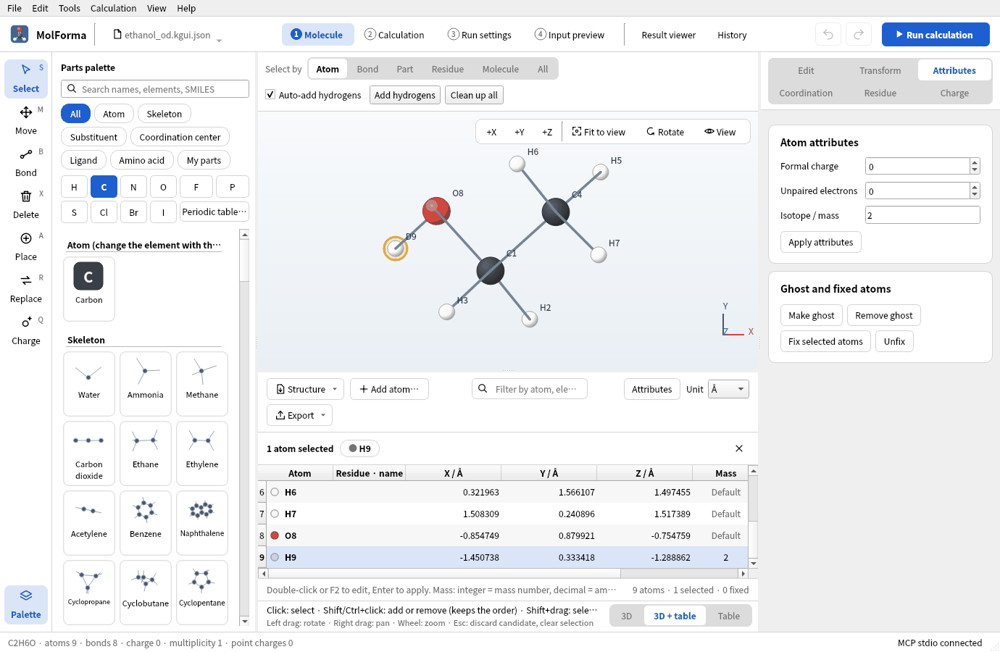

# Recipe 15 Isotopes and atom order (ethanol-OD)

Make the O–H hydrogen of optimized ethanol a deuterium and compute the frequencies again. The element is the same and only the mass changes, so the electronic energy at the same coordinates does not change, while frequencies, zero-point energy and thermochemistry do. Along the way, check masses in the coordinate table and tidy the atom order (the order of the `geometry` lines of the NWChem input).

| What you build | Details |
| --- | --- |
| Molecule | Ethanol-OD CH₃CH₂OD (9 atoms, charge 0, singlet) |
| Features | Isotope / mass on the “Attributes” page, the mass column and element cells (D, T) of the coordinate table, Sort atoms, a frequency-only calculation |
| Calculation | B3LYP/6-31G*, frequencies (at the structure optimized in [recipe 1](atoms_and_bonds.md)) |
| Run time | About 1 minute (8 MPI processes) |
| Practice data | `docs/recipes/samples/ethanol_opt.kgui.json` (optimized structure), `ethanol_od.kgui.json` (O–D) |

## 1. Start from the optimized structure

Frequencies are computed at a structure optimized with the same method and basis. Bring the result of [recipe 1](atoms_and_bonds.md) into “1 Molecule” with “History” → “Open in result viewer” → “Apply as candidate”, and confirm ([recipe 14](reuse_result.md)). The practice file `ethanol_opt.kgui.json` is that state.

## 2. Make the hydrogen a deuterium

1. Click the O–H hydrogen (H9) with the “Select” tool.
2. Enter 2 in “Isotope / mass” on the “Attributes” page on the right and press “Apply attributes”. An integer is a mass number (²H), a decimal the mass itself (amu, for example 2.0141). Applying an empty field returns to the default mass.
3. The label in the 3D view becomes “D9”.
4. Choosing “3D + table” at the right end of the strip under the 3D view shows the mass number 2 in the “Mass” column of the coordinate table (the other atoms say “Default”). If the row of the chosen atom is out of view, the table scrolls to it. Typing `D` or `T` in an “Atom” cell of the table also sets a hydrogen with mass number 2 or 3.

Changing the element (“Change selected atoms to it” and so on) removes the isotope. In the NWChem input, the `geometry` line ends with `mass 2.014101778` (mass numbers are converted to amu with Open Babel's isotope data).

## 3. Compute the frequencies

1. In “Basics” of “2 Calculation”, set the task to “Frequencies” (no optimization), with the method and basis of the optimization, B3LYP/6-31G*.
2. Run with “Run calculation” (F5) and compare the O–D and O–H stretches in the “Vibrations” tab of the “Result viewer” with the result of [recipe 1](atoms_and_bonds.md).

### Results

| Item | Ethanol ([recipe 1](atoms_and_bonds.md)) | Ethanol-OD |
| --- | --- | --- |
| Energy of the calculation | −155.033797408 Eh | −155.033797408 Eh (the same) |
| O–H / O–D stretch | 3751 cm⁻¹ | 2731 cm⁻¹ |
| C–H stretches | 2982–3134 cm⁻¹ | 2982–3134 cm⁻¹ (unchanged) |
| Zero-point correction | 50.37 kcal/mol | 48.32 kcal/mol |
| Entropy (298.15 K) | 64.34 cal/(mol·K) | 65.19 cal/(mol·K) |

The O–D stretch is 0.728 times the O–H stretch, close to the 1/√2 expected from the ratio of reduced masses. The electronic energy does not depend on masses and stays the same; the zero-point energy drops by 2.05 kcal/mol.

Choosing the three methyl hydrogens of CH3CH2OH together and giving them mass number 2 makes CD3CH2OH. “Apply attributes” with several atoms selected gives all of them the same isotope.

## 4. Tidy the atom order

The `geometry` lines of “4 Input preview” are in the order of the numbers in the 3D view. After adding and deleting atoms, the order can be mixed; sort it if needed.

1. Open “Sort atoms” in the “Structure” menu above the coordinate table and choose “By element”, “By residue” or “Selected atoms first”.
2. By element, the atoms come in the order C, H, O, …. Sorting can be undone.
3. Fixed atoms, constraints and scan atoms are kept by persistent IDs, so their numbers follow the new order (`fix atom` and `zcoord` use the new numbers).

## Troubleshooting

- **The mass does not change**: “Apply attributes” was not pressed. The “Mass” cell of the coordinate table can be edited directly too.
- **“Apply attributes” removed the mass**: With one atom selected and an empty field, applying returns it to the default mass.
- **Imaginary frequencies appear**: The frequencies use another method or basis than the optimization. Use a structure optimized under the same conditions.

See also: the coordinate table and NWChem output in “[Features and coverage](../features.md)”, [recipe 1 Building from atoms and bonds](atoms_and_bonds.md).
