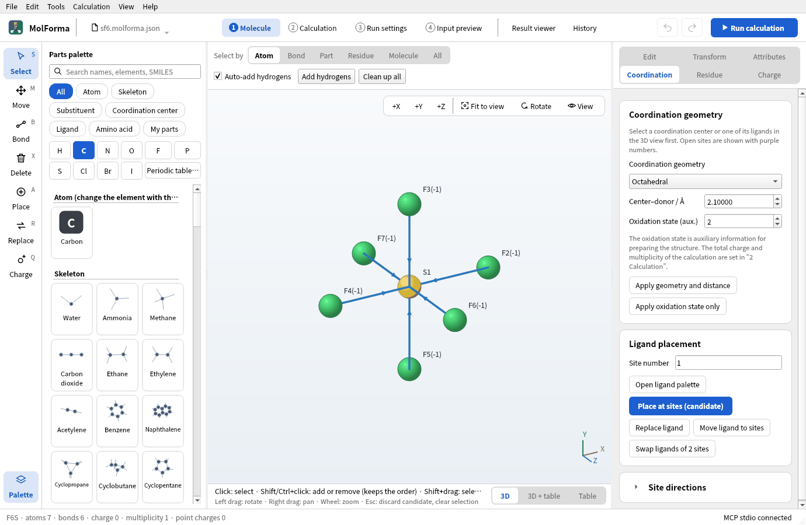
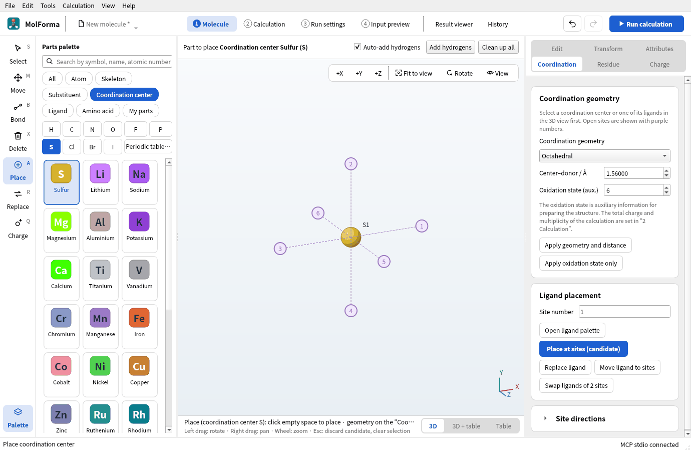
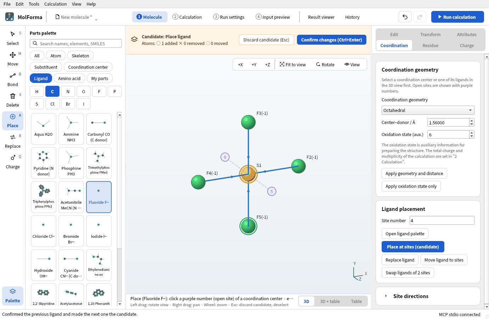
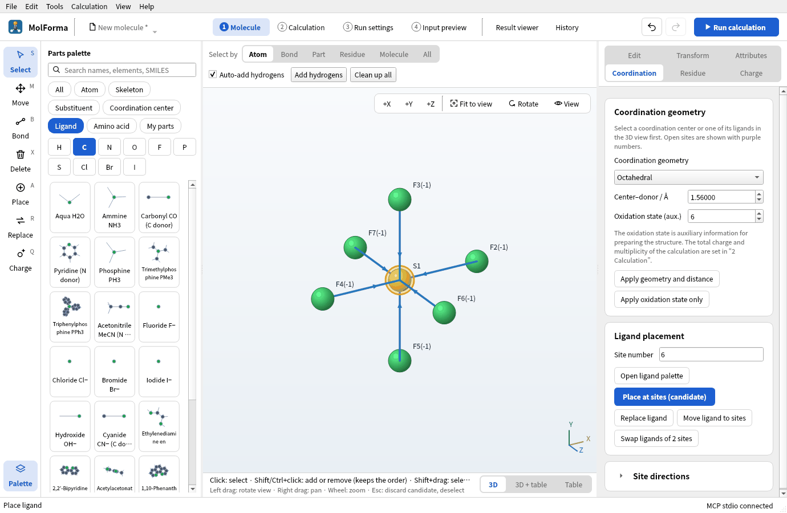
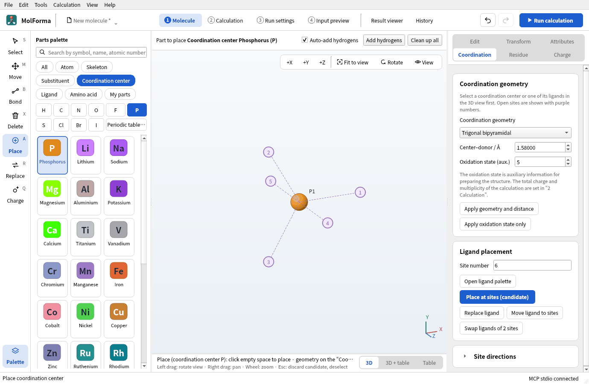
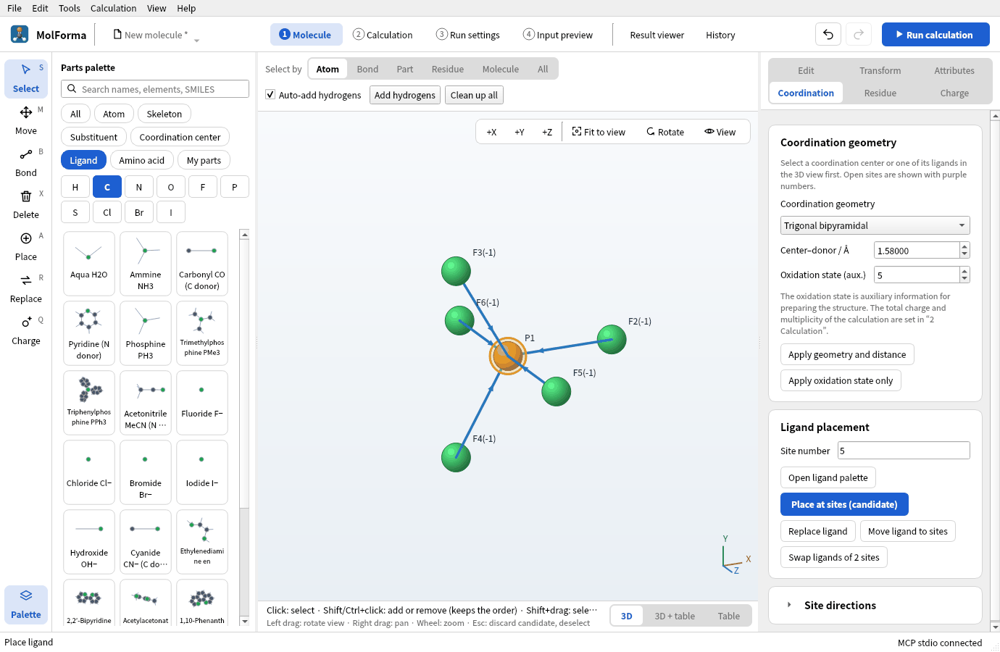
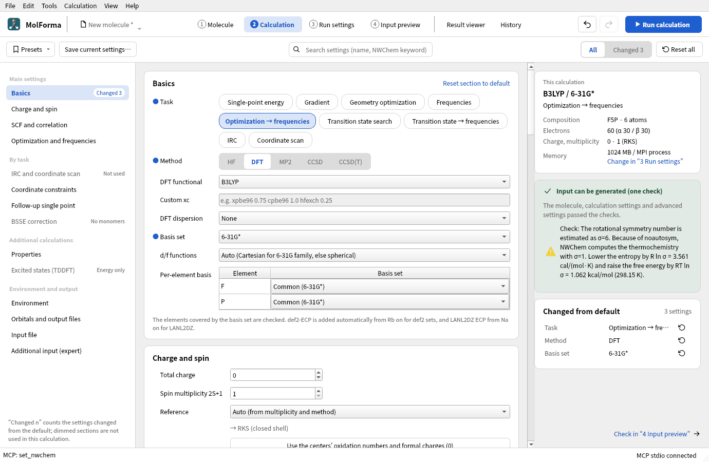
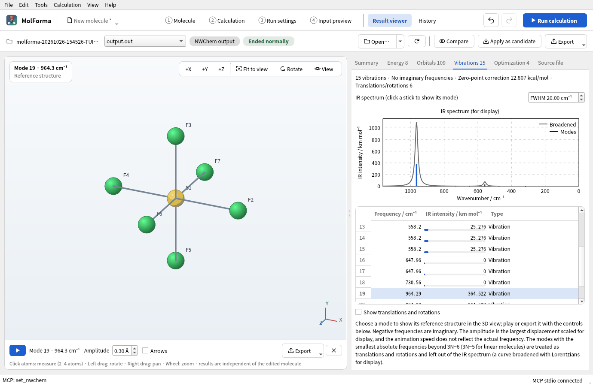

# Recipe 11 Main-group molecules (SF₆ and PF₅)

A coordination center does not have to be a metal. Place sulfur as an octahedral coordination center and put fluoride on its six sites to get SF₆; put phosphorus at the center of a trigonal bipyramid with five fluorides to get PF₅. Use the VSEPR shapes as starting structures and optimize them with B3LYP/6-31G* (with frequencies).

| What you build | Details |
| --- | --- |
| Molecule | SF₆ (7 atoms, octahedral), PF₅ (6 atoms, trigonal bipyramidal), both charge 0, singlet |
| Features | Choosing the center element with the element buttons, periodic table or search under “Coordination center”, coordination geometries, the charge following oxidation numbers, fluoride ligands, rotational symmetry numbers |
| Calculation | B3LYP/6-31G*, optimization → frequencies |
| Run time | About 4 minutes for SF₆ and 2 minutes for PF₅ (8 MPI processes) |
| Computer | AMD Ryzen 7 2700X (8 cores, 16 threads), 32 GB of memory, NWChem 7.3.1 on Linux |
| Practice data | [`sf6.molforma.json`](../../recipes/samples/sf6.molforma.json), [`pf5.molforma.json`](../../recipes/samples/pf5.molforma.json) |

## 1. Place sulfur as a coordination center

1. Start an empty molecule with “File → New” and choose the category “Coordination center” in the parts palette. The list shows metals.
2. Press the element button “S”. “Sulfur” joins the top of the list, highlighted, and “Place (coordination center S)” appears under the 3D view. Under “Coordination center”, the element buttons, “Periodic table…” and the search field (symbol, name, atomic number) choose non-metal centers too.
3. On the “Coordination” page on the right, set “Coordination geometry” to “Octahedral”, “Center–donor / Å” to 1.56 and “Oxidation state (aux.)” to 6.

   

   **Figure 1** The element button “S” adds sulfur to the top of the coordination centers.

4. Click in empty space in the 3D view. Purple sites 1–6 appear, and the total charge follows the S(VI) oxidation number to 6.

   

   **Figure 2** Clicking in empty space shows the six sites of the octahedron.

## 2. Place six fluorides

1. Click “Fluoride F−” in the category “Ligand”.
2. Click sites 1–4 in turn. From the second on, the previous ligand is confirmed before the next becomes a candidate.

   

   **Figure 3** Fluorides placed at sites 1–4. The last ligand is shown as a candidate.

3. Look from the side with “+X”, click sites 5 and 6, and press “Confirm changes”. You get SF₆ (F6S · 7 atoms · 6 bonds), and the total charge is back to 6 + 6×(−1) = 0.

   

   **Figure 4** Confirmed SF₆ (F6S · 7 atoms · 6 bonds).

The “Charge” page shows a formal charge sum of −6 and offers “Use oxidation and formal charges (0)”. Dative bonds (arrows to the center) are not written to the NWChem input; only atoms and coordinates are used.

Molecules with dative bonds are outside the force field even when the center is not a metal (“Clean up all” is not available). Change the starting distance on the “Coordination” page and let NWChem optimize.

## 3. Make PF₅

1. With “File → New”, press the element button “P” under the category “Coordination center”.
2. Set “Coordination geometry” to “Trigonal bipyramidal”, “Center–donor / Å” to 1.58 and “Oxidation state (aux.)” to 5, and click in empty space.

   

   **Figure 5** A trigonal bipyramid has three equatorial and two axial sites.

3. With “Fluoride F−”, click sites 1–3 (equatorial), look from the side with “+X”, click sites 4 and 5 (axial) and confirm. PF₅ (F5P · 6 atoms), total charge 0.

   

   **Figure 6** Confirmed PF₅ (F5P · 6 atoms).

A trigonal bipyramid has different equatorial and axial bonds (experiment: P–F 1.53 Å equatorial, 1.58 Å axial). Starting with all at 1.58 Å, the optimization separates them. To separate them from the start, open “Site directions” on the “Coordination” page and give directions and distances per site.

## 4. Run and look at the results

For SF₆ and PF₅, set the task to “Optimization → frequencies”, the method to “DFT” (B3LYP) and the basis set to “6-31G*” in “2 Calculation”, and run.

The checks note the estimated rotational symmetry number (σ=24 for SF₆, σ=6 for PF₅) and the entropy and free-energy corrections. NWChem's thermochemistry uses σ=1, so add these corrections when comparing with literature values.

**Figure 7** The settings of PF₅ and the note on the rotational symmetry number.

### Results

| Item | SF₆ | PF₅ |
| --- | --- | --- |
| Energy of the calculation | −997.106811197 Eh | −840.676345065 Eh |
| Optimization | Converged in 3 steps | Converged in 2 steps |
| Bond lengths | S–F 1.600 Å (experiment 1.564 Å) | P–F 1.569 Å equatorial, 1.597 Å axial (experiment 1.534, 1.577 Å) |
| Imaginary frequencies | None | None |
| IR-active vibrations (triply, doubly degenerate) | 964 and 558 cm⁻¹ (experiment 939, 615 cm⁻¹) | 1021, 995, 544, 503 cm⁻¹ |
| Entropy (298.15 K, σ=1) | 77.22 cal/(mol·K) | 76.00 cal/(mol·K) |

Corrected with the rotational symmetry number σ=24, the entropy of SF₆ is 77.22 − 6.32 = 70.90 cal/(mol·K), close to experiment (69.7). Degenerate vibrations appear with the same frequency in the “Vibrations” tab.

**Figure 8** The “Vibrations” tab of SF₆. A degenerate vibration appears as three rows with the same frequency.

## Troubleshooting

- **A metal is placed**: Check that you pressed the element button under the category “Coordination center” and that the 3D view says “Place (coordination center S)”. Pressing “S” under “Atom” or “All” places an ordinary sulfur atom (with hydrogens added), not a center.
- **Sites 5 and 6 cannot be seen**: From the front they overlap the center. Turn the view with “+X” or “+Y”.
- **The total charge does not come back to 0**: It does not follow if it was changed by hand before the ligands were placed. Use “Use oxidation and formal charges (0)” on the “Charge” page.

See also: [recipe 2 Coordination compounds](cobalt_complex.md), atom palette and periodic table in [“1 Molecule”: layout, tools and selection](../features/molecule.md).
