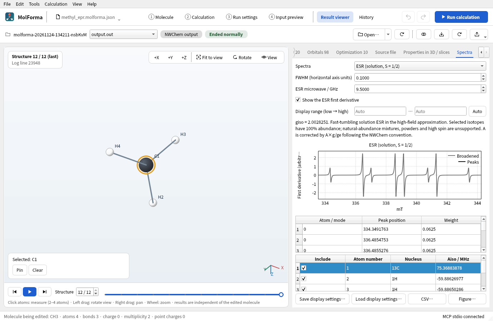

# Recipe 19 Calculating ESR (EPR) and comparing with experiment (methyl radical)

Calculate the g tensor and hyperfine coupling tensors of the simplest π radical, the methyl radical CH₃•, at B3LYP/def2-TZVP (ZORA). Draw the solution ESR spectrum in the result viewer and see the four 1:3:3:1 lines of the three equivalent hydrogens, and how they split once ¹³C is included. Compare with published experimental values, and consider the sign of hyperfine couplings, why a planar-structure calculation gives too small a ¹³C value (molecular vibration), and how the results depend on the basis set.

| What you build | Details |
| --- | --- |
| Molecule | Methyl radical CH₃• (4 atoms, charge 0, doublet) |
| Features | Placing and deleting atoms, unpaired electrons on the “Attributes” page, multiplicity and reference (UKS), relativistic Hamiltonian (ZORA), ESR g and A tensors, the result viewer's “Spectra” (solution ESR), choosing the nuclei to include |
| Calculation | Gas phase, B3LYP/def2-TZVP (ZORA), geometry optimization → g and A tensors; for comparison, a single point of the structure as built |
| Run time | About 1 minute (8 MPI processes: optimization 42 seconds, g and A 15 seconds); the single point of step 5 takes about 20 seconds; without NWChem, open the completed results below for comparison |
| Computer | AMD Ryzen 7 2700X (8 cores, 16 threads), 32 GB of memory, NWChem 7.3.1 on Linux; run on 2026-11-24 through MolForma MCP |
| Practice data | [`methyl_epr.molforma.json`](../../recipes/samples/methyl_epr.molforma.json) (the methyl radical as built, with the calculation settings) |

The practice file holds the structure and the calculation settings only, without results or run settings. To run the calculation yourself, check NWChem, MPI and the job folder in “3 Run settings”.

## Open the completed results (no recalculation needed)

**[Download the calculation log (.out, 1.54 MB)](https://github.com/hnakada123/MolForma/releases/download/methyl-epr-data-v1/methyl_epr.out)** · [SHA-256](https://github.com/hnakada123/MolForma/releases/download/methyl-epr-data-v1/methyl_epr.out.sha256)

[Full set including comparison tables and figures (ZIP, 2.68 MB)](https://github.com/hnakada123/MolForma/releases/download/methyl-epr-data-v1/methyl_epr_results_v1.zip) · [ZIP SHA-256](https://github.com/hnakada123/MolForma/releases/download/methyl-epr-data-v1/methyl_epr_results_v1.zip.sha256)

This is the NWChem output log of this page's calculation (2026-11-24). One log holds the geometry optimization and the g and A tensors, so no NWChem rerun is needed to inspect the results. Besides this log, the ZIP contains the logs of step 5 (the structure as built) and of the tables of step 6 (basis sets, carbon moved out of the plane), the input files, the practice project, the structures as XYZ, tables of the hyperfine couplings, g tensor, line positions and experimental comparisons as CSV, the calculated curves as CSV, the charts as PDF and PNG, and viewing instructions in English and Japanese.

| Individual file | What you can inspect |
| --- | --- |
| [Calculated spectra (PDF)](https://github.com/hnakada123/MolForma/releases/download/methyl-epr-data-v1/methyl_epr_calculated.pdf) | Calculated solution ESR with the protons alone and with ¹³C too (9.5 GHz, FWHM 0.1 mT, first derivative), with splitting diagrams, in an ordinary PDF viewer |
| [Experimental comparison (PDF)](https://github.com/hnakada123/MolForma/releases/download/methyl-epr-data-v1/methyl_epr_comparison_en.pdf) | The comparisons of step 6 as a figure: four lines drawn from the experimental g and a against the calculated ones, and the hyperfine couplings as the carbon moves and as the basis set changes |

1. Save `methyl_epr.out` above. With the ZIP, choose `logs/methyl_epr.out` in the extracted folder.
2. In MolForma, open that file with “Result viewer → Open…”.
3. Choose the “Spectra” tab on the right to show the solution ESR chart. From there, item 3 of step 3 and step 4 work as written. For step 5, open `logs/methyl_epr_as_built.out` of the ZIP the same way.

Reading ESR (g and A tensors, solution ESR) requires MolForma 1.1.0 or later. MolForma 1.0.0 cannot display ESR; use the PDFs and CSVs instead.

Only the hostname and NWChem build-source path have been redacted in the distributed log. Coordinates and numerical results are unchanged. This is a viewing dataset; NWChem restart databases and orbital files are not included. See `README.en.txt` in the archive for details.

## 1. Build the methyl radical

1. Start an empty molecule with “File → New”, press the element button “C” and click an empty spot of the 3D view. You get methane (CH4 · 5 atoms), as in figures 1 and 2 of [recipe 1](atoms_and_bonds.md).
2. With the “Delete” tool in the leftmost column, click one hydrogen and press “Confirm changes”. You have CH3 · 4 atoms. Now 9 electrons (odd) do not fit multiplicity 1, and “2 Calculation” says “9 electrons do not fit multiplicity 1.” (as in figure 2 of [recipe 10](phenoxyl_radical.md)).
3. Click the carbon with the “Select” tool, set “Unpaired electrons” to 1 on the “Attributes” page on the right and press “Apply attributes”.
4. Set “Spin multiplicity 2S+1” to 2 in “Charge and spin” of “2 Calculation”. “→ UKS (open shell)” appears under the reference.

The structure as built is a pyramid, methane without one hydrogen (H–C–H about 107–110°). The geometry optimization of the next step makes it planar.

## 2. Choose the calculation settings

1. In “Basics” of “2 Calculation”, set the task to “Geometry optimization”, the method to “DFT” (B3LYP) and the basis set to “def2-TZVP”.
2. Under “SCF and correlation”, set “Relativistic Hamiltonian” to “ZORA (DFT only)”.
3. Under “Properties”, turn on “ESR g and A tensors (doublet DFT / ZORA)”.
4. Choose “Changed” at the top to list only the settings you changed. “Changed from default” on the right shows the task, method, basis set, relativistic Hamiltonian and ESR g and A tensors (the practice file also sets the title under “Input file” to methyl radical).

   

   **Figure 1** The calculation settings of the methyl radical (the “Changed” view).

5. In “4 Input preview”, check for `zora on` in the `relativistic` block, `mult 2` and `odft` in the `dft` block, and after `task dft optimize` a `property` block (`gshift` and `hyperfine`) and `task dft property`.

ESR g and A tensors need multiplicity 2 (one unpaired electron), unrestricted DFT and ZORA. They cannot be combined with a follow-up single point or ghost centers ([Calculation settings](../features/calculation.md)). NWChem calculates the g shift and the hyperfine couplings within its ZORA treatment (the output headings read “ZORA g-Shift” and “ZORA NMR Hyperfine”), hence the ZORA setting. For a molecule of carbon and hydrogen alone, relativistic effects themselves are very small.

## 3. Run and show the solution ESR

1. Run with “Run calculation” (F5). After the geometry optimization, NWChem calculates the g shift and the hyperfine couplings at the optimized structure.
2. When the run has finished, open the job with “View results” of the run panel (or “Open in result viewer” in “History”) and choose the “Spectra” tab on the right. The kind is “ESR (solution, S = 1/2)”, the microwave 9.5 GHz (X band), the FWHM 0.1 mT, and “Show the ESR first derivative” is on.
3. The table of nuclei below lists each atom's “Nucleus” and “Aiso / MHz” (isotropic hyperfine coupling constant). Atom number 1, ¹³C (75.37 MHz), has “Include” off; atoms 2–4, ¹H (−59.89 MHz), have it on. Choosing a row marks that atom in the 3D view. Turn the 3D view with a left drag to see that the radical has become a planar equilateral triangle.

**Figure 2** Solution ESR of the methyl radical (B3LYP/def2-TZVP, 9.5 GHz, FWHM 0.1 mT, protons only).

The four lines of the chart lie at 335.69, 337.83, 339.97 and 342.10 mT, 2.136 mT apart, around a center at 338.90 mT. The three equivalent ¹H nuclei (nuclear spin 1/2) can point “all three up”, “two up”, “one up” or “none up”, in 1, 3, 3 and 1 ways, so the lines have intensities 1:3:3:1. The spacing of the lines is the magnitude of the hyperfine coupling constant a, the position of the center is set by the g value. The text above the chart reads giso = 2.0028251.

An ESR instrument modulates the magnetic field to detect the absorption, so measured spectra have the shape of the first derivative of the absorption. The default first-derivative display follows this; the center of a line is where the curve crosses zero. Turning off “Show the ESR first derivative” shows the absorption.

The peak table lists each line's position (mT) and weight: 0.125, 0.375, 0.375 and 0.125 (1:3:3:1, adding up to 1). The Aiso of the three hydrogens differ by about 0.002 MHz through numerical noise of the calculation, but MolForma treats nuclei of one isotope whose Aiso differ by less than 0.01 MHz as equivalent.

### Results

| Item | Value |
| --- | --- |
| Calculated energy | −39.881382250 Eh |
| Geometry optimization | Converged (10 points in the “Optimization” tab) |
| Structure | Planar, C–H 1.079 Å, H–C–H 120.0° |
| Isotropic g value | 2.00283 (Δg = g − ge = +0.51 × 10⁻³) |
| Hyperfine couplings (isotropic) | ¹³C +75.37 MHz (+2.689 mT), ¹H −59.89 MHz (−2.136 mT) ×3 |
| Run time | Optimization 42 seconds, g and A 15 seconds (8 MPI processes) |

MHz convert to mT by A / (g μB / h) (28.03 MHz/mT at giso = 2.00283). The Aiso in the table of nuclei is corrected by A×g/ge following the NWChem convention, so its fourth digit differs a little from the log (−59.87 MHz for ¹H) ([Result viewer](../features/results.md#nmr-normal-raman-and-solution-esr-spectra)).

## 4. Include ¹³C

1. In the table of nuclei, turn on “Include” of atom number 1 (¹³C). Each of the four lines splits in two, giving eight lines between 334.35 and 343.45 mT.

   

   **Figure 3** With ¹³C included, the 1:3:3:1 quartet splits into two sets by the ¹³C hyperfine coupling (2.689 mT).

2. Set “ESR microwave / GHz” to 34 (Q band). The center of the chart moves to about 1212.9 mT, but the spacing of the lines stays the same. In field units, hyperfine splittings do not depend on the frequency; only the center (the g value) moves in proportion to it. Set it back to 9.5 afterwards.

¹³C has nuclear spin 1/2 and splits each line in two. MolForma draws the spectrum of molecules that contain the chosen isotope at 100% (here ¹³CH₃). Natural carbon holds about 1.1% ¹³C, so the spectrum of an ordinary methyl radical is mainly the four lines of ¹²CH₃, with the eight lines of ¹³CH₃ on top as weak satellites carrying about 1% of the total intensity together. Natural-abundance mixtures are not drawn.

## 5. Calculate the structure as built (pyramidal)

1. In “2 Calculation”, set the task to “Single-point energy”. The molecule is still the pyramid as built, before the optimization (calculation results do not change the molecule). Leave ESR g and A tensors on.
2. Run with “Run calculation” and look at the table of nuclei in the “Spectra” tab of the result viewer.

| Item | Planar (step 3) | As built (pyramidal) |
| --- | --- | --- |
| Angle between the C–H bonds and the plane of the three H (out-of-plane angle) | 0° | 20.9° |
| Energy difference | 0 | +9.33 kcal/mol |
| Isotropic g value | 2.00283 | 2.00285 |
| a(¹H) / mT | −2.136 | −0.40 to −0.49 |
| a(¹³C) / mT | +2.689 | +13.44 |

As a pyramid, the ¹³C hyperfine coupling is five times that of the planar radical, while ¹H becomes small. The H–C–H angles of the structure as built differ a little, so the three hydrogens differ a little too. The g value hardly changes.

## 6. Compare with experiment

The experimental values are those measured by Fessenden and coworkers. The spacing of lines only gives the magnitude of a, so the signs of the experimental values follow the textbook by Weil and Bolton, and ¹³C is given as a magnitude. 1 mT = 10 G (gauss).

| Quantity | Calculated (planar, B3LYP/def2-TZVP) | Experiment | Source of the experiment |
| --- | ---: | ---: | --- |
| Isotropic g value | 2.00283 | 2.00255 | Fessenden & Schuler (1963) |
| a(¹H) / mT | −2.136 | −2.304 | Fessenden & Schuler (1963) |
| a(¹³C) / mT | +2.689 | 3.83 (96 K) | Fessenden (1967) |
| a(¹³C) of the planar structure / mT | +2.689 | 2.70 (estimated from the analysis of experiment) | Fessenden (1967), table III of Adam et al. (2015) |

The calculation gives the magnitude of a for ¹H 7% too small and for ¹³C 30% too small. For ¹³C, it agrees well with the value of the planar structure estimated from the analysis of experiment (2.70 mT). The next table repeats the optimization and the g and A tensors with the settings of step 3, changing only the basis set.

| Basis set | C–H / Å | Isotropic g value | a(¹H) / mT | a(¹³C) / mT |
| --- | ---: | ---: | ---: | ---: |
| 6-31G* (Cartesian 6d functions) | 1.083 | 2.00274 | −2.532 | +4.410 |
| 6-311+G** | 1.081 | 2.00283 | −2.252 | +2.551 |
| def2-TZVP (this recipe) | 1.079 | 2.00283 | −2.136 | +2.689 |
| x2c-TZVPall | 1.079 | 2.00283 | −2.136 | +2.750 |

The other table moves only the carbon of the optimized structure of step 3 perpendicular to the plane of the three hydrogens and calculates single points at the same settings (the hydrogens stay put, so the C–H bonds also lengthen a little).

| Carbon moved by / Å | Out-of-plane angle | C–H / Å | Energy difference / kcal mol⁻¹ | Isotropic g value | a(¹H) / mT | a(¹³C) / mT |
| ---: | ---: | ---: | ---: | ---: | ---: | ---: |
| 0 (optimized structure) | 0° | 1.079 | 0 | 2.00283 | −2.136 | +2.689 |
| 0.1 | 5.3° | 1.084 | 0.33 | 2.00282 | −1.980 | +3.600 |
| 0.2 | 10.5° | 1.097 | 1.74 | 2.00282 | −1.558 | +6.151 |
| 0.3 | 15.5° | 1.120 | 5.24 | 2.00281 | −0.977 | +9.890 |

## 7. Assess where the calculation is useful

First check these questions yourself from the figures and tables.

1. The calculated a(¹H) is negative. Can you tell the sign from the spectrum? The unpaired electron is in a carbon 2p orbital, perpendicular to the molecular plane with a node at the hydrogens; why is there spin density at the hydrogen nuclei?
2. The calculated ¹³C value is 30% below experiment, yet agrees well with the estimate for the planar structure. From step 5 and the last table, what is missing from a calculation of the planar structure?
3. How many mT does the difference between the calculated and experimental g values shift a line at 9.5 GHz? Compare with the line width of 0.1 mT.
4. Which changes more with the basis set, ¹H or ¹³C?

### An example interpretation

- **The number of lines and their intensities are predicted reliably.** n equivalent nuclei of spin 1/2 give n + 1 lines with binomial intensities: four 1:3:3:1 lines for three ¹H, eight with ¹³C. The number and spacing of lines tell which nuclei interact with the unpaired electron, and how many of them.
- **The sign does not show in the spectrum.** Line positions depend on the magnitude of a alone. a(¹H) is negative through spin polarization: by exchange, the unpaired (α) electron in the carbon 2p orbital slightly polarizes the electron pair of the C–H σ bond, leaving a little more β spin at the hydrogen nucleus. In McConnell's relation a(H) = Q·ρ(C) between the π spin density ρ(C) and the hydrogen hyperfine coupling, Q ≈ −2.2 to −2.3 mT (Weil and Bolton), and the measured −2.304 mT of the methyl radical, with ρ(C) = 1, lies in this range. This calculation gives Q = −2.14 mT. The positive ¹³C value of the planar methyl radical also comes not from the 2p orbital but from spin polarization of the inner 1s and 2s electrons.
- **The ¹³C difference comes from molecular vibration.** The calculation is the value at one point, the planar equilibrium structure; experiment averages over a vibrating molecule. The methyl radical has a soft vibration that flips the molecule like an umbrella (the umbrella mode; experimental frequency 606.5 cm⁻¹, table I of Adam et al. 2015), with a zero-point energy of about 300 cm⁻¹ (0.87 kcal/mol). Moving the carbon by 0.1 Å costs 116 cm⁻¹ (0.33 kcal/mol), within the zero-point motion. In a pyramid, the carbon 2s orbital mixes into the orbital of the unpaired electron, and ¹³C rises steeply: by 0.91 mT at 0.1 Å and 7.2 mT at 0.3 Å. The vibrational average is larger than the planar value. In the high-level calculation of Adam et al. (2015), zero-point vibration adds 44% of the planar value (1.13 mT).
- **A rough estimate.** From the 0.1 Å point of the last table, approximate the energy by 116 cm⁻¹ × (d / 0.1 Å)² and the increase of ¹³C by 0.91 mT × (d / 0.1 Å)². In the zero-point state of a harmonic oscillator the mean potential energy is a quarter of the frequency (152 cm⁻¹), so the mean of d² is 0.013 Ų, ¹³C increases by about 1.2 mT and averages about 3.9 mT. This is close to the experimental 3.83 mT, but only a rough estimate that describes the vibration by the displacement of the carbon alone and uses the experimental frequency.
- **The ¹H difference is not explained by vibration.** Moving the carbon makes a(¹H) smaller in magnitude, so a vibrational average takes the calculation further from experiment. The planar a(¹H) is too small in magnitude to begin with, which is an error of the functional and the basis set. The −2.532 mT of 6-31G* looks close to experiment, but the same basis set misses ¹³C badly at 4.4 mT: the errors cancel.
- **The g value stays close to ge.** Experiment gives Δg = 2.00255 − 2.00232 = +0.23 × 10⁻³, the calculation +0.51 × 10⁻³. Shifts of g come from spin–orbit coupling, which is small in a molecule of carbon and hydrogen alone. The difference of 0.00028 between calculation and experiment moves the center by 0.05 mT at 9.5 GHz (338.90 mT calculated, 338.94 mT with the experimental g), less than the line width of 0.1 mT. The g value hardly changes in a pyramid either.
- **¹³C is sensitive to the basis set.** The ¹H value is about settled with a triple-zeta basis, but ¹³C changes widely, from 4.41 mT with 6-31G* to 2.75 mT with x2c-TZVPall. Describing the spin density at a nucleus needs steep s functions close to it.

What this calculation offers is the number of lines and their intensities, which nuclei split them and by how much, and the signs of hyperfine couplings and their origin. For a molecule with a soft vibration such as the methyl radical, the difference between a calculation at one equilibrium structure and experiment contains a large vibrational average. It is a calculation of one molecule in the gas phase, so solvent effects and line widths (set by molecular motion) need separate consideration.

As a further exercise, build CF₃, a pyramidal σ radical (experimental a(¹³C) 27.1 mT, Weil and Bolton), calculate it and compare its ¹³C with that of the methyl radical. This is not a calculation run for this page.

## Troubleshooting

- **Turning on “ESR g and A tensors” gives an error in the checks**: Check that the multiplicity is 2, the method is DFT with an unrestricted reference (→ UKS) and the relativistic Hamiltonian is ZORA. It cannot be turned on with a follow-up single point or ghost centers.
- **“9 electrons do not fit multiplicity 1.” appears**: Set the multiplicity to 2 in “Charge and spin”. Double-clicking the line in the checks fixes it too.
- **No ESR in the “Spectra” tab**: If the calculation stopped before the g and A tensors, the log has no tables of g shifts and hyperfine couplings. Check in the run panel or “History” that it ended normally.
- **The wrong number of lines, or lines that run together**: Check “Include” in the table of nuclei. By default only H, N, F and P nuclei are included. A large FWHM makes close lines overlap. Experimental papers often give line widths peak to peak (between the maximum and minimum of the first derivative); for a Lorentzian line, the peak-to-peak width = FWHM / √3.
- **“Hyperfine coupling is too large for the high-field ESR approximation.” appears**: When the total splitting of the included nuclei exceeds 10% of the microwave energy, the first-order high-field approximation does not hold and nothing is shown. Raise the microwave frequency or include fewer nuclei.
- **Your numbers differ from the tables**: Check the basis set, the DFT grid (fine in this recipe), SCF convergence and that the geometry optimization converged. The ¹³C value is particularly sensitive to the basis set and the structure. Aiso in the table of nuclei is corrected by A×g/ge, so its fourth digit differs from the log.

Sources: the experimental ¹H and g from R. W. Fessenden, R. H. Schuler, J. Chem. Phys. 39, 2147 (1963); ¹³C (96 K) and the estimate for the planar structure from R. W. Fessenden, J. Phys. Chem. 71, 74 (1967), as given in table III of A. Y. Adam, A. Yachmenev, S. N. Yurchenko, P. Jensen, J. Chem. Phys. 143, 244306 (2015), [doi:10.1063/1.4938253](https://doi.org/10.1063/1.4938253). The experimental frequency of the umbrella mode and the zero-point increase of ¹³C are also from tables I and III of Adam et al. (2015). The sign of ¹H and McConnell's Q follow J. A. Weil, J. R. Bolton, Electron Paramagnetic Resonance, 2nd ed., Wiley (2007), section 9.2, and the ¹³C of CF₃ section 9.3 of the same book. For the method, see [NWChem's EPR and pNMR](https://nwchemgit.github.io/EPR-pNMR.html).

Related: [the list of recipes](../recipes.md), [recipe 10 Ions and radicals](phenoxyl_radical.md) (multiplicity and reference), [recipe 17 Calculating NMR and comparing with experiment](ethanol_nmr.md), [recipe 18 Calculating normal Raman and comparing with experiment](benzene_raman.md), [Calculation settings](../features/calculation.md), [Result viewer](../features/results.md#nmr-normal-raman-and-solution-esr-spectra).
