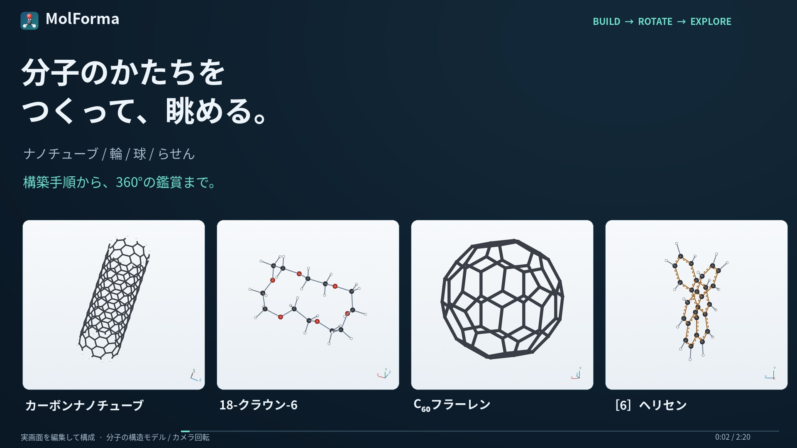

# Recipe 20 Explore molecular shapes (four molecules from the video)

Open and rotate the carbon nanotube, 18-crown-6, C₆₀ fullerene and [6]helicene from the 2-minute-20-second introduction video in your own MolForma. The practice files contain the atomic coordinates and bonds shown in the video. **This is a viewing exercise: NWChem and run settings are not needed.**

| What you build | Details |
| --- | --- |
| Molecules | Four shapes: a tube, a ring, a sphere and a helix |
| Features | Open projects and SDF files, rotate, zoom, display styles, coordinate table, From SMILES, Get from PubChem |
| Calculation | None in this exercise. The files are structure models, not NWChem optimization results |
| Practice data | Download the “Project” for the molecule you want from the next table |



## 1. Open the molecules from the video

| Molecule | Formula, atoms and bonds | Project (the structure in the video) | SDF for import |
| --- | --- | --- | --- |
| Carbon nanotube | C₂₄₀H₂₄, 264 atoms, 372 bonds | [nanotube.molforma.json](../../recipes/samples/nanotube.molforma.json) | [nanotube.sdf](../../recipes/samples/nanotube.sdf) |
| 18-Crown-6 | C₁₂H₂₄O₆, 42 atoms, 42 bonds | [crown.molforma.json](../../recipes/samples/crown.molforma.json) | See the SMILES instructions below |
| C₆₀ fullerene | C₆₀, 60 atoms, 90 bonds | [c60.molforma.json](../../recipes/samples/c60.molforma.json) | [c60.sdf](../../recipes/samples/c60.sdf) |
| [6]Helicene | C₂₆H₁₆, 42 atoms, 47 bonds | [helicene.molforma.json](../../recipes/samples/helicene.molforma.json) | [helicene.sdf](../../recipes/samples/helicene.sdf) |

1. Click a “Project” link to save the file. From the in-app manual, choosing where to save it also opens the molecule.
2. In MolForma, choose “File → Open…” and open the saved `.molforma.json` file.
3. In “1 Molecule”, click “Fit to view”. Compare the formula and atom and bond counts in the status bar with the table.
4. Open another file in the same way to view a different molecule. To keep your edits, first save a separate copy with “File → Save as…”.

The projects include coordinates and bonds, so opening them needs neither an internet connection nor regeneration of the structure. Use “File → Open…” for SDF files too. Aromatic bonds are recognized when an SDF is imported, which may change how bond lines are drawn; the atomic coordinates are preserved.

## 2. Explore by rotating and changing the display

Choose the “Select” tool, then **left-drag** in the 3D view to rotate the camera. The wheel zooms and right-drag pans. These operations leave the atomic coordinates unchanged. The “Rotate” sliders also set the horizontal, vertical and in-plane angles. If labels overlap, choose “View → Labels → None”.

| Molecule | Try this | Look for |
| --- | --- | --- |
| Nanotube | Choose “View → Display style → Stick” and rotate from the side. Click “+Y” to look along the tube axis, then zoom with the wheel | The hexagonal mesh and the hollow center. The white atoms at the ends are hydrogens |
| 18-Crown-6 | Rotate in ball-and-stick, then switch to spacefill (CPK) | The 18-atom ring with six red oxygens. Including hydrogens, the molecule has 42 atoms |
| C₆₀ | Rotate slowly in stick style | The closed cage formed by 12 pentagons and 20 hexagons |
| [6]Helicene | Turn from a nearly front-on view to a side view | Six fused rings that cannot all lie in one plane, with the ends overlapping at different heights |

Choose “3D + table” below the view to inspect the same atoms' coordinates. To change only the viewpoint, avoid dragging atoms with the “Move” tool. Sphere sizes, colors and bond widths are display conventions. The video also shows camera rotation, not a simulation of molecular motion.

## 3. Prepare structures as in the video

### Nanotube and C₆₀: open the supplied SDF files

For these two molecules, coordinates and bonds were generated outside MolForma, saved as SDF and imported through “File → Open…”. This exercise does not use a dedicated nanotube-generation button in MolForma. Open `nanotube.sdf` and `c60.sdf` above to follow the import steps shown in the video.

### 18-Crown-6: build from SMILES

1. Open “File → From SMILES…”.
2. Enter this single line and click “Build 3D”.

   ```text
   C1COCCOCCOCCOCCOCCO1
   ```

3. Open Babel generates 3D coordinates and cleans up the geometry with a force field. The structure appears as a candidate. Check for C12H24O6, 42 atoms and 42 bonds, then click “Confirm changes”.
4. Save the project with “File → Save as…”.

Generating the structure again may produce another conformation of the ring. Open the supplied `crown.molforma.json` to inspect the exact conformer shown in the video.

### [6]Helicene: get it from PubChem

1. With an internet connection, open “File → Get from PubChem…”.
2. Enter CID `98863` and click “OK”.
3. When the 3D structure appears, check for C26H16, 42 atoms and 47 bonds.

The video used PubChem's 3D structure. PubChem entries can change; open the supplied `helicene.molforma.json` or `helicene.sdf` to use the saved coordinates from the video.

## 4. Where the data came from

**[6]Helicene is the molecule whose 3D coordinates were downloaded from an external database.** The other three structures were generated for the video. The practice files were prepared on 2026-11-28.

| Molecule | Source or construction method | What the files represent |
| --- | --- | --- |
| Nanotube | Generated with a custom script, not a downloaded structure. A hexagonal lattice with a C–C spacing of 1.42 Å was mapped onto a (6,6) armchair cylinder for 10 axial repeats; both ends were terminated with hydrogens at C–H distances of 1.09 Å | Ideal coordinates of a finite tube, without geometry optimization, periodic boundary conditions or closed caps |
| 18-Crown-6 | The SMILES above was entered into MolForma, which used Open Babel for 3D generation and force-field cleanup. No coordinates were downloaded | One generated conformer, not the result of a lowest-energy conformer search |
| C₆₀ | A custom script constructed 60 vertices and 90 edges of a truncated icosahedron, then relaxed the structure with RDKit's UFF force field. The coordinates were not downloaded | A force-field-relaxed model, not an NWChem optimization result |
| [6]Helicene | The 3D structure of [PubChem CID 98863 ([6]Helicene)](https://pubchem.ncbi.nlm.nih.gov/compound/98863), retrieved on 2026-11-28. [3D SDF download endpoint used (PUG REST)](https://pubchem.ncbi.nlm.nih.gov/rest/pug/compound/cid/98863/SDF?record_type=3d) | Public 3D coordinates. The supplied SDF is the downloaded file; the project was imported and saved by MolForma. No further geometry optimization was performed for this exercise |

The PubChem links point to the external source; the practice-data links above provide the saved files used here. The projects let you inspect the same structures regardless of later source updates or network availability.

## Troubleshooting

- **The browser displays the file as text**: Right-click the link and choose “Save link as”, keeping the `.molforma.json` or `.sdf` extension.
- **The molecule is tiny or missing**: Click “Fit to view” in “1 Molecule”, then zoom with the wheel. Also check “View → Show all atoms”.
- **You accidentally changed the geometry**: Undo the edit or reopen the supplied project. Use the “Select” tool when rotating the view.
- **PubChem cannot be reached**: Open the supplied helicene project or SDF to view it offline.

See [“1 Molecule”](../features/molecule.md) for the view controls, and [recipe 4](caffeine_smiles.md) for building from SMILES and structure files.
