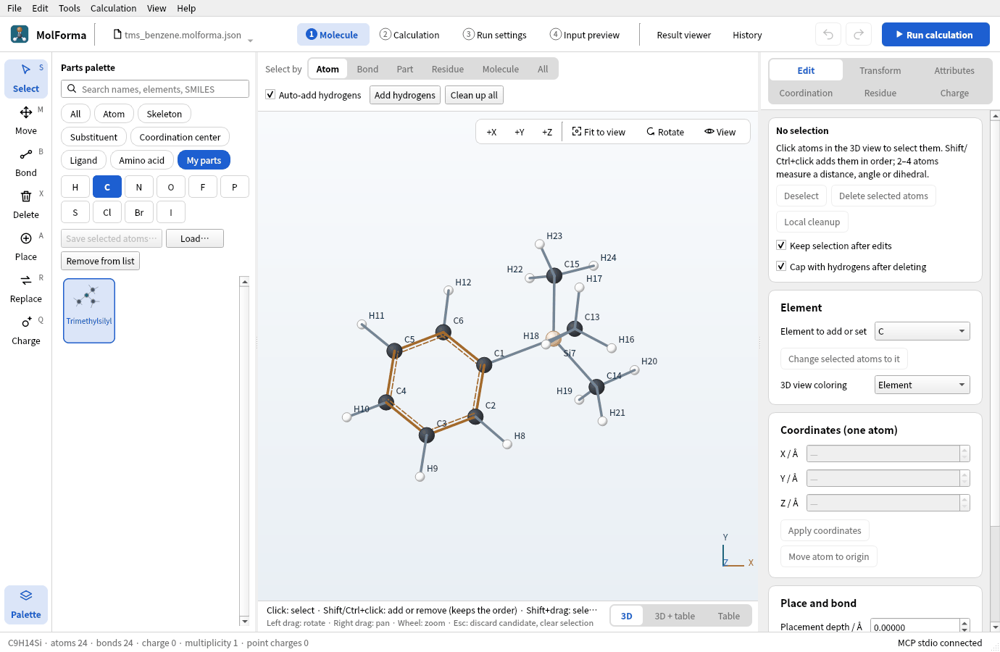
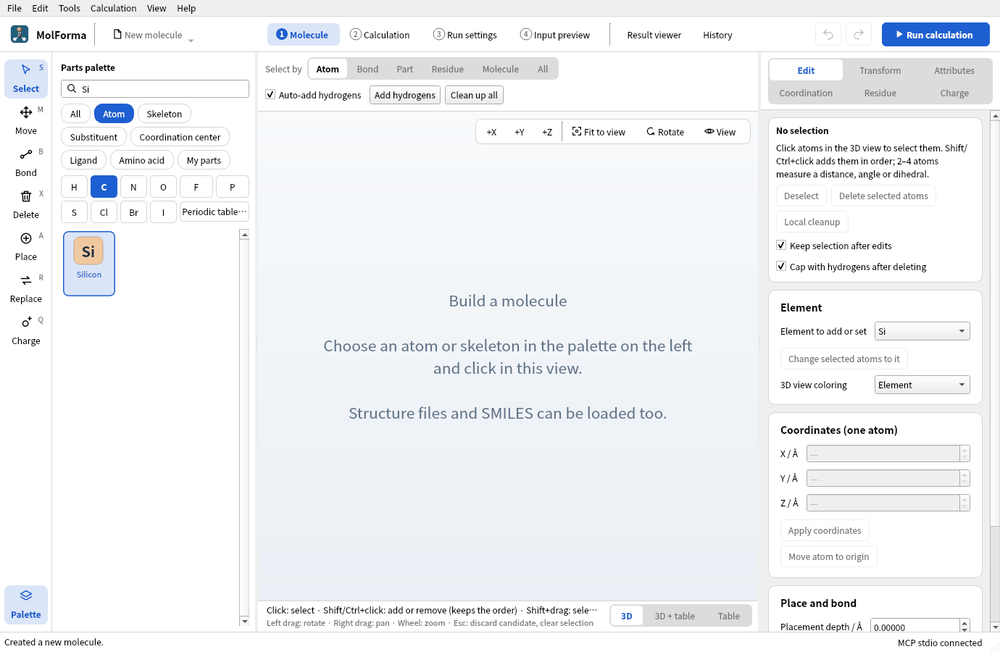
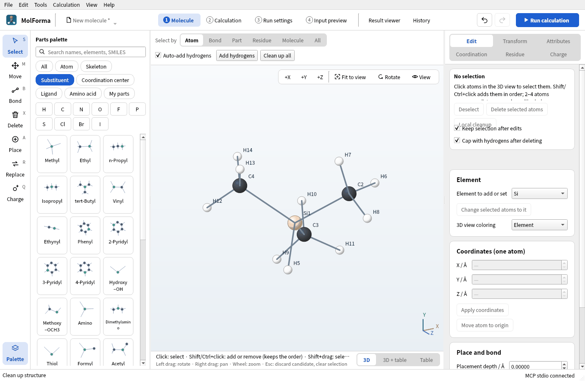
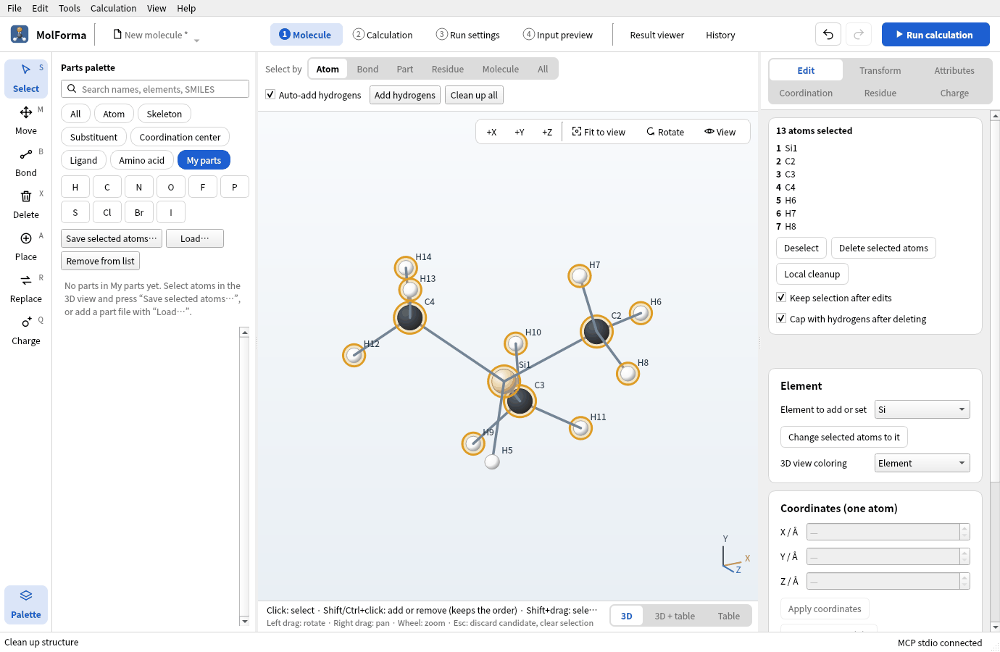
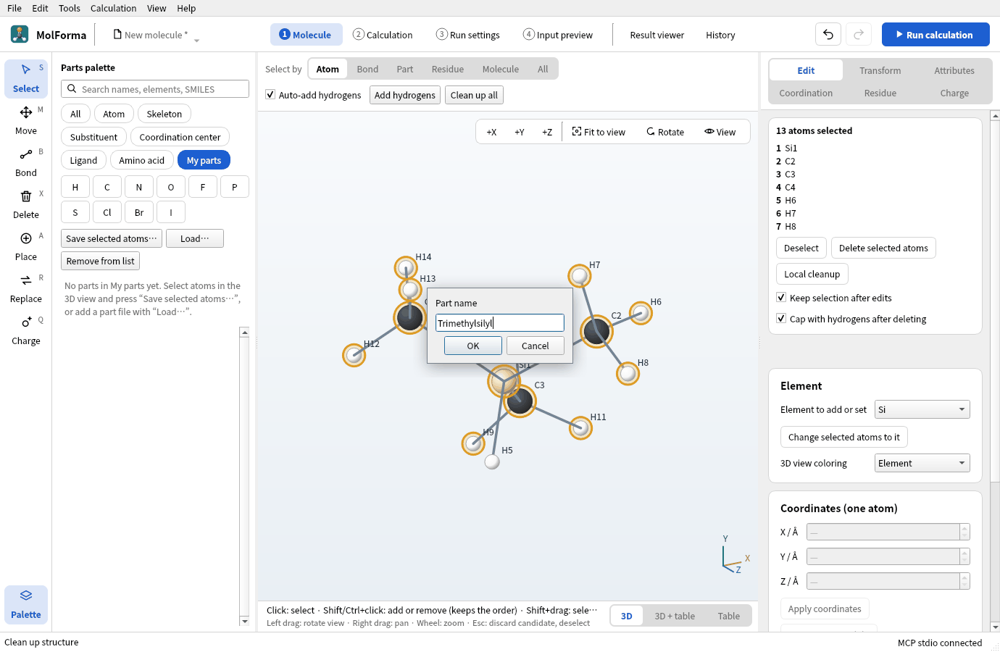
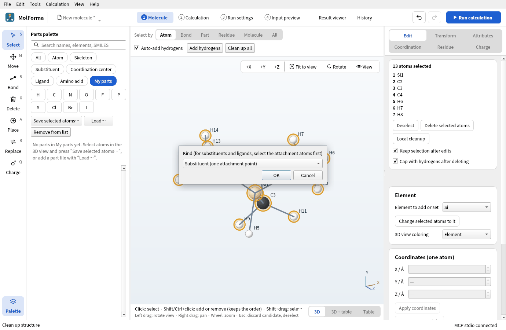
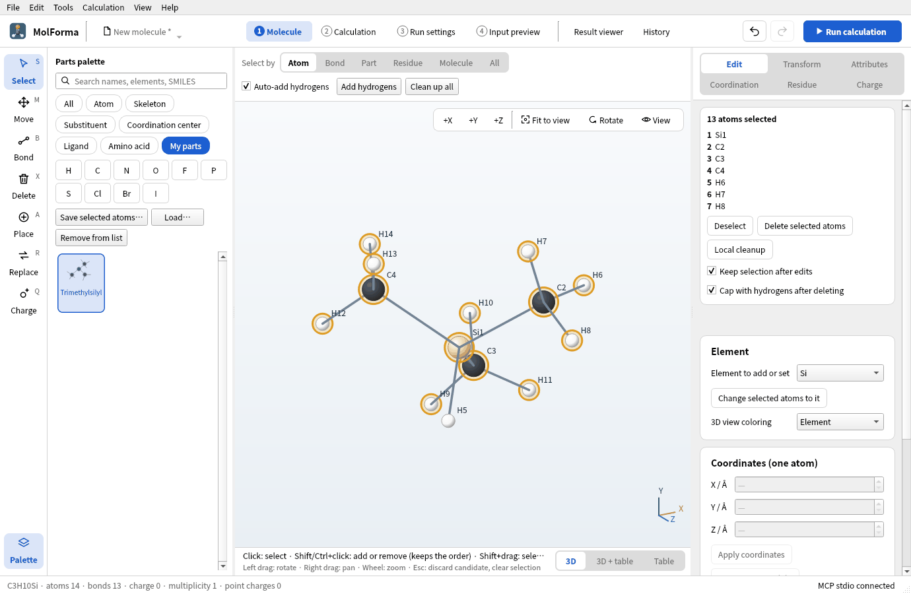
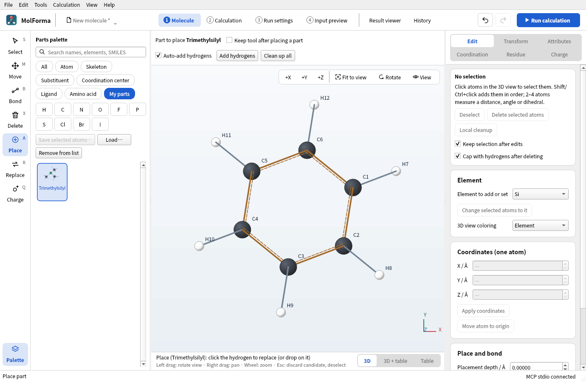
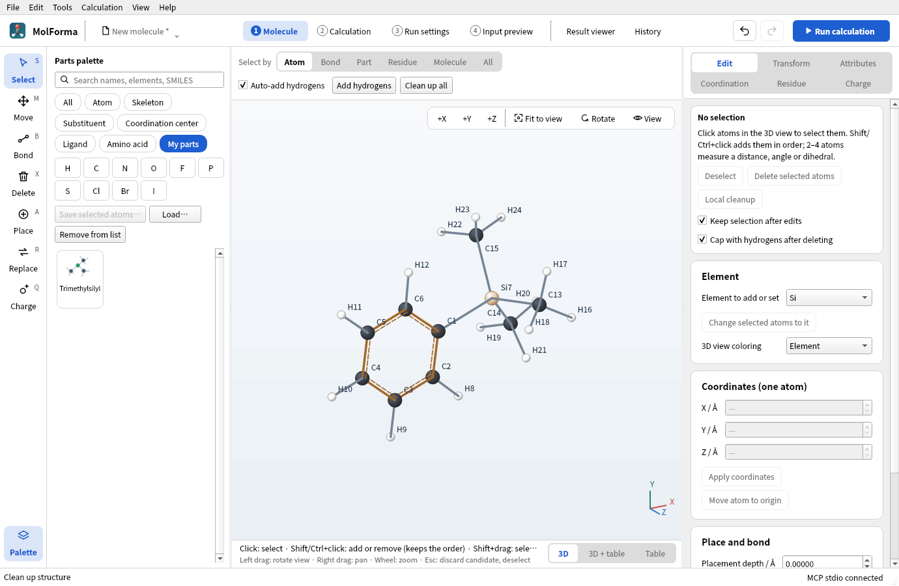
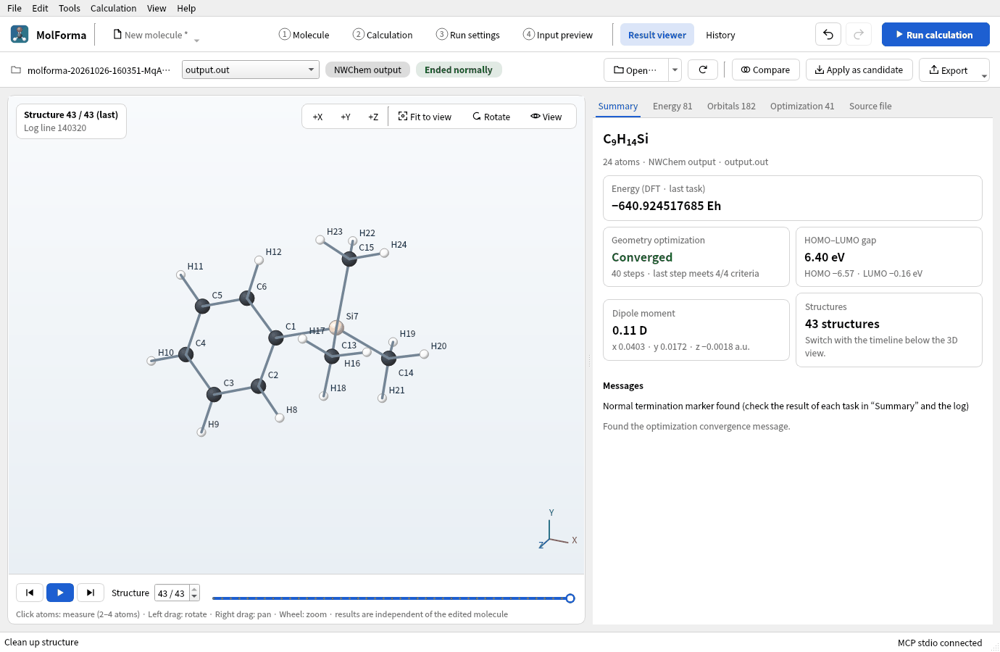

# Recipe 16 Your own parts (My parts)

Build a trimethylsilyl group –Si(CH₃)₃, which is not among the substituent templates, choose its attachment point and save it as one of “My parts”. Saved parts appear in the category “My parts” of the palette and, like the built-in substituents, replace the hydrogen you click. Pass parts as files (`.molforma-part.json`) and optimize a molecule built with one.

| What you build | Details |
| --- | --- |
| Part | Trimethylsilyl (substituent, attached at Si) |
| Molecule | Trimethylsilylbenzene C₉H₁₄Si (24 atoms) |
| Features | Choosing elements with the periodic table or search, selection order and attachment point, saving my parts (name, kind, file), the my-parts list, Load and Remove from list, placing my parts |
| Calculation | B3LYP/6-31G*, geometry optimization |
| Run time | About 48 minutes (8 MPI processes, alongside other runs; 40 steps from the methyl rotations) |
| Computer | AMD Ryzen 7 2700X (8 cores, 16 threads), 32 GB of memory, NWChem 7.3.1 on Linux |
| Practice data | [`trimethylsilyl.molforma-part.json`](../../recipes/samples/trimethylsilyl.molforma-part.json) (the part), [`tms_benzene.molforma.json`](../../recipes/samples/tms_benzene.molforma.json) |

## 1. Build the atoms of the part

1. Start an empty molecule with “File → New”, choose the category “Atom” in the parts palette and enter `Si` (or “Silicon”, or 14) in the search field. Click “Silicon” and place it in empty space: SiH4. Elements without a button are chosen with the search or “Periodic table…”.

   

   **Figure 1** With `Si` in the search field, silicon, which has no element button, appears in the list.

2. With “Methyl” of the category “Substituent”, replace three hydrogens of Si in turn: (CH3)3SiH (C3H10Si · 14 atoms).
3. Clean up with “Clean up all” and confirm.

   

   **Figure 2** Trimethylsilane (CH3)3SiH cleaned up (C3H10Si · 14 atoms).

## 2. Choose the attachment point and save

A substituent part is attached at “the inner end of its one outgoing bond”. Make a part where the Si–H hydrogen comes off and the molecule joins there.

1. With the “Select” tool, click **the attachment atom Si first**, then Shift+click the atoms of the methyl groups (the 12 carbons and hydrogens). Do not select the Si–H hydrogen (13 atoms selected). A selection that is not connected cannot be saved.

   

   **Figure 3** Choose the attachment atom Si first, then add the atoms of the methyl groups, but not the Si–H hydrogen.

2. Choose the category “My parts” and press “Save selected atoms…” above the list.
3. Enter `Trimethylsilyl` as the “Part name” and press OK, choose “Substituent (one attachment point)” as the kind and press OK.

   

   **Figure 4** Enter the part name.

   

   **Figure 5** Choose the kind of part.

4. You are asked where to save the part file; save it as `trimethylsilyl.molforma-part.json` or similar. “Trimethylsilyl” appears in the category “My parts”.

   

   **Figure 6** The saved part appears in “My parts”.

There are three kinds of parts:

| Kind | Attachment point | Placing |
| --- | --- | --- |
| Substituent (one attachment point) | The atom chosen first | Replaces the hydrogen you click |
| Ligand | The atom chosen first (donor) | Click a purple site of a coordination center |
| Skeleton (no attachment point, placed in empty space) | None | Click empty space |

The my-parts list is kept in the application settings and is there at the next start. Placed parts are also recorded in the project.

## 3. Attach my part

1. With “File → New”, place “Benzene”.
2. Click “Trimethylsilyl” in the category “My parts”. Under the 3D view: “Place (Trimethylsilyl): click the hydrogen to replace (or drop on it)”.

   

   **Figure 7** A part of your own is attached like a built-in substituent, by clicking the hydrogen to replace.

3. Click a hydrogen of benzene. You get trimethylsilylbenzene (C9H14Si · 24 atoms). Clean up with “Clean up all” and confirm.

   

   **Figure 8** Trimethylsilylbenzene (C9H14Si · 24 atoms).

Part files received from others are added to the list with “Load…” in the category “My parts”. “Remove from list” only removes them from the list; the file stays.

## 4. Calculate

In “2 Calculation”, set the task to “Geometry optimization”, the method to “DFT” (B3LYP) and the basis set to “6-31G*”, and run.

**Figure 9** “Summary” of the optimization of trimethylsilylbenzene.

### Results

| Item | Value |
| --- | --- |
| Energy of the calculation | −640.924517685 Eh |
| Optimization | Converged in 40 steps (the rotations of the three methyl groups have small forces and take many steps) |
| Si–C | 1.893 Å (benzene ring), 1.895 Å (methyl) |
| Dipole moment | 0.11 D |

Molecules with many soft degrees of freedom (methyl rotations and so on) take more optimization steps. The maximum iterations and the convergence criteria are in the advanced settings of “Optimization and frequencies”.

## Troubleshooting

- **Saving is refused**: “Select the attachment atom first.” is about the order, “A substituent needs exactly one external bond, a ligand zero or one.” about the number of bonds leaving the selection, and “The atoms of a part must be bonded to each other.” about unconnected atoms. Choose the attachment atom first and select so that exactly one bond leaves the selection.
- **An attached part points oddly**: A substituent puts its attachment atom in the direction of the replaced hydrogen's bond. Clean up with “Clean up all”, or attach it again with the “Replace” tool.
- **The part is not in the palette**: Check that the search field is empty and that the category is “My parts” or “All”.

See also: tools and parts palette in [“1 Molecule”: layout, tools and selection](../features/molecule.md), [recipe 3 Substituted aromatics](aromatic_substitution.md).
