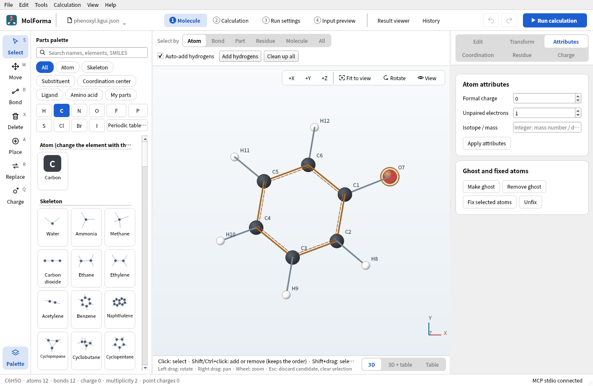
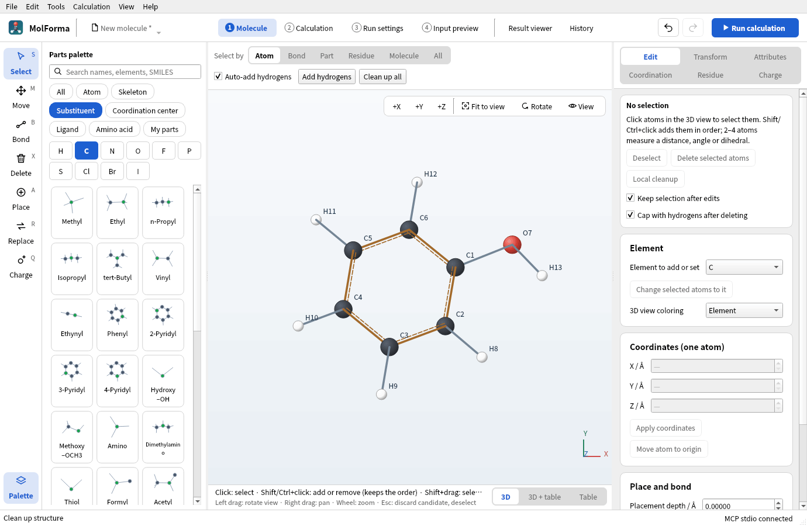
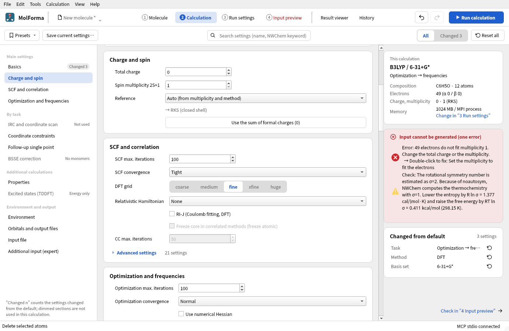
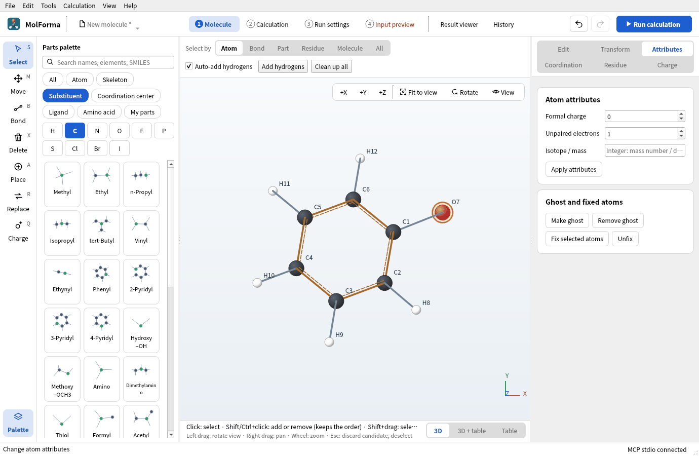
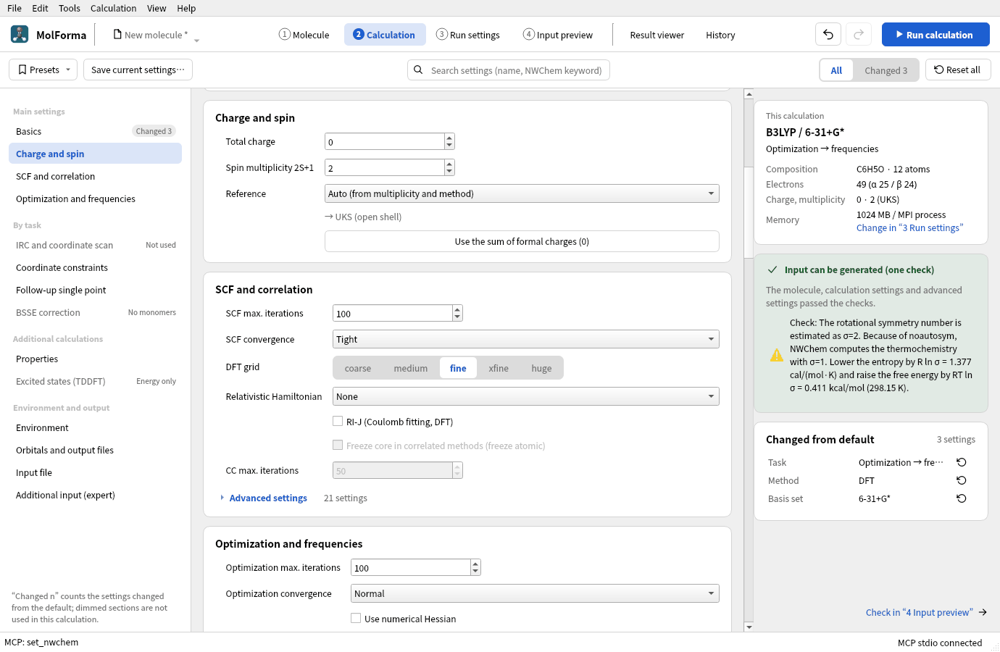
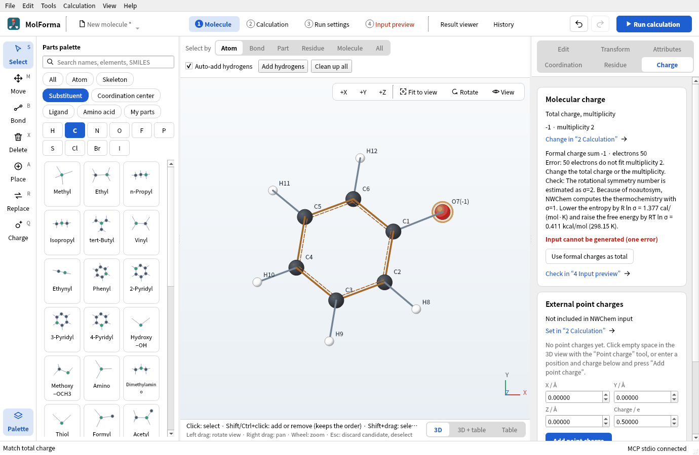
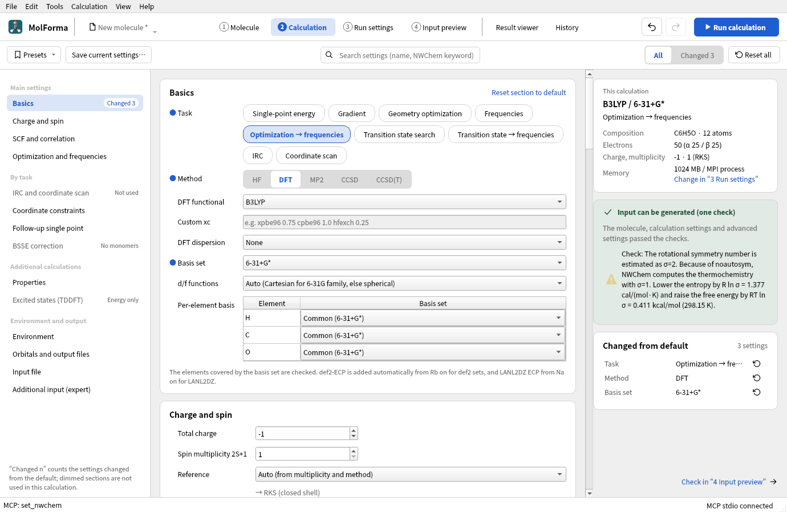
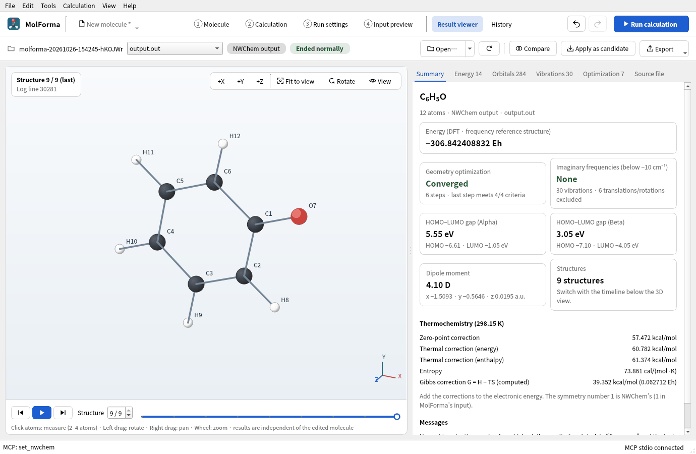

# Recipe 10 Ions and radicals (phenol, phenoxyl radical, phenolate)

Delete just the O–H hydrogen of phenol and make the phenoxyl radical (doublet) with an unpaired electron on oxygen, and the phenolate ion with a formal charge of −1. See how the atom attributes (formal charge, unpaired electrons) relate to the total charge, multiplicity and reference of the calculation, then optimize the three with B3LYP/6-31+G* to get the O–H bond dissociation energy and the gas-phase acidity.

| What you build | Details |
| --- | --- |
| Molecule | Phenol C₆H₆O (13 atoms), phenoxyl radical C₆H₅O (12 atoms, charge 0, doublet), phenolate C₆H₅O⁻ (12 atoms, charge −1, singlet) |
| Features | Deleting a hydrogen, formal charge and unpaired electrons on the “Attributes” page, the “Charge” page, multiplicity and reference (RKS, UKS), the rotational-symmetry note |
| Calculation | B3LYP/6-31+G*, optimization → frequencies (three molecules), a hydrogen-atom single point |
| Run time | About 26 minutes for phenol, 58 for the phenoxyl radical and 19 for phenolate (6 MPI processes, alongside other runs); seconds for the hydrogen atom |
| Practice data | [`phenol.kgui.json`](../../recipes/samples/phenol.kgui.json), [`phenoxyl.kgui.json`](../../recipes/samples/phenoxyl.kgui.json), [`phenolate.kgui.json`](../../recipes/samples/phenolate.kgui.json) |

## 1. Make phenol

1. With “File → New”, place “Benzene” from the category “Skeleton” and replace a hydrogen with “Hydroxy –OH” from the category “Substituent”.
2. Clean up with “Clean up all”, confirm, and save as `phenol.kgui.json` with “File → Save as…”.

   

   **Figure 1** Phenol cleaned up (C6H6O · 13 atoms).

## 2. Make the phenoxyl radical

1. With the “Delete” (X) tool, click the O–H hydrogen and confirm the candidate. You have C6H5O · 12 atoms.
2. Now 49 electrons (odd) do not fit multiplicity 1: “4 Input preview” in the header turns red and “2 Calculation” says “49 electrons do not fit multiplicity 1.”

   

   **Figure 2** Deleting one hydrogen leaves an odd number of electrons, and no input can be made with multiplicity 1.

3. Click the oxygen with the “Select” tool, set “Unpaired electrons” to 1 on the “Attributes” page on the right and press “Apply attributes”. Unpaired electrons are an attribute that prepares the structure (adding hydrogens and so on); the multiplicity does not change by itself.

   

   **Figure 3** Set the unpaired electrons of the oxygen to 1 on the “Attributes” page.

4. Set “Spin multiplicity 2S+1” to 2 in “Charge and spin” of “2 Calculation”. “→ UKS (open shell)” appears under the reference (open-shell DFT is unrestricted). Double-clicking the line “49 electrons do not fit multiplicity 1.” in the checks fixes the multiplicity too.

   

   **Figure 4** With multiplicity 2, the reference becomes UKS (open shell).

5. Save as `phenoxyl.kgui.json`.

## 3. Make phenolate

1. Choose the oxygen of the phenoxyl radical, set “Formal charge” to −1 and “Unpaired electrons” to 0 on the “Attributes” page, and press “Apply attributes”.

   

   **Figure 5** An atom with a formal charge shows the charge in its label.

2. Press “Use formal charges as total” on the “Charge” page. The total charge becomes −1 (the atoms' formal charges and the calculation's total charge are kept apart).

   

   **Figure 6** “Molecular charge” on the “Charge” page. The total charge is now −1; the next step sets the multiplicity back to 1.

3. Set the multiplicity back to 1 in “2 Calculation” (→ RKS (closed shell)).
4. The checks note “The rotational symmetry number is estimated as σ=2.” Coordinates are written with `noautosym`, so NWChem's thermochemistry uses symmetry number 1. Correct the entropy and free energy of phenolate (C2v) by the amounts shown (−R ln 2, +RT ln 2 = 0.411 kcal/mol).

   

   **Figure 7** The checks note the rotational symmetry number and the corrections of entropy and free energy.

5. Save as `phenolate.kgui.json`.

## 4. Settings and runs

For each of the three projects, set the task to “Optimization → frequencies”, the method to “DFT” (B3LYP) and the basis set to “6-31+G*” in “2 Calculation”, and run. Anions spread their electrons, so use a basis with diffuse functions (+).

The bond dissociation energy also needs the energy of a hydrogen atom: with “File → New”, press the element button “H”, turn “Auto-add hydrogens” above the 3D view off, place one hydrogen in empty space, and compute it with multiplicity 2, task “Single-point energy”, same method and basis.

## 5. From the results

“History” lists the four jobs. Open each with “Open in result viewer” and read the energy and the thermochemical corrections in the “Summary”.

**Figure 8** “Summary” of the phenoxyl radical. Being open shell, it shows alpha and beta HOMO–LUMO gaps. The thermochemical corrections are further down.

With the enthalpy of each molecule H = energy of the calculation + enthalpy correction (298 K):

- O–H bond dissociation enthalpy (298 K): D = H(phenoxyl) + H(hydrogen atom) − H(phenol)
- Gas-phase acidity (deprotonation enthalpy): ΔH = H(phenolate) + H(H⁺) − H(phenol), with H(H⁺) = 5/2 RT = 1.481 kcal/mol.

### Results

| Item | Phenol | Phenoxyl radical | Phenolate | Hydrogen atom |
| --- | --- | --- | --- | --- |
| Reference | RKS | UKS (⟨S²⟩ = 0.788) | RKS | UKS |
| Energy of the calculation | −307.480295774 Eh | −306.842408832 Eh | −306.920980884 Eh | −0.500272779 Eh |
| Optimization | Converged in 10 steps | Converged in 6 steps | Converged in 5 steps | (single point) |
| Imaginary frequencies | None | None | None | — |
| C–O | 1.373 Å | 1.260 Å | 1.276 Å | — |
| Enthalpy correction (298.15 K) | 69.607 kcal/mol | 61.374 kcal/mol | 60.682 kcal/mol | 1.481 kcal/mol (5/2 RT) |

The hydrogen atom has no vibrations, so its enthalpy correction is 3/2 RT of translation plus RT for the PV term, 5/2 RT (the same as for H⁺).

- O–H bond dissociation enthalpy: ΔE = 86.35 kcal/mol and an enthalpy correction of −6.75 kcal/mol give D = 79.6 kcal/mol (experiment about 87 kcal/mol)
- Gas-phase acidity: ΔE = 350.98 kcal/mol and an enthalpy correction of −7.44 kcal/mol give ΔH = 343.5 kcal/mol (experiment about 350 kcal/mol)

B3LYP tends to underestimate bond dissociation energies by a few kcal/mol. Comparing values of the same method, such as differences between substituted phenols, cancels much of the error. The C–O of the phenoxyl radical is 0.11 Å shorter than in phenol, closer to a double bond with the unpaired electron spread over the oxygen and the ring. ⟨S²⟩ is close to the exact 0.75 of a doublet, so spin contamination is small.

## Troubleshooting

- **“4 Input preview” stays red**: The electron count and multiplicity do not fit. Odd electron counts need multiplicity 2, 4, …; even counts 1, 3, ….
- **You want ROHF for an open shell**: The reference can be “ROHF” only for HF. Open-shell DFT and MP2 are unrestricted (UKS, UHF).
- **The total charge did not change with the formal charge**: Atom formal charges are not applied to the total charge automatically. Use “Use formal charges as total” on the “Charge” page or “Use the sum of formal charges (−1)” in “2 Calculation”.
- **Deleting adds a hydrogen next to it**: Only deleting a heavy atom adds hydrogens to the cut bonds (“Cap with hydrogens after deleting”); deleting a hydrogen alone adds none.

See also: [“2 Calculation”](../features/calculation.md) (supported calculations, diagnostics), [recipe 1 Building from atoms and bonds](atoms_and_bonds.md).
