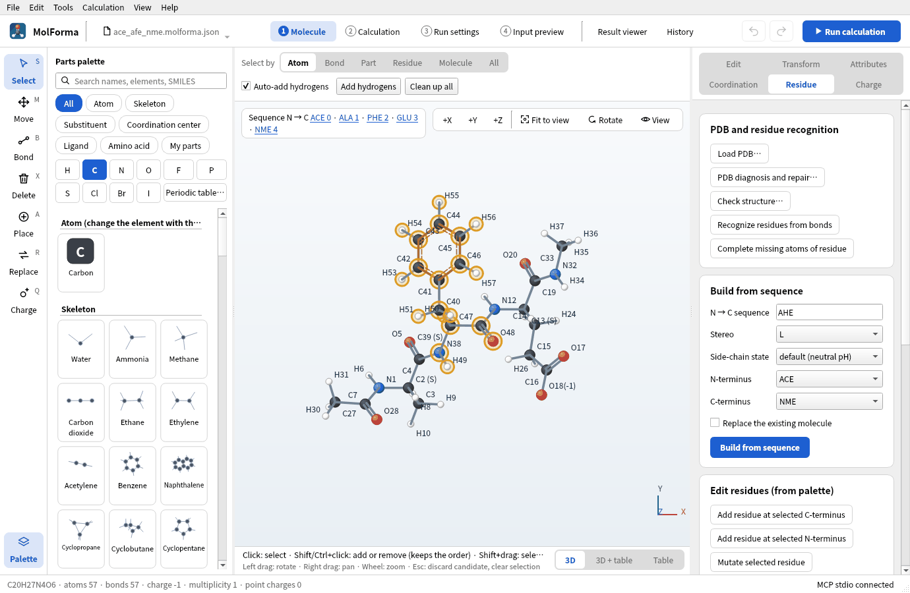
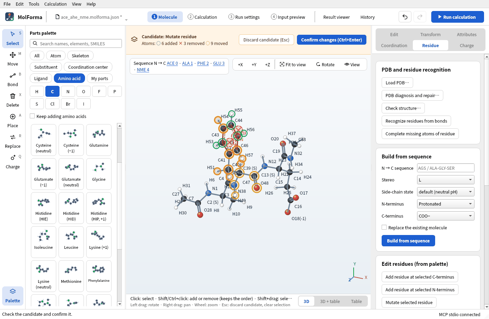
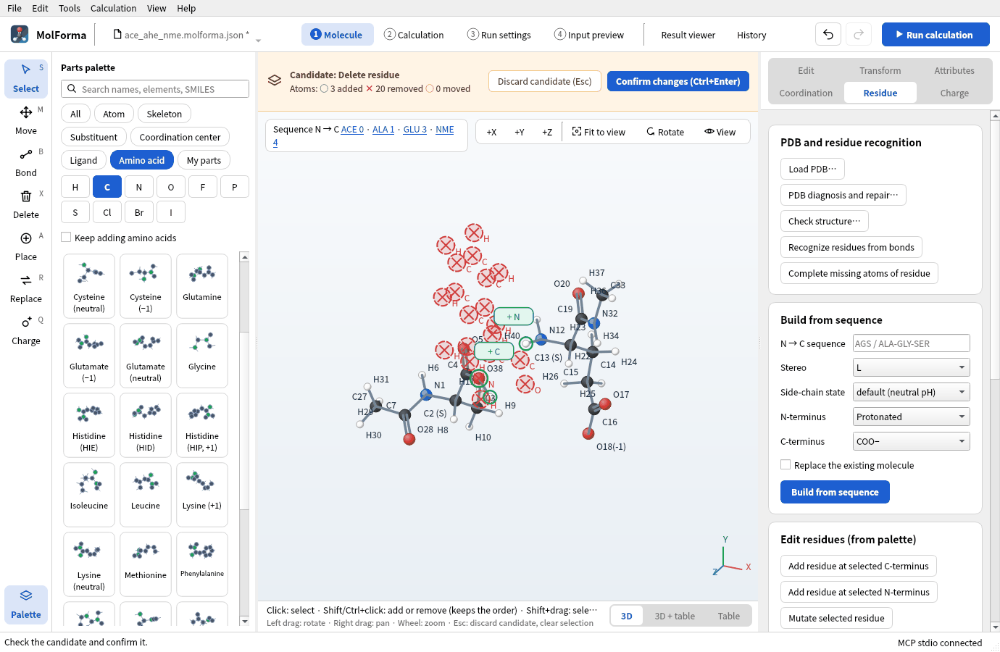
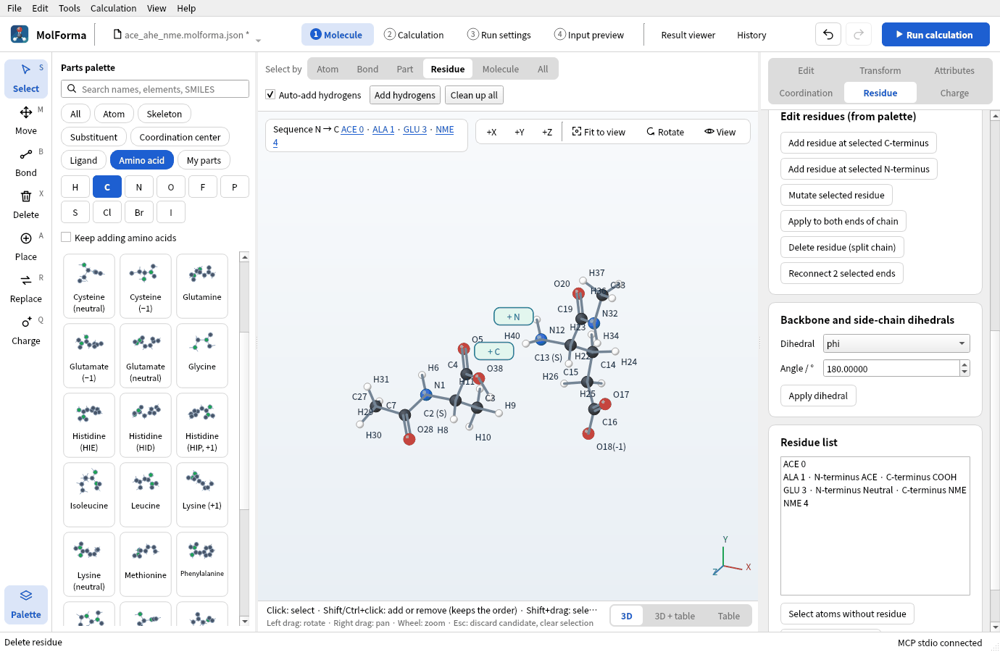
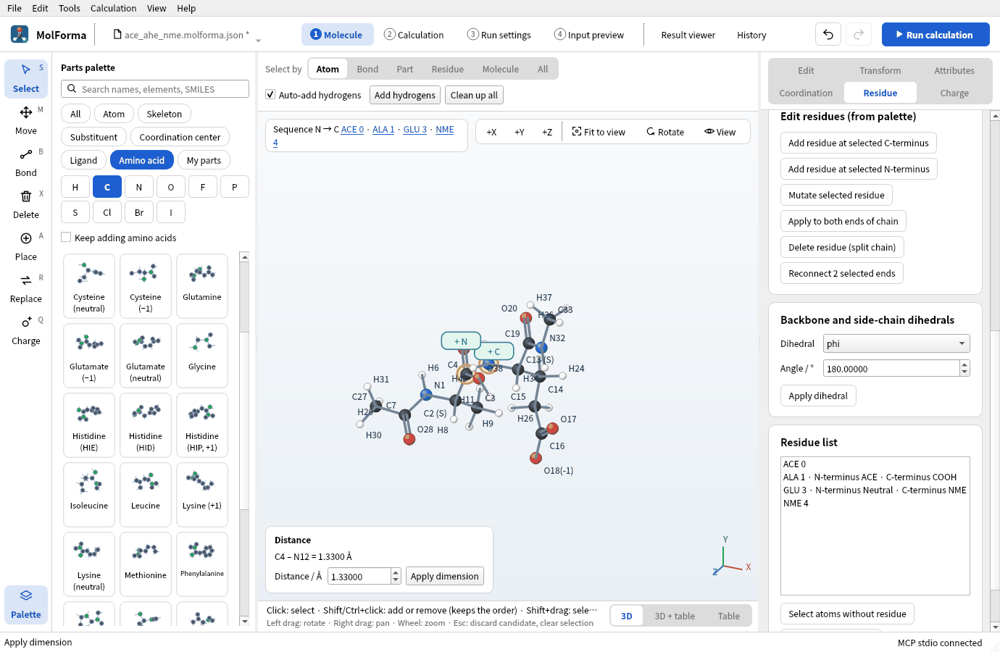
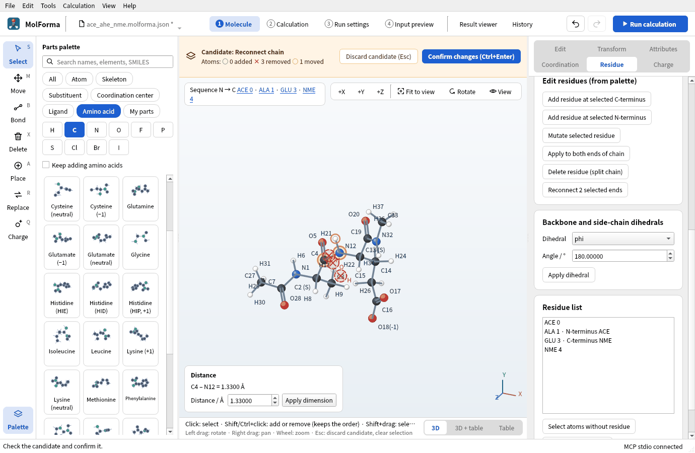
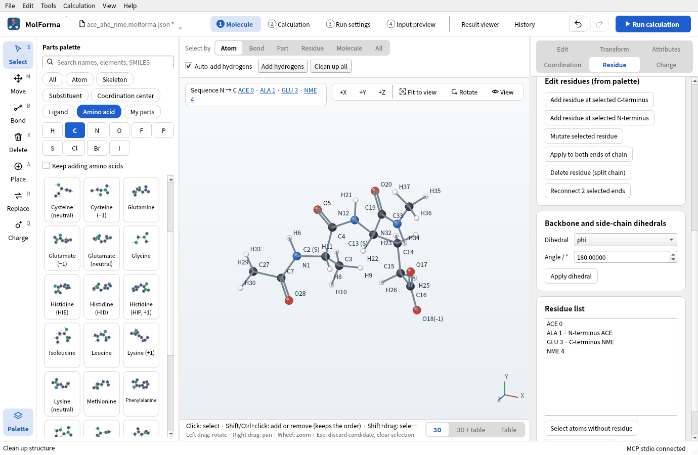
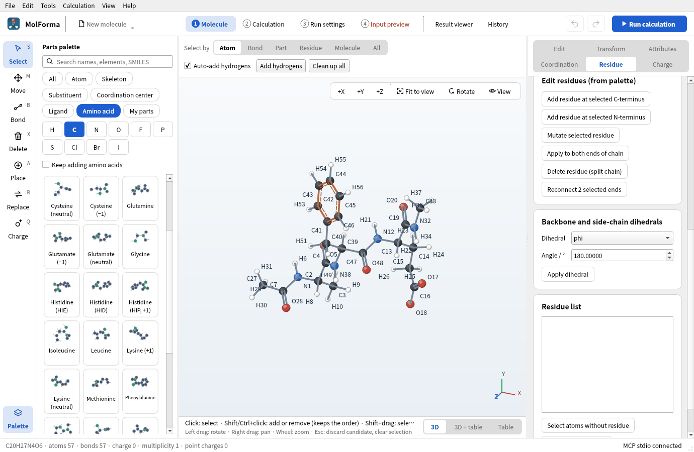
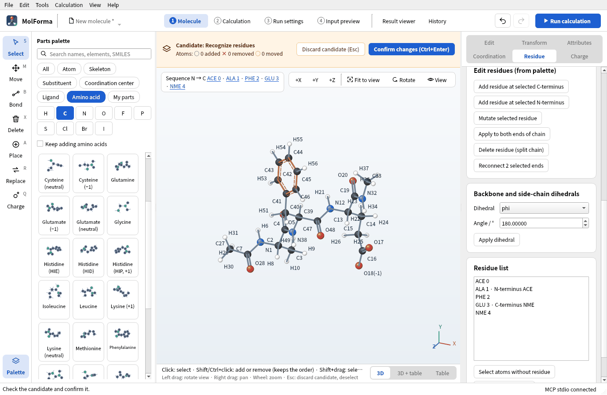
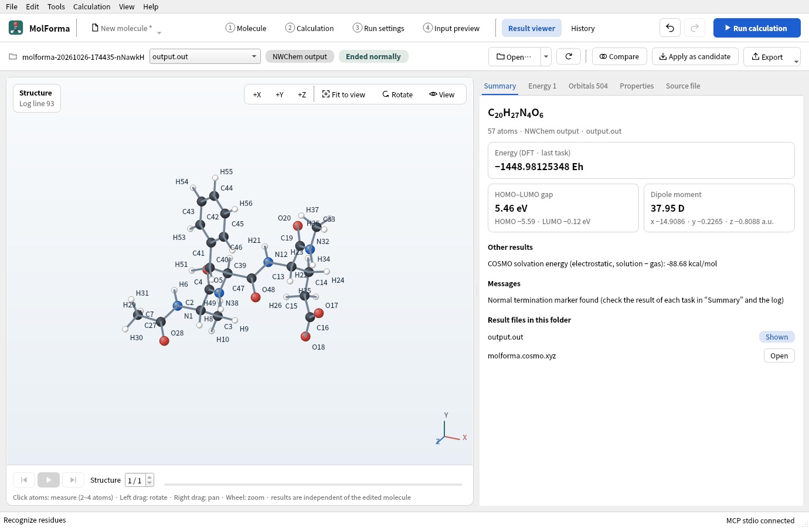

# Recipe 8 Mutating residues and editing chains (a mutant)

Replace His of the ACE–Ala–His–Glu–NME of [recipe 7](capped_peptide.md) with Phe to make a mutant, then delete Phe and join the two chains again. Finally, recognize the residues again in a structure exported as XYZ, and run a single point in COSMO (water).

| What you build | Details |
| --- | --- |
| Molecule | ACE–Ala–Phe–Glu–NME C₂₀H₂₇N₄O₆ (57 atoms, charge −1), ACE–Ala–Glu–NME C₁₁H₁₈N₃O₅ (37 atoms, charge −1) |
| Features | Mutate selected residue, Delete residue (split chain), positioning two chains with a dimension, Reconnect 2 selected ends, the residue list, Recognize residues from bonds |
| Calculation | B3LYP/6-31G*, single-point energy, COSMO (water) (the mutant) |
| Run time | About 31 minutes (8 MPI processes, alongside other runs, “Recompute DFT integrals each time” on) |
| Computer | AMD Ryzen 7 2700X (8 cores, 16 threads), 32 GB of memory, NWChem 7.3.1 on Linux |
| Practice data | [`ace_afe_nme.molforma.json`](../../recipes/samples/ace_afe_nme.molforma.json) (mutant), [`ace_ae_nme.molforma.json`](../../recipes/samples/ace_ae_nme.molforma.json) (after reconnecting) |

## 1. Replace His with Phe

1. Open the project of [recipe 7](capped_peptide.md) (`ace_ahe_nme.molforma.json`).
2. Click “HIS 2” in the sequence of the 3D view to select the atoms of His.
3. Click “Phenylalanine” in the category “Amino acid” of the parts palette and press “Mutate selected residue” on the “Residue” page.
4. Check that the candidate is C20H27N4O6 · 57 atoms · charge −1 and press “Confirm changes”.

   

   **Figure 1** The candidate of mutating His to Phe (C20H27N4O6 · 57 atoms). The sequence shows PHE too.

The backbone N, Cα, C and O stay where they are; the side chain and its hydrogens are exchanged. The backbone amide hydrogen is put into the plane of the peptide bond (opposite the C=O of the previous residue). Atoms are renumbered, so check settings that refer to atom numbers (constraints and so on) after a mutation. The side-chain direction (χ1) can be changed with chi1 under “Backbone and side-chain dihedrals”.

## 2. Delete a residue to split the chain

1. Choose “PHE 2” and press “Delete residue (split chain)” on the “Residue” page. The candidate is C11H20N3O6 · 40 atoms; confirm it.

   

   **Figure 2** The candidate of “Delete residue (split chain)”, with the atoms to remove crossed out.

2. The chain splits into ACE–Ala and Glu–NME, and the cut ends become uncharged termini (COOH at the C-terminus of Ala, NH2 at the N-terminus of Glu). The “Residue list” of the “Residue” page shows them as “ALA 1 · N-terminus ACE · C-terminus COOH” and “GLU 3 · N-terminus Neutral · C-terminus NME”.

   

   **Figure 3** The residue list after the split. The new ends are uncharged termini.

3. The total charge stays at the −1 of the Glu side chain.

To change the state of the ends, choose a residue, choose “N-terminus” and “C-terminus” and press “Apply to both ends of chain” (with charged COO− and NH3+ ends, the total charge follows the sum of formal charges).

## 3. Join the two chains again

Reconnecting works only when the C of the C-terminus and the N of the N-terminus are 1.1–1.7 Å apart. Bring separated chains together with a dimension first.

1. Set “Select by” above the 3D view to “Atom”, click the C-terminal carbon (C) of Ala and Shift+click the N-terminal nitrogen (N) of Glu. The distance appears at the bottom left.
2. Enter 1.33 in “Distance / Å” and press “Apply dimension”. The two atoms are in separate chains (unbonded molecules), so the whole Glu–NME chain with the atom chosen last moves.

   

   **Figure 4** A distance applied between atoms of separate chains moves the chain of the atom chosen second.

3. With atoms of Ala and Glu chosen in the order C-terminal side (Ala) → N-terminal side (Glu), press “Reconnect 2 selected ends”. The terminal OH and H come off, giving a candidate of C11H18N3O5 · 37 atoms. Confirm it.

   

   **Figure 5** The candidate of “Reconnect 2 selected ends” (C11H18N3O5 · 37 atoms).

4. Tidy the new bond with “Clean up all”.

   

   **Figure 6** ACE–Ala–Glu–NME reconnected and cleaned up.

When the ends are too far apart, reconnecting is refused with the present distance and how to close it (“The C–N distance is … Å. Bring it to 1.1–1.7 Å before linking (…).”). Cyclic peptides joining the two ends of one chain cannot be made (only ends of different chains).

## 4. Recognize residues again from XYZ

An XYZ file has elements and coordinates only: opening it loses residues, formal charges and settings, and bonds are guessed from distances and bond orders from the geometry.

1. Export with “Export → Export XYZ (Å)…” of the coordinate table in “1 Molecule” and open it again with “File → Open…”. The charge in the status bar is 0 and the list of the “Residue” page is empty.

   

   **Figure 7** Opened from XYZ, the residues and formal charges are gone (the residue list is empty).

2. Press “Recognize residues from bonds” on the “Residue” page. Standard amino acids are found from elements and connections and their atoms named, and the ACE and NME caps at the chain ends are recognized too, in a candidate (RDKit required).
3. Formal charges come from the hydrogens: a carboxylate oxygen without hydrogen (COO−) gets −1, a nitrogen with four bonds (NH3+, Lys and Arg side chains) +1, and a His with hydrogens on both nitrogens is HIP (+1). The side-chain states (HID or HIE of His, charged or neutral Asp and Glu, …) follow the same way.
4. Once confirmed, the sequence in the 3D view (ACE 0 · ALA 1 · PHE 2 · GLU 3 · NME 4) and the residue list are back, and the total charge follows the sum of formal charges (−1) (when it matched that sum before the recognition).

   

   **Figure 8** The candidate of “Recognize residues from bonds”: the sequence, the caps and the charge of Glu come back.

5. Atoms that were not recognized can be chosen with “Select atoms without residue” and registered with a three-letter code using “Register as residue…”.

To keep residues, charges and settings, pass projects (`.molforma.json`) rather than XYZ.

## 5. Run and look at the results

Calculate the mutant (ACE–Ala–Phe–Glu–NME) under the conditions of [recipe 7](capped_peptide.md) (B3LYP/6-31G*, single-point energy, COSMO water, total charge −1, “Recompute DFT integrals each time” on). Energies of molecules of different composition cannot be compared directly; compare properties such as the solvation energy (the dipole moment of a charged molecule depends on the choice of origin and cannot be compared).

**Figure 9** “Summary” of the “Result viewer” for the mutant.

### Results

| Item | ACE–Ala–His–Glu–NME ([recipe 7](capped_peptide.md)) | ACE–Ala–Phe–Glu–NME (mutant) |
| --- | --- | --- |
| Atoms | 54 | 57 |
| Energy of the calculation (COSMO water) | −1442.962159354 Eh | −1448.981253478 Eh |
| Gas-phase energy at the same structure | −1442.808414957 Eh | −1448.839933595 Eh |
| COSMO solvation energy (electrostatic) | −96.48 kcal/mol | −88.68 kcal/mol |

Replacing the polar imidazole (His) with the nonpolar benzyl group (Phe) makes the solvation energy about 7.8 kcal/mol smaller. In both, most of it comes from the carboxylate (−1) of Glu.

## Troubleshooting

- **“Select a residue.”**: No atom of a residue is selected. Click the residue name in the sequence, or set “Select by” to “Residue” and click an atom.
- **“Select an amino acid.”**: Choose an amino acid (category “Amino acid”) in the palette before pressing “Mutate selected residue”.
- **“Select a free C-terminus and a free N-terminus of different chains.”**: The residues are in the same chain, or the order is reversed. Choose the C-terminal residue first.
- **Reopened XYZ has too many or too few bonds**: Bonds are guessed from distances, so atoms that are too close (around 1 Å) get extra bonds. Clean up the structure before exporting, or pass a project.

See also: [Right-side pages of “1 Molecule”](../features/molecule_pages.md) (Residue), [recipe 7 Peptides](capped_peptide.md), [recipe 15 Isotopes and atom order](isotopes.md).
