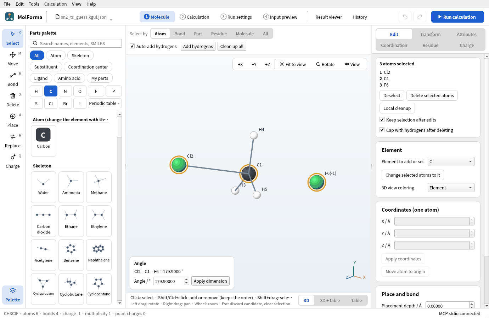
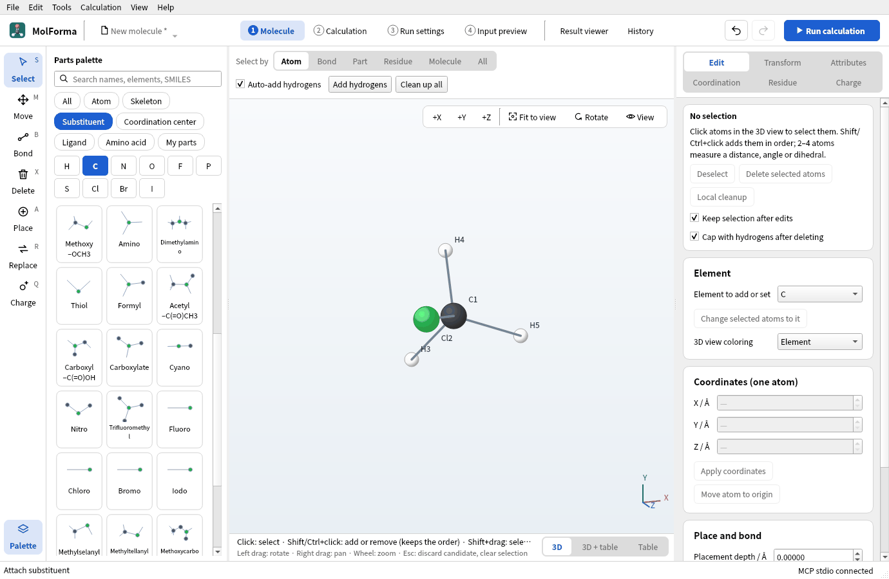
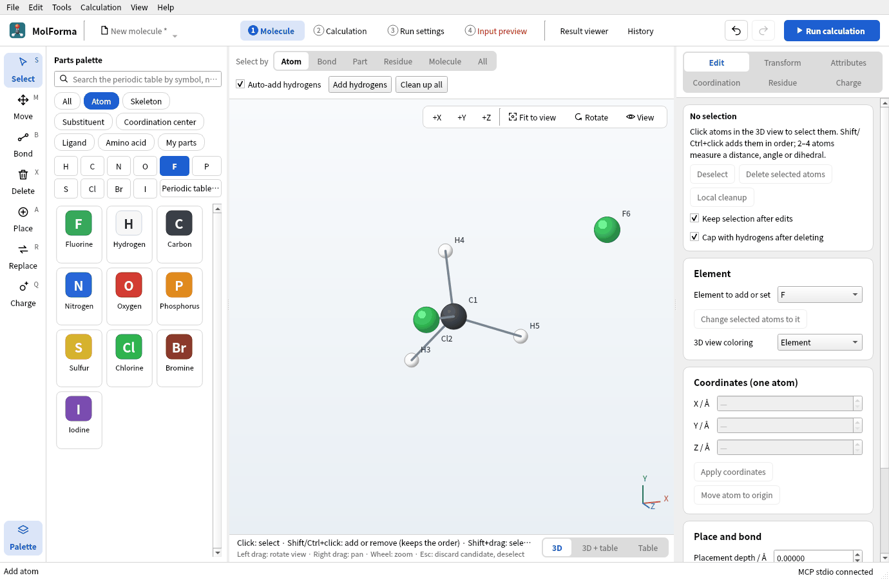
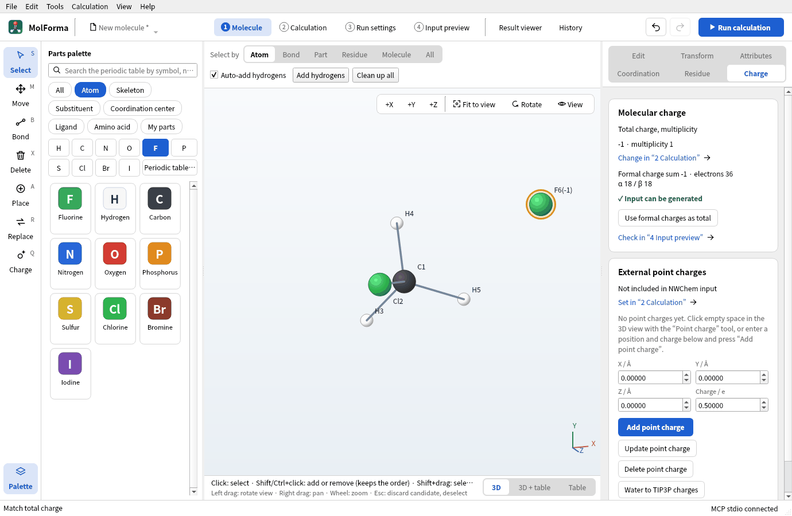
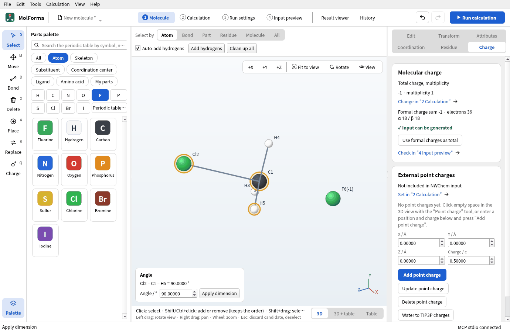
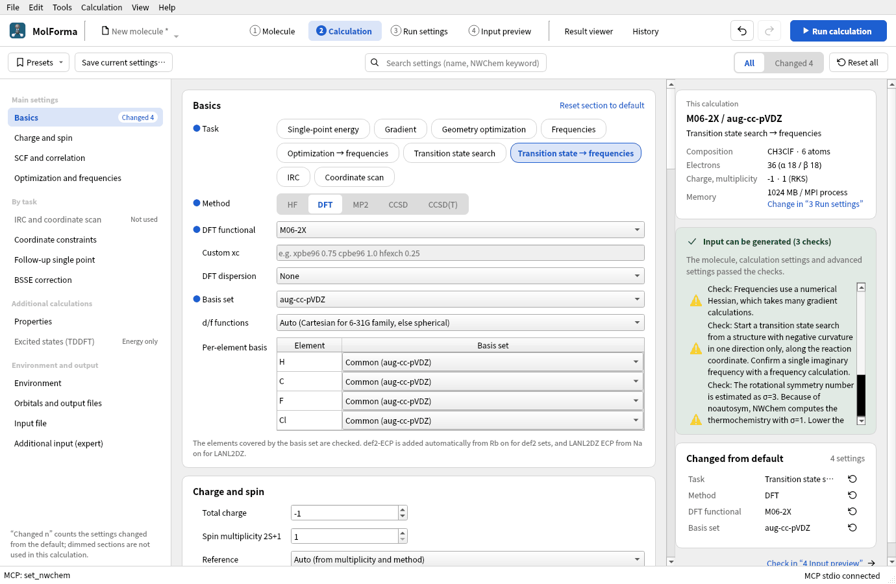
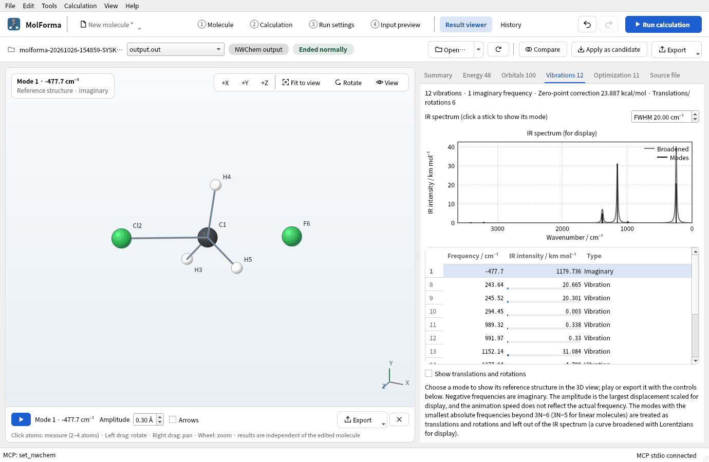
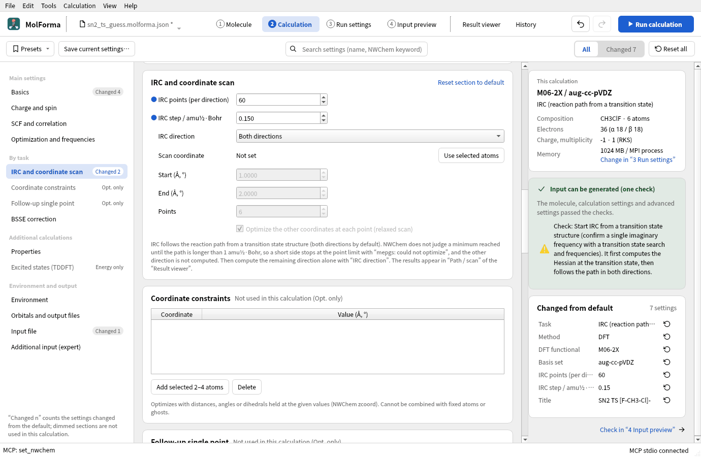
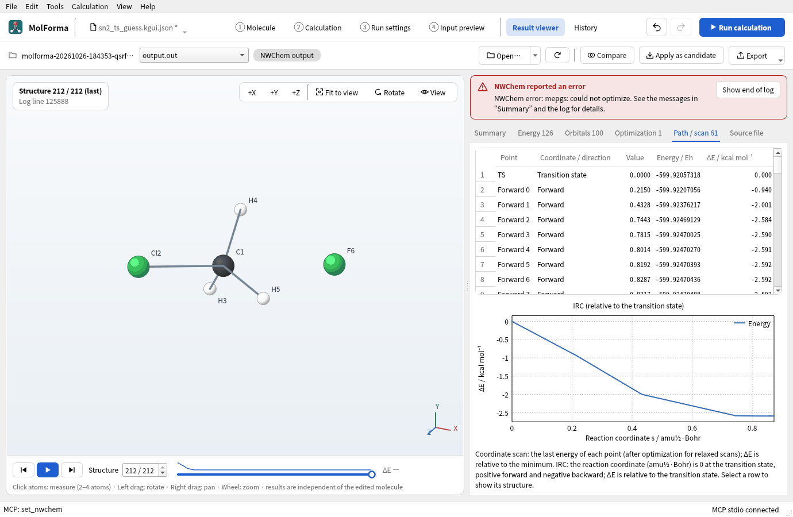
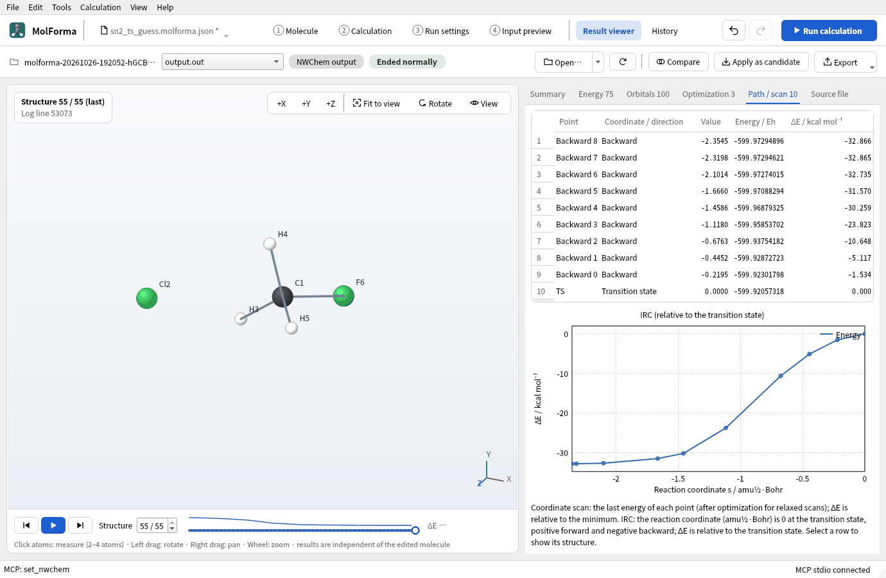

# Recipe 13 Transition states and reaction paths (F⁻ + CH₃Cl → CH₃F + Cl⁻)

Find the transition state [F···CH₃···Cl]⁻ of an SN2 reaction. There is no feature that builds a path between two structures, so build a guess close to the transition state by hand, setting distances and angles by value. Run a transition-state search and frequencies with M06-2X/aug-cc-pVDZ, check that there is exactly one imaginary frequency, and follow the path toward reactants and products with IRC. Optimize the reactant complex too and get the activation energy.

| What you build | Details |
| --- | --- |
| Molecule | Transition-state guess [F···CH₃···Cl]⁻ (6 atoms, charge −1, singlet), reactant complex F⁻···CH₃Cl |
| Features | Placing a lone atom (auto-added hydrogens off), formal and total charge, distances and angles by value (between separate molecules the later one moves), TS search → frequencies, playing the imaginary mode, IRC and its direction |
| Calculation | M06-2X/aug-cc-pVDZ, TS search → frequencies, IRC, reactant complex optimization → frequencies |
| Run time | About 13 minutes for the transition-state search → frequencies, 8 for the reactant complex, 25 (forward) and 15 (backward) for IRC (8 MPI processes) |
| Computer | AMD Ryzen 7 2700X (8 cores, 16 threads), 32 GB of memory, NWChem 7.3.1 on Linux |
| Practice data | [`sn2_ts_guess.kgui.json`](../../recipes/samples/sn2_ts_guess.kgui.json) (guess), [`sn2_reactant.kgui.json`](../../recipes/samples/sn2_reactant.kgui.json) (starting reactant complex) |

## 1. Place CH₃Cl and a fluoride ion

1. With “File → New”, place “Methane” from the category “Skeleton” in empty space and replace a hydrogen with “Chloro” from the category “Substituent”. You get CH3Cl (C1, Cl2, H3–H5).

   

   **Figure 1** CH3Cl (C1, Cl2, H3–H5).

2. Press the element button “F”, turn “Auto-add hydrogens” above the 3D view off, and click in empty space away from CH3Cl. An F atom without hydrogens (F6) is placed as a separate molecule. Turn “Auto-add hydrogens” back on afterwards.

   

   **Figure 2** An F atom (F6) placed with auto-added hydrogens off.

3. Choose F6, set “Formal charge” to −1 on the “Attributes” page and press “Apply attributes”. Then press “Use formal charges as total” on the “Charge” page to make the total charge −1: 36 electrons, multiplicity 1.

   

   **Figure 3** The total charge set to −1 on the “Charge” page.

## 2. Build the reactant complex

Choose atoms in order, enter a value at the bottom left of the 3D view and press “Apply dimension”. C and F are separate, unbonded molecules, so F (chosen last) moves.

1. Choose C1 → F6, set the distance to 2.8 and press “Apply dimension”.
2. Choose Cl2 → C1 → F6, set the angle to 179.9 and press “Apply dimension” (exactly 180° is not allowed, since the direction to turn would be undefined).

   

   **Figure 4** The starting reactant complex: F approaches C from opposite Cl.

3. Save as `sn2_reactant.kgui.json`. This is the starting reactant complex, with F approaching C from opposite Cl.

## 3. Build the transition-state guess

At the transition state CH3 is planar, and both C–F and C–Cl are stretched.

1. Set C1 → F6 to a distance of 2.05 and C1 → Cl2 to 2.10 (C–Cl is bonded, so the Cl side, chosen last, moves).
2. Choose Cl2 → C1 → H3, Cl2 → C1 → H4 and Cl2 → C1 → H5 in turn and set each angle to 90. The three hydrogens line up in the plane perpendicular to the Cl–F axis, with H–C–H 120°.

   

   **Figure 5** The transition-state guess. From the side, the planar CH3 sits between Cl and F.

3. Save as `sn2_ts_guess.kgui.json`.

## 4. Transition-state search and frequencies

1. In “Basics” of “2 Calculation”, set the task to “Transition state → frequencies”.
2. Set the method to “DFT”, the DFT functional to “M06-2X” and the basis set to “aug-cc-pVDZ”. B3LYP hardly shows a barrier for this reaction; M06-2X is known for barrier heights, and anions need diffuse functions (aug-).
3. Check total charge −1 and multiplicity 1. The checks note “Frequencies use a numerical Hessian, which takes many gradient calculations.” (meta-GGAs have no analytic Hessian) and a hint about transition-state searches.

   

   **Figure 6** The settings of the transition-state search and the notes in the checks.

4. Run with “Run calculation” (F5). NWChem's `task dft saddle` climbs to the top along the direction of negative curvature, and the frequencies follow.
5. Check that “Imaginary frequencies” in the “Summary” of the “Result viewer” is one. In the “Vibrations” tab, choose the imaginary (negative) mode and press play under the 3D view: CH3 moves back and forth between F and Cl (an umbrella inversion).

   

   **Figure 7** The imaginary mode (−477.7 cm⁻¹) in the “Vibrations” tab. Played, CH3 moves back and forth between F and Cl.

## 5. Follow the path with IRC

1. Bring the transition-state structure into “1 Molecule” with “Apply as candidate” in the “Result viewer” and confirm.
2. Set the task in “2 Calculation” to “IRC”, and set “IRC points (per direction)” and “IRC step / amu½·Bohr” in “IRC and coordinate scan”. If the points run out before a minimum is reached NWChem ends with an error, so allow enough (60 points and 0.15 here).

   

   **Figure 8** The IRC settings: the number of points and the step.

3. After the run, the “Path / scan” tab of the “Result viewer” plots the energy against the reaction coordinate with the transition state at 0 (forward positive, backward negative). Choosing a row shows that point's structure.

For this reaction, an IRC in both directions stops with “NWChem error: mepgs: could not optimize” in the forward direction (here the side of the reactant complex F⁻···CH₃Cl; which side is forward depends on the sign of the imaginary mode). NWChem does not judge a minimum reached until the path is longer than 1 amu½·Bohr, but this side is only about 0.8 long from the transition state to the minimum. It keeps taking small steps after reaching the minimum, stops at 60 points, and the backward direction is not computed. The forward points can be seen in “Path / scan”.

**Figure 9** The IRC in both directions stops partway in the forward direction; the “Path / scan” tab lists the forward points.

4. Compute the remaining direction from the same transition-state structure with “IRC direction” in “IRC and coordinate scan” set to “Backward only”. The backward path reaches the product complex CH₃F···Cl⁻ at a path length of 2.35, and the result says “IRC: 9 points, converged in the backward direction”.

   

   **Figure 10** The backward IRC follows the path to the product complex CH₃F···Cl⁻.

## 6. Reactant complex and activation energy

Open `sn2_reactant.kgui.json` and run “Optimization → frequencies” with the same method and basis. The energy difference to the transition state is the activation energy from the complex. “Compare ΔE” in “History” lists the differences between jobs of the same composition, method and basis (without thermal corrections).

### Results

| Structure | Energy of the calculation | C–F | C–Cl | Imaginary frequencies |
| --- | --- | --- | --- | --- |
| Reactant complex F⁻···CH₃Cl (optimized) | −599.924707582 Eh | 2.446 Å | 1.867 Å | None |
| Transition state [F···CH₃···Cl]⁻ | −599.920574451 Eh | 2.053 Å | 2.095 Å | One (477.7i cm⁻¹, IR intensity 1180) |
| Product complex CH₃F···Cl⁻ (end of the IRC) | −599.972948960 Eh | 1.417 Å | 3.144 Å | — |

- The transition-state search converged in 10 steps with exactly one imaginary frequency.
- Activation energy from the complex: ΔE‡ = 2.59 kcal/mol, ΔH‡ = 2.10 kcal/mol (enthalpy at 298 K) and ΔG‡ = 3.21 kcal/mol (free energy)
- The end of the forward IRC (−599.924705 Eh) agrees with the separately optimized reactant complex within 0.002 kcal/mol.
- From the reactant to the product complex the reaction releases 30.3 kcal/mol. The transition state lies close to the reactant side (little C–Cl stretch, long C–F), an “early” transition state typical of strongly exothermic reactions.

## Troubleshooting

- **F gets a hydrogen and becomes HF**: Turn “Auto-add hydrogens” off before placing it, or delete the hydrogen.
- **An angle of 180 gives “The angle must be greater than 0° and less than 180°.”**: In a straight line the direction to turn is undefined; use a value just off, such as 179.9.
- **Two or more imaginary frequencies**: The guess is too far from the top. Look at the extra modes; if they are unrelated to the reaction (a methyl rotation and so on), start again from a structure displaced along them.
- **IRC stops with “mepgs: could not optimize”**: Too few points, or a side where the minimum is close to the transition state (a path shorter than 1 amu½·Bohr). Check in “Path / scan” whether the last point of that side reached a minimum; if so, compute the remaining direction alone with “IRC direction”.
- **The transition-state search does not converge**: Raise the maximum iterations in the advanced settings of “Optimization and frequencies”, or estimate the top first with an optimization constraining the reaction coordinates (the C–F and C–Cl distances) or a relaxed scan ([recipe 5](butane_conformers.md)).

See also: transition states, IRC, constraints and scans in [“2 Calculation”](../features/calculation.md), [recipe 14 From a result to the next calculation](reuse_result.md).
