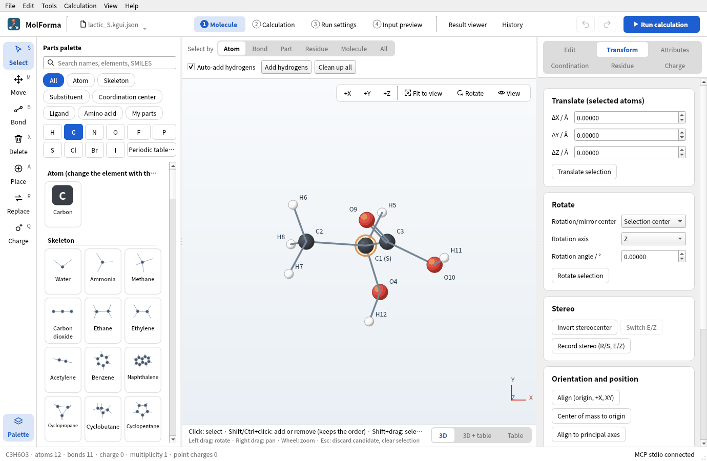
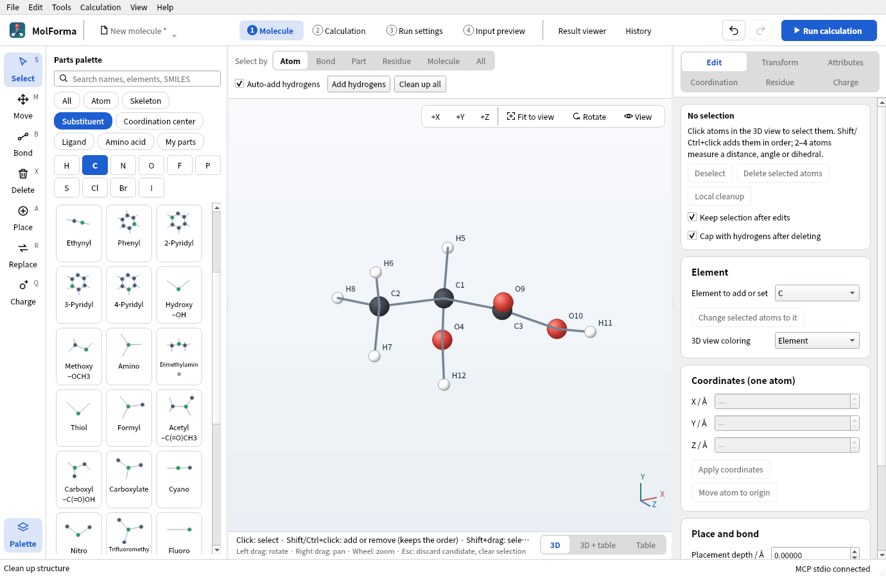
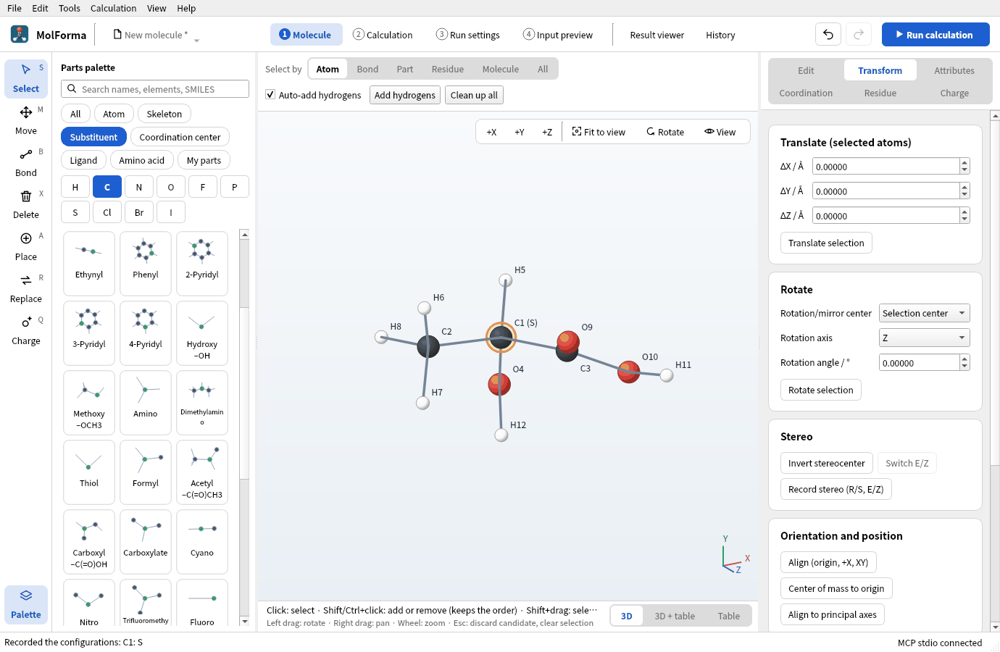
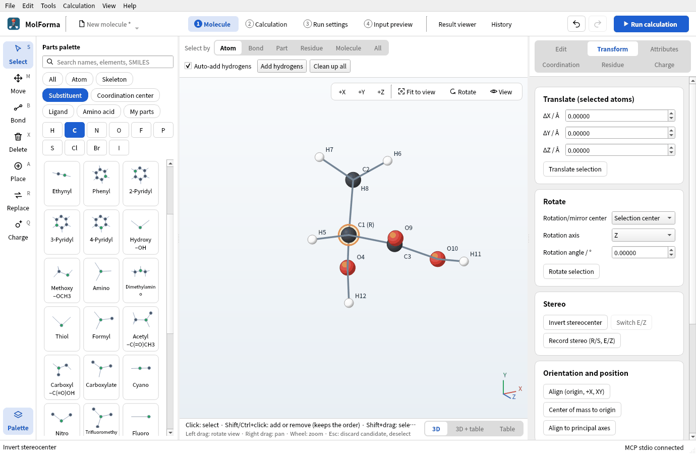
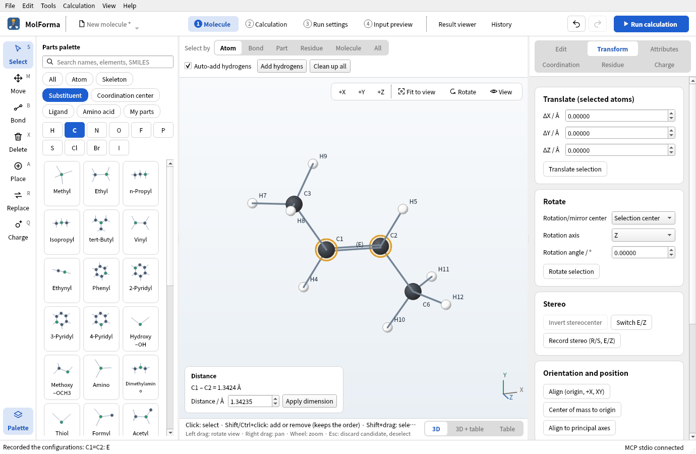
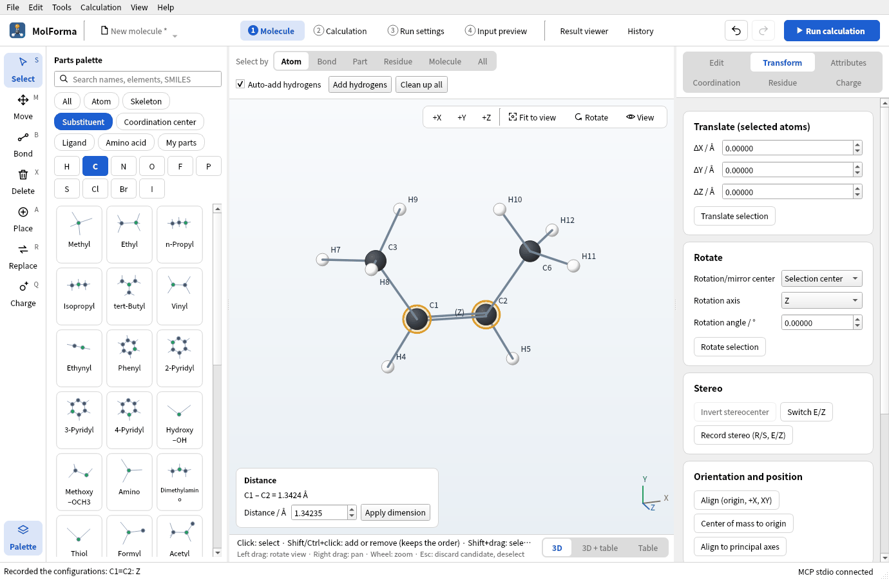
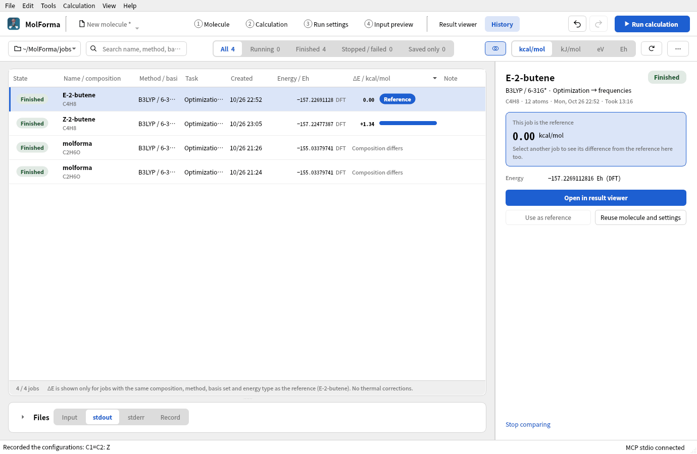

# Recipe 6 Stereochemistry (R/S lactic acid, E/Z 2-butene)

In a structure assembled from templates, the configuration of a stereocenter or of a double bond is whatever came out. Record and check the configuration (R/S) of the stereocenter of lactic acid and the geometry (E/Z) of the double bond of 2-butene, and make the other isomer with “Invert stereocenter” and “Switch E/Z”. Optimize the E and Z isomers with B3LYP/6-31G* (with frequencies) and compare their energies.

| What you build | Details |
| --- | --- |
| Molecule | R and S lactic acid C₃H₆O₃ (12 atoms), E and Z 2-butene C₄H₈ (12 atoms) |
| Features | Record stereo (R/S, E/Z), R/S and E/Z in the 3D view, Invert stereocenter, Switch E/Z, Save as |
| Calculation | B3LYP/6-31G*, optimization → frequencies (E and Z 2-butene) |
| Run time | About 35 minutes for E and 47 minutes for Z (2 MPI processes, alongside other runs) |
| Computer | AMD Ryzen 7 2700X (8 cores, 16 threads), 32 GB of memory, NWChem 7.3.1 on Linux |
| Practice data | [`lactic_R.kgui.json`](../../recipes/samples/lactic_R.kgui.json), [`lactic_S.kgui.json`](../../recipes/samples/lactic_S.kgui.json), [`butene_E.kgui.json`](../../recipes/samples/butene_E.kgui.json), [`butene_Z.kgui.json`](../../recipes/samples/butene_Z.kgui.json) |

R/S and E/Z are assigned with RDKit. In builds without RDKit, “Record stereo (R/S, E/Z)” is disabled (inverting and switching still work).

## 1. Build lactic acid and record its configuration

1. Start with “File → New” and place “Ethane” from the category “Skeleton”.
2. Replace one hydrogen of C1 with “Carboxyl –C(=O)OH” from the category “Substituent”, and another hydrogen of C1 with “Hydroxy –OH”. You get CH3–CH(OH)–COOH (C3H6O3 · 12 atoms).
3. Clean up with “Clean up all” and confirm.

   

   **Figure 1** Lactic acid built and cleaned up (C3H6O3 · 12 atoms).

4. Open the “Transform” page on the right and press “Record stereo (R/S, E/Z)” under “Stereo”. The status bar says “Recorded the configurations: C1: S”, for example, and the label of C1 in the 3D view becomes “C1 (S)”. Which one you get depends on the hydrogens the substituents replaced.

   

   **Figure 2** “Record stereo (R/S, E/Z)” on the “Transform” page adds R/S to the stereocenter's label.

5. Save it with “File → Save as…” (`lactic_S.kgui.json` in this example).

## 2. Invert the stereocenter

1. Choose only the stereocenter C1 and press “Invert stereocenter” on the “Transform” page. Two substituents of C1 (here the hydrogen and the methyl group) trade places, and the label becomes “C1 (R)”.

   

   **Figure 3** “Invert stereocenter” swaps two substituents of C1: the R isomer.

2. Save under another name (`lactic_R.kgui.json`).

A recorded configuration is protected in later cleanups. When a cleanup would give another configuration, MolForma says “The cleanup result differs from the recorded stereo configuration. The original structure was kept.” and leaves the structure as it was.

To put the mirror image beside the original, choose the whole molecule, turn on “Make a mirrored copy” in “Mirror and duplicate” on the “Transform” page and press “Mirror in plane” (the copy goes 6 Å along +X).

## 3. Make E and Z 2-butene

1. With “File → New”, place “Ethylene” from the category “Skeleton”.
2. Replace one hydrogen of C1 with “Methyl”, then the hydrogen of C2 across the double bond from it. Clean up and confirm.
3. Choose the two carbons of the double bond (C1 and C2) and press “Record stereo (R/S, E/Z)”. “(E)” appears in the middle of the double bond.

   

   **Figure 4** Recording with the two atoms of the double bond chosen puts (E) or (Z) in the middle of the bond.

4. With C1 and C2 still chosen, press “Switch E/Z”. One side of the double bond turns by 180° to the Z isomer, and the label changes to “(Z)”. Save E and Z under their own names.

   

   **Figure 5** “Switch E/Z” turns one side by 180°: the Z isomer.

## 4. Calculate and compare

For each of E and Z, set the task to “Optimization → frequencies”, the method to “DFT” (B3LYP) and the basis set to “6-31G*” in “2 Calculation”, and run. “Compare ΔE” in “History” lists the energy difference between jobs of the same composition, method and basis.

**Figure 6** “Compare ΔE” in “History” lists the energy differences between the reference job (E) and jobs of the same composition, method and basis (Z).

R- and S-lactic acid are mirror images and have the same energy with any method (checking that with single points is a good exercise).

### Results

| Item | E-2-butene | Z-2-butene |
| --- | --- | --- |
| Energy of the calculation | −157.226911282 Eh | −157.224773869 Eh |
| Optimization | Converged in 12 steps | Converged in 22 steps |
| Imaginary frequencies | None | None |
| Dipole moment | 0.00 D (centrosymmetric) | 0.18 D |
| Zero-point correction | 68.05 kcal/mol | 68.18 kcal/mol |

Z lies above E by ΔE = +1.34 kcal/mol, ΔH = +1.47 kcal/mol (enthalpy at 298 K) and ΔG = +1.26 kcal/mol (free energy), from the repulsion of the methyl groups. The experimental difference of the enthalpies of formation is about 1.0 kcal/mol. Both have rotational symmetry number 2, so the σ correction does not affect the difference.

## Troubleshooting

- **“Record stereo” shows nothing**: A molecule without stereocenters or E/Z double bonds gives “There are no stereocenters or E/Z double bonds to record.” Also check that “View → Labels” is not “None”.
- **“Invert stereocenter” cannot be pressed or is refused**: Choose exactly one four-coordinate stereocenter. A center whose substituents to be swapped are joined by a ring is refused with “Substituents joined by a ring can't be inverted.”
- **“Switch E/Z” cannot be pressed**: Choose exactly the two atoms of the double bond.
- **Cleanup is refused**: When a cleanup would change a recorded configuration, the structure is kept. Record again with “Record stereo”, or match it with inverting or switching.

See also: [Right-side pages of “1 Molecule”](../features/molecule_pages.md) (Transform), [recipe 5 Chains and conformers](butane_conformers.md).
