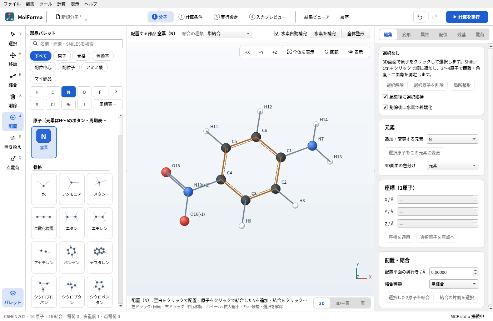

# 機能と操作（画面・タブごとの説明）

MolFormaはNWChem向けの分子作成・座標編集・計算入力作成・実行・結果表示のデスクトップアプリです。分子座標は倍精度のÅ、原子参照は永続IDで管理します。ローカルでの計算実行・停止・ログ表示と結果の閲覧、保存した計算の履歴一覧、入力・ログの参照、分子と条件の再利用に対応します。MCPクライアントからの操作にも対応します（[MCPサーバーの概要](features/ai.md)）。

機能の説明は、画面・タブごとのページに分けています。下の「[ページの一覧](#ページの一覧)」から、調べたい画面のページを開いてください。分子を組んで計算し、結果を確かめるまでを題材ごとに通す手順は「[題材から選ぶ実習](recipes.md)」にあります。

## 1.1.0の新機能

[変更履歴](changes.md)に追加機能と制限をまとめています。複数の計算は「3 実行設定」のキューへ登録し、配座探索の結果は「ツール → 配座セット…」で保存・一括評価できます。「履歴」では熱補正・反応エネルギー図を、「結果ビューア」ではNMR・通常ラマン・溶液ESR・ECD・ORD（β）と物性3D・格子断面を利用できます。

## 次の版で追加した機能

[変更履歴](changes.md)に追加機能と制限をまとめています。止まった計算は「履歴」の「続きから実行を準備」でNWChemのデータベースから続けられ、計算はウィンドウを閉じても続きます。別の計算機で実行した結果は「履歴」で登録でき、「結果ビューア」では励起状態の軌道の内訳と結合次数を、「履歴」の熱補正では振動数スケール・準RRHO・標準状態の補正と速度定数を利用できます。

## はじめに: 基本の流れ

1. **分子を作る（「1 分子」）**: ヘッダー左のファイル名のメニュー（または「ファイル」メニュー）の「SMILESから作成」、「開く」で構造ファイル、または部品パレットを使います。よく使う元素はパレットのH・C・N・O・F・P・S・Cl・Br・Iのボタンで、それ以外は「周期表…」で選びます。パレットで原子・部品をクリックすると「配置」ツールになり、3D画面をクリックして置けます。左端の列（またはS・A・Bなどのキー）でツールを選ぶと、3D画面の上にそのツールの設定を、下にクリックしたときの動作を表示します。削除・整形・配位子などの変更は候補として表示し、「変更を確定」（Ctrl+Enter）で適用、Escで取消、Ctrl+Zで元に戻します（[「1 分子」の画面・ツール・選択](features/molecule.md)）。
2. **計算条件を決める（「2 計算条件」）**: 計算目的・手法・基底関数・電荷・多重度を選びます。問題は右の一覧に表示し、「→ ダブルクリックで修正」と書かれたものはダブルクリックで直せます。軌道の形を見る場合は「軌道・出力ファイル」の「MOLDENファイルを出力」をオンにします。各セクションの「詳細設定」を開くと、NWChemの各ブロックへ直接指定する項目も設定できます（[「2 計算条件」](features/calculation.md)、[詳細設定とCUBE・MOLDEN出力](features/advanced.md)）。
3. **計算を実行する**: ヘッダー右の「計算を実行」または「計算 → 計算を実行」（F5）でNWChemを起動します（実行ファイルなどは「3 実行設定」で確認します）。終了すると結果を「結果ビューア」に読み込み、最適化の収束・エネルギー・虚振動の数を実行パネル（「実行状況とログ」）とステータスバーに表示します（[「3 実行設定」](features/execution.md)）。
4. **結果を見る（「結果ビューア」・「履歴」）**: 構造・エネルギー・軌道・振動などを、データのあるタブで確認します。過去の計算は「履歴」から開き、分子・条件を再利用できます（[「結果ビューア」](features/results.md)、[「履歴」](features/history.md)）。

各ページで機能と制限を説明します。キー操作は「ヘルプ → キーボードショートカット一覧」にあります。

## ページの一覧

| No. | ページ | 画面 | 主な内容 |
| --- | --- | --- | --- |
| 1 | [「1 分子」の画面・ツール・選択](features/molecule.md) | 1 分子 | 画面の構成、ツールと部品パレット、選択・削除・候補・視点・キー操作、原子パレットと周期表 |
| 2 | [「1 分子」の右側のページ](features/molecule_pages.md) | 1 分子 | 編集・変形・属性・配位・残基・電荷、構造ツール、配座セットの保存と一括評価 |
| 3 | [座標の表](features/coordinates.md) | 1 分子 | 座標と属性の表の編集、構造ファイルの読込・書き出し、NWChemの座標ブロックへの出力 |
| 4 | [「2 計算条件」](features/calculation.md) | 2 計算条件 | 手法・基底・溶媒・相対論、遷移状態・IRC・拘束・スキャン、分光・物性格子・BSSE、入力取込と診断 |
| 5 | [詳細設定とCUBE・MOLDEN出力](features/advanced.md) | 2 計算条件 | 各セクションの「詳細設定」（56項目）、適用範囲と優先順位、CUBE・MOLDENファイルの出力 |
| 6 | [「3 実行設定」](features/execution.md) | 3 実行設定 | NWChem・MPIの起動条件、キューの登録・逐次実行、実行パネルとログ、失敗原因の案内 |
| 7 | [「4 入力プレビュー」](features/input_preview.md) | 4 入力プレビュー | 生成したNWChem入力の表示、入力の構成と編集元、書出し用と実行時の入力、コピー・書き出し |
| 8 | [「結果ビューア」](features/results.md) | 結果ビューア | 構造・軌道・振動、NMR・ラマン・ESR・ECD・ORD、物性3D・格子断面、再計算の準備 |
| 9 | [「履歴」](features/history.md) | 履歴 | 保存ジョブの一覧と再利用、ΔE、熱補正付き比較・反応エネルギー図、記録の修復 |
| 10 | [3D描画](features/rendering.md) | 1 分子・結果ビューア | VTKとQPainterの描画、表示スタイル、計測・水素結合の表示、描画性能 |
| 11 | [アプリ全体](features/app.md) | 全体 | 画面の共通部品、ステータスバー、表示言語、自動保存と復旧、操作ガイド・マニュアル、テスト |
| 12 | [MCPサーバーの概要](features/ai.md) | — | AIクライアントからの操作、公開するツール、安全のための制限（詳しくは「[MCPサーバー](mcp.md)」） |

## 実装済み

| 分類 | 操作 |
| --- | --- |
| ファイル | MolFormaプロジェクト（`.molforma.json`）、XYZ（複数フレームの選択）/ MOL / SDF / Mol2 / CML / PDBの読込・保存、PDB IDからのダウンロード（RCSB PDB）、mmCIFの読込（PDB・mmCIFは読み込むモデル・鎖・成分などを選択）、gzip圧縮した構造ファイルの読込、NWChem入力（`.nw`、計算条件を含む）・Gaussian入力（`.gjf` / `.com`）の取込み、Gaussian入力の書出し、XYZのコピー・貼り付け、SMILES → 3D、SMILES・構造ファイルからの断片の追加、最近使ったファイル、ドラッグ＆ドロップ、自動保存と異常終了後の復旧 |
| パレット | H〜Ogの118元素を周期表で選択、骨格19種、置換基32種、配位子21種、アミノ酸28状態、配位中心25元素（元素記号のカラーアイコン・日本語名・原子番号、他の部品と同じ48px以上の行、元素記号・日本語名・英語名・原子番号で検索。ほかの元素も元素ボタン・周期表・検索で配位中心に選べる）、分子サムネイル付き一覧（日本語名・接続点表示・HiDPI対応）、検索、マイ部品の保存・読込・登録解除 |
| 3D画面 | 回転・平行移動・ズーム、+X/+Y/+Z、3軸回転スライダー、番号、水素、非表示Hのマーカー、配位矢印、固定・同位体表示、配位サイト、末端追加ハンドル、PNG、表示スタイル（ボール＆スティック・スティック・空間充填・ワイヤーフレーム・主鎖（Cαトレース））、元素・残基・鎖ごとの色分け、原子の一時非表示、計測値の常時表示、水素結合の表示 |
| 選択 | 原子・結合・部品・残基・連結分子・全体、番号と範囲指定、矩形、右クリックメニュー |
| 編集 | 原子追加、結合途中への挿入、元素変更、置換基付加、部品全体の置換（1接続点）、単・二重・三重・芳香族・配位結合、座標表、座標適用、平行移動、複製、削除、水素補完 |
| 寸法・立体 | 距離・角度・IUPAC二面角の測定と設定（結合した原子では片側、別々の分子の原子では後の原子の分子全体を移動）、結合片側の選択、回転、鏡映、不斉中心の置換基交換、E/Z幾何の切替、重心・主慣性軸、原子順の向き合わせ、R/S・E/Z判定と記録、点群の判定と対称化、Z-matrixの表示・編集、配座探索、構造の比較・重ね合わせ（RMSD） |
| 原子属性 | 形式電荷、不対電子、同位体・質量、ゴースト、固定、元素順・残基順・選択優先の並べ替え |
| 配位 | 12形状、中心配置、単座・二座配位子、サイト指定、配位子交換・移動、形状・距離・酸化数、個別サイト方向、単座配位子のサイト交換、供与H方向の調整 |
| ペプチド | 1/3文字配列、L/D、側鎖状態、荷電/中性末端、ACE/NME、N/C末端追加、連続追加、残基置換・削除、鎖の分割・再連結、phi/psi/omega/chi、配列リンク、手動登録、結合グラフからの残基認識、欠損側鎖補完、活性部位の切り出し（クラスターモデル） |
| 点電荷 | 追加・更新・削除、選択した水のTIP3P点電荷への変換（候補）、NWChem入力への出力の切替、`x y z q`（Å）形式のファイル保存 |
| 計算準備 | 全電荷・多重度（「2 計算条件」）、原子の固定、ゴースト化、構造の検査、原子対応CSV |
| 編集履歴 | 候補の確定・取消、Undo/Redo、失敗した編集のロールバック、未保存表示、保存前の候補処理 |
| 整形 | Open Babel MMFF94 / UFF、全体・局所整形、3D再生成、固定の保持、処理中止 |
| 計算実行 | ローカル計算キュー、登録時の入力・条件の保存、逐次実行・並べ替え・取消・一時停止、キューの保存と復元、失敗原因の案内と設定への移動、ウィンドウを閉じた後の継続と再接続、別の計算機で実行するためのジョブスクリプト |
| 再開・引き継ぎ | 止まった計算の続行（NWChemのデータベースから）、振動数計算のHessianによる遷移状態探索、Hessianを再利用した振動数、分子軌道の引き継ぎ、外部で実行した計算の取込み |
| 配座の評価 | 配座セットのJSON保存・複数XYZ出力、一括最適化と振動数計算、重複構造の分類、E／Gによるセット内の分布 |
| エネルギー比較 | E・E + ZPE・H・G、別ジョブの熱補正、反応段階の係数付き合計、温度・条件・虚振動の確認、振動数スケール・準RRHOエントロピー・1 mol/Lの標準状態、Eyringの速度定数、CSV／PNG |
| 分光 | IR・UV–Visに加え、分裂なしNMR、通常ラマン、S＝1/2溶液ESR、ECD、ORDのβ。励起状態の軌道の内訳、配座平均スペクトル。表示条件のJSON保存、曲線・ピークのCSVと図のPNG |
| 物性の可視化 | 双極子・分極率の3D表示、電子密度表面のESP色付け、CUBE格子断面、単位ラベルと共通の色尺度 |
| 再計算 | 保存したジョブの条件と表示中の結果構造から、新しいジョブを準備。座標は候補として確認・確定 |

## 制限事項・未対応

主な制限と未対応の機能は次のとおりです。

- 同時実行、SSHでの転送・投入・監視、座標スキャン・IRC・BSSE補正の再開、NMRのJ分裂、粉末／高スピンESR、比旋光度への換算は未対応です。詳細は[変更履歴](changes.md)と各機能のページを参照してください。
- PDBの修復は「残基 → PDBの診断・修復…」で残基ごとの診断、欠損原子の補完候補、残基の再認識を行い、主画面で確認・確定します。補完は主鎖N/CA/Cと標準アミノ酸テンプレートが揃う残基を対象とし、未知の残基や欠損主鎖は自動修復しません。MODEL/ALTLOC選択と原子名・鎖情報を保持します。
- 断片割当（FMO・Counterpoise・SAPT0）とその検証。NWChem入力へ変換できないため、作成・編集のUIはありません（[「1 分子」の右側タブ](features/molecule_pages.md)）。Counterpoise補正は「2 計算条件」のBSSE補正（結合した分子ごとの単量体）で計算できます。FMO・SAPT0は未対応です。
- v1プロジェクトの移行。

R/S・E/Zの判定・記録と結合グラフからの残基認識には、オプションのRDKit C++ライブラリを使います。この環境では有効です。見つからない環境では該当ボタンを無効化します。

3D表示はC++のVTK/OpenGLとQPainterの代替描画に対応します。整形・SMILES生成はOpen Babelで行います。金属・配位結合・ゴーストの力場整形は拒否します。Br・I・Se・Teなどの典型元素は、MMFF94またはUFFにパラメータがあれば整形できます。マイ部品の付加は1接続点、配位子は1/2供与原子に対応します。マイ部品は「骨格（接続点なし）」としても保存でき、組込みの骨格と同じく空白のクリックで配置します。

「ファイル → SMILESから断片を追加」「ファイルから断片を追加」（XYZ・MOL・SDF・Mol2・CML・PDB・mmCIF・NWChem・Gaussian入力）は、今の分子を残したまま、別の分子を+X側に3 Å離して候補として追加します（二量体・溶媒和・錯形成前の配置など）。原子・結合・残基・部品・配位中心を取り込み、断片の点電荷と計算設定は取り込みません。全電荷が形式電荷の合計と一致していた場合は、追加後の合計に合わせます。位置は「平行移動」や結合していない原子間の寸法設定で調整します。複数フレームのXYZは追加するフレームを選びます。

プロジェクトの未知のフィールドは保存時にそのまま保持し、NWChem入力には使いません。
