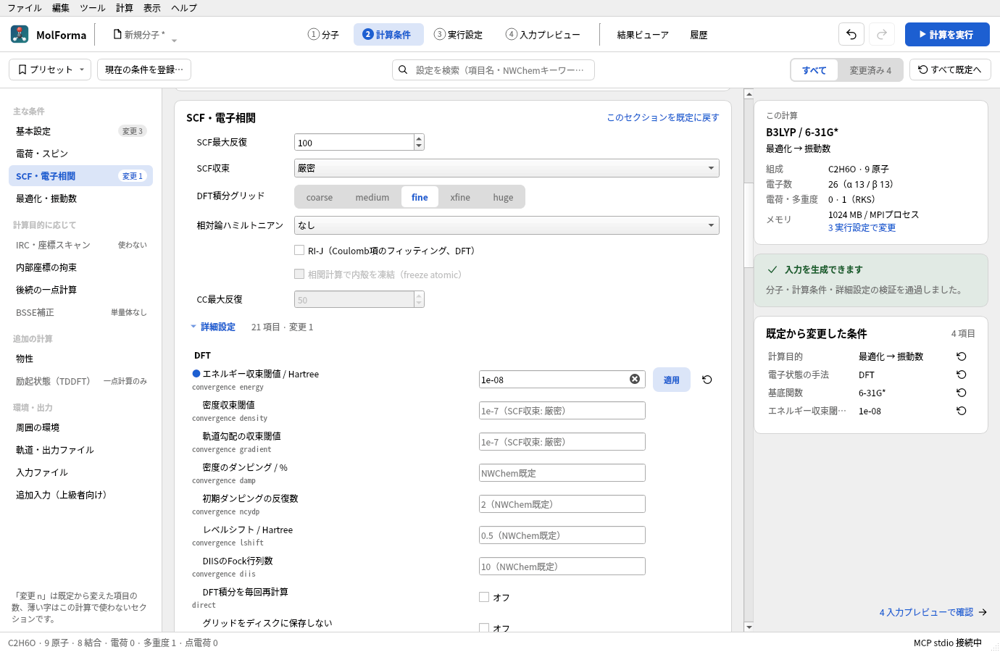
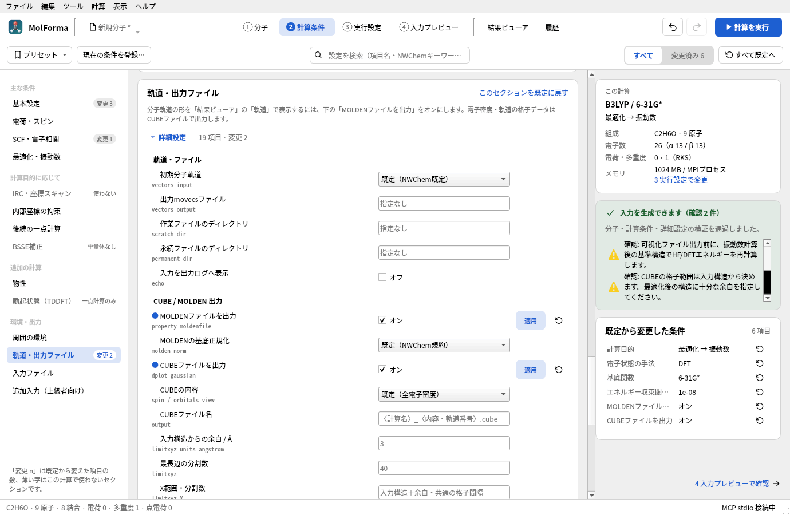

# 詳細設定とCUBE・MOLDEN出力

「2 計算条件」の各セクションの「詳細設定」と、計算後にCUBE・MOLDENファイルを出力する設定を説明します。基本の計算条件は「[「2 計算条件」](calculation.md)」、出力したファイルの表示は「[「結果ビューア」](results.md)」にあります。

## 詳細設定（各セクションの「詳細設定」）

NWChemの各ブロックへ直接指定する8グループ・56項目は、関係するセクションのカードの下にある「詳細設定」（後ろに項目数と変更数）を開いて設定します。「SCF・電子相関」にHF / 参照SCF・DFT・MP2 / CCSD、「最適化・振動数」にDRIVER 最適化・振動数・熱化学、「周囲の環境」にCOSMO、「軌道・出力ファイル」に軌道・ファイルとCUBE / MOLDEN 出力があります。「軌道・出力ファイル」は詳細設定だけのセクションなので、最初から開いています。今の計算で使わない項目は隠し、「この計算で使わない項目も表示（n）」で表示します。左の一覧の「変更 n」、「このセクションを既定に戻す」「すべて既定へ」、上部の「変更済み」の絞り込みと検索は、詳細設定も対象にします。



**図1** 「SCF・電子相関」の詳細設定。エネルギー収束閾値を1e-08にした行は名前の前に青い点が付き、状態が「適用」になります。空欄には実際に使われる値（「1e-7（SCF収束: 厳密）」など）が薄く出ます。

各行は、項目名とその下のNWChemのキーワード、値の入力欄、状態（「適用」「保留」「エラー」。未指定は空白）、既定に戻すボタンです。変更した項目は名前の前に青い点を付け、今の計算で使わない項目は名前を淡色で表示します。空欄の値欄には、実際に使われる値とその出どころ（例: 「1e-7（SCF収束: 厳密）」「0.00045（最適化収束: 標準）」「0.3（NWChem既定）」）を薄く表示します。

行をクリックするか入力欄で操作すると、右側の「選んだ詳細設定」に名前・キーワード・状態・説明と、既定（空欄のときに使う値）・現在の値・使う計算を表示します。その下には、項目を書き込む入力のブロックを抜粋して項目の行を強調し（空欄・保留のときはその旨を表示）、「既定に戻す」と「入力で見る」（「4 入力プレビュー」でその行を表示）を置きます。「軌道・出力ファイル」には計算後に出力するCUBE・MOLDENファイルを表示します。詳細設定の検査結果は右の検査結果のカードに含まれ、項目名を含む行をクリックするとその行を表示します（保留中の項目も表示します）。入力全文のコピー・`.nw`保存は「4 入力プレビュー」で行います。

| グループ（セクション） | 設定項目 |
| --- | --- |
| HF / 参照SCF（5項目、SCF・電子相関） | 波動関数の収束 `thresh`、積分の打切り `tol2e`、`direct`、閉殻RHF専用の `diis` と `diisbas`。MP2/CCSDの参照SCFにも適用 |
| DFT（9項目、SCF・電子相関） | energy/density/gradientの個別収束、ダンピング率・初期反復数、レベルシフト、DIISのFock行列数、`direct`、`grid nodisk` |
| MP2 / CCSD（7項目、SCF・電子相関） | 明示的な凍結占有軌道数、MP2の `tight` とプロセスごとの `scratchdisk`、CCの `thresh`・`tol2e`・`diisbas`・`nodisk` |
| DRIVER 最適化（8項目、最適化・振動数） | `gmax`・`grms`・`xmax`・`xrms`、`trust`、`eprec`、各構造のXYZ出力、Cartesian座標での最適化（`noautoz`） |
| 振動数・熱化学（4項目、最適化・振動数） | 1〜20個の温度、数値Hessianの `fd_delta`、解析Hessianの `hessian thresh`、振動モードのXYZ出力 |
| COSMO（4項目、周囲の環境） | 表面分割 `minbem`、初期多面体 `ificos`、誘電遮蔽 `screen`、表面電荷幅 `zeta` |
| 軌道・ファイル（6項目、軌道・出力ファイル） | 原子密度／一電子Hamiltonian／既存movecsによる初期軌道、入力・出力movecs、`scratch_dir`・`permanent_dir`、`echo` |
| CUBE / MOLDEN 出力（13項目、軌道・出力ファイル） | CUBE・MOLDENの有効化、密度・軌道・スピン・軌道番号、CUBE名・格子範囲・分割数、MOLDEN正規化 |

数値は `1e-8` / `1D-8` 等の指数表記に対応します。空欄・「既定」は明示指定を解除し、上の計算条件またはNWChemの既定値を使います。値の確定時に型・有限性・範囲・手法との整合を検査し、有効な設定だけで入力を生成します。修正途中の不正値もプロジェクトへ保存できますが、使用中の項目にエラーがある間は出力できません。各項目の既定に戻すボタン、セクション単位・全体のリセット、共有Undo/Redoに対応します。Ctrl+Sでも入力中の値を確定してから保存します。

### 適用範囲と優先順位

- 明示したSCF/DFT/CCの閾値、凍結軌道数、最適化閾値は基本条件より優先します。DRIVERでは標準・厳密等のプリセット指示の後に個別閾値を出力します。凍結軌道数0は内殻凍結を解除し、相関電子が不足する指定は拒否します。
- DFTの値を保持したままHFへ変更した場合など、現在の計算に適用できない値は「保留」とし、入力へ出力しません。対応する手法・計算目的へ戻すと再適用します。数値Hessianの差分幅と解析Hessianの精度も、この規則で切り替えます。
- 最適化の変位・trust radius・数値差分幅はBohr、勾配はHartree/Bohr、エネルギーはHartreeです。座標のÅ/Bohr切替では変更しません。温度はKで指定します。
- 最適化構造は `<計算名>_opt`、振動モードは `<計算名>_vib` をファイル名の接頭辞にします。XYZの生成は外部でNWChemを実行したときに行われます。
- 入力movecsは実行先のファイルを指定し、MolFormaでは読みません。原子順・基底との互換性は実行時の確認が必要です。既存movecsを使う場合は、NWChemが入力ファイルを出力先として再利用する既定動作を避けるため、別の出力movecsを指定します。パスの別名・シンボリックリンクによる同一性までは検査しません。
- movecsのパスは引用符で囲み、空白を含むパスにも対応します。NWChemの起動時ディレクトリ指定は別の構文なので、`scratch_dir` / `permanent_dir` は引用符なしで出力し、空白・コロン・引用符を含むパスを拒否します。各ディレクトリは実行先に存在する必要があります。「3 実行設定」ではジョブ内の相対ディレクトリを作成します。環境変数展開、ホスト／MPIランク別の保存先指定、複数ディレクトリの指定は未対応です。
- 候補表示中・整形中は編集と出力を無効化します。詳細設定の変更は分子座標や固定原子を動かしません。

### 詳細設定の保存と互換性

明示指定だけを `document.nwchem.advanced` に保存します。詳細設定を開いただけでは既定値をプロジェクトへ追加しません。未知の詳細フィールドは保持し、未対応であることを表示して出力から除外します。プロジェクトの未知のフィールドも保持します。

ユーザープリセットには「軌道・ファイル」と「可視化ファイル出力」以外の詳細設定を含めます。組込みプリセットや旧形式のプリセットに詳細指定がない場合は、これらの上書きを解除してプリセットの基本条件を有効にします。軌道・保存先・echo・可視化ファイル出力の設定と未知フィールドは保持し、プリセット適用全体をUndo一回で戻せます。

任意のキーワード入力、SCF半直接計算の細かなキャッシュ調整、RODFT/CDFT・部分占有、任意の軌道占有、TCE、相対論、距離・角度拘束、スキャン、遷移状態、IRC、MD、周期系などは未対応です。NWChem本体やPythonは、詳細設定の編集・保存・入力生成には不要です。

仕様の参照: [HF](https://nwchemgit.github.io/Hartree-Fock-Theory-for-Molecules.html)、[DFT](https://nwchemgit.github.io/Density-Functional-Theory-for-Molecules.html)、[MP2](https://nwchemgit.github.io/MP2.html)、[CCSD](https://nwchemgit.github.io/CCSD.html)、[DRIVER](https://nwchemgit.github.io/Geometry-Optimization.html)、[Hessian・振動数](https://nwchemgit.github.io/Hessians-and-Vibrational-Frequencies.html)、[COSMO](https://nwchemgit.github.io/COSMO-Solvation-Model.html)、[Scratch directory](https://nwchemgit.github.io/Scratch_Dir.html)。

## GUIからCUBE・MOLDENを出力する

1. 「2 計算条件」の左の一覧で「軌道・出力ファイル」を選びます。「CUBE / MOLDEN 出力」の項目は最初から表示しています。
2. 「CUBEファイルを出力」「MOLDENファイルを出力」の必要な方を有効にします。両方を同時に出力できます。
3. CUBEは「全電子密度」「Alpha電子密度」「Beta電子密度」「スピン密度」「分子軌道」から選びます。分子軌道ではAlpha/BetaとHOMO/LUMO/番号指定を選びます。番号は1始まりです。Beta軌道はUHF/UKSで使用します。
4. 「4 入力プレビュー」で計算後の`property`・`dplot`指示を確認し、ヘッダーの「計算を実行」（F5）で計算を実行します。
5. 終了後、実行パネル（「計算 → 実行状況とログ」）の「結果ビューアへ」でジョブを開き、ファイル一覧からCUBEまたはMOLDENを選ぶと、自動で読み込んで表示します。



**図2** 「軌道・出力ファイル」で「MOLDENファイルを出力」と「CUBEファイルを出力」をオンにしたところ。

CUBEの格子は入力構造の各軸の最小・最大座標に余白3 Åを加えた範囲を、全軸で同じ格子間隔にします。既定は最も長い辺を40分割（41点）し、ほかの軸は同じ間隔で範囲を覆うよう中心から広げます（細長い分子で無駄な格子点を作りません）。余白・分割数の変更や、X/Y/Zごとの「最小値 最大値 分割数」の指定ができます。範囲は常にÅで、座標の表の表示単位・NWChem geometryの出力単位とは独立です。最大200万格子点とし、無効な範囲・分割数・ファイル名では入力出力を止めます。最適化後も格子範囲は入力構造から決めたままなので、十分な余白を確保してください。

MOLDENは`<計算名>.molden`、CUBEは`<計算名>_<内容・軌道番号>.cube`を生成します。CUBE名は拡張子`.cube`または`.cub`のファイル名だけを変更できます。どちらも「軌道・ファイル」の`permanent_dir`へ保存し、未指定ならジョブフォルダー直下です。入力一式保存では生成先を`run.json`にも記録するため、結果ビューアはpermanent内のファイルも一覧に表示します。ローカル実行前には既存出力との衝突を検査します。

MOLDENの基底正規化は`NWChem規約`（既定）または`未正規化（NONE）`を選びます。**標準MOLDENの係数を前提とする外部ソフトへ渡す場合はNONEを選んでください。** NWChem規約はプリミティブの正規化因子を基底係数に含めるため、標準規約として読むと因子が二重に掛かり、軌道の形状・大きさが変わります。NONEは入力基底の係数をそのまま書く指定であり、分子軌道の正規化を解除する意味ではありません。MolFormaの結果ビューアは両規約に対応します。

出力する軌道・密度はHF/KSの参照波動関数で、MP2/CCSDの相関密度・自然軌道には対応しません。振動数計算の後には基準構造でHF/DFTエネルギーを再計算し、その軌道を出力します。HOMO/LUMO番号は電子数・多重度・ECP・スピンから決め、部分占有や励起状態は扱いません。最小基底などで存在しない軌道番号を指定した場合はNWChem実行時にエラーになります。CUBEは1計算につき1ファイル・1内容で、ゴースト中心を含む構造のGUI出力は未対応です。

ファイル本体はNWChemが書きます。NWChem 7.3.1の分子軌道CUBEは、正の原子数を持つ単一スカラー場として出力され、Gaussianの複数軌道形式（負の原子数と軌道番号リスト）は使いません。軌道番号とスピンはファイル名・生成入力で確認してください。座標はBohr、密度は電子数/bohr³、軌道関数はbohr⁻³ᐟ²です。

設定はプロジェクトに保存し、共有Undo/Redo・リセット・履歴からの再利用に対応します。出力を無効にしても格子・軌道等の指定は保留として保持し、再び有効にすると使います。計算プリセットを適用しても出力設定は維持します。MOLDENを開くと基底とMO係数から分子軌道を表示します。分子軌道CUBEも使用できます。

仕様の参照: [NWChem DPLOT](https://nwchemgit.github.io/DPLOT.html)、[Properties / MOLDENFILE](https://nwchemgit.github.io/Properties.html#moldenfile)。

## 詳細設定の検証

`advanced`のQt Testは、項目の型・値域、適用と保留、閾値の優先順位、HF/DFTの違い、凍結軌道、解析/数値Hessian、温度、パス、未知フィールドの保持、プリセット、セクション内の表示（開閉・使わない項目・変更済み）、検索、検査結果からの移動、リセット、Undo/Redo、候補、Ctrl+S、フォーカス中の終了を検査します。通常のCTestはNWChemもネットワークも不要です。

任意の実機検証用入力と画面画像を生成できます。出力先には空白・コロンを含まないパスを指定してください。

```sh
QT_QPA_PLATFORM=offscreen MOLFORMA_ADVANCED_ARTIFACTS=/tmp/molforma-advanced \
  ./build/test_advanced engineArtifacts
```

軌道の読込試験 `vectors_details.nw` は、軌道を保存する `files_details.nw` の実行後に使用します。

2026-10-22にNWChem 7.3.1（MPI 2プロセス、OMP/OpenBLAS各1スレッド）で9種類の詳細設定入力の正常終了を確認しました。HFのDIIS・積分精度、DFTの個別収束・ダンピング・グリッド、MP2/CCSD、最適化→解析振動数、MP2数値振動数、COSMO、保存先、movecsの書出し・再読込を含みます。温度100/298.15/350 K、数値差分幅0.003 Bohrの反映とXYZ生成も確認しています。初期軌道の保存・再読込は同じSCFエネルギー −74.945628203255 Hartreeを得ました。詳細設定・計算条件のQt TestはAddressSanitizerでも検証しています。

## CUBE・MOLDEN出力設定の検証

`output`のQt Testは、出力無効時の互換性、HF/DFT/MP2・振動数後のtask生成、HOMO/LUMO・スピン・番号の検査、格子・ファイル名の検査、保存・プリセット・Undo、出力先の衝突、permanent内と外部保存先の結果一覧、GUI操作と入力プレビューの一致を検査します。通常のCTestにNWChem・MPIは不要です。

NWChemとMPIを使える環境では、以下で15ケースの生成入力の実行、両形式の読込、設定画面のPNG保存を確認できます。原子番号・座標・格子範囲・点数・データ件数を検査し、CUBEの値をMOLDENの軌道係数から再評価した値と照合します。s〜gの球面／Cartesian基底、NWChem／NONE正規化、ROHF／UHFのAlpha・Beta・スピン密度、ECPを含みます。NONEの読込規約は生成入力に従って明示します。

```sh
QT_QPA_PLATFORM=offscreen MOLFORMA_OUTPUT_ARTIFACTS=/tmp/molforma-output \
  ./build/test_output realEngineArtifacts
```

2026-10-23にNWChem 7.3.1（MPI 2プロセス、OMP/OpenBLAS各1スレッド）で、水のHF電子密度、水カチオンのUKS/PBE Beta HOMO、MP2の参照HF密度、H₂の最適化＋数値振動数後の密度の4ケースについてCUBE・MOLDEN生成と読込を確認しました。相対permanentと空白を含む出力movecsの組合せも成功しました。H₂の両ファイルの原子座標は最適化後の構造と一致しています。全10系列のCTestと、output・execution・resultsのAddressSanitizer検証（外部ライブラリのリーク検出を無効化）が成功しています。

2026-10-29の形式検証では、上記15ケースをNWChem 7.3.1で実行して数値照合まで成功しました。さらにPySCF 2.12.1で22個のMOLDENから軌道・密度を独立に再計算し、66個のCUBEの計207,550値と照合しました。座標ヘッダーの丸めを含むL2相対誤差は3.3×10⁻⁵以下、MOの直交規格化誤差（CᵀSCと単位行列の最大差）は5.3×10⁻¹⁰以下でした。NWChem規約の係数は独立計算前にプリミティブ正規化因子を除去しています。その変換を省くと標準MOLDEN読込では正しくなく、NONE出力はそのまま一致しました。この検証は全ソフトとの互換性や、未検証の基底・NWChemバージョンを保証するものではありません。

関連: [「2 計算条件」](calculation.md)、[「結果ビューア」](results.md)、「[機能と操作](../features.md)」のページの一覧。
