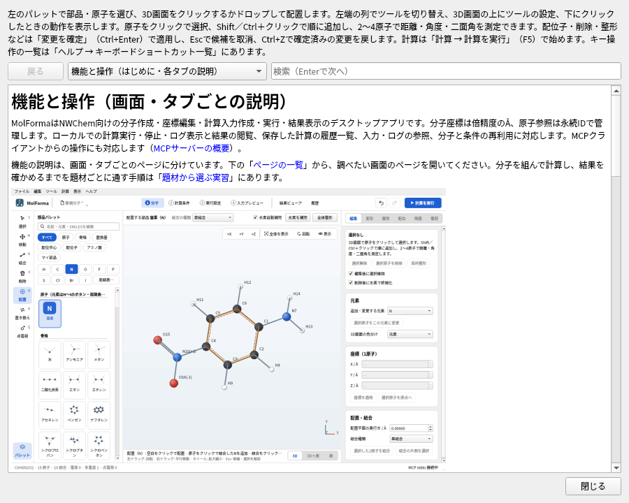

# アプリ全体

- **画面の共通部品**: どのタブも同じ部品で組み立てます。上部の行（ツールバー）、白いカード、切替（選択肢が5個以下はセグメント、結果ビューアの詳細のように多いものは下線付きのタブ。タブの中にタブは置きません）、ボタン（青は画面の主な操作、赤い枠は削除・ごみ箱、矢印付きの青い文字はほかのタブへの移動）、検査結果のカード（「入力を生成できます」「実行できます」などの見出しと項目）、計算の要約のカード、ログ・ファイルの表示（切替・ファイル名・追尾・コピー）、表（罫線なし、数値は等幅で右揃え）、3D画面右上の操作です。
- **値を編集する場所は1か所**: ほかのタブでは値を表示し、「2 計算条件で変更」のようなリンクで移動します。全電荷・多重度・外部点電荷を入力に含めるか・座標の出力単位・MOLDEN・CUBEの出力は「2 計算条件」、メモリは「3 実行設定」、形式電荷・不対電子・原子名の表は「1 分子」の座標の表の「属性の列」で設定します。
- **ステータスバー**: ウィンドウ下端の1段で、ふだんは編集中の分子の要約（分子式 · 原子数 · 結合数 · 電荷 · 多重度 · 点電荷）、一時的なメッセージの間はその文だけを表示します（要約は隠れ、右端の表示が変わっても重なりません）。結果ビューアと履歴では、表示中の結果と取り違えないよう要約の先頭に「編集中の分子:」を付けます。右端には実行中・最後の計算の状態（クリックで実行パネル）などを表示します。
- **表記**: エネルギーの単位は画面ではEh（= Hartree）と書きます（履歴のCSVの列名は互換性のため従来のまま）。語を並べるときは「・」、要約の項目の区切りは前後に空白を入れた「 · 」を使います。ファイルを1つ作る操作は「〜を書き出す…」、ファイルから取り込む操作は「〜を読み込む…」、ジョブフォルダーを作る操作は「ジョブとして保存」、検査をやり直す操作は「再検査」、分子全体を収める表示は「全体を表示」、固定は「選択原子を固定」「固定を解除」と書きます。タブは本文でもリンクでも番号とタブ名で書きます（本文では「2 計算条件」とかぎ括弧で、ほかのタブへ移るリンクは「4 入力プレビューで確認」）。ヘッダーの作業の流れだけは番号を丸いバッジで示します。負のエネルギーなど読ませる値の負号は「−」（U+2212）にし、結果ビューアの表のセルはコピーした値が数値のままになるよう「-」にします。
- **最近使ったファイル**: 「ファイル → 最近使ったファイル」に、開いた・保存したファイルを新しい順に10件まで表示します（アプリ設定に保存）。見つからないファイルは選べません。「一覧を消去」で消去します。
- **表示言語（日本語・英語）**: 画面・メッセージ・操作ガイド・マニュアルを日本語と英語で表示できます。既定はシステムの言語に従い（日本語の環境では日本語、それ以外は英語）、「編集 → 環境設定」の「表示言語 / Language」で日本語・Englishに固定できます（再起動後に反映）。環境変数 `MOLFORMA_LANGUAGE`（`ja` / `en`）を指定すると、それを優先します。整形・結果読込のワーカーとMCPの応答のメッセージも同じ言語です。プロジェクト・ジョブ・NWChem入力の内容は表示言語によらず同じです。英語の訳は `assets/translations/en.json` にあり、テスト（`translations`）が、ソースの日本語の文字列がすべて訳の対象になっていて、訳があることを確かめます。
- **Qtのダイアログの言語**: メッセージ・ファイル選択などQt標準のダイアログとボタンも表示言語に合わせます。日本語ではQtの翻訳（Arch Linuxの `qt6-translations`、Debian/Ubuntuの `qt6-translations-l10n` など）があればそれを使い、ない場合も「保存」「変更を破棄」「キャンセル」「閉じる」などの標準ボタンは日本語にします。
- **新規**: 「ファイル → 新規」は空の未保存プロジェクトを作り、編集するまで保存の確認を出しません（実行設定は「環境設定」の既定値）。視点も正面に戻します。保存するときの既定のファイル名は分子式（例: `C2H6O.molforma.json`）です。
- **読込エラー**: 開けないファイルは、ファイル名と理由を表示します。XYZでは問題のある行番号とその行を示します。
- **XYZのコピー・貼り付け**: 「ファイル → 分子全体をXYZでコピー」は分子全体、「編集 → 選択をXYZでコピー」（Ctrl+C）は選択した原子（未選択なら全体）をコピーします。「ファイル → XYZを貼り付けて置き換え…」は今の構造を置き換える候補、「編集 → XYZを断片として貼り付け」（Ctrl+V）は今の分子の横に追加する候補を作ります。
- **ドラッグ＆ドロップ**: ウィンドウへ構造ファイル・プロジェクト・NWChem/Gaussian入力をドロップすると開きます（未保存の変更は確認）。座標の表へのXYZ・MOL・SDF・PDB・ENT・mmCIFのドロップは、開く代わりに構造を置き換える候補になります。`.out`・`.log`・CUBE・MOLDENとフォルダーは結果ビューアで開きます。「1 分子」のパレットからの部品のドロップは従来どおり分子へ配置します。
- **自動保存と復旧**: 対話的な起動では、未保存の変更があるとき1分ごとにプロジェクトのコピーをデータフォルダー（Linuxでは `~/.local/share/MolForma/autosave/`）へ保存します。保存・正常終了でコピーを消します。異常終了したセッションのコピーが残っていると、次の起動時に保存日時・元のファイル・分子を示して「復旧する／破棄する／後で決める」を尋ねます。復旧した分子は未保存のプロジェクトとして開くので、名前を付けて保存してください。他のMolFormaウィンドウが使用中のコピーには触れません。`--mcp-gui` の起動は自動保存しますが、復旧の確認は出しません（`--mcp` と `--screenshot` は対象外）。
- **操作ガイド・マニュアル**: 「ヘルプ → 操作ガイド・マニュアル」（F1）で、この「[機能と操作](../features.md)」のページ、[題材から選ぶ実習](../recipes.md)（16題材のページと画面）、MCPの説明を実行ファイルに組み込んだ表示で読めます（インストール先の文書ファイルは不要）。ページ間のリンクをたどれ、「戻る」で前のページに戻ります。題材の「練習データ」のリンクをクリックすると、保存先を選んでそのファイルを開きます（部品ファイルは「マイ部品」に読み込みます）。検索欄でEnterを押すと次の一致へ移動します。
- **デスクトップ連携**: `cmake --install` で、ランチャー（`share/applications/molforma.desktop`）、アイコン（`share/icons/hicolor` の `molforma`）、プロジェクト（`*.molforma.json`）とNWChem入力（`*.nw`）のMIME型（`share/mime/packages/molforma.xml`）を配置します。システムのデータベースへの反映は `update-desktop-database` / `update-mime-database` が必要な場合があります。ウィンドウのアイコンにも同じ図案を使います。`LICENSE`（GNU GPL バージョン2。MolFormaはバージョン2以降）・`NOTICE`・`README.md` を `share/molforma` に配置します。

**図1** 「ヘルプ → 操作ガイド・マニュアル」（F1）。ページ間のリンクをたどり、「戻る」で前のページに戻れます。

**図2** 表示言語をEnglishにした画面（図は「1 分子」）。「編集 → 環境設定…」の「表示言語 / Language」で選び、再起動後に反映します。

## テスト

`ctest --test-dir build --output-on-failure` を使用します。

- 全101テンプレートの生成・再読込、`tests/fixtures/` の4プロジェクトの往復。
- 不正XYZ、同位体、水素補完、付加、数値寸法、固定・環内結合の拒否。
- ペプチドの組成・末端・置換・キャップ、配位距離・二座サイト条件。
- 水のTIP3P点電荷への変換。
- 芳香族環を含む全テンプレートの水素補完、XYZの結合次数推定、回転対称数。
- SMILES、固定を含む整形、SDF/PDB往復。
- GUIクリック配置、Delete/Esc、配列構築、候補確定・取消、Undo/Redo、失敗時の原状保持。
- ヘッダーの作業の流れとタブの連動・入力エラーの表示・狭いウィンドウでの2行配置、「1 分子」の3D画面と座標の表の並べ方（3D／3D＋表／表）と隠れている表の更新、ツールに応じた3D画面上の設定行（ツールや候補で3D画面の位置が変わらないこと）、3D画面上の配列・計測の表示、選択と候補の一覧、パレットのタイル配置、ダークテーマでの配色。
- クリック選択とShift＋クリックの追加、統一した削除（水素の除去・終端化）、候補のバナーと差分の原子数、キー操作の一覧、Ctrl+C/V、トラックボールとスライダーの同期、カーソル位置での拡大縮小、ラベルの選択、診断からの修正と検索、ステータスバーの実行状態、履歴の組成・メモ、振動アニメーションのまとめ、パレットから決める色。
- 骨格サムネイルの表示・検索後の配置、残基状態名の区別、マイ部品のサムネイル更新とHiDPI表示。
- キャップ付き残基の置換・削除・末端切替、部品置換。
- 点群（C2v・C3v・Td・D∞h・D2h・D6h・Cs・Oh・Ih・D2d・C∞v・C2・C1・Ci）と対称化、Z-matrixの参照と値、配座探索と重ね合わせ。
- 溶媒・相対論・RI-J・物性・遷移状態探索・IRC・拘束・スキャン・BSSE・後続計算・追加入力の入力生成と検査、NWChem入力の往復取込み、Gaussian入力・複数フレームXYZ。
- 結果のスキャン・IRC・物性・BSSE・溶媒和の読取り、並進・回転の判定、結果ビューアの経路表・ΔE・計測・比較・終了状態の警告・概要のカード・操作欄の切替、履歴のΔE列、計算終了時の結果の読込。
- 表示スタイル・非表示・計測表示・水素結合、最近使ったファイル・ドラッグ＆ドロップ・自動保存と復旧・内蔵マニュアル。
- 英語表示: ソースの日本語の文字列がすべて訳の対象で英訳があり、`%1` などがそろっていること、英語で組み立てた画面（全タブと「1 分子」の右側のページ）に日本語が残っていないこと（`translations`）。テストはアプリ設定とデータフォルダーを一時ディレクトリへ切り替えて実行し、利用者の設定ファイルには書き込みません。

CTestは `core`、`editor`、`coordinates`、`calculation`、`advanced`、`execution`、`input_preview`、`results`、`history`、`output`、`molden`、`rendering`、`translations`、`mcp` の14系列で、各 `tests/test_*.cpp` が1つの実行ファイルです。各節の日付付きの記録は、その時点の系列数・件数です。別ディレクトリへのインストール後のX11起動・画面保存と、ワーカーのSMILES生成・固定原子を保持する整形・不正SMILESのエラー応答も確認しています。

`tests/fixtures/` はプロジェクトの作例4ファイルです。スクリーンショットは `--screenshot` で再生成できます。

関連: [MCPサーバーの概要](ai.md)、「[機能と操作](../features.md)」のページの一覧。
