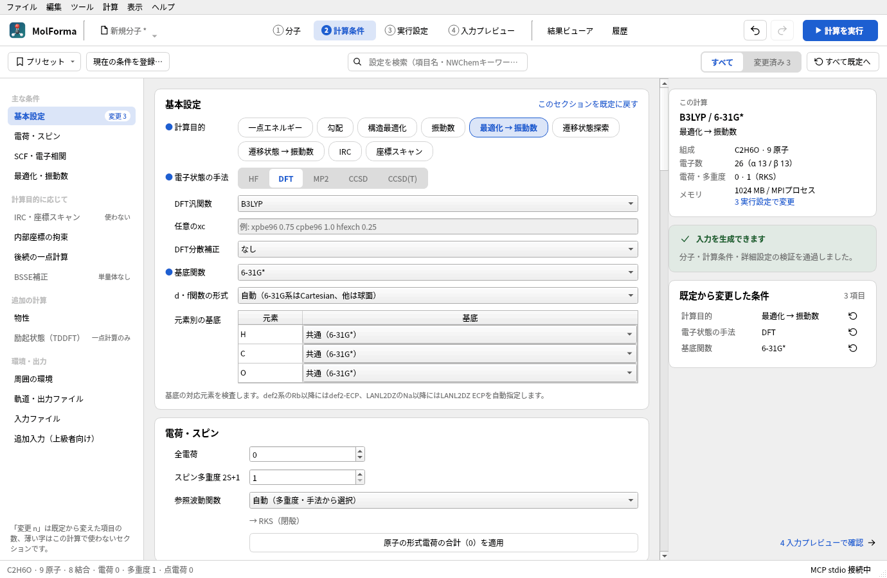
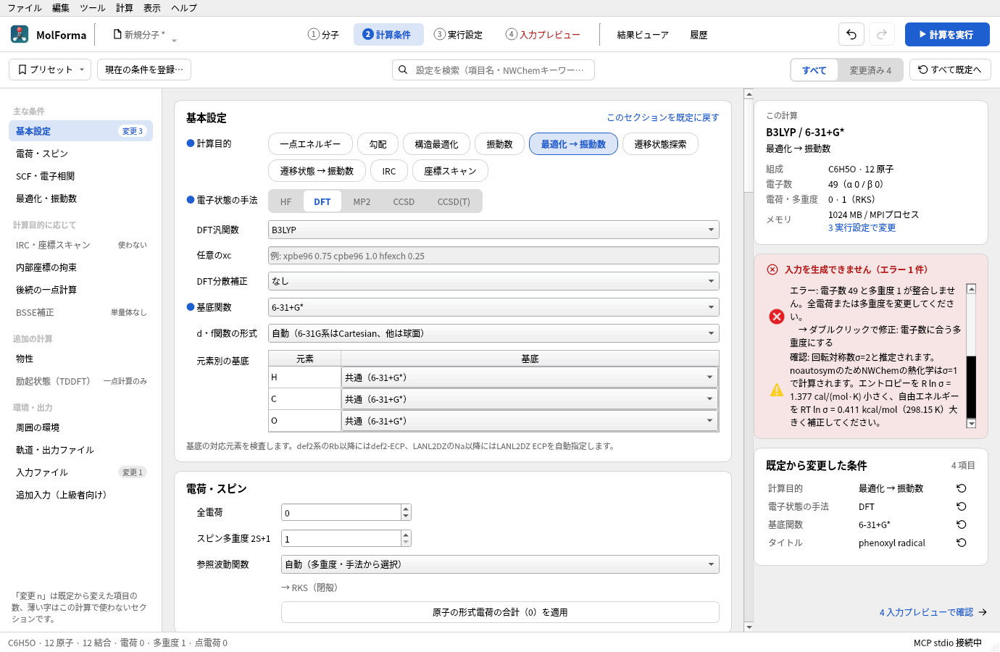
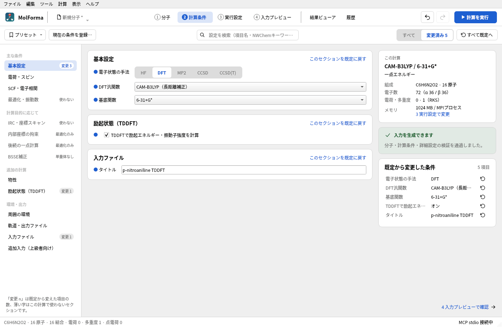

# 「2 計算条件」

左の一覧にセクション（基本設定・電荷・スピン・SCF・電子相関・最適化・振動数・IRC・座標スキャン・内部座標の拘束・後続の一点計算・BSSE補正・物性・励起状態（TDDFT）・周囲の環境・軌道ファイル・入力ファイル・追加入力）を、中央に各セクションの設定を、右に計算の要約・入力の検査結果・既定値から変更した条件を表示します。一覧のセクションを選ぶとその設定へ移動し、設定をスクロールすると一覧の選択も追従します。一覧には既定値から変えた項目の数（「変更 n」）と、今の計算目的・手法では使わないセクション（淡色で「使わない」「最適化のみ」「単量体なし」「DFTのみ」「一点計算のみ」）を示し、セクションの見出しにも同じ理由を表示します。ウィンドウの幅が狭いと一覧は隠れます。既定値から変えた設定には名前の前に青い点を付けます。計算目的・電子状態の手法・DFT積分グリッド・溶媒モデルはボタンで選びます（MCPからは従来どおり `nwchem_task` などの選択欄でも設定できます）。

RI-J・TDDFT・後続計算・相対論は、手法や目的を変えて不適合になっても、設定を解除できる状態を保ちます。診断からの移動と修正は、表示言語にかかわらず該当する設定に適用します。



**図1** エタノールのB3LYP/6-31G*「最適化 → 振動数」。左の一覧でセクションへ移動し、右に計算の要約・検査結果・既定から変更した条件が出ます。

条件の変更は共有のUndo/Redo（ヘッダーの「元に戻す」「やり直す」）へ記録します。矛盾した条件も修正途中の設定として保持しますが、エラーが残る間は入力の生成・コピー・保存を禁止します。候補表示中・整形中は条件の変更を無効にし、タブの上部に理由を表示します。

## 対応する計算

| 項目 | 対応範囲 |
| --- | --- |
| 手法 | HF、DFT、MP2、CCSD、CCSD(T) |
| 計算目的 | 一点エネルギー、勾配、構造最適化、振動数、最適化→振動数、遷移状態探索、遷移状態探索→振動数、IRC、座標スキャン（緩和・固定）。CCSD系は閉殻RHFの一点エネルギーのみ。DFTの一点エネルギーにはTDDFT（励起状態）を追加可能 |
| 参照波動関数 | 自動・RHF/RKS・UHF/UKS・ROHF。自動は一重項を制限、開殻HFをROHF、開殻DFT/MP2を非制限にします。DFT/MP2のROHF参照は未対応 |
| DFT | B3LYP、PBE、PBE0、BLYP、BP86、B3PW91、BHLYP、TPSS、SCAN、r²SCAN、M06-L、M06、M06-2X、PW6B95、CAM-B3LYP、ωB97X-D3と任意のxc行。分散補正なし・D3・D3(BJ)、coarse/medium/fine/xfine/hugeグリッド、RI-J（Weigendのクーロンフィッティング） |
| 基底 | STO-3G、3-21G、6-31G、6-31G*、6-31G**、6-31+G*、6-31++G**、6-311G**、6-311+G**、6-311++G**、cc-pVDZ/TZ/QZ、aug-cc-pVDZ/TZ、def2-SVP/SVPD/TZVP/TZVPP/TZVPD/QZVP、LANL2DZ（ECP）、相対論用の全電子基底 x2c-SVPall/TZVPall・cc-pVDZ-DK/cc-pVTZ-DK・SARC-ZORA/SARC-DKH。元素別の基底指定。d・f関数の形式は自動・球面調和関数・Cartesianから選択 |
| 相対論 | ZORA（DFTのみ）、Douglas–Kroll–Hess（DKH2）、X2C。全電子基底のHF/DFTで使用 |
| 収束 | SCF最大反復・収束条件（NWChem既定・標準・厳密・さらに厳密）、最適化最大反復・標準/厳密/緩い、CC最大反復、相関計算の内殻凍結 |
| 環境 | HF/DFTのCOSMO（誘電率または溶媒名）、DFTのSMD（溶媒名）。HFのUHF参照はNWChemのCOSMOが未対応のため拒否し、ROHFまたはUKSを使用。保存された点電荷の任意の有効化 |
| 物性 | Mulliken電荷、ESP・RESP電荷、NMR遮蔽定数（GIAO）、静的分極率。最後の計算レベルで計算 |
| 複合計算 | 最適化・遷移状態探索の後の別手法・別基底での一点計算、結合した分子を単量体とするBSSE（counterpoise）補正、内部座標の拘束、任意の追加入力 |
| 出力 | 計算名・タイトル・MPIプロセスごとのメモリ、Å/Bohr。完成した`.nw`のコピー・保存は「4 入力プレビュー」 |

基底の元素範囲は、NWChem 7.3.1のライブラリファイルの元素別エントリーから作った固定リストで検査します。基底ファイル自体は同梱しません。STO-3GはH〜I、3-21GはH〜Cs、6-31G/6-31G**はH〜Zn、6-31G*はH〜Kr、6-31+G*・6-31++G**・6-311+G**・6-311++G**はH〜Ca、6-311G**はH〜Ca・Ga〜Kr・Iです。cc-pVDZ/TZ/QZはH〜Kr（Kを除く）、aug-cc-pVDZ/TZはH〜Kr（K・Caを除く）、def2系はH〜La・Hf〜Rn、LANL2DZはH・Li〜La・Hf〜Bi・U〜Puに対応します。実行先に選択したライブラリが必要です。

「元素別の基底」の表で、分子に含まれる元素ごとに別の基底を選べます（例: 有機配位子は6-31G*、金属だけdef2-TZVPやLANL2DZ）。指定がある場合は `*` を使わず、元素ごとに `Fe library "def2-tzvp"` の行を出力します（NWChemは同じ元素への2つ目のライブラリ指定を置き換えではなく追加として扱うため）。ゴーストにはその元素の基底を割り当てます。分子にない元素の指定は保持し、出力には使いません。`basis spherical / cartesian` は全元素に共通なので、元素別の基底とd関数の慣例が異なる場合は確認事項を表示します。ライブラリにない任意の基底・ECPの入力は未対応です。

d・f関数の形式の「自動」は、基底の定義に合わせて6-31G・6-31G*・6-31G**をCartesian（6d）、そのほかを球面調和関数（5d・7f）で出力します（Gaussianの既定と同じ慣例）。以前のプロジェクト・ユーザープリセットの球面調和関数の設定は、明示的な選択として引き継ぎます。慣例と異なる形式を明示した場合は確認事項を表示します。文献値と比べる場合は「自動」を使用してください。

def2系ではRb〜Xeに28電子、Cs〜Laに46電子、Hf〜Rnに60電子を除去する `def2-ecp` を、LANL2DZではNa〜Cuに10、Znに18、Ga〜Agに28、Cdに36、In〜Laに46、Hf〜Auに60、Hg・Tlに68、Pb・Bi・U〜Puに78電子を除去する `lanl2dz ecp` を自動指定します（NWChemのECPライブラリの `nelec`）。実原子だけにECPを付け、電子数を補正してα/β電子数・多重度の整合性を検査します。ゴーストの核電荷は0で、`bqC library C ...` のように基底を明示します。相関計算の `freeze atomic` は既定でオフです。有効にした場合はNWChemの原子別規則で凍結する軌道数を表示し、相関電子が不足する設定を拒否します。ECP中心とゴーストは内殻凍結の対象外です。

分散補正は、NWChem 7.3.1がGrimmeの公表パラメータを出力する組合せだけ選べます。M06系のD3(BJ)とSCAN・r²SCANのD3はNWChemにパラメータがなく、B3PW91のD3(BJ)とPW6B95のD3はNWChemの値が公表値と一致しないため拒否します。ωB97X-D3はD3を含むため補正なしで使います。「任意のxc指定」ではDFTブロックの `xc` 行を英数字・`_`・`.`・`+`・`-`・空白の1行で指定します（例: `xpbe96 0.75 cpbe96 1.0 hfexch 0.25`）。名前の妥当性はNWChemが実行時に判定し、分散補正は選べません。2026-10-24にNWChem 7.3.1で、追加した全汎関数と許可した分散補正の入力が正常終了することを確認しました。

振動数はHF/DFTの解析Hessianを基本とし、MP2・ROHF・ECP・COSMO、メタGGA・長距離補正・任意のxcのDFTでは数値Hessianを選びます（NWChemはメタGGA・長距離補正の解析Hessianを持たず、自動で差分計算に切り替えるため）。手動で数値Hessianを選択することもできます。固定・ゴースト・外部点電荷を含む振動数解析と、ゴーストを含むCOSMOは未対応です。座標を `noautosym` で出力するため、NWChemの熱化学は回転対称数σ=1で計算されます。60原子以下で同位体・質量指定のない分子では、MolFormaが原子の置換として重なる回転を数えてσを推定し、σ>1なら確認事項にエントロピー（−R ln σ）と自由エネルギー（+RT ln σ、298.15 K）の補正量を表示します。最適化に続けて振動数を求める場合は、二つの `task` を順に出力します。SCF収束は標準1e-5・厳密1e-7（既定）・さらに厳密1e-9で、HFは `thresh`、DFTはenergy/density/gradientに適用します。「NWChem既定」はこれらを出力せず、NWChemの既定の閾値を使います（振動数の計算では精度が不足することがあるため確認事項に表示します）。CCの収束閾値は1e-7です。「SCF・電子相関」の詳細設定で個別の閾値を指定すると、対応する値を上書きします。

## 保存・プリセット・互換性

- NWChem固有の条件は `document.nwchem` に保存します。`geometry_units` は座標の表の書き出しと共有します。全電荷・多重度は分子の値（`document.charge` / `document.multiplicity`）で、「1 分子」での変更も反映します。原子の形式電荷と計算の全電荷は区別し、異なるときは確認事項を表示します。
- NWChem設定がないプロジェクトではHF/STO-3Gの初期条件を表示します。未知のフィールドは保存時に保持します。原子の固定フラグはNWChemへ出力します。
- 点電荷は初期状態では出力しません。このタブまたは「1 分子 → 電荷」で有効にすると `bq units angstrom` へ出力します。点電荷の座標は分子の出力単位にかかわらずÅを明示します。
- HF/STO-3G、B3LYP-D3(BJ)/def2-SVP最適化＋振動数、内殻凍結MP2/cc-pVDZの組込みプリセットがあります。適用はUndo一回で戻せます。適用前の変更点は説明欄のツールチップに表示します。プリセットは分子・電荷・多重度・計算名・タイトル・メモリ・単位・未知フィールドを変更しません。参照波動関数・溶媒モデル・誘電率・外部点電荷の出力を含むそれ以外の基本条件は、プリセットの値に置き換えます。ユーザープリセットの登録・削除はローカルのQSettingsに保存します。
- タイトルと計算名は入力確定時に反映します。NWChemの別命令が混入しないよう、計算名の文字種・長さ、タイトルの改行・引用符等を検査します。入力プレビューは読取専用です。

「励起状態（TDDFT）」を有効にすると、`tddft` ブロック（`nroots`、閉殻で三重項を求めない場合の `notriplet`、Tamm–Dancoff近似の `cis`）と `task tddft energy` を出力します。開殻（UKS）は一重項・三重項を分けない非制限の励起状態になります。NWChem 7.3.1のTDDFTはメタGGA（TPSS・SCAN・r²SCAN・M06系・PW6B95）で停止するため拒否し、TDDFTによる構造最適化（励起状態の勾配）も対象外です。CAM-B3LYP・ωB97X-D3・COSMO・分散補正との組合せは実機で確認しています。

計算実行とMPIの起動設定は「3 実行設定」、出力の閲覧は「結果ビューア」で行います。TCE・MD・周期系・QM/MMは対象外です（必要な指示は追加入力に書けます）。NWChem本体がなくても条件編集と入力生成はできます。入力検査は収束や物理モデルの妥当性まで保証するものではありません。

## 溶媒・相対論・RI-J

- 溶媒モデルは「COSMO」と「SMD（DFT・溶媒名を指定）」です。溶媒は「誘電率を指定（COSMOのみ）」または水・メタノール・エタノール・1-プロパノール・1-ブタノール・アセトニトリル・アセトン・DMSO・DMF・THF・1,4-ジオキサン・ジエチルエーテル・酢酸エチル・ジクロロメタン・クロロホルム・ニトロメタン・ピリジン・ベンゼン・トルエン・n-ヘキサン・シクロヘキサンから選び、`cosmo` ブロックへNWChemのSMD溶媒コード（`h2o`、`acetntrl`、`dcm` など）を `solvent` として出力します。溶媒名を選ぶとCOSMOでも同じ表の誘電率を使います。SMDは `do_cosmo_smd true` を加え、非静電項（CDS）を含む溶媒和自由エネルギーを求めます。NWChem 7.3.1のSMDはDFT専用のためHFとの組合せは拒否します（実機では「cosmo-smd can be used only with dft and sodft」で停止）。溶媒中の振動数は数値Hessianです。
- 相対論は `relativistic` ブロックに `zora on`、`douglas-kroll dkh`、`x2c on` を出力します。NWChemのZORAはDFT専用のため、HFではDKHかX2Cを選びます（実機では「ZORA available only for DFT」で停止）。ECPと併用すると内殻を二重に扱うため拒否し、Kr以降に非相対論の基底を使う場合は確認事項を表示します。ZORAの全エネルギーは非相対論・DKH・X2Cと直接比較できません。相対論を使う振動数は数値Hessianです。
- RI-J（DFT）は `basis "cd basis"` に `weigend coulomb fitting`（H〜La・Hf〜Rn、ゴースト中心にも同じ基底）を出力し、クーロン項を近似します。全エネルギーは通常の計算とわずかに異なり、振動数は数値Hessianです。

## 遷移状態・IRC・拘束・スキャン

- 「遷移状態探索」はDRIVERの `task … saddle` です。反応座標に沿って負の曲率を持つ初期構造から始め、「遷移状態探索 → 振動数」で虚振動が1つであることを確認します。
- 「IRC（遷移状態からの反応経路）」はNWChemのGonzalez–Schlegel法（`mepgs` ブロックと `task … mepgs`）で、初めに遷移状態のHessianを計算し、前進・後退の両方向へ「IRCの点数（各方向、`maxmep`）」まで追跡します。刻み幅（`stride`）は質量加重座標のamu½·Bohrです。点数が足りず極小に達しない場合、NWChemはエラーで終了するため、点数は余裕をもって指定します。NWChem 7.3.1は経路の長さ（stotal）が1 amu½·Bohrを超えるまで極小に着いたと判定しないため、遷移状態から極小までが短い側は、極小に着いた後も小さな刻みを続けて点数の上限で「mepgs: could not optimize」となって止まり、残りの方向は計算されません（それまでの点は「経路・スキャン」で見られます）。そのときは「IRCの方向」（両方向・前進のみ・後退のみ、`mepgs` の `forward` / `backward`）で残りの方向だけを計算します。固定原子・ゴーストを含む構造には使えません。
- 「内部座標の拘束（最適化）」は、「1 分子」で順に選んだ2〜4原子の距離・角度・二面角を、表の値に固定して最適化します（`zcoord` の `bond`・`angle`・`torsion` を `constant` で出力し、このとき `noautoz` を外します）。二面角の符号はMolFormaの測定値と同じ定義です。NWChemは内部座標と固定原子（Cartesianの拘束）を同時に扱えない（「cartesian constraints+internals」で停止）ため、固定原子・ゴーストとは併用できません。拘束した原子を削除すると、その拘束も削除します。
- 「座標スキャン」は「選択中の原子を設定」で選んだ距離・角度・二面角を、開始値から終了値まで等間隔の点（2〜50点）で計算します。各点は名前付きの構造（`geometry scanN`）で、後に選んだ原子の側を動かした座標から始めます。「緩和スキャン」ではスキャン座標を `zcoord` で固定して他を最適化し、固定スキャンでは一点エネルギーを計算します。各点の `title` に `MolForma scan k/n` を書き、結果ビューアが点ごとのエネルギーと構造を読み取ります。緩和スキャンも固定原子・ゴーストと併用できません。

## 物性・BSSE・後続の一点計算

- 「物性」のMulliken電荷・NMR遮蔽定数（GIAO、`shielding`）・静的分極率（`aoresponse 1 0.0`）は一つの `property` ブロックと `task … property` で、ESP・RESP電荷は `esp`（`restrain`）と `task esp` で計算します。後続の一点計算がある場合はその条件で、HF・DFTに限ります。NMRと分極率はROHFに使えません。MOLDEN出力と併用する場合は、MOLDEN用の `property` の前に `unset prop:*` を出力し、NMR等を二重に計算しないようにしています。
- 「BSSE補正」は結合でつながった分子を単量体とし、`bsse` ブロック（`mon`、単量体の形式電荷の合計を `charge`、`mult 1`）を出力します。NWChemのBSSEモジュールは各単量体の計算で相手をゴーストにするため、全元素に `bqX library X …` の基底（RI-Jでは `cd basis` にも）を自動で加えます（ないと「no basis on ghost atom」で停止）。一点エネルギー・勾配・構造最適化に使え、閉殻の単量体からなる一重項に限ります。全電荷が形式電荷の合計と異なる場合や、溶媒・TDDFT・物性・後続計算・CUBE/MOLDEN・外部点電荷との併用は拒否します。
- NWChem 7.3.1が出力する「BSSE error」「Corrected energy」は、単量体の前半の誤差しか足していません（`task_bsse.F` が2·nmon個の単量体エネルギーを `do j = 1, nmon, 2` で集計するため。単量体2個なら1個目だけ）。結果の読込みでは、超分子のエネルギーの後に並ぶ各単量体のエネルギー（自分の基底、全体の基底の順）から全単量体の補正量を求め直し、NWChemの値と違えば警告して、求め直した補正量と補正後のエネルギーを使います（「計算のエネルギー」「履歴」のΔEも同じ）。各単量体の自分の基底でのエネルギーの和から、相互作用エネルギー（補正後・補正前）も「物性」タブに表示します。
- 「後続の一点計算」は、最適化・遷移状態探索の後に、別の手法・汎関数・分散補正・基底（全元素共通）で一点エネルギーを計算します。NWChemは設定を実行中のデータベースに残すため、後続計算の前に `unset scf:*`・`unset dft:*`（相関計算は `unset mp2:*`・`unset ccsd:*`）を出力し、最初の条件のCAMパラメータや分散補正を引き継がないようにしています。溶媒・相対論・RI-Jはそのまま使います。主計算でECPを使い後続でECPを使わない場合、ECPが残るため拒否します。後続の条件も同じ規則で検査し、エラーは「後続の一点計算: 」を付けて表示します。

## 追加入力（任意のキーワード）

「追加入力（上級者向け）」の「タスクの前」はtask行の直前に、「入力の末尾」は入力の最後に、MolFormaが扱わないNWChemの指示をそのまま加えます（例: `set cphf:maxiter 50`、`task dft property`）。内容は検査しないため、入力プレビューで確認してください。外部プログラムを起動できる `task shell` と `python` ブロックは拒否します。追加入力は実行ファイル・ランチャー・環境変数と同じく、MCPからは変更できず、MCPから開始する計算は利用者が設定した追加入力でだけ実行します。プリセットには含めません。

## NWChem・Gaussian入力の取込み

「ファイル → 開く」で `.nw` を開くと、最初のCartesian `geometry`（`units`、`bq` ゴースト、`mass`、`\` の継続行と `;` 区切り）、`charge`、`scf`/`dft` の多重度と参照、`xc`（一覧の汎関数に一致しなければ任意のxc）、分散補正・グリッド、`basis`（ライブラリ名が一覧にあるもの、元素別、`cd basis` によるRI-J、spherical/cartesian）、`cosmo`（誘電率・溶媒名・SMD）、`relativistic`、`tddft`、`driver` の反復数、`property`・`esp`・`bsse`・`mepgs`、`constraints` の `fix atom`、`task` の組合せ（最適化＋振動数、遷移状態探索、IRC等）を取り込みます。最初のtaskより後の計算条件（後続計算）、2番目以降のgeometry、`zcoord`、その他のブロックは取り込まず、一覧で知らせます。Z-matrix形式のgeometryは拒否します。実行設定は環境設定の既定値を使います。

Gaussian入力（`.gjf` / `.com`）はLink0とルート・タイトルを読み飛ばし、電荷・多重度とCartesian座標（`C(Fragment=1)`、原子番号、凍結フラグの列に対応）を取り込みます。Z-matrixや変数を使う入力は拒否します。ルートの手法・基底は取り込みません。

仕様の参照: [HF](https://nwchemgit.github.io/Hartree-Fock-Theory-for-Molecules.html)、[DFT](https://nwchemgit.github.io/Density-Functional-Theory-for-Molecules.html)、[MP2](https://nwchemgit.github.io/MP2.html)、[CCSD](https://nwchemgit.github.io/CCSD.html)、[ECP](https://nwchemgit.github.io/ECP.html)、[Optimization](https://nwchemgit.github.io/Geometry-Optimization.html)、[Frequencies](https://nwchemgit.github.io/Hessians-and-Vibrational-Frequencies.html)、[COSMO](https://nwchemgit.github.io/COSMO-Solvation-Model.html)、[TASK](https://nwchemgit.github.io/TASK.html)。

## 診断・変更点・検索

右側の「この計算」には、手法・基底・計算目的・溶媒、組成、電子数（α/β）、電荷・多重度（参照波動関数）、メモリを表示します（「4 入力プレビュー」の「この入力」も同じカード）。メモリは「3 実行設定」で設定し、「3 実行設定で変更」で移動します。その下のカードに入力を生成できるかを示し（「3 実行設定」「4 入力プレビュー」と同じ形。詳細設定の検査も含み、エラーがなければ「検証を通過しました」と添えます。この検査は編集にすぐ追従し、MolFormaの外のファイルに依らないので「再検査」はありません）、エラー・確認事項を1件ずつ一覧にします。行をクリックすると該当する設定欄へ移動し（詳細設定の項目はその行へ）、修正候補がある行（多重度と電子数の不整合、使えない分散補正、TDDFTの計算目的、SMDの溶媒名・手法、ZORAの手法、RI-Jの手法など）はダブルクリックで修正します。「参照波動関数」が自動のときは、選ばれる参照（「→ RKS（閉殻）」など）を欄の下に表示します。



**図2** フェノキシラジカル（電子数49）で多重度を1にしたところ。エラーの行をダブルクリックすると、電子数に合う多重度（2）に直します。

「既定から変更した条件」は、変更した条件を画面と同じ言葉で並べます（カードは行の数の高さで、12行を超えるとスクロールします）。行をクリックするとその設定へ移動し、右端のボタンでその条件だけを既定値に戻します（追加入力を除く）。変更した詳細設定も同じ一覧に並べ（今の計算で使わないものは値に「（保留）」）、クリックでその行を表示します。セクション見出しの「このセクションを既定に戻す」はそのセクションの詳細設定も含めて戻します。どちらも「元に戻す」で戻せます。NWChem入力の全文は「4 入力プレビューで確認」から確認します。

上部の「プリセット」のメニューで組込み・登録したプリセットを適用します。各項目のツールチップに、適用で変わる項目を「項目: 現在 → 適用後」の形で表示し、適用は「元に戻す」で戻せます。「現在の条件を登録…」で登録し、メニューの「登録を解除」で削除します。上部の「すべて」「変更済み」（件数付き）の切替で、「変更済み」は既定値から変更した設定と詳細設定の行だけを表示します。「すべて既定へ」は計算条件と詳細設定を既定に戻します（計算名・タイトル・座標の出力単位・追加入力と、電荷・多重度は保持。「元に戻す」で一度に戻せます）。検索欄は計算条件と詳細設定の項目名を補完し、計算条件の項目はその欄へ、詳細設定の項目（NWChemキーワードでも検索できます）はそのセクションの詳細設定を開いてその行へ移動します。



**図3** 上部の「変更済み」を選ぶと、既定値から変えた設定だけを表示します（p-ニトロアニリンのTDDFT）。

## 計算条件の検証

`calculation`のQt Testは入力生成、手法・参照・タスクの組合せ、電子数、基底の元素範囲、ECP、ゴースト、固定番号、同位体、単位、点電荷、入力の不正値、保存互換性、プリセット、Undo/Redo、タブ間同期、候補の操作制御、使わないセクションの判定、変更した条件の一覧・絞り込み・個別とセクション単位のリセットを検査します。通常のCTestではNWChem・ネットワークを使用しません。

任意の実機検証用入力と画面画像を生成できます。

```sh
QT_QPA_PLATFORM=offscreen MOLFORMA_CALCULATION_ARTIFACTS=/tmp/molforma-calculation \
  ./build/test_calculation engineArtifacts
```

2026-10-24に、溶媒（SMD・溶媒名のCOSMO）、ZORA・DKH・X2C、RI-J、物性（Mulliken・ESP/RESP・NMR・分極率とMOLDENの併用）、遷移状態探索→振動数（HCN⇄HNCで虚振動 −1227 cm⁻¹ が1つ）、IRC（両方向が収束）、拘束付き最適化（二面角115.000°・距離1.4500 Åを保持、Bohr出力でも同じ）、緩和・固定スキャン、BSSE（水二量体と、16原子を超えて継続行を使う単量体）、後続の一点計算（分散補正が残らないこと）、追加入力、hugeグリッドの18種類の生成入力をNWChem 7.3.1で実行し、すべて正常終了を確認しました。

2026-10-22にNWChem 7.3.1（MPI 2プロセス、OMP/OpenBLAS各1スレッド）で23種類の生成入力の正常終了を確認しました。HF、5種のDFT汎関数と分散補正、MP2、CCSD、CCSD(T)、開殻HF/DFT、def2-ECP、内殻凍結、ゴースト・同位体・固定、Å/Bohr、点電荷、COSMO、解析/数値振動数を含みます。水のB3LYP-D3(BJ)/def2-SVPプリセットは最適化と振動数解析が完了し、振動数は1638.93 / 3791.78 / 3886.86 cm⁻¹でした。AddressSanitizerでも計算条件タブのテストを実行しています。

CCSD(T)の検証には水/6-31Gを使用しています。この環境では最小基底のH₂/STO-3GのCCSD(T)がNWChemの三重励起処理中にMPI通信エラーとなりました。入力検査ではこのような実行環境・エンジン固有の問題は検出しません。

## 操作例

### 水二量体のCounterpoise（BSSE）補正

1. 水の骨格を配置し、「ファイル → ファイルから断片を追加」または「SMILESから断片を追加」（`O`）で2個目の水を+X側に加えて確定します。
2. 一方の水素ともう一方の酸素を順に選び、「編集」の寸法で H···O 距離を約1.95 Åにします（結合していない別々の分子なので、後に選んだ水全体が動きます）。「表示 → 水素結合を表示」で破線を確認できます。
3. 「2 計算条件」で手法・基底を選び、「BSSE補正」の「単量体ごとのcounterpoise補正（BSSE）」をオンにします。単量体2個が表示されます。
4. 「計算を実行」で実行し、「結果ビューア」の「物性」または概要でBSSE補正量と補正後のエネルギーを確認します。構造最適化を選ぶと、BSSE補正した勾配で最適化します。

関連: [詳細設定とCUBE・MOLDEN出力](advanced.md)、[題材5 鎖状分子と配座](../recipes/butane_conformers.md)、[題材10 イオンとラジカル](../recipes/phenoxyl_radical.md)、[題材13 遷移状態と反応経路](../recipes/sn2_transition_state.md)、「[機能と操作](../features.md)」のページの一覧。
