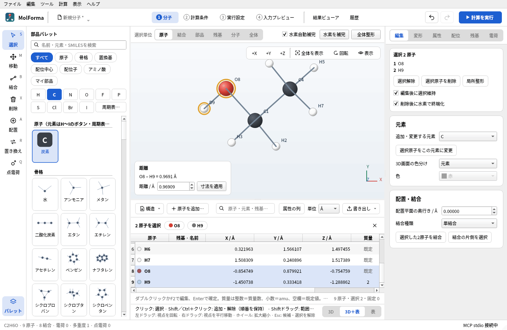
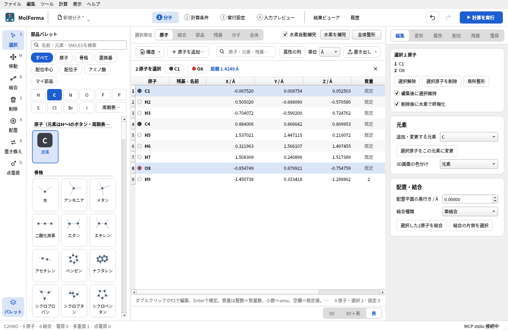

# 座標の表（「1 分子」）



**図1** 「3D＋表」の並べ方（エタノール-OD）。表の行と3D画面の原子は同じ選択で、3D画面の左下に選んだ2原子の距離が出ます。質量の列のH9は重水素（2）です。

- 「1 分子」の3D画面の下（または3D画面の代わり）に表示する、原子の座標と属性の表です。3D画面の下の帯の右端の「3D」「3D＋表」「表」または「表示 → 1 分子の並べ方」（ほかのタブからも選べ、「1 分子」を開きます）で並べ方を切り替え（アプリ設定に記憶。既定は「3D」）、「3D＋表」では境界をドラッグして高さを変えられます（最初は3D:表 = 6:4。ドラッグした位置はアプリ設定に記憶）。表は4行以上を保ち（幅が狭く表の上の操作の行が折り返したときも）、狭いウィンドウでは3D画面のほうが縮みます。分子データ・選択・候補・Undo/Redoは「1 分子」と同じもので、表の行と3D画面の原子を相互に選択できます（3D画面で選んだ原子の行が表に見えていなければ、その行まで表を送ります）。操作の行の「属性の列」で形式電荷・不対電子・原子名の列を表示して編集できます（「編集 → 座標の表（属性の列つき）」は表を表示して同じ列を開きます。列の表示の有無はアプリ設定に記憶）。座標表の数値は小数6桁で右に揃えて表示し、セルの編集中と保存値は元の精度のままです。
- 表の「原子」列は3D画面と同じ番号つきの名前（`C14`）と元素の色で示し、固定原子には鍵の印を付けて座標を淡く表示します。セルを編集すると元素記号を変えます。ペプチドなどの残基に属する原子は「残基 · 名前」列に `GLY 2 · CA` のように表示します。質量の空欄は「既定」と表示します。表の列番号（MCPの `ui_edit_cell` の `column`）は従来どおり 0 元素、1〜3 X/Y/Z、4 質量、5 ゴースト、6 固定で、残基は7、候補の変化は8、属性の列は 9 形式電荷、10 不対電子、11 原子名です。
- 操作の行の絞り込み欄は、番号つきの原子名・元素・残基名を含む行だけを表に表示します。表示だけの絞り込みで、選択・出力・編集の対象は変わりません。表の下に原子数・選択数・固定数（絞り込み中は表示数）を表示します。
- 選択バーには選んだ原子（3原子まで。2原子までは残基も）と選択解除（×）を表示し、「表」の並べ方（3D画面がないとき）だけ、2〜4原子を選んだときの距離・角度・二面角も表示します（3D画面があるときは3D画面の計測の欄に表示）。選択した原子の固定・ゴースト・削除・原点へ移動などは、表の横にある右側のページ（「編集」「変形」「属性」）で行います。表の「ゴースト」「固定」列は行ごとに直接切り替えられます。表でのDeleteキーは「1 分子」の削除と同じです（削除後に水素で終端化の設定に従い、候補として表示）。表が見えている（「3D＋表」「表」）間は、「編集」の「座標（1原子）」を隠します（表のセルで同じ値を編集します）。
- 候補があるとき、選択バーの位置に琥珀色の帯を表示し、表は候補の座標を編集不可で表示します。「変化」列は今の構造から追加・移動する原子を示し、「変化あり」でその行だけに絞り込めます。原子はIDで比べます。ただし構造の読込・XYZの貼り付けのようにすべての原子が新しいIDになる置換で、元素の並びの一方がもう一方の先頭と一致するとき（同じ構造の読み直し、末尾への原子の追加）は、原子の順番で比べ、0.001 Å未満の差（PDBの小数3桁の精度）は同じ位置とみなします。この比較は「1 分子」の3D画面の印と、候補バーの追加・削除・移動の数にも使います。
- 原子がないときは表の代わりに「構造を読み込む…」「XYZを貼り付け…」「原子を追加…」を表示します。表へXYZ・MOL・SDF・PDB・ENT・mmCIFのファイル（gzipで圧縮したものも）をドロップすると、「構造を読み込む…」と同じく置き換えの候補を作ります（ほかのファイルや3D画面・ほかのタブへのドロップは従来どおりウィンドウで開きます）。
- 元素、X/Y/Z、質量数またはamu、ゴースト、固定と、属性の列（形式電荷 −99〜20、不対電子 0〜8、原子名）をセル単位で編集します。元素はH〜Ogの118元素とD/T、`@C`などの入力に対応します。元素を変えたときは旧元素の質量指定を解除します。NaN・無限大・未知元素・原子の重複を拒否し、エラーを表示して元のセルへ戻します。失敗した編集は履歴にも分子にも反映しません。
- 座標表・原子の属性パネル・MCPの原子属性編集は同じ検証を使います。データベースにない同位体質量数は編集時に拒否します。任意の質量は正の有限値をamuで指定してください。原子名は制御文字を含まない16文字以内です。
- 表示単位はÅ/Bohrです（1 Bohr = 0.529177210903 Å）。切替やカメラ操作で物理座標を変更しません。表示は有効数字14桁で、編集したセルだけを読み取るため他の座標の精度は維持されます。
- 原子追加ダイアログでは表と同じ単位で1原子を入力します。元素はよく使う元素（H・C・N・O・F・P・S・Cl・Br・I・D・T）のボタン、一覧、「周期表から選ぶ…」で選び、X/Y/Zを入力すると最も近い原子とその距離を表示します。結合・水素を自動補完しません。操作の行の「構造」メニューには「構造ファイルを読み込む…」「XYZを貼り付けて置き換え…」「原子を並べ替え」（元素順・残基順・選択した原子を先頭へ。表とNWChemの座標の順番が変わり、元に戻せます）「全原子を削除」があります。選択削除・全削除・構造ファイル読込・XYZの貼り付けは候補として表示し、確定・取消します。固定原子の座標変更・削除・構造置換は拒否します。
- 1原子を原点へ移すには、「変形」の「向きをそろえる（原点・+X・XY）」（「3D」の並べ方では「座標（1原子）」の「選択原子を原点へ」も同じ）を使います。分子全体と点電荷を平行移動し、固定原子が動く場合は拒否します。
- XYZ / MOL / SDF / Mol2 / CML / PDB / ENT / mmCIF（`.cif` / `.mmcif`）を構造として読み込めます（Mol2・CMLはOpen Babel経由）。Open Babelが読めるその他の形式は、他人から受け取ったファイルの解析で異常終了するおそれがあるため読み込みません。PDB・mmCIFでは「読み込む範囲」のダイアログで、モデル（MODEL）、代替位置（ALTLOC。既定は残基ごとに占有率が最大のもの）、鎖、成分を選びます。鎖の一覧には、ファイルにある分子名（PDBの `COMPND`、mmCIFの `_entity.pdbx_description`）とたんぱく質・核酸の残基数が、配位子や水だけの鎖にはその残基名が出ます。成分は「たんぱく質・核酸」「配位子・イオン・糖鎖など」「水」です。mmCIFは `_entity.type` で分け、PDBはATOM行をたんぱく質・核酸、HETATM行のうち `SEQRES` の配列にある残基（セレノメチオニンMSEなどの修飾残基）もたんぱく質・核酸、水の残基名（HOH・WATなど）を水、残りを配位子・イオン・糖鎖などとします。すべて選ぶと従来どおりファイル全体を読み込み、選ぶものがない（モデル・代替位置・鎖・成分が1つずつの）ファイルではダイアログを出しません。複数フレームのXYZ（最適化の軌跡など）は読み込むフレームを選択します（既定は最後）。mmCIFは原子の表（`_atom_site`）を読み、残基番号と鎖名にはPDBファイルと同じ著者の番号・名前（`auth_seq_id`・`auth_asym_id`）を使います。2文字以上の鎖名もそのまま保持します。結合と結合次数はPDBと同じく原子間の距離と幾何から求めるため、同じエントリーのPDBファイルと同じ構造になります（座標はmmCIFの桁数のまま）。小分子のCIF（分率座標）は読み込めません。NWChem入力（`.nw`）とGaussian入力（`.gjf` / `.com`）も開けます（[NWChem・Gaussian入力の取込み](calculation.md#nwchemgaussian入力の取込み)）。これらはgzipで圧縮したファイル（PDBが配布する `10mu.cif.gz`・`pdb10mu.ent.gz` のように名前が `.gz` で終わるもの）も展開せずに開けます（展開後512 MiBまで。プロジェクトは展開してから開きます）。書き出しはXYZ・SDF・MOL・Mol2・CML・PDB・Gaussian入力です。読込・貼り付けによる置換でもプロジェクトの実行・結果情報や計算設定を保持し、旧原子を参照する設定は保留にします。結合は入力構造から引き継ぎます。XYZでは距離から結合を推定し、Open Babelで幾何から二重・三重・芳香族の結合次数を割り当てます。XYZには電荷がないため、イオンでは形式電荷を設定してから水素補完してください。金属・ゴーストとの結合は単結合のままです。「ファイル → XYZを貼り付けて置き換え」「SMILESから作成」「配列から構築」の「既存の分子を置き換える」も構造だけを置き換え、計算条件・実行設定・プロジェクト情報を保持します。XYZの入出力は表の表示にかかわらずÅです。`@元素`と第5列の質量はMolFormaの拡張で、一般的なXYZ読込ソフトでは未対応の場合があります。固定・結合・残基・点電荷等を保存する場合はプロジェクト形式を使います。XYZのフレームとPDB・mmCIFの読み込む範囲の選択は、「ファイル → 開く」、座標表の「構造ファイルを読み込む」、ファイルからの断片追加で共通です。選択ダイアログを取り消すと、その読込は適用されません。
- 「ファイル → PDBからダウンロード…」（「残基」ページの「PDBからダウンロード…」も同じ）でPDB ID（例: 7DMU、拡張ID `pdb_00007dmu`）を入れると、RCSB PDB（`https://files.rcsb.org`）からそのエントリーのmmCIF（`.cif.gz`）をダウンロードし、「読み込む範囲」を選んで開きます。通信するのはこの操作をしたときだけで、送るのはPDB IDだけです。HTTPSだけを使い（HTTPへのリダイレクトはしません）、256 MiBを超えるファイルや1分間データが届かない通信は中止し、進み具合のダイアログからも中止できます。ファイルはアプリのキャッシュフォルダー（Linuxでは `~/.cache/MolForma/pdb/`）に保存し、同じIDをダウンロードし直すと置き換えます。読み込んだ構造は「名前を付けて保存」でプロジェクトとして保存します。



**図2** 「表」の並べ方。3D画面がないときは、選んだ2〜4原子の距離・角度・二面角を表の上の選択バーに出します。

## NWChemへの出力

操作の行の「書き出し」メニューから、NWChemの座標ブロックとXYZ（常にÅ）をそれぞれコピー、またはファイルに書き出し（「〜を書き出す…」、`.nw` / `.xyz`）ます。NWChemの座標の単位は表の表示単位と独立で、「2 計算条件」の「座標の出力単位」で設定し（`document.nwchem.geometry_units` に保存し、Undo/Redoにも対応）、メニューの項目名に今の単位を表示します。

- `geometry units angstrom` または `geometry units au` を出力します。Å出力では `angstrom_to_au` を明示し、Bohr出力との換算を揃えます。
- `nocenter noautosym` により、指定した原子順・座標系で入力を作成します。固定原子・ゴースト・内部座標の拘束がない構造最適化・遷移状態探索では `noautoz` を付けず、NWChemの自動内部座標（autoz）で最適化します。B3LYP/6-31G*の確認では、Cartesian座標と同じ極小へ少ない反復で収束しました（安息香酸29→12回、エタノール12→5回、グリシン21→16回、ビフェニル22→10回、水二量体34→26回）。直線分子などで内部座標を作れない場合、NWChemは自動でCartesian座標に切り替えます。収束しにくい弱い錯体などでは、「2 計算条件」の「最適化・振動数」の詳細設定「Cartesian座標で最適化（noautoz）」で切り替えられます。それ以外の計算（一点エネルギー・振動数のみ・IRC等）と、固定原子・ゴーストを含む最適化は `noautoz` のCartesian座標です（NWChemはCartesianの固定と内部座標を同時に扱えないため）。「2 計算条件」で内部座標の拘束・緩和スキャンを指定した場合は、拘束を扱うため `zcoord` を出力します。
- 座標・質量・点電荷は、読み戻すと同じ倍精度の値になる最短の表記で出力します（`0.758`。`0.75800000000000001` のような17桁の表記にはしません）。NWChemの自動対称化と周期境界条件の編集は未対応です（構造の対称化は「ツール → 点群・対称化」）。
- 同位体質量数はOpen Babel C++の同位体データからamuへ変換し、NWChemの `mass` として出力します。質量数をそのまま実質量として出力しません。任意質量は小数で指定でき、データベースにない同位体は明示質量が必要です。
- ゴーストは `bqC` 等のゼロ核電荷の中心として出力します。`basis` 内に `bqC library C <basis-name>` 等の明示的な基底割当が必要で、書き出す断片の末尾に案内を付けます。原子の形式電荷をNWChemの核電荷指定へ転用しません。
- 固定フラグは `constraints` の `fix atom` へ出力時の原子番号で変換します。構造最適化ではゴースト中心も固定します。核のないゴーストを固定しないと、基底関数ごと実原子へ引き寄せられて最適化が収束しないためです。先頭の `clear` は以前の固定条件を除去するため、既存入力へ組み込む場合は必要な他の拘束も同じブロックへ追加してください。

表の書き出しは**座標と固定原子の入力断片**です。完成した計算入力は「2 計算条件」で作成し、「4 入力プレビュー」で確かめます。未確定の候補がある間は書き出しを無効にします。計算実行は「3 実行設定」、出力の閲覧は「結果ビューア」で行います。既存のNWChem入力は「ファイル → 開く」で取り込めます。NWChem本体のインストールは表の使用には不要です。

入力仕様の参照: [Cartesian coordinate input](https://nwchemgit.github.io/Cartesian-coordinate-input.html)、[Geometry keywords](https://nwchemgit.github.io/Keywords-for-the-GEOMETRY-directive.html)、[Constraints](https://nwchemgit.github.io/Constraints.html)、[Basis sets](https://nwchemgit.github.io/Basis.html)。

## 座標の表の検証

`ctest --test-dir build --output-on-failure` で従来のcore/editorとcoordinatesの回帰テストを実行します。coordinatesは単位変換と精度、セル単位のロールバック、同位体・ゴースト・固定、選択同期、原子追加（元素ボタン・最も近い原子）、候補・Undo/Redo、候補の比較（ID・原子の順番、変化列と絞り込み）、ファイルのドロップ、原子がないときの表示、残基の列・絞り込み・選択バー（「表」の並べ方だけの測定、操作ボタンを置かないこと）と右側のページによる一括の固定・ゴーストの反映、「座標（1原子）」の表示切替、部品パレットの開閉と狭いウィンドウでの表の行数、「表示 → 1 分子の並べ方」、書き出しメニュー、3D画面との並べ方の切替、構造置換時の参照失効・envelope保持、出力単位の保存、並べ替え後の固定番号を検査します。

任意の目視・実機検証用に、次のコマンドでスクリーンショットとNWChemへの試験入力（STO-3G、水＋炭素ゴースト、重水素、酸素固定）を生成できます。通常のCTestはNWChemを必要としません。

```sh
QT_QPA_PLATFORM=offscreen MOLFORMA_COORDINATE_ARTIFACTS=/tmp/molforma-coordinates \
  ./build/test_coordinates nwchemExportAndSettings
```

2026-10-22の検証では、上記のÅ/Bohr入力をNWChem 7.3.1で実行し、固定原子4とゼロ核電荷の `bqC` が認識され、SCFエネルギーがそれぞれ −74.945716644654 / −74.945716644653 Hartreeとなることを確認しています。

関連: [題材9 分子間錯体とBSSE補正](../recipes/benzene_water.md)、[題材15 同位体と原子の並び順](../recipes/isotopes.md)、「[機能と操作](../features.md)」のページの一覧。
