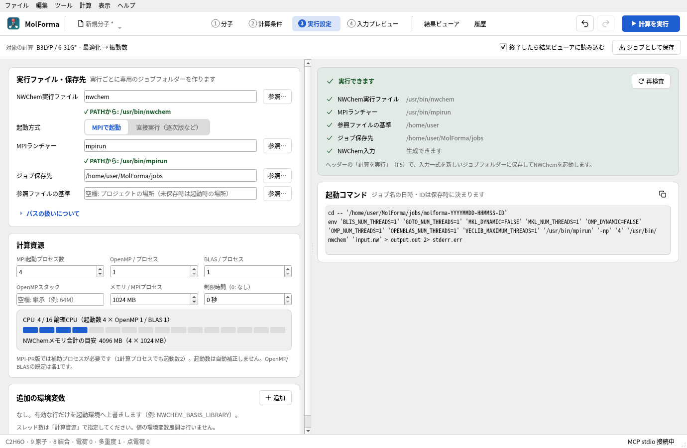
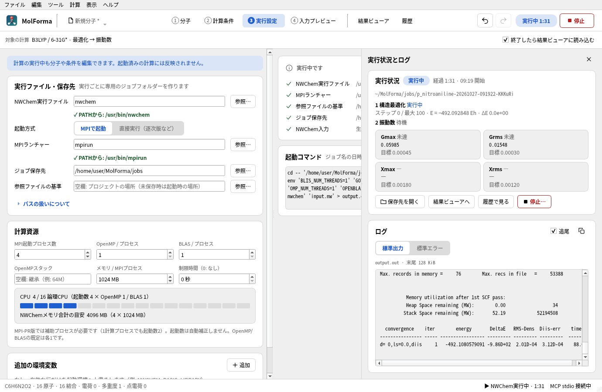

# 「3 実行設定」

NWChemとMPIの起動条件を設定し、ジョブとして保存します。上部に対象の計算（手法・基底・計算目的の1行）、「終了したら結果ビューアに読み込む」「ジョブとして保存」、左に設定（実行ファイル・保存先、計算資源、追加の環境変数）、右に「実行前の確認」「起動コマンド」を並べます。計算はヘッダーの「計算を実行」（F5）で開始し、ヘッダーの「停止」で止めます（このタブに同じボタンは置きません）。実行中・最後の計算の状態とログは、どのタブの上にも開ける実行パネル（下記）に表示します。実行ファイルは名前（PATHから検索）またはパスで指定し、名前で指定したときはPATHで見つかった場所を欄の下に表示します（パスで指定したときは右の確認欄だけ。見つからないときは理由を欄の下にも表示）。プロジェクトを開いただけでは実行しません。



**図1** 「3 実行設定」。実行ファイルとMPIランチャーはPATHで見つかった場所を欄の下に示し、計算資源ではこのPCの論理CPUのうち使う数をマスで示します。

- **実行前の確認**: NWChem実行ファイル・MPIランチャー（MPI起動時）・参照ファイルの基準・ジョブ保存先・NWCHEM_BASIS_LIBRARY（指定時）・NWChem入力を1行ずつ、見つかった場所や結果とともに示し、それ以外のエラー・確認事項をその下に表示します。カードの見出しは「実行できます」「実行できません（n 件）」などで、ほかの設定タブの検査結果と同じ形です。「再検査」で確認し直します。
- **計算資源**: 起動数とスレッド数から使う論理CPUの数をこのPCの論理CPUのマスで示し（超えると赤）、NWChemメモリの合計の目安（起動数 × 1プロセス分）を表示します。
- **実行パネル（実行状況とログ）**: ウィンドウ右側にタブの上へ重ねて表示し（「1 分子」では右側のページの位置に重ね、3D画面・その上の操作・並べ方の切替は隠しません。このタブでは上部の対象の計算・「終了したら結果ビューアに読み込む」・「ジョブとして保存」の行より下に重ねます）、計算を始めると開きます。ヘッダーの「実行中」、ステータスバーの実行状況、「計算 → 実行状況とログ」（Ctrl+Shift+L）、「履歴」の「実行状況とログを表示」、このタブの「実行状況とログを表示」からどのタブでも開け、閉じても計算は続きます。「実行状況」には保存・実行したジョブの状態（実行中・終了・停止・失敗・保存のみ）、経過時間（実行中は開始時刻も）、ジョブフォルダーと、「保存先を開く」「結果ビューアへ」「履歴で見る」、実行中は「停止…」（ヘッダーの「停止」と同じく確認してから停止）を表示します。実行中は入力の `task` ごとに（構造最適化・振動数など）完了・実行中・待機を示し、最適化中はログの「@」行から最新のステップ・エネルギー・ΔE と、Gmax・Grms・Xmax・Xrmsの値をNWChemの閾値と比べて達成・未達を表示します。その下にログ（標準出力・標準エラー）を表示します。ログは実行中のものを読むだけで、ファイルは変更しません。
- **実行中の編集**: 分子や条件は実行中も編集でき、起動済みの計算には反映しません（このタブにも表示します）。



**図2** 計算中の実行パネル（p-ニトロアニリンの最適化）。taskごとの状態、最適化のステップと収束条件の達成・未達、ログを表示します。ヘッダーには経過時間と「停止」が出ます。

| 項目 | 動作 |
| --- | --- |
| NWChem実行ファイル | 既定は `nwchem`。ローカル実行前にファイルと実行権限を確認 |
| 起動方式 | MPIまたは直接実行。MPIは `mpirun/mpiexec -np <起動数> <NWChem> input.nw` |
| MPIランチャー・起動数 | 既定は `mpirun`、2プロセス。MPI-PRの補助プロセスを含めた起動数を指定し、自動補正しない |
| OpenMP / BLAS | 1プロセスごとのスレッド数。既定は各1。OpenMPスタックは空欄で継承、`64M` 等を指定可能 |
| メモリ | NWChemの `memory`（`document.nwchem.memory_mb`）。ここで設定し、「2 計算条件」「4 入力プレビュー」の要約に表示。起動数を掛けた合計目安を表示。RSSの上限ではない |
| 制限時間 | 秒単位、0は制限なし。到達時は停止処理へ移行 |
| ジョブ保存先 | 既定は `~/MolForma/jobs`。実行ごとに計算名・日時（ローカル時刻）・ランダムIDから専用フォルダーを作成。`run.json` の時刻はUTCで記録 |
| 参照ファイルの基準 | 相対指定の入力movecsを探す基準。空欄ではプロジェクトのディレクトリ、未保存ならアプリの作業ディレクトリ |
| 環境変数 | 有効な行だけを親環境へ上書き。無効な行は保存するが適用しない。名前・値・重複を検査 |

MPI起動数1では動作しないMPI-PR版があります。使用するNWChemとMPIランチャーは同じMPI環境のものを指定してください。UIにはMPI起動数とOpenMP/BLASスレッド数を分けて表示し、論理CPU数を超える並列度や多重並列の注意点を表示します。起動数の制限・CPU割当はMPI側の設定にも依存します。仕様の参照: [NWChem FAQ](https://nwchemgit.github.io/FAQ.html)、[Memory](https://nwchemgit.github.io/Memory.html)、[Open MPI mpirun](https://docs.open-mpi.org/en/main/man-openmpi/man1/mpirun.1.html)。

## 環境とパス

- `OMP_NUM_THREADS`、`OPENBLAS_NUM_THREADS`・`GOTO_NUM_THREADS`・`MKL_NUM_THREADS`・`BLIS_NUM_THREADS`・`VECLIB_MAXIMUM_THREADS` を専用欄から設定します。`OMP_DYNAMIC` と `MKL_DYNAMIC` はFALSEにします。これらと `OMP_STACKSIZE` の重複指定は環境変数表で拒否します。
- `NWCHEM_BASIS_LIBRARY` を表で指定した場合はプロジェクトの場所を基準に絶対パスへ変換し、末尾に `/` を付けます。ほかの値は文字列として渡し、シェル展開・環境変数展開はしません。通常は親環境とNWChemの `.nwchemrc` による基底設定を利用できます。[NWChem Getting Started](https://nwchemgit.github.io/Getting-Started.html)
- 実際の作業ディレクトリは毎回新しいジョブフォルダーです。詳細設定の相対入力movecsだけを参照基準から絶対パスへ解決し、scratch・permanentの相対パスはジョブ内を基準にします。相対出力movecsはpermanentを基準にし、`./`で始めた場合はジョブ直下を基準にします。ジョブ内の出力用サブディレクトリは作成します。`../` でジョブ外へ出る相対出力先は拒否します。外部の保存先を指定するときは絶対パスを使用します。
- 既存の出力movecs・CUBE・MOLDENや、同じ計算名のファイルが残る外部scratch/permanentへの実行は拒否します。外部ディレクトリは事前に用意してください。ジョブの入力・ログ・実行記録と同じ名前の出力movecsも拒否します。
- 起動には `QProcess` のプログラム名・引数配列を使い、シェルは起動しません。コマンド欄は確認用のPOSIXシェル表記です。保存前の日時・IDはプレースホルダーです。

## 保存・実行・停止

「ジョブとして保存」（入力一式の保存）はNWChemがインストールされていなくても使えます。実行ファイルや参照movecsをコピーする機能ではありません。別環境で実行する場合はパス・MPI・基底ライブラリをその環境に合わせて用意してください。

「計算を実行」は起動前に同じ入力一式を保存し、次のファイルを作成します。

| ファイル | 内容 |
| --- | --- |
| `input.nw` | 実行する完成したNWChem入力。入力movecsの相対パスを解決済み |
| `project.molforma.json` | 起動時の分子・計算条件・詳細設定・実行設定を含むプロジェクトのコピー |
| `run.json` | 実行ファイル、引数、上書き環境変数、作業先、入力のSHA-256、時刻、状態、終了コード。親環境全体は記録しない |
| `output.out` / `stderr.err` | 標準出力／標準エラーの全文。プロセスから直接保存 |

計算は非同期で動作します。候補表示中・整形中は実行と入力一式の保存を無効にします。起動後は確定済みのコピーを使い、編集中の分子や設定、別プロジェクトの読込は実行中の計算に影響しません。計算終了時にも分子・座標・既存の結果参照は変更しません。画面では標準出力・標準エラーの末尾128 KiBを表示し、「保存先を開く」で全文にアクセスできます。

停止・制限時間ではまず終了を要求し、2秒で応答しなければ強制終了します。Unixでは専用のプロセスグループを作り、その子プロセスも停止対象にします。非Unix環境の停止は起動プロセスへの終了要求・強制終了です。実行中にウィンドウを閉じる場合は停止を確認します。アプリ終了後のバックグラウンド継続は行いません。

起動失敗、非ゼロ終了、停止、制限時間を区別して表示・記録します。「終了コード0」はプロセスの正常終了を示します。正常終了したジョブを結果ビューアに読み込むと、ログから読み取った最適化の収束・計算のエネルギー・虚振動の数・励起状態の数を実行パネルの「実行状況」とステータスバーに1行で表示します。各taskの詳細はログを確認してください。

設定は `document.nwchem_execution` に保存し、共有Undo/Redo、Ctrl+S、再読込に対応します。「編集 → 環境設定」（このタブと同じカードと環境変数の表）では、実行ファイル・起動方式・MPIランチャー・起動数・スレッド数・OpenMPスタック・ジョブ保存先・制限時間・追加の環境変数の既定値と、起動時に水分子を読み込むか（既定はオフで、新規の状態で起動します）、3D描画の方式と表示言語（どちらも再起動後に反映）をアプリ設定に保存できます。既定値は新規作成と、プロジェクト以外の構造ファイル（XYZ・SDF・PDB等）を開いたときに使い、プロジェクトに保存された設定は変更しません。「現在の実行設定を読み込む」で表示中のプロジェクトの値を取り込めます。環境変数表の入力途中もCtrl+Sで確定します。旧形式の `execution`、未知フィールド、実行・結果参照を保持し、旧形式の実行パスやオプションをNWChemへ自動適用しません。計算プリセットを適用しても実行設定は変更しません。

現在は1ウィンドウにつき同時に1計算です。複数ジョブのキュー・終了通知、SSH、Slurm/PBS、任意のMPI追加引数、再起動後の実行監視、NWChemデータベースからのrestartは未対応です。最適化後の構造は「結果ビューア」の「分子へ候補として適用」で取り込めます。MPI-PRのビルド構成や基底ライブラリの内容までは自動検出しません。

計算はどのタブからでもヘッダーの「計算を実行」や「計算 → 計算を実行」（F5）で開始できます（開始できない状態では「3 実行設定」を開き、理由を確認欄に表示します）。「計算」メニューには停止・ジョブとして保存・結果ファイルを開く・履歴もあります。計算が終わると（終了・失敗・停止・制限時間）、ステータスバー右の実行状況に結果を表示し（結果ビューアに読み込んだログの要約は左にも表示）、MolFormaが背面にある場合はタスクバーで知らせ、デスクトップ通知に対応する環境では通知を出します。「終了したら結果ビューアに読み込む」（既定でオン、アプリ設定に保存）を有効にすると、正常終了したジョブフォルダーを結果ビューアに読み込みます。タブは切り替えません。実行パネルのログ欄は、ファイルに増えた分だけを追記するため、選択した文字列は解除されません（表示は末尾128 Ki文字まで）。「追尾」（既定でオン）または末尾までスクロールしている間は新しい行を表示します。ログの切替（標準出力・標準エラー）・ファイル名・追尾・コピーは「履歴」のファイル欄と同じものです（切替は、狭いパネルでも名前が読めるよう見出しの下に置きます）。実行中・最後の計算の状態と経過時間はウィンドウ下のステータスバーに常に表示し、クリックで実行パネルを開きます。実行中はヘッダーにも経過時間と「停止」を表示します。「停止」はどこから押しても確認してから停止します。

## 実行設定の検証

`execution`のQt TestはC++製の試験用プロセスで、引数・環境・作業先、入力の固定コピー、パス・既存ファイルの保護、保存互換性、起動失敗、非ゼロ終了、停止・制限時間・Unix子プロセスの終了、ログ量の制限、Undo/Redo、候補、編集中のCtrl+S、終了処理、実行前の確認の各項目、実行中のログから読む進み具合（taskの段階・DRIVERのステップと収束条件）、実行パネルの開閉・配置・「停止…」とヘッダーの表示、実行ファイルの欄の下の表示（PATHで見つけた名前だけ）を検査します。通常のCTestはNWChem・MPI・ネットワークを必要としません。

NWChemが使用できる環境では、次の任意テストでタブからのMPI実行・計算途中の停止とスクリーンショットを確認できます。

```sh
QT_QPA_PLATFORM=offscreen MOLFORMA_EXECUTION_ARTIFACTS=/tmp/molforma-execution \
  MOLFORMA_EXECUTION_ENGINE=/usr/bin/nwchem ./build/test_execution realEngineArtifacts
```

2026-10-22にNWChem 7.3.1をMPI 2プロセス、OpenMP/BLAS各1、メモリ256 MB/プロセスで起動し、水のHF/STO-3G計算が終了コード0、SCFエネルギー −74.945628203255 Hartreeで完了することを確認しました。DFT/cc-pVTZの最適化・振動数ジョブはDFTモジュール開始後に停止し、Linux上でジョブフォルダーを作業先とする子プロセスが残らないことも確認しています。CTest全6系列と、実行設定テストのAddressSanitizer検証が成功しています。

関連: [「履歴」](history.md)、[題材1 原子と結合から組む](../recipes/atoms_and_bonds.md)、「[機能と操作](../features.md)」のページの一覧。
