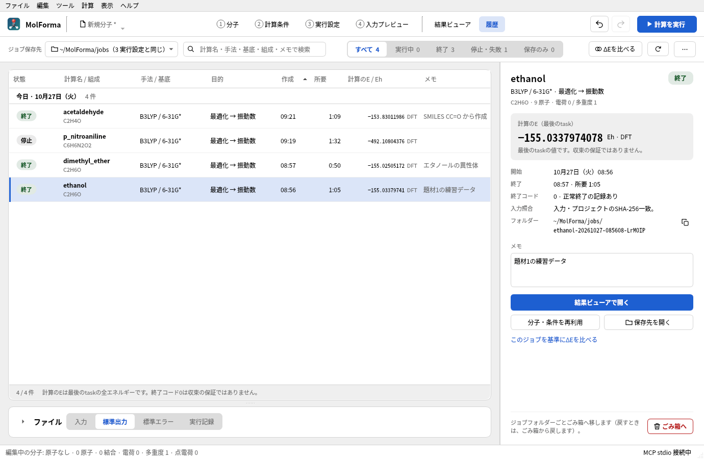
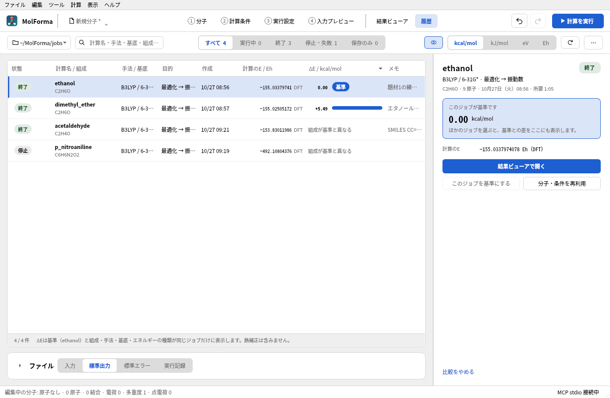

# 「履歴」

「履歴」は保存・実行したジョブ（「ジョブとして保存」「計算を実行」）を、保存先直下の`run.json`から読み込みます。アプリを再起動しても同じフォルダーを指定すれば一覧を復元できます。既定は「3 実行設定」の保存先を使います。上部のジョブ保存先のボタンはパスと、「3 実行設定と同じ」か「選んだ保存先」かを示し（ツールバーが1行に収まらないときは見出し「ジョブ保存先」とこの注記をツールチップへ移し、検索欄を狭め、「ΔEを比べる」をアイコンだけにします）、そのメニューの「保存先を選ぶ…」で選んだ別の保存先はアプリ設定に記憶します。「「3 実行設定」の保存先に戻す」で追従に戻せます。履歴の表示操作では編集中の分子・候補・Undo・プロジェクトの未保存状態を変えません。

**図1** 「履歴」。ジョブ保存先の計算を一覧にし、選んだジョブの詳細とメモ、「結果ビューアで開く」「分子・条件を再利用」などの操作を右に表示します。

- **一覧**: 状態（色付きのラベル）、計算名と組成（計算時の分子式。計算名が既定の「molforma」のままでタイトルを付けたジョブはタイトル）、手法・基底（DFTは汎関数名、Hartree–FockはHF）、計算目的、作成時刻（ローカル時刻）、所要時間、計算のエネルギー（Eh、手法付き）、メモを表示します。作成日時の順では日ごとに区切り（「今日」「昨日」・日付と件数）、ほかの列見出しで並べ替えると区切らずに並べます。値のない行は並び順にかかわらず後ろに置きます。検索は計算名・手法・基底・目的・組成・メモ・フォルダー・状態が対象です。上部の切替で状態を絞り込みます（すべて・実行中・終了・停止・失敗・保存のみ。各件数は検索に合うジョブの数）。「実行中」には稼働未確認、「停止・失敗」には中断・プロセスなし・読めない記録を含みます。並べ替え・更新後もフォルダーを基準に選択を維持し、絞り込みで隠れた行への操作は無効にします。
- **選んだジョブ（右側）**: 計算名と状態、手法・基底・目的、組成・原子数・電荷・多重度（ジョブに保存したプロジェクトから読みます）、計算のエネルギーとその種類（最後のtask・振動数の参照構造・BSSE補正後・ログ末尾の最後の値）、開始・終了と所要時間、終了コードと正常終了の記録の有無、入力照合、実行エラー、注意、フォルダー（パスをコピー可能）、メモ、操作を表示します。メモは入力が止まって少し後、またはほかの欄へ移ったときにジョブフォルダーの `memo.txt` に保存します（照合用のハッシュの対象外、1000文字まで）。CSVにも組成とメモを出力します。
- **実行中のジョブ**: このウィンドウで実行中のジョブを選ぶと、エネルギーの代わりに実行パネルと同じ進み具合（taskごとの完了・実行中・待機、構造最適化の最新ステップと、Gmax・Grms・Xmax・Xrmsの値と閾値）を経過時間とともに表示します。「この計算を停止」（確認あり）、「途中のログを開く」（結果ビューア）、「実行状況とログを表示」（実行パネル）を使えます。実行中は再利用・メモ・ごみ箱の操作を表示しません。
- **ファイル（一覧の下）**: 「入力」「標準出力」「標準エラー」「実行記録」で計算時の固定コピーを切り替えて確認し、表示中のファイルをコピーできます。入力は`input.nw`そのものであり、現在の編集内容から再生成しません。ログは末尾128 KiBを表示し、「追尾」を有効にすると表示中に1秒間隔で更新します。全ログは「保存先を開く」から参照できます。見出しの左の矢印で欄を開閉します（ほかのカードの開閉と同じ形。最初は閉じて一覧を広く表示し、開閉はアプリ設定に記憶）。ウィンドウの幅が1250 px未満では、ジョブを選ぶまで右側の欄を隠して一覧を広げ、選んだ後も右側の欄を狭くして、一覧は「目的」を「手法 / 基底」の下に表示します。
- 「結果ビューアで開く」または行のダブルクリックで、選択したジョブの結果を開きます。実行パネルの「履歴で見る」からは、そこで表示中のジョブを選択します。
- 「分子・条件を再利用」は保存した`project.kgui.json`を検証してから、新しい未保存プロジェクトとして開きます。未保存の編集がある場合は通常の保存・破棄・取消ダイアログを使います。候補・整形中は再利用できません。元のジョブの入力・プロジェクトは上書きせず、再実行は「計算を実行」で新しいジョブとして開始します。読み込む座標は計算開始前の分子です。最適化後の構造は、続けて「結果ビューアで開く」→「分子へ候補として適用」で取り込めます。
- 上部の「…」の「一覧をCSVで書き出す…」は現在の絞り込み・並び順で全表示行を書き出します。日時はUTCのISO形式、数値は小数点`.`、UTF-8で出力します。数式として解釈され得る文字列には先頭に`'`を付けます。
- 「この計算を停止」は、このウィンドウで管理している実行だけを、確認してから停止します。「ごみ箱へ」は確認後、選択したジョブフォルダー全体をOSのごみ箱に移します。実行中・稼働未確認・壊れた実行記録は対象外です（「中断・プロセスなし」は移動できます）。
- **記録の修復**: 「中断・プロセスなし」のジョブがあると、一覧の上に件数と計算名を示すバーを表示し、「記録を修復」でそれらの記録をまとめて「中断（記録を修復）」に直し、ログから計算のエネルギーを求めます。選んだジョブだけを右側の「記録を修復」で直すこともできます。ごみ箱に対応しない保存先ではエラーにし、完全削除へ切り替えません。
- **ΔEで比べる**: 「ΔEを比べる」または右側の「このジョブを基準にΔEを比べる」で、基準のジョブとの差（ΔE）の列を表示し、ΔEの順に並べます。単位はkcal/mol・kJ/mol・eV・Ehから選び、数値と棒で示し、基準の行には「基準」と表示します。ΔEは基準と組成・手法（DFTの汎関数を含む）・基底・エネルギーの種類（BSSE補正の有無など）が同じジョブだけに表示し、ほかのジョブには理由（「基底が基準と異なる」など）を示します。実行中・稼働未確認のジョブは「終了後に表示」、「中断・プロセスなし」は「記録の修復後に表示」とし、エネルギーのないジョブには「エネルギーの記録なし」と示します。右側には選んだジョブの差を4つの単位で示し、両方のエネルギーと比べた値の種類を表示します。熱補正（ゼロ点エネルギーなど）は含みません。比較中は「ファイル」欄を閉じ、「このジョブを基準にする」で基準を変え、「比較をやめる」で通常の一覧に戻ります。
- **ジョブのない保存先**: ジョブがない（または見つからない・読めない）保存先では、一覧の代わりに案内と「保存先を選ぶ…」「3 実行設定の保存先に戻す」を表示し、「3 実行設定」の保存先にあるジョブの数（2000件まで）を示します。

**図2** ethanolを基準にΔEを比べたところ。同じC2H6Oのジメチルエーテルは +5.49 kcal/mol で、組成の異なるジョブには理由を示します。

一覧の状態は短いラベル（保存のみ・起動中・実行中・停止処理中・終了・失敗・停止・時間制限・稼働未確認・プロセスなし・中断・読めません）で示し、詳しい状態（「入力保存済み」「終了（コード0）」「実行失敗」「停止済み」「稼働未確認（記録: running）」「中断・プロセスなし」「中断（記録を修復）」「記録を読めません」など）は行と右側のラベルのツールチップに表示します。`run.json`には計算を起動したホスト名・起動ID（Linux）・プロセスIDとその開始時刻を記録します。別のウィンドウ・過去の起動で`starting` / `running` / `stopping`と記録されたままの計算は、同じPCで記録され、そのプロセスが終了している（PIDが存在しない・別のプロセスに再利用された・PCを再起動した）と判定できる場合だけ「中断・プロセスなし」とし、それ以外（別のPC、プロセスの記録がない旧記録、まだ動いている）は「稼働未確認」とします。終了コード0は収束や全taskの成功を意味しません。一覧のエネルギーは、計算の終了時にログ全体をtaskごとに区切って求め、`run.json`の`summary`に保存した値です（最後のtaskのSCF・DFT・MP2・CCSD・CCSD(T)全エネルギー。振動数のtaskは参照構造の値、BSSEは補正後の値）。実行中のジョブと、この記録がない以前のジョブは、ログ末尾128 KiB内の最後の全エネルギーを表示します。収束値とは限りません。該当する値がない場合は`—`とします。

新しく保存する`run.json`には計算条件の要約、元プロジェクトの基準ディレクトリ、プロジェクトのSHA-256を追加します。入力・プロジェクトの照合不一致では再利用を拒否します。従来のversion 1記録も読み込み、条件の要約がなければ固定コピーから取得します。旧記録にプロジェクトのハッシュがない場合は入力のみ照合し、その旨を表示します。ハッシュは外部編集・破損を検出するためのもので、真正性の署名ではありません。

再利用では元の参照ディレクトリを維持し、相対指定の実行ファイルを元の基準から解決します。新しいジョブの保存先は選択したジョブの親フォルダーです。旧記録で相対実行パスの元の場所を復元できない場合は再利用を拒否します。外部のmovecs・基底・scratch/permanentディレクトリを複製したり、移動先に合わせて推測したりはしません。再実行前に実行設定で存在と書込み可否を確認してください。入力を手編集した計算を元の設定へ逆変換する機能、NWChemデータベースからのrestart、SSH・ジョブキュー・他ウィンドウのプロセス停止、履歴グラフは未対応です。

一覧は直下を1ジョブずつイベントループで走査し、中止・保存先切替ができます。上限は2000ジョブまたは20000フォルダーで、到達時は部分一覧と上限メッセージを表示します。サブフォルダーの再帰走査やシンボリックリンクのジョブは対象外です。`run.json`の解析は256 KiB、入力・プロジェクトは各8 MiBまでです。壊れた記録を含むフォルダーはエラー行として残し、他の履歴を読み進めます。任意のNWChem出力だけを持つフォルダーは履歴に登録せず、「結果ビューア」で直接開きます。

## 履歴の検証

`history`のQt Testは、新旧の固定コピー、フォルダー移動、SHA-256不一致、壊れた記録、読込上限、リンク、ログ末尾・途中行のエネルギー、ログ全体の要約（task・BSSE・振動数）と実行記録のプロセス情報、終了したプロセスの判定（PIDの消失・再利用、別PC）と記録の修復（修復を促すバーを含む）、保存したプロジェクトの原子数・電荷・多重度、ΔEを比べられるジョブの判定（組成・手法・基底・エネルギーの種類）、CSV、走査中止・保存先変更、日ごとの区切り・状態別の件数と絞り込み・検索・数値ソート・選択保持、右側の詳細とメモの保存、ΔEの比較（基準・単位・並び順・表示しない理由）、実行中のジョブの進み具合と確認付きの停止、ジョブのない保存先と「3 実行設定」の保存先への復帰、狭いウィンドウでのツールバーの1行表示、再利用時の未保存保護と別名保存、候補の保護、結果ビューアへの移動、ごみ箱操作の対象制限を検査します。通常のテストはネイティブの疑似実行ファイルを使い、NWChem・MPI・ネットワークは不要です。

2026-10-23に全9系列のCTest、履歴13件（初期化・終了処理・任意の画面出力を含む）のAddressSanitizer検証が成功しました。履歴画面の画像も確認しています。

2026-10-25に画面を作り直した後、全13系列のCTest（通常・VTKなし）と、`history`・`execution`・`mcp`・`output`のAddressSanitizer検証が成功しました。実際のNWChemで作ったジョブ（終了・停止・時間制限・失敗・保存のみ・ΔEを比べられる同じ条件の水）で、一覧・比較・実行中・ジョブのない保存先の画面を明暗両方の配色で確認しています。

関連: [「結果ビューア」](results.md)、[題材14 計算結果から次の計算へ](../recipes/reuse_result.md)、「[機能と操作](../features.md)」のページの一覧。
