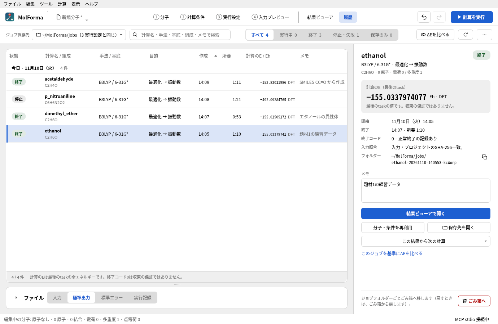
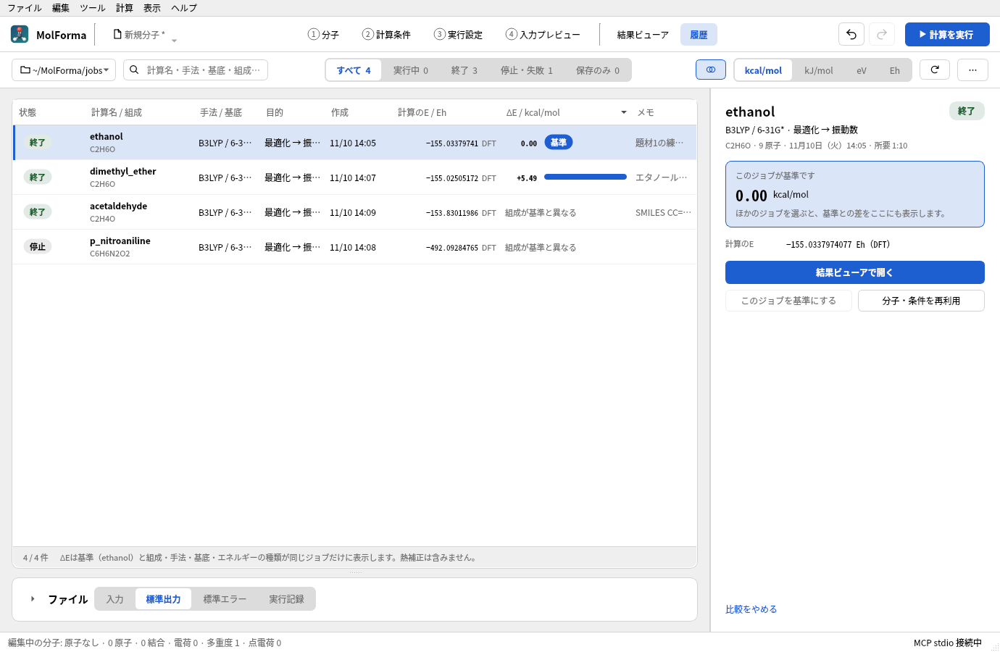

# 「履歴」

「履歴」は保存・実行したジョブ（「ジョブとして保存」「計算を実行」）を、保存先直下の`run.json`から読み込みます。アプリを再起動しても同じフォルダーを指定すれば一覧を復元できます。既定は「3 実行設定」の保存先を使います。上部のジョブ保存先のボタンはパスと、「3 実行設定と同じ」か「選んだ保存先」かを示し（ツールバーが1行に収まらないときは見出し「ジョブ保存先」とこの注記をツールチップへ移し、検索欄を狭め、「ΔEを比べる」をアイコンだけにします）、そのメニューの「保存先を選ぶ…」で選んだ別の保存先はアプリ設定に記憶します。「「3 実行設定」の保存先に戻す」で追従に戻せます。履歴の表示操作では編集中の分子・候補・Undo・プロジェクトの未保存状態を変えません。

**図1** 「履歴」。ジョブ保存先の計算を一覧にし、選んだジョブの詳細とメモ、「結果ビューアで開く」「分子・条件を再利用」などの操作を右に表示します。

- **一覧**: 状態（色付きのラベル）、計算名と組成（計算時の分子式。計算名が既定の「molforma」のままでタイトルを付けたジョブはタイトル）、手法・基底（DFTは汎関数名、Hartree–FockはHF）、計算目的、作成時刻（ローカル時刻）、所要時間、計算のエネルギー（Eh、手法付き）、メモを表示します。作成日時の順では日ごとに区切り（「今日」「昨日」・日付と件数）、ほかの列見出しで並べ替えると区切らずに並べます。値のない行は並び順にかかわらず後ろに置きます。検索は計算名・手法・基底・目的・組成・メモ・フォルダー・状態が対象です。上部の切替で状態を絞り込みます（すべて・実行中・終了・停止・失敗・保存のみ。各件数は検索に合うジョブの数）。「実行中」には稼働未確認、「停止・失敗」には中断・プロセスなし・読めない記録を含みます。並べ替え・更新後もフォルダーを基準に選択を維持し、絞り込みで隠れた行への操作は無効にします。
- **選んだジョブ（右側）**: 計算名と状態、手法・基底・目的、組成・原子数・電荷・多重度（ジョブに保存したプロジェクトから読みます）、計算のエネルギーとその種類（最後のtask・振動数の参照構造・BSSE補正後・ログ末尾の最後の値）、開始・終了と所要時間、終了コードと正常終了の記録の有無、入力照合、実行エラー、注意、フォルダー（パスをコピー可能）、メモ、操作を表示します。メモは入力が止まって少し後、またはほかの欄へ移ったときにジョブフォルダーの `memo.txt` に保存します（照合用のハッシュの対象外、1000文字まで）。CSVにも組成とメモを出力します。
- **実行中のジョブ**: このウィンドウで実行中のジョブを選ぶと、エネルギーの代わりに実行パネルと同じ進み具合（taskごとの完了・実行中・待機、構造最適化の最新ステップと、Gmax・Grms・Xrms・Xmaxの値と閾値）を経過時間とともに表示します。「この計算を停止」（確認あり）、「途中のログを開く」（結果ビューア）、「実行状況とログを表示」（実行パネル）を使えます。実行中は再利用・メモ・ごみ箱の操作を表示しません。
- **ファイル（一覧の下）**: 「入力」「標準出力」「標準エラー」「実行記録」で計算時の固定コピーを切り替えて確認し、表示中のファイルをコピーできます。入力は`input.nw`そのものであり、現在の編集内容から再生成しません。ログは末尾128 KiBを表示し、「追尾」を有効にすると表示中に1秒間隔で更新します。全ログは「保存先を開く」から参照できます。見出しの左の矢印で欄を開閉します（ほかのカードの開閉と同じ形。最初は閉じて一覧を広く表示し、開閉はアプリ設定に記憶）。ウィンドウの幅が1250 px未満では、ジョブを選ぶまで右側の欄を隠して一覧を広げ、選んだ後も右側の欄を狭くして、一覧は「目的」を「手法 / 基底」の下に表示します。
- 「結果ビューアで開く」または行のダブルクリックで、選択したジョブの結果を開きます。実行パネルの「履歴で見る」からは、そこで表示中のジョブを選択します。
- 「分子・条件を再利用」は保存した`project.molforma.json`を検証してから、新しい未保存プロジェクトとして開きます。未保存の編集がある場合は通常の保存・破棄・取消ダイアログを使います。候補・整形中は再利用できません。元のジョブの入力・プロジェクトは上書きせず、再実行は「計算を実行」で新しいジョブとして開始します。読み込む座標は計算開始前の分子です。最適化後の構造は、続けて「結果ビューアで開く」→「分子へ候補として適用」で取り込めます。
- **続きから・次の計算**: 失敗・停止・時間切れなどで終わらなかったジョブには「続きから実行を準備」を、実行済みのジョブには「この結果から次の計算」（Hessianで遷移状態探索・Hessianを再利用した振動数・分子軌道の引き継ぎ）を表示します。使えない項目には理由をツールチップに示します（[計算の再開と引き継ぎ](#計算の再開と引き継ぎ)）。
- **外部で実行した計算**: 「保存のみ」のジョブのフォルダーに `output.out` が戻っていると「外部で実行した結果を登録」を表示します。上部の「…」の「外部で実行した計算を取り込む…」は、MolFormaを使わずに実行したNWChemの出力を新しいジョブとして登録します（[外部で実行した計算を取り込む](#外部で実行した計算を取り込む)）。
- 上部の「…」の「一覧をCSVで書き出す…」は現在の絞り込み・並び順で全表示行を書き出します。日時はUTCのISO形式、数値は小数点`.`、UTF-8で出力します。数式として解釈され得る文字列には先頭に`'`を付けます。
- 「この計算を停止」は、このウィンドウで実行中の計算と、ほかのウィンドウや前回の起動で始めて見張り用のプロセスが動いている計算を、確認してから停止します（[ウィンドウを閉じても計算を続ける](execution.md#ウィンドウを閉じても計算を続ける)）。見張り用のプロセスがない記録（以前の版で実行したものなど）は停止できません。「ごみ箱へ」は確認後、選択したジョブフォルダー全体をOSのごみ箱に移します。実行中・稼働未確認・壊れた実行記録は対象外です（「中断・プロセスなし」は移動できます）。
- **記録の修復**: 「中断・プロセスなし」のジョブがあると、一覧の上に件数と計算名を示すバーを表示し、「記録を修復」でそれらの記録をまとめて「中断（記録を修復）」に直し、ログから計算のエネルギーを求めます。選んだジョブだけを右側の「記録を修復」で直すこともできます。ごみ箱に対応しない保存先ではエラーにし、完全削除へ切り替えません。
- **ΔEで比べる**: 「ΔEを比べる」または右側の「このジョブを基準にΔEを比べる」で、基準のジョブとの差（ΔE）の列を表示し、ΔEの順に並べます。単位はkcal/mol・kJ/mol・eV・Ehから選び、数値と棒で示し、基準の行には「基準」と表示します。ΔEは基準と組成・手法（DFTの汎関数を含む）・基底・エネルギーの種類（BSSE補正の有無など）が同じジョブだけに表示し、ほかのジョブには理由（「基底が基準と異なる」など）を示します。実行中・稼働未確認のジョブは「終了後に表示」、「中断・プロセスなし」は「記録の修復後に表示」とし、エネルギーのないジョブには「エネルギーの記録なし」と示します。右側には選んだジョブの差を4つの単位で示し、両方のエネルギーと比べた値の種類を表示します。熱補正（ゼロ点エネルギーなど）は含みません。比較中は「ファイル」欄を閉じ、「このジョブを基準にする」で基準を変え、「比較をやめる」で通常の一覧に戻ります。
- **ジョブのない保存先**: ジョブがない（または見つからない・読めない）保存先では、一覧の代わりに案内と「保存先を選ぶ…」「3 実行設定の保存先に戻す」を表示し、「3 実行設定」の保存先にあるジョブの数（2000件まで）を示します。

**図2** ethanolを基準にΔEを比べたところ。同じC2H6Oのジメチルエーテルは +5.49 kcal/mol で、組成の異なるジョブには理由を示します。

一覧の状態は短いラベル（保存のみ・起動中・実行中・停止処理中・終了・失敗・停止・時間制限・稼働未確認・プロセスなし・中断・読めません）で示し、詳しい状態（「入力保存済み」「終了（コード0）」「実行失敗」「停止済み」「稼働未確認（記録: running）」「中断・プロセスなし」「中断（記録を修復）」「記録を読めません」など）は行と右側のラベルのツールチップに表示します。`run.json`には計算を起動したホスト名・起動ID（Linux）・プロセスIDとその開始時刻を記録します。別のウィンドウ・過去の起動で`starting` / `running` / `stopping`と記録されたままの計算は、同じPCで記録され、そのプロセスが終了している（PIDが存在しない・別のプロセスに再利用された・PCを再起動した）と判定できる場合だけ「中断・プロセスなし」とし、それ以外（別のPC、プロセスの記録がない旧記録、まだ動いている）は「稼働未確認」とします。終了コード0は収束や全taskの成功を意味しません。一覧のエネルギーは、計算の終了時にログ全体をtaskごとに区切って求め、`run.json`の`summary`に保存した値です（最後のtaskのSCF・DFT・MP2・CCSD・CCSD(T)全エネルギー。振動数のtaskは参照構造の値、BSSEは補正後の値）。実行中のジョブと、この記録がない以前のジョブは、ログ末尾128 KiB内の最後の全エネルギーを表示します。収束値とは限りません。該当する値がない場合は`—`とします。

新しく保存する`run.json`には計算条件の要約、元プロジェクトの基準ディレクトリ、プロジェクトのSHA-256を追加します。入力・プロジェクトの照合不一致では再利用を拒否します。従来のversion 1記録も読み込み、条件の要約がなければ固定コピーから取得します。旧記録にプロジェクトのハッシュがない場合は入力のみ照合し、その旨を表示します。ハッシュは外部編集・破損を検出するためのもので、真正性の署名ではありません。

再利用では元の参照ディレクトリを維持し、相対指定の実行ファイルを元の基準から解決します。新しいジョブの保存先は選択したジョブの親フォルダーです。旧記録で相対実行パスの元の場所を復元できない場合は再利用を拒否します。外部のmovecs・基底・scratch/permanentディレクトリを複製したり、移動先に合わせて推測したりはしません。再実行前に実行設定で存在と書込み可否を確認してください。入力を手編集した計算を元の設定へ逆変換する機能と、SSHでの実行先の操作は未対応です。

一覧は直下を1ジョブずつイベントループで走査し、中止・保存先切替ができます。上限は2000ジョブまたは20000フォルダーで、到達時は部分一覧と上限メッセージを表示します。サブフォルダーの再帰走査やシンボリックリンクのジョブは対象外です。`run.json`の解析は256 KiB、入力・プロジェクトは各8 MiBまでです。壊れた記録を含むフォルダーはエラー行として残し、他の履歴を読み進めます。任意のNWChem出力だけを持つフォルダーは一覧に現れません。「結果ビューア」で直接開くか、「外部で実行した計算を取り込む…」でジョブとして登録します。

## 計算の再開と引き継ぎ

NWChemは計算の途中経過（構造・分子軌道・最適化のHessian・数値Hessianの進み具合）を、ジョブフォルダーのデータベース（`計算名.db`）と関連ファイルに残します。MolFormaはこれらを新しいジョブフォルダーへ複写し、`restart` で始まる入力を作って続きを計算します。元のジョブは変更しません。

| 操作 | 使えるジョブ | 新しい計算 |
| --- | --- | --- |
| 続きから実行を準備 | 失敗・停止・時間切れ・中断で終わり、データベースが残っているジョブ | 終わっていないtaskから再開。最適化は止まった構造とHessianから、数値Hessianは済んだ変位の続きから |
| このHessianで遷移状態探索を準備 | 振動数計算が正常に終わったジョブ | その構造とHessian（`driver` の `clear`・`inhess 2`）から遷移状態を探索 |
| Hessianを再利用して振動数を準備 | 同上 | Hessianを計算し直さず（`freq` の `reuse`）、別の温度・同位体で振動数と熱化学を求める |
| 分子軌道を引き継いで再計算を準備 | 分子軌道のファイルが残っているジョブ | そのジョブの `.movecs` を初期軌道にした通常の計算（`restart` ではない）。構造や計算目的は変更できる |

準備すると、元のジョブの分子・条件にログの最後の構造を当てはめた新しい未保存プロジェクトを開き、「2 計算条件」の上部に再開元と「再開を解除」を表示します。「計算を実行」で新しいジョブとして始まります。

- **入力**: 再開の入力には `geometry` を出力しません。構造・拘束・分子軌道はデータベースの値を使うためで、「1 分子」に表示する構造はログに最後に出力された構造です（データベースの構造より1ステップ古い場合があります）。
- **変更できること**: 反復数・収束条件・メモリ・SCFの設定などは変更できます。分子（座標・同位体・固定）と内部座標の拘束、計算名、`permanent_dir` を変えると入力を生成できません。「Hessianを再利用」では同位体・質量だけを変更でき、`freq` の `mass` として原子番号ごとに出力します。温度は「最適化・振動数」の詳細設定で指定します。
- **終わったtask**: 「最適化 → 振動数」の最適化が終わっていれば、再開の入力は振動数のtaskから始まります。終わったtaskより前の構成（計算目的・物性・出力）を変えると、対応が取れないため入力を生成できません。後ろにtaskを加えることはできます。
- **再開を解除**: 表示中の構造から始める通常の計算になります（「結果ビューア」の「再計算を準備」と同じ扱い）。
- **使えない計算**: 座標スキャン・IRC・BSSE補正、`permanent_dir`・`scratch_dir` をジョブの外に指定した計算、以前の版で実行してデータベースが残っていないジョブ。
- 複写するのは `計算名.` で始まるファイルです（積分・グリッドの作業ファイルと、CUBE・MOLDENなどの表示用ファイルは除く）。大きな分子では分子軌道のファイルが数十MBになります。
- 再開後の計算が元の計算と同じ結果になることを保証するものではありません。NWChemの版や並列数を変えた場合は、最初のステップのエネルギーが元のログの最後の値と一致するか確認してください。

### 止まった最適化を続ける

1. 「履歴」で停止・時間切れ・失敗のジョブを選び、「続きから実行を準備」を押します（計算の直後なら実行パネルにも同じボタンがあります）。
2. 「2 計算条件」で反復数や収束条件を、「3 実行設定」で制限時間を見直します。
3. 「計算を実行」を押します。実行パネルの最初のステップのエネルギーが、元のジョブの最後のステップと同じであることを確認します。

## 外部で実行した計算を取り込む

- **保存したジョブを別の計算機で実行した場合**: `output.out` を元のジョブフォルダーへ戻し、そのジョブを選んで「外部で実行した結果を登録」を押します。ログから正常終了の有無・エネルギー・所要時間（NWChemが出力したwall時間）・失敗原因を読み、「終了」または「中断」として記録します。ジョブフォルダーごと別の場所に持ち帰った場合は、「外部で実行した計算を取り込む…」でその中の `output.out` を選ぶと、フォルダーを保存先へ複写して登録します。
- **MolFormaを使わずに実行した場合**: 「外部で実行した計算を取り込む…」でNWChemの出力（`.out`・`.log`）を選びます。保存先に新しいジョブフォルダーを作り、出力を `output.out` として、同じ名前の入力（`.nw`。なければフォルダーにただ1つある `.nw`）を `input.nw` として複写します。出力と同じ名前、または入力の計算名で始まるファイル（分子軌道・データベースなど）も複写します。分子と計算条件は入力から取り込み（[NWChem入力の取込み](calculation.md#nwchemgaussian入力の取込み)と同じ範囲）、入力を読めない場合はログの最初の構造だけを使います。
- 取り込んだジョブは「分子・条件を再利用」「結果ビューアで開く」「ΔEを比べる」を通常のジョブと同じように使えます。実行ファイルや起動コマンドの記録はなく、実行設定は環境設定の既定値です。入力から取り込めなかった条件は再利用時に失われるため、元の入力（「ファイル」の「入力」）を確認してください。
- 取り込みは元のファイルを変更しません。フォルダーの直下だけを対象とし、シンボリックリンクは複写しません。

## 熱補正・反応エネルギー図

ジョブを選び、その他メニューの「熱補正・反応エネルギー図…」で比較画面に追加します。「ジョブを追加…」で複数の結果を読み込み、段階名・電子エネルギーのジョブ・熱補正のジョブ・係数を指定します。同じ段階名の成分を合計し、段階の追加・並べ替え、基準、Hartree／kcal/mol／kJ/molを選べます。

E、E＋ZPE、H、Gを選択できます。Hは出力のエンタルピー補正（ZPE込み）を一度だけ加え、GはさらにT×Sを引きます。指定温度の熱補正がない場合や、電子エネルギーと補正の組成・電荷・多重度が違う場合は計算しません。別ジョブの補正、虚振動、計算条件・反応段階の組成／電荷収支の不一致を表示します。振動数のスケール、低振動数モードのエントロピー、標準状態（1 atm／1 mol/L）の補正は「[熱化学の補正と速度定数](#熱化学の補正と速度定数)」のとおり選べます。溶媒や計算条件は元ジョブから記録します。

比較は最大200結果・200段階。JSONには取り込んだ数値・出典・条件と段階を保存し、再読込できます。CSVは段階ごとの値、「図…」はエネルギー図（PNG・PDF・SVG）です。正常終了マーカーは科学的妥当性の保証ではありません。構造の対応と補正の出典を確認してください。

### 熱化学の補正と速度定数

NWChemが出力する熱化学は、調和振動子・剛体回転子・理想気体（1 atm）のものです。比較画面の2段目の欄で、E + ZPE・H・Gに次の補正を適用できます。既定（スケール1・調和振動子・1 atm）ではNWChemの出力値をそのまま使います。補正はログの振動数からMolFormaが計算し、NWChemは実行しません。適用中の補正は表の下のメッセージに表示します。

- **振動数スケール**（0.5〜1.5、既定1）: ZPE、熱振動エネルギー、振動エントロピーに使うすべての振動数に同じ因子を掛けます。ZPE用・基本振動数用のように量ごとに別の因子を使い分けることはできません。
- **エントロピー**: 低振動数モードの振動エントロピーの扱いで、Gだけが変わります。「準RRHO（Grimme）」は各モードのエントロピーを w·S(調和振動子) + (1 − w)·S(自由回転子)、w = 1/(1 + (ν₀/ν)⁴) とします（自由回転子の慣性モーメント μ = h/(8π²cν) を B_av = 10⁻⁴⁴ kg m² で μ′ = μ·B_av/(μ + B_av) に制限）。「準調和（Truhlar）」はしきい値 ν₀ より低い振動数を ν₀ に引き上げて調和振動子のエントロピーを求めます。ν₀ の既定は100 cm⁻¹（10〜500）です。どちらもエントロピーだけの補正で、ZPEと熱エネルギー（H）は調和振動子のままです。
- **標準状態**: 「1 mol/L（溶液）」は各成分のGに RT·ln(R′T·c°/p°)（R′ = 0.0820574 L atm mol⁻¹ K⁻¹、298.15 Kで +1.894 kcal/mol）を加えます。分子数が変わる段階（会合・解離）のΔGが変わり、E・E + ZPE・Hは変わりません。隣の「記録用ラベル」は自由記述の欄で、換算には使いません（ラベルが「1 atm」「1 mol/L」のときは選択に合わせて書き換えます）。

補正はNWChemの出力値のうち振動の寄与だけを置き換えます: 補正後 = 出力値 − 調和振動子（NWChemが使った振動数）＋ モデル（スケール後の振動数）。並進・回転の寄与はNWChemの値のままです。振動数はNWChemの熱化学と同じもので、投影後の振動数から並進・回転と虚振動を除いたものです（入力で `set vib:scalefreq` を指定したログではその因子を掛けた値で、画面のスケールはさらにその上に掛かります）。虚振動は補正でも無視し、従来どおり警告を表示します。置き換える差は CODATA 2018 の定数で計算します。NWChem 7.3.1は気体定数に1.9863 cal mol⁻¹ K⁻¹などを使うため、出力値は同じ式をCODATAの定数で計算した値より約0.05%小さく、補正後の値にもその差が残ります。振動数の記録を含まない以前の比較JSONは既定の設定でそのまま評価でき、スケール・エントロピーの補正を選んだときだけジョブの追加し直しを求めます。

Gを選ぶと、表に基準段階に対する exp(−ΔG/RT) と、ΔG > 0 の段階のEyringの速度定数 k = (k_B·T/h)·exp(−ΔG‡/RT) を表示し、CSVにも補正の設定とともに書き出します。E・E + ZPE・Hでは表示しません。透過係数は1で、トンネル効果・再交差・拡散律速は含みません。基準段階を反応物（複数分子ならその合計）にしてください。単位は一分子反応で s⁻¹、1 mol/Lの標準状態で求めた二分子反応では L mol⁻¹ s⁻¹ です。同じ反応物から2つの遷移状態が競合する場合、速度の比は両者の exp(−ΔG/RT) の比 r = exp(−ΔΔG‡/RT)（不利な側／有利な側）で、エナンチオ選択性は ee = (1 − r)/(1 + r) です。例: ΔΔG‡ = 1.0 kcal/mol、298.15 Kでは r = 0.185、ee = 69%。

### 比較表を作る手順

1. 「履歴」で最初のジョブを選び、その他メニューの「熱補正・反応エネルギー図…」を開きます。「ジョブを追加…」で比較したい保存済みジョブのフォルダーを追加します。
2. 表で反応段階名と電子エネルギーのジョブを選びます。別計算の振動数補正を使う場合だけ「熱補正のジョブ」を変更し、組成・電荷・多重度の一致と構造の妥当性を確認します。
3. 複数分子を合計する段階では「成分を追加」を使い、同じ段階名と係数を指定します。「段階を追加」で次の中間体などを作ります。
4. E・E + ZPE・H・G、温度、単位、基準を選びます。H・GにZPEをさらに加えないでください。必要なら振動数スケール・エントロピーの扱い・標準状態を選びます。警告を確認し、「保存…」で比較条件と数値をJSONに、「CSV…」「図…」で表と図（PNG・PDF・SVG）を書き出します。

## 履歴の検証

`history`のQt Testは、新旧の固定コピー、フォルダー移動、SHA-256不一致、壊れた記録、読込上限、リンク、ログ末尾・途中行のエネルギー、ログ全体の要約（task・BSSE・振動数）と実行記録のプロセス情報、終了したプロセスの判定（PIDの消失・再利用、別PC）と記録の修復（修復を促すバーを含む）、保存したプロジェクトの原子数・電荷・多重度、ΔEを比べられるジョブの判定（組成・手法・基底・エネルギーの種類）、CSV、走査中止・保存先変更、日ごとの区切り・状態別の件数と絞り込み・検索・数値ソート・選択保持、右側の詳細とメモの保存、ΔEの比較（基準・単位・並び順・表示しない理由）、実行中のジョブの進み具合と確認付きの停止、ジョブのない保存先と「3 実行設定」の保存先への復帰、狭いウィンドウでのツールバーの1行表示、再利用時の未保存保護と別名保存、候補の保護、結果ビューアへの移動、ごみ箱操作の対象制限を検査します。通常のテストはネイティブの疑似実行ファイルを使い、NWChem・MPI・ネットワークは不要です。

2026-10-23に全9系列のCTest、履歴13件（初期化・終了処理・任意の画面出力を含む）のAddressSanitizer検証が成功しました。履歴画面の画像も確認しています。

2026-10-25に画面を作り直した後、全13系列のCTest（通常・VTKなし）と、`history`・`execution`・`mcp`・`output`のAddressSanitizer検証が成功しました。実際のNWChemで作ったジョブ（終了・停止・時間制限・失敗・保存のみ・ΔEを比べられる同じ条件の水）で、一覧・比較・実行中・ジョブのない保存先の画面を明暗両方の配色で確認しています。

関連: [「結果ビューア」](results.md)、[題材14 計算結果から次の計算へ](../recipes/reuse_result.md)、「[機能と操作](../features.md)」のページの一覧。
