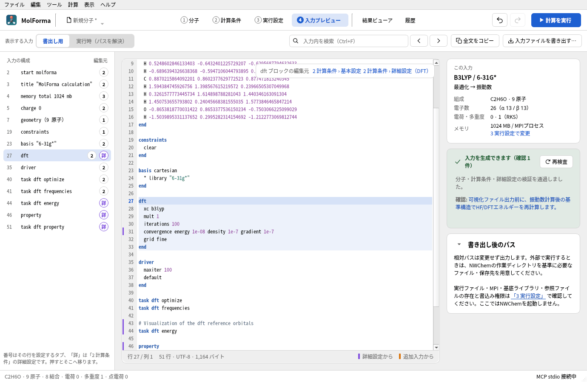

# 「4 入力プレビュー」

現在の分子・座標・計算条件・詳細設定から生成するNWChem入力を読み取り専用で表示します。既存の入力生成・検証を共用し、編集、候補の確定・取消、Undo/Redo、プロジェクトの読込・保存に追従します。左に入力の構成、中央に入力、右に入力の要約・検査結果・パスの扱いを表示します。「2 計算条件」の「4 入力プレビューで確認」と、詳細設定の「入力で見る」からも移動できます。



**図1** エタノールの入力で、左の「入力の構成」からdftブロックを選んだところ。詳細設定から来た行（31行目）は紫の印、右上にそのブロックの編集元が出ます。

| 表示モード | 内容 |
| --- | --- |
| 書出し用入力（既定） | 「2 計算条件」と同じ完成入力。設定した相対パスをそのまま出力 |
| 実行時の入力 | 「3 実行設定」の入力一式保存と同じ生成処理。入力movecsの相対パスを、参照基準ディレクトリから絶対パスへ変換 |

実行時の入力の参照基準が空欄なら、保存済みプロジェクトのディレクトリを使います。未保存ならアプリの作業ディレクトリを使います。scratch・permanentの相対パスはジョブ内、出力movecsはpermanent内を基準とします。`./`で始まる出力movecsはジョブ内を基準にします。プレビューはジョブフォルダーを作成せず、NWChemも起動しません。実行時の入力を単独で書き出して外部で計算する場合は、出力先のサブディレクトリを用意してください。「ジョブとして保存」ではこれらを作成します。

- 左の「入力の構成」は、入力の指示・ブロック（`start`、`geometry`（原子数）、`basis`、`dft` など）を行番号とともに並べ、選ぶとその行へ移動します。各行の番号（1〜3）はその部分を設定するタブで、押すとそのタブ（「2 計算条件」はその設定欄）を開きます。紫の「詳」は詳細設定から来た部分で、押すとそのセクションの詳細設定のグループを開きます。
- どの行が詳細設定と追加入力から来たかは、入力を生成する処理で求めます（それらの設定を空にして生成した入力にない行）。入力の行番号の左に、詳細設定から来た行は紫、追加入力の行は橙の印を付けます。カーソルのあるブロックは背景を色付けし、右上にそのブロックの編集元（「2 計算条件 › 基本設定」「2 計算条件 › 詳細設定（DFT）」など）をリンクで表示します。
- 行番号とキーワード・数値・文字列・コメントの色分け、現在の行・列と、行数・バイト数の表示に対応します。行番号・色・印は入力ファイルには含めません。
- Ctrl+Fで検索欄へ移動し、Enterまたは「次へ」「前へ」で検索します。大小文字を区別せず、末尾・先頭で折り返します。再検査で入力が変わらない場合は選択位置を保持します。
- 「この入力」に分子式・原子数・手法・基底・計算目的・電荷・多重度・電子数・メモリを表示します（「2 計算条件」と同じカード）。検査結果のカードの「再検査」は、参照ファイル・保存先などMolFormaの外で変わったものを確認し直します。エラーや確認事項のリンクから、分子・計算条件（名前の挙がった設定欄・詳細設定の行）・実行設定へ移動できます。数値Hessianの確認事項には該当する行番号を添えます。保留中の詳細設定も表示し、入力には含めません。「書き出し後のパス」（実行時モードでは「実行時のパス」）のカードは見出しの矢印で畳め（畳むと見出しの後ろに要約を表示）、状態をアプリ設定に保存します。
- エラー時は古い入力を消し、全文コピー・書き出しを無効にします。候補は確認用の入力を表示し、確定・取消までは出力ボタンを無効にします。整形処理中も出力できません。出力直前には編集中の設定欄を確定して検査し直します。
- 「全文をコピー」と「入力ファイルを書き出す…」は選択中のモードの全文を出力します。`.nw`はUTF-8・LF改行で、拡張子がない場合は`.nw`を追加します。書き出しだけではプロジェクトの保存先・編集履歴・未保存状態を変更しません。

入力の生成検査と、実行環境の検査は別です。書出し用入力は実行ファイル・MPI設定の不備に影響されません。実行時モードでは実行設定の型・値・パスの制限も検査しますが、実行ファイル、入力movecs、基底ライブラリの存在、保存先の書込み可否は「3 実行設定」で確認します。生成可能という表示はNWChemによる構文検査や収束の保証ではありません。

プレビューは常に編集中のプロジェクトを対象とします。実行中・過去の計算の固定コピーを表示する画面ではありません。その入力はジョブフォルダーの`input.nw`で確認してください。任意のNWChem入力の読込・直接編集・外部編集内容のプロジェクトへの取込み、任意のキーワードの追加は未対応です。

入力の構造・`task`の順序・ファイル指定については[NWChem Getting Started](https://nwchemgit.github.io/Getting-Started.html)を参照しています。

## 入力プレビューの検証

`input_preview`のQt Testは、全文コピー・ファイル保存と生成器の一致、実行時のパスと保存ジョブの一致、プレビュー中のファイル非作成、未知フィールド・編集履歴の保持、候補・エラー時の出力制御、Undo/Redo、保留設定、検証リンク、HTML文字の表示、検索・ブロック移動、入力の構成と編集元（詳細設定・追加入力から来た行の判定、編集元のタブ・詳細設定への移動）、フォーカス中の設定確定、保存ダイアログを検査します。通常のCTestはNWChem・MPI・ネットワークを必要としません。

2026-10-23に既存6系列と入力プレビューのテストが成功しました。入力プレビューは整形開始・取消時の出力制御を含む9件（初期化・終了処理を含む）をAddressSanitizerでも検証し、画面画像を確認しています。

次の任意コマンドで画面画像と試験入力を保存できます。

```sh
QT_QPA_PLATFORM=offscreen MOLFORMA_PREVIEW_ARTIFACTS=/tmp/molforma-preview \
  ./build/test_input_preview focusedSettingAndSaveDialog
```

関連: [「2 計算条件」](calculation.md)、[詳細設定とCUBE・MOLDEN出力](advanced.md)、「[機能と操作](../features.md)」のページの一覧。
