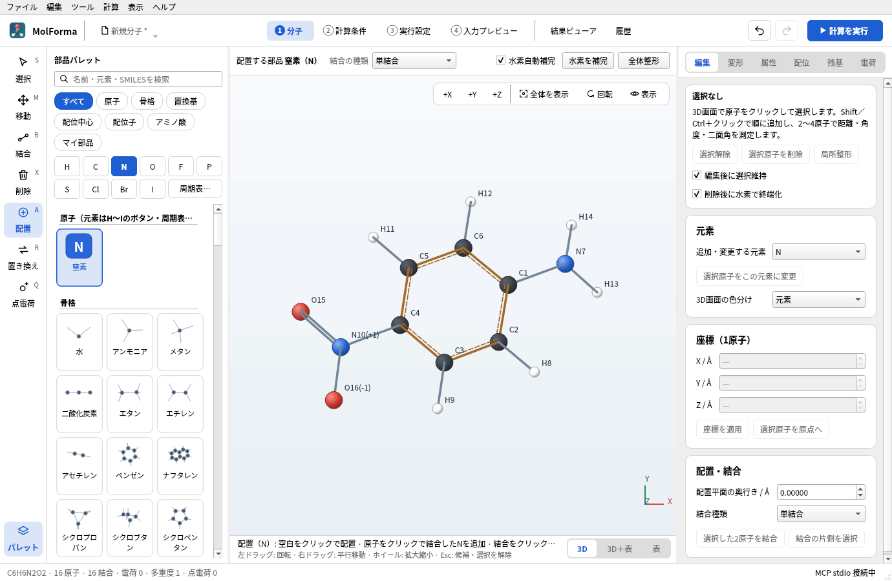
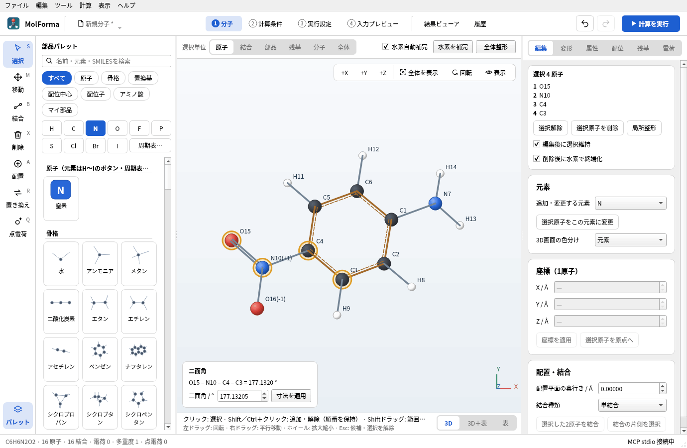
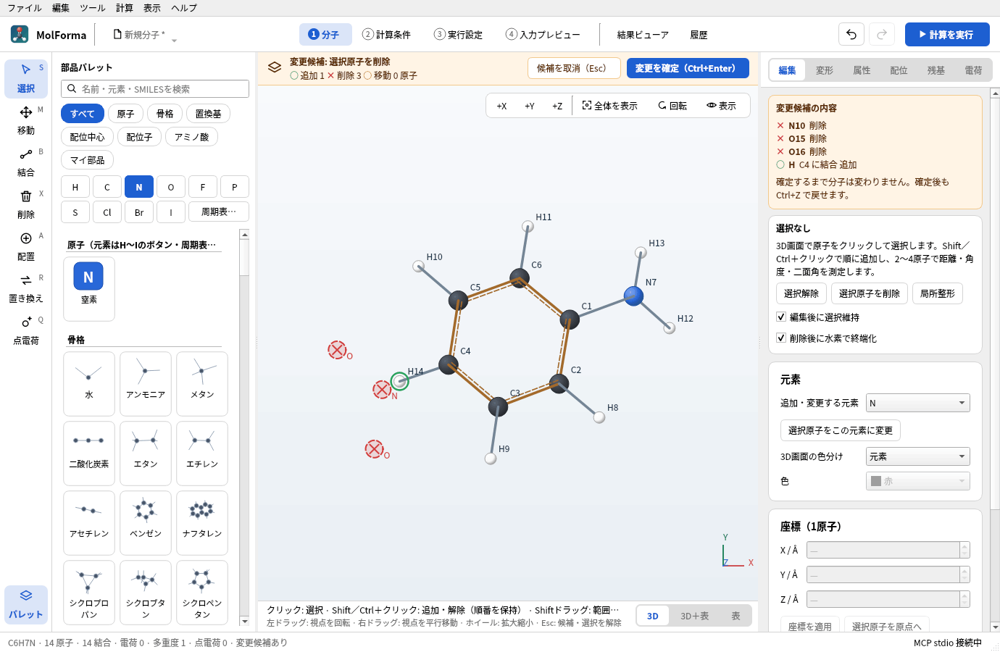
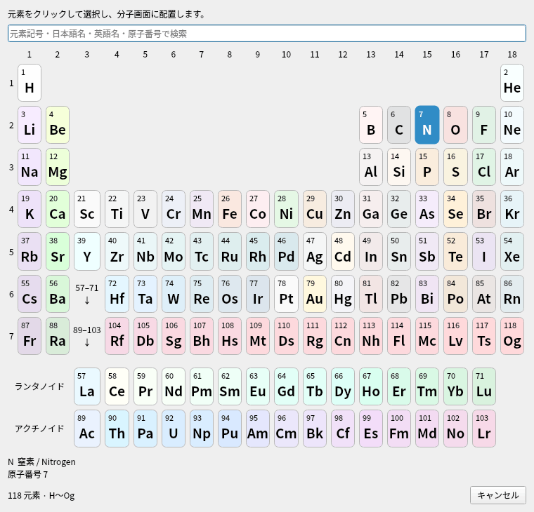

# 「1 分子」の画面・ツール・選択

「1 分子」は分子を組み立てる画面です。このページでは、画面の構成、ツールと部品パレット、選択・削除・候補・視点・キー操作、原子パレットと周期表を説明します。右側の「編集」〜「電荷」のページは「[「1 分子」の右側のページ](molecule_pages.md)」、3D画面の下（または代わり）に出す表は「[座標の表](coordinates.md)」にあります。

**図1** パレットで「N」を押したところ。ツールが「配置」になり、3D画面の上に置く部品と結合の種類、下にクリックしたときの動作が出ます。

## 画面の構成

- **ヘッダー**: 左にファイル名（クリックで新規・開く・PDBからダウンロード・最近使ったファイル・SMILESから作成・保存）、中央に作業の流れ（「1 分子」〜「4 入力プレビュー」と「結果ビューア」「履歴」）、右に「元に戻す」「やり直す」「計算を実行」（F5）があります（計算の実行中は「計算を実行」の代わりに「実行中」と経過時間、「停止」を表示します）。「2 計算条件」〜「4 入力プレビュー」のタブには元に戻す・やり直す・ほかのタブへ移るボタンを置かず、ヘッダーのものを使います。作業の流れのボタンでタブを切り替え（Ctrl+1〜Ctrl+6も同じ）、開いているタブを色付きで示します。「4 入力プレビュー」は入力を生成できないとき赤字になり、ツールチップに理由を表示します。ウィンドウが狭いと、作業の流れはヘッダーの2行目に移ります。
- **「1 分子」**: 左端にツールの列、その右に部品パレット（ツールの列の下の「パレット」で畳めます。畳むと3D画面と座標の表が広がり、状態はアプリ設定に記憶。「配置」「置き換え」ツール、「配位子パレットを開く」、マイ部品の保存では開きます）、中央に3D画面、右に「編集」「変形」「属性」「配位」「残基」「電荷」のページがあります。3D画面の上の行には今のツールの設定（選択単位・結合の種類・置く部品・部品の配置後もツールを保持・削除後に水素で終端化・置く点電荷の値）と「水素自動補完」「水素を補完」「全体整形」を表示します。候補があるときは同じ行が候補の確定・取消に替わります。行の高さは候補の有無やツールで変えないので、3D画面の大きさと位置は変わりません（狭いウィンドウで設定が2行に折り返すツールに替えたときを除く）。
- **3D画面の上の表示**: 左上にペプチドの配列（鎖ごとに残基番号の順。末端キャップは「ACE 0 · ALA 1 · … · NME 4」のように両端に並ぶ。残基をクリックするとその原子を選択。25残基以上は先頭24残基）、右上に+X/+Y/+Z・全体を表示・回転・表示、左下に2〜4原子を順に選んだときの距離・角度・二面角と寸法の入力を表示します。3D画面が狭いと、右上のボタンはアイコンだけになり、配列はその下に移ります。3D画面の下の2行は、今のツールでクリックしたときの動作とマウス操作です（収まらない部分は「…」で省き、ツールチップに全文を表示）。
- **表示の切替**: 3D画面右上の「表示」は「表示」メニューと同じで、水素の表示（H）・番号の表示・ラベル・表示スタイル・計測表示などを切り替えます。「回転」は左右・上下・画面内の回転角のスライダーを開きます。

## ツールと部品パレット

- **ツール**: 左端の列（選択・移動・結合・削除・配置・置き換え・点電荷。角に各ツールのキー）、「編集 → ツールを選ぶ」、または「1 分子」でのキー（S・M・B・X・A・R・Q。入力欄では文字の入力になります）で選びます。3D画面の上の行に今のツールの設定を、3D画面の下に今のツールでクリックしたときの動作と置く元素・部品の名前を表示します。パレットで部品・原子をクリックすると「配置」ツールに切り替わります。ただし「置き換え」ツールのままなら、選んだ元素・部品への置き換えを続けます。「選択」ツールの後に「配置」「置き換え」へ戻すと、前に選んだパレットの項目を再び強調表示して使います。
- **配置ツール**: パレットで選んだものを、クリックした場所に応じて置きます。原子は空白に置くか、クリックした原子に「結合の種類」の結合でつなぎます（水素をクリックするとその水素と置き換え、結合をクリックすると間に挿入）。結合への挿入では、新しい原子を共有結合半径の結合長と四面体角（例: C–O 1.42 Å、C–O–C 109.5°）の位置に置き、小さいほうの断片を外側へずらします。環の中の結合や、両側に固定原子がある結合では、ほかの原子を動かさず結合の線から外した位置に置きます（一直線のままだと力場が角度を開けないため）。骨格・アミノ酸・末端キャップは空白に置くか、原子・水素へ接続します。置換基はクリックした水素を置き換えます（空白には置けません）。配位中心は空白に配位サイトつきで置きます。置く元素は、パレットで強調表示している項目（分類を切り替えた直後は先頭の項目）です。配位子は配位中心の紫の番号（空きサイト）へ配位させ、空白をクリックすると単独の分子として置きます。
- **結合ツール**: 結合の種類（単結合〜結合を削除）は、3D画面の上の「結合の種類」で選びます（「編集」ページの「結合種類」と同じ設定。「配置」で原子に原子をつなぐときにも使うので、原子を置く「配置」ツールでも表示します）。既にその種類の結合を指定しても、変更や履歴にはなりません。結合の変更は編集パネル・結合ツール・メニュー・ショートカット・右クリックで共通です。「水素自動補完」がオンなら水素数も調整し、オフなら指定した結合だけを変更します。
- **元素の変更**: 「編集」ページの「選択原子をこの元素に変更」、元素を選んだ置き換えツール、右クリックの「元素を…に変更」は同じ変更で、どれも「水素自動補完」がオンなら水素数も調整します。
- **移動ツール**: 原子をドラッグすると、その原子に付いている水素（選択中の原子をドラッグしたときは選択全体と、その水素）がカーソルに合わせて動き、離したときに1回の編集として確定します。固定原子を含む場合は動かさず、離したときに理由を表示します。Altドラッグは回転です。
- **配位子を続けて置く**: 配位子を選んだ「配置」ツールで次の空きサイトをクリックすると、前に置いた配位子の候補を確定してから次を候補にします。
- **ツールの戻り方**: 骨格・置換基・アミノ酸などの部品（単独で置いた配位子を含む）を1つ置くと「選択」ツールに戻り、パレットの強調表示も消えます（「部品の配置後もツールを保持」をオンにすると続けて置けます）。原子・配位中心・空きサイトへの配位子の配置と、ほかのツールは、切り替えるまで続きます。
- **よく使う元素**: パレットのH・C・N・O・F・P・S・Cl・Br・Iのボタンで、その元素を「配置」ツールで置けるようにします（選んだ元素のボタンを色付きで示します）。分類「原子」の一覧にも、選んだ元素とこれらの元素を表示します。
- **分類と並び方**: パレット上部のボタン（すべて・原子・骨格・置換基・配位中心・配位子・アミノ酸・マイ部品）で分類を切り替えます。元素のボタン（H・C・N…）と「周期表…」は、分類「配位中心」では配位中心の元素を選び（S・P・Xeなど金属以外も一覧の先頭に加わる）、骨格・置換基などの分類では分類を「原子」に切り替えてその元素を選びます。「マイ部品」では部品の上に「選択原子を保存…」「読み込む…」「一覧から外す」を表示します（一覧から外してもファイルは消しません。部品がないときは増やし方を表示）。部品・原子は構造のサムネイルと名前のタイルで並べ（名前は2行まで。全文はツールチップ）、見出しと「SMILES「…」から3Dで作成」は1行を使います。
- **「すべて」の並び**: 検索していないときは、原子・骨格・置換基・配位子・アミノ酸・末端キャップ・配位中心（金属）・マイ部品の順に、見出しを付けて並べます。
- **パレットの検索**: 元素記号・原子番号は、その元素を一覧の先頭に表示します（「N」なら窒素。分類「配位中心」では、その元素を配位中心として表示）。日本語名（「窒素」など）・英語名でも元素を探せます。部品名・SMILESで部品も検索し、どの部品にも当たらない文字列がSMILESとして読める形なら「SMILES「…」から3Dで作成」を表示します（今の分子の横に置く候補を作ります）。検索欄のEnterで先頭の項目を選びます。
- **SMILESから作成**: 例を示した入力欄で、今の分子を置き換える候補を作ります。SMILESを読めない場合は理由を表示し、「SMILESを修正…」で入力をやり直せます。

## 選択・削除・候補・視点・キー操作

- **選択**: 原子をクリックすると、その原子（「選択単位」が部品・残基・分子・全体なら、そのまとまり）だけを選びます。Shift／Ctrl＋クリックで選択へ追加・解除し、選んだ順番を距離・角度・二面角の測定と寸法の変更に使います。Shift／Ctrlドラッグで範囲選択（Ctrlは追加）、Ctrl+Aですべて選択、Escで解除します。選択単位は選択・移動ツールのときに3D画面の上で選び、削除・置き換えツールにも同じ単位を使います（原子以外のときは3D画面の下の説明に表示）。
- **選択の欄**: 「編集」ページの上部に、選んだ原子を選択順に（残基の原子は「ALA 1 · CA」のように）8原子まで表示し、「選択解除」「選択原子を削除」「局所整形」（選択原子だけを力場で整え、候補として表示）と「編集後に選択維持」（既定でオン）「削除後に水素で終端化」を置きます。選択した原子への操作（削除・固定・ゴースト・原点へ・平行移動など）は右側のページにだけ置き、座標の表の選択バーには選んだ原子と選択解除だけを表示します。
- **選択に対する操作**: 選択した原子に働くボタン（削除・結合・座標の適用・寸法・回転など）は、必要な数の原子を選ぶまで無効で、ツールチップに選ぶ数を表示します。原子を選んでいないとき、右側の座標欄や寸法欄は「—」で、前に選んだ原子の値を残しません。
- **削除**: 「編集」ページの「選択原子を削除」、Deleteキー、削除ツール、右クリックは同じ削除で、候補として表示します。削除する原子だけに結合していた水素も一緒に消し、「削除後に水素で終端化」（「編集」ページの選択の欄と削除ツールの設定は共通、既定でオン）がオンなら、重原子を削除して切れた結合の相手に水素を補います（水素だけを削除したときは補いません）。削除前の全電荷が形式電荷の合計（配位中心があれば酸化数との合計）と一致していれば、全電荷も削除後の合計に合わせます（Na⁺の配位クラスターを消すと+1から0に戻るなど）。座標の表でもDeleteキーは同じ削除です。
- **候補**: 確定前の変更は3D画面の上の行（ツールの設定と同じ場所。画面に重ならず、3D画面の大きさも変えません）に琥珀色で示し、操作名と、追加・削除・移動した原子数を3D画面と同じ印（追加は緑の円、削除は元の位置に赤い×、移動は橙の円）で表示します。「編集」ページの上部には削除・追加する原子を8件まで一覧します。Ctrl+Enterで確定、Escで取消します（どのタブからでも有効）。「1 分子」以外のタブでは、タブの下に同じバーを表示します。「元に戻す」「やり直す」のツールチップと「編集」メニューには、対象の操作名を表示します。
- **元に戻す・やり直し**: Undo/Redoは分子と各タブの設定で共通です。戻せる・やり直せる操作がないときはボタンとメニューを無効にします（「変更を確定」も候補があるときだけ有効）。実行するとステータスバーに操作名を表示し、今のタブ以外の内容（例: 「1 分子」で戻した基底関数の変更）なら「（「2 計算条件」の内容）」のようにタブ名を添えます。
- **視点**: 左ドラッグは画面の縦・横軸まわりの回転（トラックボール）で、向きによる回転方向の偏りがありません。立体的な構造のファイルを開いたときは、結果ビューアと同じく斜めから見た向きで表示します（平面の分子や新規作成は正面から）。編集のあとは、分子が画面からはみ出たときだけ全体表示に合わせ直し、それ以外は視点を動かしません（次にクリックする原子が動かないように）。「+Z」は正面（+Z方向）から見て全体を表示し、「全体を表示」（F）は向きを変えずに分子全体を収めます。回転スライダー（3D画面右上の「回転」）はマウス操作や+X/+Y/+Zに追従し、スライダーに触れても視点は飛びません。ホイールはカーソル位置を中心に拡大縮小します。3D画面右上の操作（+X/+Y/+Z・全体を表示・回転・表示）は結果ビューアでも同じ並びです。
- **ラベル**: 「表示 → ラベル」で元素記号・番号を表示する原子（すべて・水素以外・選択した原子・なし）を、「表示 → 番号を表示」で通し番号の有無を選びます（3D画面右上の「表示」からも同じ）。ラベルは原子の右上・右下・左上・左下のうち、ほかのラベルや原子に重ならない位置に置きます。置けないラベルは、選択した原子・配位中心・水素以外・手前の原子を優先して省きます。結果ビューアにも同じ選択があります（設定は別々に保存）。
- **キー操作**: Delete（選択原子を削除。選択がなければステータスバーで知らせます）、Ctrl+A（すべて選択）、Ctrl+C（選択した原子、または全体をXYZでコピー）、Ctrl+V（クリップボードのXYZを断片として今の分子の横に追加）、1/2/3（選択した2原子の結合次数）、H（水素の表示）、F（全体表示）は「1 分子」にフォーカスがあるときだけ働き、入力欄では各欄の通常の操作になります。Ctrl+Enter・Esc・Ctrl+1〜Ctrl+6（タブの切替）・Ctrl+Z/Y等はどこでも働きます。「ヘルプ → キーボードショートカット一覧」に全項目と有効な場所、マウス操作をまとめています。
- **回転・鏡映の中心**: 「変形」ページの「選択を回転」「指定平面で鏡映」は、既定で選択した原子の中心（座標の平均）を通る軸・平面で行い、分子はその場で向きを変えます。「回転・鏡映の中心」を「原点」にすると座標原点を使います。「鏡像の写しを作る」では、写しを元の分子の+X方向6 Åの位置に、その場で鏡映して置きます。
- **大きな分子での応答**: 編集・Undo・選択のたびに更新するのは表示中のタブと座標の表だけで、隠れている座標の表とほかのタブ（「2 計算条件」〜「4 入力プレビュー」）は表示したときに最新の状態にします（MCPがGUIを読み取る・操作する前にも更新）。「4 入力プレビュー」のタブ名の赤字と説明は、非表示の間も入力のエラーに追従します。2160原子の水のクラスターで、すべて選択は約0.1秒、座標の編集・Undoは約0.1秒です（以前はそれぞれ約13秒・約1秒）。Undoは直近100回までです。
- **配色**: 選択中のツール・開いているタブ・「計算を実行」・分類ボタンなどのアクセント色はMolForma固有の青（明るいテーマで #1D5FD1、ダークテーマで #2F6FE4）で、デスクトップの選択色には合わせません。ヘッダー・ツールの列・3D画面の上に重ねた表示の背景・文字・線、候補のバナー、エラー文字、入力プレビューの色分けはQtのパレットから決め、ダークテーマでも読めるようにしています。候補のバナーは明るいテーマでは淡い琥珀色、ダークテーマでは暗い琥珀色です。3D画面の背景は明るい色のままです（何も表示していないときだけ、ダークテーマではウィンドウの色にします）。

**図2** 4原子を順に選ぶと、3D画面の左下に二面角とその値を変える欄が出ます（2原子なら距離、3原子なら角度）。

**図3** ニトロ基（N10・O15・O16）を選んで「選択原子を削除」を押すと、削除は候補になります。削除する原子に赤い×、終端化で補う水素に緑の円が付き、「変更を確定」までは分子は変わりません。

## 原子パレットと周期表

「1 分子」のパレットで分類が「原子」または「すべて」のとき、「周期表…」を押すと、Qtの周期表ダイアログを開きます。18族・7周期と、下段のランタノイド／アクチノイドから元素をクリックして選びます。日本語名・英語名・元素記号・原子番号で検索でき、一致しないマスは位置を保って薄く表示します。矢印キーでマス間を移動し、Enter／Spaceで選択、Escで取消できます。検索結果が1元素の場合は検索欄のEnterでも選択できます。

**図4** 「周期表…」で開くダイアログ。元素記号・日本語名・英語名・原子番号で検索できます。

選択した元素は色付き記号、日本語名、原子番号を添えてパレットに表示し、分子画面へのクリック／ドラッグで配置できます。周期表の選択だけでは分子を変更せず、配置はUndo／Redoに対応します。追加したFr〜Ogは、元素変更・座標入力・プロジェクト保存・XYZ・NWChem座標出力・NWChemログ／CUBE／MOLDENの構造読込でも共通して扱います。

元素の範囲は[NWChemの元素表](https://github.com/nwchemgit/nwchem/blob/master/src/geom/periodic.fh)にある正式名称付きのH〜Og（原子番号1〜118）です。仮称Uue・Ubn（119・120）は対象外です。**元素の認識と基底関数の対応は別です。**「2 計算条件」の組込み基底が未対応の元素（Fr〜Ogなど）を含む場合は、従来どおり計算入力の生成を拒否します。ライブラリにない任意の基底・ECPの入力は未実装です。

H〜Rnは同梱の元素データ（物性値・同位体）を使い、Fr〜Ogの質量・共有結合半径・色と英語名はOpen Babel 3.2.1の元素データから補っています。重元素の半径には推定値・代替値を含み、結合推定や配置は近似です。質量はデータベース参照値で、超重元素の標準原子量や全元素の力場対応を保証するものではありません。

関連: [題材1 原子と結合から組む](../recipes/atoms_and_bonds.md)、[題材3 芳香族の置換体](../recipes/aromatic_substitution.md)、[題材16 自作の部品（マイ部品）](../recipes/my_parts.md)、「[機能と操作](../features.md)」のページの一覧。
