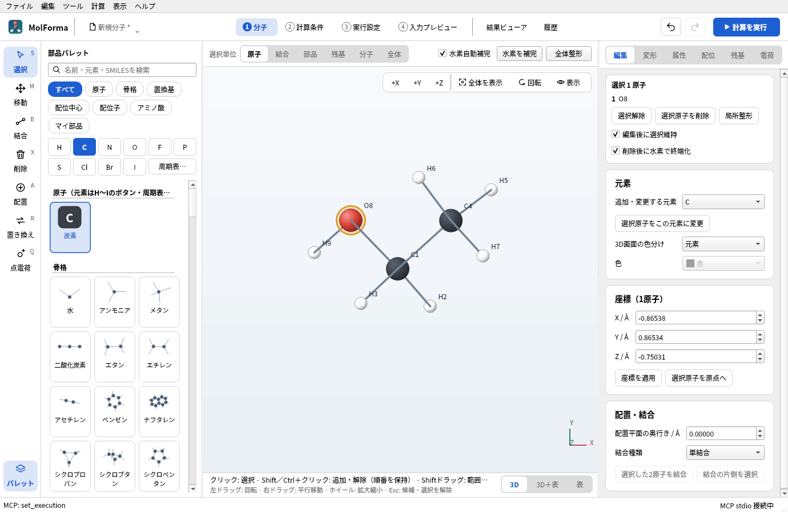
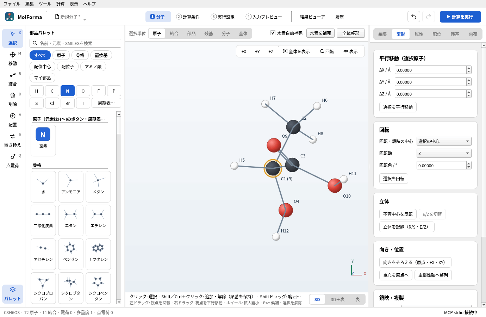
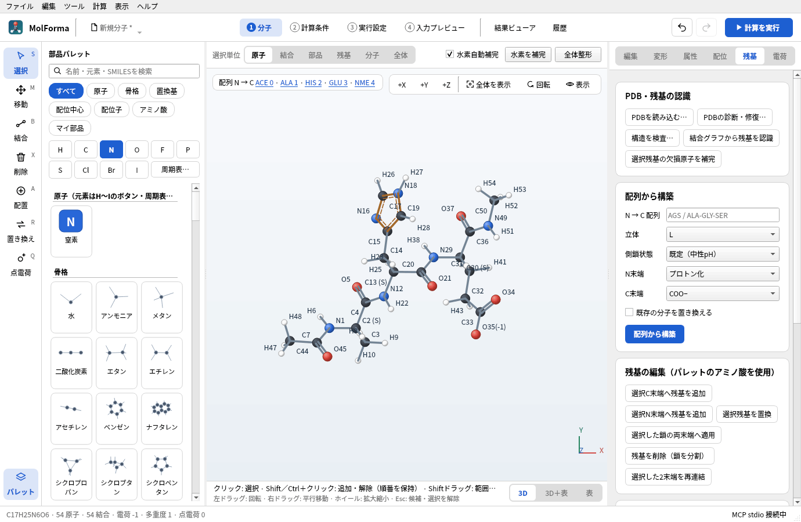
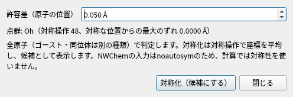

# 「1 分子」の右側のページとNWChemへの対応

右側は「編集」「変形」「属性」（原子の属性とゴースト・固定だけ）「配位」「残基」「電荷」の6ページで、上部の切替で選びます（ページの中にさらにタブはありません）。各ページは操作をカードにまとめ、ボタンは横に並べます。よく使う操作は青いボタン（配位子の配置・配列から構築・点電荷の追加）で示し、あまり使わない「サイトの方向」は見出しの矢印で開きます。NWChemへ直接渡す計算設定と、元素・座標・水素・立体構造を作るための操作を残しています。結合次数、残基名、配位サイト、酸化数はNWChemの分子QM入力には直接出力しませんが、初期構造の準備に使用します。

| タブ・項目 | 用途 |
| --- | --- |
| 編集: 元素変更、1原子のXYZ・原点移動（「3D」の並べ方のとき）、配置平面の奥行き | 計算に渡す元素・座標を作成 |
| 編集: 結合種類、2原子を結合、結合片側の選択、水素終端付き削除 | 結合グラフから水素数や移動対象を決める構造準備 |
| 変形: 平行移動、回転、不斉中心反転、E/Z切替、R/S・E/Z記録 | 立体異性体の作成・確認。記録したR/Sは3D画面の原子のラベル（「C1 (S)」）、E/Zは二重結合の中央（「(E)」）に表示し、記録した結果をステータスバーに示す。立体ラベル自体はNWChem入力に出力しない |
| 変形: 向きの整列、重心移動、主慣性軸、鏡映・鏡像コピー、複製 | 初期座標、異性体、複合体の作成。分子全体（選択なし）の「重心を原点へ」「主慣性軸へ整列」は、「向きをそろえる（原点・+X・XY）」と同じく点電荷も一緒に動かす |
| 属性: 形式電荷、不対電子、属性適用 | 水素補完・化学構造の属性。計算の全電荷・スピン多重度とは別であることを表示 |
| 属性: 同位体・任意質量、ゴーストにする・ゴーストを解除 | `mass`、`bq元素` と基底を出力 |
| 属性: 選択原子を固定、固定を解除 | 編集時の保護と最適化の `constraints / fix atom` に反映。固定状態が混在しても明示的に設定・解除。3D画面の右クリックメニューも同じ名前 |
| 距離・角度・二面角の拘束、スキャン | 「2 計算条件」の「内部座標の拘束（最適化）」「IRC・座標スキャン」で設定（NWChemの `zcoord` へ出力）。距離・角度の変更・測定は「1 分子」で行う |
| 座標の表の「構造 → 原子を並べ替え」（元素順・残基順・選択した原子を先頭へ）、パレットの「マイ部品」の保存・読込・一覧から外す | 出力原子順の整理と構造の再利用 |
| 3D画面の上の「全体整形」、「編集」の選択の欄の「局所整形」（選択原子だけ）、「ツール → 3Dを再生成」 | Open Babelによる初期構造準備。NWChem計算とは別の処理 |
| 配位: 配位形状、中心–供与原子距離、サイト番号、配位子配置・交換・移動・2サイト交換、個別サイト方向 | 錯体の初期構造を作成。候補を確認して確定 |
| 配位: 酸化数の補助入力・適用 | 計算の全電荷・多重度は「2 計算条件」で別に設定する旨を表示 |
| 残基: 認識、欠損原子補完、配列構築、L/D、側鎖状態、N/C末端状態 | ペプチドの原子・水素・プロトン化状態・立体構造を準備。結合グラフからの認識は元素とつながりで標準アミノ酸を照合し（XYZから推定した結合次数に依らない）、鎖の両端のACE・NMEのキャップも認識し、水素の数から形式電荷（COO−、NH3+、Lys・Arg、HisのHIP）と側鎖の状態（HID・HIE・HIP、Asp・Gluの荷電・中性など）を決める。全電荷は「電荷」ページの説明のとおり新しい値に追従（「PDBの診断・修復…」での認識も同じ） |
| 残基: 両末端への追加、残基置換、末端状態適用、削除、再連結、主鎖・側鎖二面角 | 構成と初期配座を編集。残基置換はパレットで選んだアミノ酸の状態（「ヒスチジン（HIP, +1）」など）を使い、主鎖のN・Cα・C・Oを保ったまま（それらの原子を使う内部座標の拘束・スキャン座標も残る）、主鎖のアミド水素をペプチド面内（前の残基のC=Oの反対側）に置き直す。ACEキャップを付けたときも同じ。全電荷は末端への追加と同じく追従。再連結はC–Nが1.1〜1.7 Åのときだけで、離れているときは今の距離と寸法での近づけ方を示す |
| 残基: 一覧選択、未登録原子選択、手動登録 | 大きな構造の選択と管理 |
| 断片割当（FMO／Counterpoise／SAPT0）、断片電荷・多重度、BDA:BAA | 作成・編集のUIはない（NWChem入力へ変換できないため）。Counterpoise補正は「2 計算条件」の「BSSE補正」（結合した分子ごとの単量体、NWChemの `bsse` ブロック）で設定。FMO・SAPT0は未対応 |
| 残基: PDB読込・診断・修復、構造を検査…、原子対応CSVの書き出し | CSVは出力原子番号・元素・原子名・残基を保存 |
| 残基: 活性部位の切り出し（「周囲を選択」「選択範囲を切り出す」） | たんぱく質の配位子や活性部位の周りを、量子化学計算用のクラスターモデルにする。「周囲を選択」は選択した原子から半径（既定5 Å）以内の原子を選ぶ。「残基ごとに含める」では半径内に原子がある残基を丸ごと（残基に登録されていない原子は分子ごと）選び、「水分子を含める」を外すと水を除く。水素は結合相手の原子と一緒に選ぶ。「選択範囲を切り出す」は選択していない原子を削除する候補を作り、切った共有結合ごとに、残す原子から元の結合の向きへX–Hの長さ（共有結合半径の和）で水素を置く（リンク原子）。金属との結合と配位結合には水素を置かない。「切断した原子を固定」では水素を付けた原子を固定し、構造最適化でも全体の中での位置を保つ。「水素を付ける（pH 7）」（既定オン）では、PDBの構造にない水素をpH 7の状態で付ける。Asp・Glu −1、Lys・Arg +1、鎖の末端はNH3+・COO−、Hisは金属に配位していない窒素に水素（どちらも配位していなければHIE。残基名がHID・HIE・HIP・ASH・GLH・LYN・CYMならその状態）、金属に配位したCysは−1にする。PDBの化学成分辞書のイオンはその電荷（ZN +2、NA +1、CL −1など）、硫酸（SO4）は−2にし、金属との結合は供与原子からの配位結合にする（配位した水はH2Oのまま）。そのほかの配位子は原子価に合わせて水素を付けるので、電荷・プロトン化状態を確かめる。すでに水素がある構造でも、これらの状態に揃える。「周りの電荷を点電荷として残す」では、削除する原子のうち切り出す原子から「点電荷の範囲」（既定15 Å）以内にある、電荷を持つ基を点電荷（出所「site」）として残し、「2 計算条件」の「「1 分子」の外部点電荷を含める」をオンにする。Asp・Glu（カルボキシ基の2つの酸素に−0.5ずつ）、Lys（+1）、Arg（グアニジノ基の3つの窒素に+1/3ずつ）、HIP（2つの窒素に+0.5ずつ）、鎖の末端、イオン、硫酸と、そのほかの残基の原子の形式電荷が対象。原子ごとの部分電荷ではなく基の正味の電荷だけを置く簡易な埋め込みで、水と中性の基は残さない。全電荷は形式電荷の合計に追従。MCPでは `cut_out_site` でファイルの読み込みから切り出しまでを1つの編集で行えるので、1万原子を超える構造にも使える（[MCP](../mcp.md)） |
| 編集: 3D画面の色分け（元素・残基・鎖。「元素」カード） | 構造の確認。残基は残基ごとの色、鎖はたんぱく質・核酸の残基を鎖ごとの色（鎖の順に青・橙・緑・赤…）にし、配位子・イオン・水と残基に登録されていない原子は元素の色のまま。選んだ色分けは保存しない |
| 電荷: 全電荷・多重度の表示、形式電荷の合計を全電荷に適用 | 値は「2 計算条件」で設定し、ここでは表示と「2 計算条件で変更」の移動先を示す。配位中心があるときは、中心の形式電荷の代わりに酸化数（補助）を数えた値を「酸化数と形式電荷の合計（n）を全電荷に適用」で適用 |
| 電荷: 点電荷の座標・電荷、一覧、追加・更新・削除、TIP3P変換、ファイルへの書き出し | 外部静電場の準備。TIP3P変換は候補として確認 |
| 電荷: 外部点電荷をNWChem入力に含めるかの表示、点電荷の一覧（ないときは追加のしかたを表示） | 設定は「2 計算条件」の「周囲の環境」（`bq units angstrom` を出力） |
| 電荷: 電子数・整合性表示、入力の可否、入力確認 | ECP・ゴーストを考慮した電子数、α/β電子数、エラー・確認事項と「入力を生成できます」かを表示し、「4 入力プレビューで確認」で移動 |

原子の属性は座標表・MCPと共通の検証を使います。同位体データにない質量数は編集時に拒否し、任意の質量は正の有限値を小数で指定します。

**図1** 「編集」ページ。上部に選んだ原子と「選択解除」「選択原子を削除」「局所整形」、その下に元素・座標・結合のカードが並びます。

**図2** 「変形」ページ。「立体を記録（R/S・E/Z）」を押すと、判定したR/Sが原子のラベル（「C1 (R)」）に出ます。

![trans-[Co(en)₂Cl₂]⁺ で「配位」ページを開き、Coを選んだところ。配位形状・距離・酸化数と、配位子の配置のカードがある](images/molecule_pages/03_coordination.png)

**図3** 「配位」ページ。配位中心の形状・中心–供与原子距離・酸化数を設定し、パレットの配位子をサイトへ置きます。

**図4** 「残基」ページ。配列からの構築、残基の追加・置換・削除、PDBの診断・修復、活性部位の切り出しなどを行います。3D画面の左上には配列が出ます。

![[Na(H₂O)₄]⁺ とTIP3P点電荷で「電荷」ページを開いたところ。分子の電荷のカードと、外部点電荷の一覧（3個）と追加・更新・削除のボタンがある](images/molecule_pages/05_charge.png)

**図5** 「電荷」ページ。全電荷・多重度・電子数の確認と、外部点電荷の一覧・編集です。全電荷と多重度の値は「2 計算条件」で設定します。

水素補完は、芳香族結合を単結合と二重結合（ケクレ構造）に割り当ててから原子価を数えます。ピロール・イミダゾール型の窒素が水素を失っている場合は、炭素ではなく窒素へ水素を戻します。O²⁻・S⁻・H⁻などのイオンは電荷に応じた原子価で扱います。

電荷設定は候補の表示中・整形中は変更できません。形式電荷の合計を適用しても多重度は推測しません。原子の削除、断片の追加、配位中心の配置、配位子の配置・交換、配位形状・酸化数の変更、残基の認識・追加・置換・末端状態の変更、配列からの構築では、変更前の全電荷が構造から見込まれる値（形式電荷の合計、配位中心は酸化数）と一致していれば、新しい値に合わせます（例: Co(III)を置くと3、塩化物を2つ配位させると1）。一致していなかった全電荷はそのままです（「既存の分子を置き換える」で配列から構築したときは新しい合計）。原子の属性・元素・結合の変更では全電荷を変えません。「2 計算条件」の確認事項と「構造を検査…」も、配位中心があるときはこの値と全電荷を比べます。外部点電荷は分子の電子数や全電荷には加算しません。点電荷の出力は既定でオフで、有効化はプロジェクト保存・Undo/Redoに対応します。これは固定した外部静電場であり、力場・トポロジー・QM/MM境界を持つNWChemのQM/MM計算ではありません。

NWChemで実行できるCounterpoise（BSSE）補正、距離・角度・二面角の拘束、座標スキャンは「2 計算条件」で設定します。FMO・SAPT0は未対応です。基底・ECP・計算手法も「2 計算条件」で設定します。

既存プロジェクトの未知のフィールドは保存時に保持し、NWChem入力へは変換しません。

確認資料: [NWChemの座標・質量・ゴースト](https://nwchemgit.github.io/Cartesian-coordinate-input.html)、[固定原子](https://nwchemgit.github.io/Constraints.html)、[構造最適化](https://nwchemgit.github.io/Geometry-Optimization.html)、[外部点電荷](https://nwchemgit.github.io/Bq.html)、[Counterpoise計算例](https://nwchemgit.github.io/Python.html)。

`editor` のQt Testで、「属性」ページが原子の属性とゴースト・固定だけであること（並べ替え・マイ部品・局所整形・3D再生成の移動先を含む）、UIからの固定・点電荷操作が生成入力へ反映されること、全電荷・多重度・点電荷の出力設定を「2 計算条件」で変えると電荷ページの表示が追従すること、候補の操作制限、Undo/Redo、未知のフィールドの保存時の保持を検証します。`MOLFORMA_MOLECULE_ARTIFACTS=/tmp/molforma-molecule` を指定して `test_editor nwchemMoleculeControls` を実行すると、各タブの画面画像を保存できます。

## 構造ツール（ツールメニュー）

- **点群・対称化**: 「ツール → 点群・対称化…」で、指定した許容差（既定0.05 Å）の範囲で点群をSchoenflies記号（C1・Cs・Ci・Cn・Cnv・Cnh・Dn・Dnh・Dnd・S2n・T・Td・Th・O・Oh・I・Ih・C∞v・D∞h）で表示し、対称な位置からの最大のずれを示します。ゴースト・同位体・質量指定の原子は別の種類として扱い、200原子まで判定します。「対称化（候補にする）」は見つかった対称操作で座標を平均し、厳密に対称な構造を候補にします。固定原子が動く場合は拒否します。Open Babelの点群判定は水をCs、メタンをC3vと誤るため、対称操作の探索と分類はMolForma独自の実装です。NWChemの入力は `noautosym` のため、計算で対称性は使いません。
- **Z-matrix**: 「ツール → Z-matrix（内部座標）…」で原子番号順の内部座標（前の原子を参照し、結合した原子を優先、直線に並ぶ参照は避ける）を表で表示します。距離・角度・二面角のセルを編集すると、その原子の側（結合の先）を動かして分子へ反映し、Undoで戻せます。「テキストをコピー」で `H 1 0.960000 2 104.5000` 形式のテキストを取得できます。Z-matrixを入力として読み込むことはできません。
- **3Dを再生成**: 「ツール → 3Dを再生成」で結合から3D座標を作り直し、力場で整えた結果を候補として表示します。
- **配座探索**: 「ツール → 配座探索…」で回転可能な結合をランダムに回し、MMFF94（使えない場合UFF）で最適化した配座を、重原子のRMSD 0.25 Å未満の重複を除いてエネルギー順に並べます。選んだ配座を候補にします（MCPから開始した場合は最安定の配座）。今の構造と同じ配座しか見つからない場合（回転できる結合がない分子など）は候補を作らず、ステータスバーで知らせます。別プロセスで実行し中止できます。固定原子・金属・ゴーストを含む分子は対象外です。力場の配座探索であり、量子化学計算による最安定配座の保証ではありません。
- **構造の検査**: 「ツール → 構造を検査…」（「1 分子」の「残基」ページの「構造を検査…」も同じ）で原子・結合数、形式電荷と設定電荷、電子数と多重度の組合せ、結合次数の合計を検査します。配位中心の空いたサイトの数と、配位中心の酸化数（補助）と配位子の形式電荷から見込まれる全電荷と設定電荷の違いも示します。問題がなければ「問題は見つかりませんでした。」と表示します。
- **構造の比較・重ね合わせ**: 「ツール → 構造を比較・重ね合わせ…」で別の構造ファイル（同じ原子が同じ順番）と比べ、座標そのままのRMSD、Kabsch法で重ね合わせた後のRMSD（全原子・水素以外）と最大のずれを表示します。「比較対象に重ねる（候補）」で今の分子全体を比較対象の位置・向きへ移動します。結果ビューアの「分子と比較」も同じ計算です。

**図6** 「ツール → 点群・対称化…」のダイアログ（SF₆、点群 Oh）。

## 操作例

### Ala–Gly–Ser

1. 新規分子を開き、「残基」の配列に `AGS` を入力します。
2. N末端をプロトン化、C末端をCOO−にして「配列から構築」を押します。
3. 候補の **C8H15N3O5、31原子、形式電荷0** を確認し、確定します。
4. 「2 計算条件」で手法・基底・計算目的を選びます（例: HF / STO-3G・一点エネルギー）。全電荷は形式電荷の合計と同じ0です。
5. 「4 入力プレビュー」で入力を確認し、ヘッダーの「計算を実行」で計算を始めます。

### 四面体の亜鉛錯体

1. 配位中心パレットからZnを選びます。
2. 「配位」の形状を四面体、距離を2.3 Å、酸化数を2にします。
3. 空白をクリックして中心を置きます。
4. 配位子パレットから塩化物を選び、サイト1〜4へ順に配置・確定します。
5. 「2 計算条件」の「電荷・スピン」で計算の全電荷を−2、多重度を1にします（「1 分子」の「電荷」ページにも表示します）。

関連: [題材2 配位化合物・金属錯体](../recipes/cobalt_complex.md)、[題材6 立体化学](../recipes/stereochemistry.md)、[題材7 ペプチド](../recipes/capped_peptide.md)、[題材12 溶媒和クラスターと点電荷](../recipes/hydrated_sodium.md)、「[機能と操作](../features.md)」のページの一覧。
