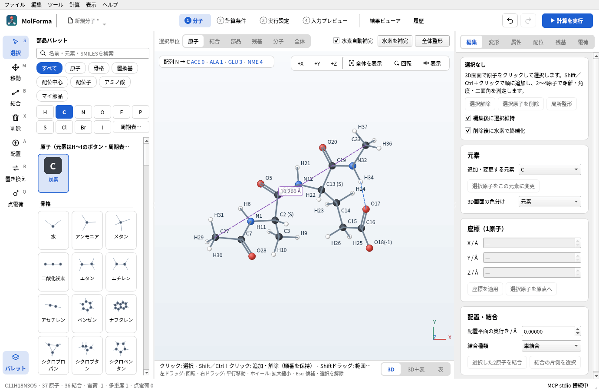
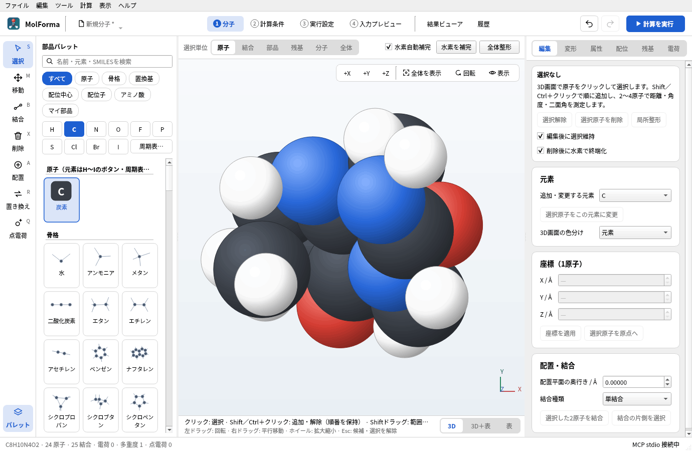

# 3D描画

- 分子編集画面と結果ビューアは共通の描画部品を使用します。Qt6対応VTKを検出したビルドでは、`QVTKOpenGLNativeWidget`にC++のVTKシーンを組み込みます。PythonやPyVistaへの実行時依存はありません。
- OpenGL 3.2を使えずVTKからQPainterへ切り替えたときだけ、各3D画面の左上に「描画: QPainter（CPU）· OpenGLを使えないため簡易表示」と表示します（初期化失敗による途中の切替にも追従）。現在の描画方式は「ヘルプ → MolFormaについて」で確認でき、「環境設定」の「3D描画」でQPainterを選ぶこともできます。VTKの表示はハードウェアGPUの使用を保証するものではありません。
- 原子はGPU Glyphでまとめて描画します。等値面は正負それぞれのメッシュとして保持し、形状変更時だけ頂点・法線を更新します。法線は頂点ごとに格子の値の勾配から求め、三角形の境目が目立たない陰影にします。回転、拡大、パン、透明度、正負の表示切替、選択では等値面を再構築しません。再表示する結果フレームが同じ共有メッシュを使う場合も保持します。軌道計算と等値面生成は従来どおりキャンセル可能な別プロセスで実行します。
- 平行投影と編集用の座標変換を共有し、カメラ操作で物理座標を変更しません。二重・三重結合、芳香族の破線、配位結合の矢印は見える向きを保つため小規模な描画用座標だけを更新します。原子の表示半径は従来と同じ画面上の範囲に制限します。
- ラベル、選択枠、固定マーク、ゴースト、非表示水素の小さなハンドル、配位サイト、末端ハンドル、点電荷、座標軸はQtの2Dレイヤーに描きます。このレイヤーは常に3D形状の手前に表示します。マウス・キー・ドラッグ＆ドロップは既存の編集処理で扱います。
- 半透明面には最大16回のdepth peelingを要求し、MSAAを無効にしてFXAAを使用します。多数の面が重なる場所や対応しないドライバーでは透明合成に限界があります。OpenGL対応でもllvmpipeなどのソフトウェア実装ではハードウェアGPUと同じ速度にはなりません。等値面は50万三角形までです。QPainter経路では15万三角形を超える面を均等に間引いて描きます。
- `MOLFORMA_RENDERER=painter`、VTKなしのビルド、Qtのoffscreen/minimal環境、OpenGLコンテキストの初期化失敗ではQPainter描画を使用します。QPainter経路もカメラ行列・原子色・結合端点検索をキャッシュしますが、大きい等値面はCPU描画の制約を受けます。
- 「表示 → 表示スタイル」でボール＆スティック（既定）、スティック、空間充填（CPK、Open Babelのファンデルワールス半径）、ワイヤーフレームを切り替えます。スティック・ワイヤーフレームの結合は両端の原子の色で塗り分け、多重結合は1本で表します。選んだスタイルはアプリ設定に保存し、分子データと計算には影響しません。
- 「表示 → 選択した原子を隠す」（Ctrl+Shift+H）で原子を一時的に隠し、「すべての原子を表示」（Ctrl+Shift+U）で戻します。表示だけの設定で、保存・計算・選択単位の展開には含まれます。隠した原子はクリックで選べません。
- 「表示 → 選択中の計測を画面に表示」（Ctrl+M）は、順に選んだ2〜4原子の距離・角度・二面角を紫の破線と値で画面に残します。値は原子の移動に追従し、原子を削除すると消えます。「画面の計測表示を消去」で消します。計測表示はプロジェクトに保存しません。
- 「表示 → 水素結合を表示」は、N・O・Fに結合したHと、別のN・O・Fとの間（H···Y 1.5〜2.6 Å、X–H···Y 120°以上）を青い破線で示します（5000原子まで）。距離と角度による目安で、エネルギーによる判定ではありません。



**図1** 「表示 → 水素結合を表示」の青い破線（H34···O17）と、「選択中の計測を画面に表示」で残した距離（紫の破線、C27–C33）。



**図2** 「表示 → 表示スタイル → 空間充填（CPK）」（カフェイン、ラベルなし）。

通常のCTestは表示サーバーを必要とせず、QPainter経路と編集・候補・Undoを検査します。VTK経路では別途、表示位置とクリック座標、半透明処理、回転時の等値面保持、PNG取得を検査できます。

```sh
xvfb-run -a env QT_QPA_PLATFORM=xcb MOLFORMA_REQUIRE_VTK=1 \
  MOLFORMA_RENDER_ARTIFACTS=/tmp/molforma-rendering ./build/test_rendering
```

描画性能は同じ表示環境・画面サイズ・形状で比較します。次の任意ベンチマークは800×600の画面で1万・5万・10万三角形を回転し、ウォームアップ後30フレームの中央値と95パーセンタイルを表示します。時間はテストの合否には使いません。Xvfb上の値は通常ソフトウェアOpenGLの性能であり、実機GPUの評価には実際の表示環境で実行してください。

```sh
MOLFORMA_RENDER_BENCHMARK=1 ./build/test_rendering rotationBenchmark
MOLFORMA_RENDERER=painter MOLFORMA_RENDER_BENCHMARK=1 ./build/test_rendering rotationBenchmark
```

2026-10-23にNVIDIA GeForce GTX 1060 6GB、NVIDIA 580.178.04、Qt 6.12.0、VTK 9.7.1、xcbで測定しました。正負に色分けした球面、透明度150/255、3原子を使用し、同じビルドのQPainter経路（キャッシュ最適化を含む）と比較しています。VTK経路の約16.7msはこの表示環境の60Hz同期に相当し、GPU単体の処理時間を表すものではありません。

| 三角形数 | QPainter 中央値 | VTK 中央値 |
| --- | --- | --- |
| 10,000 | 22.29ms | 16.71ms |
| 50,000 | 63.17ms | 16.72ms |
| 100,000 | 111.69ms | 16.71ms |

10万三角形の95パーセンタイルはQPainterが126.60ms、VTKが17.74msでした。形状の重なり、解像度、GPU・ドライバーによって結果は変わります。

関連: [「1 分子」の画面・ツール・選択](molecule.md)、[「結果ビューア」](results.md)、「[機能と操作](../features.md)」のページの一覧。
