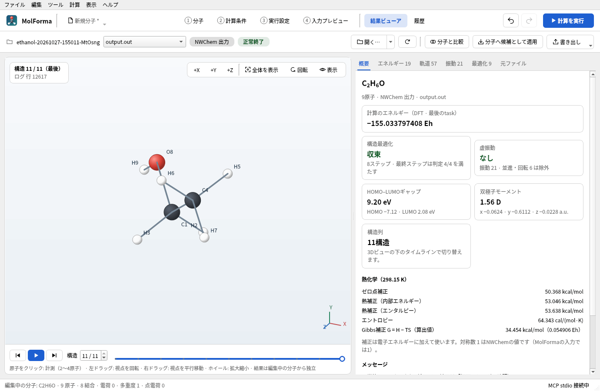
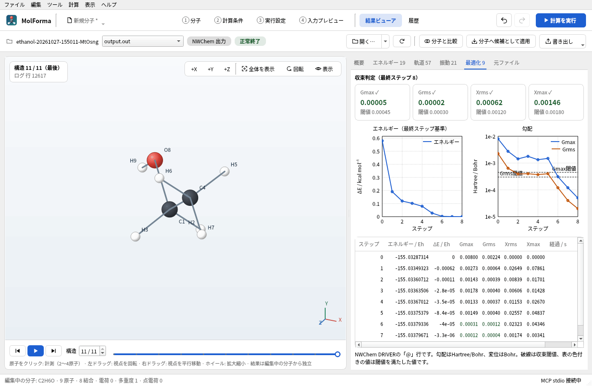
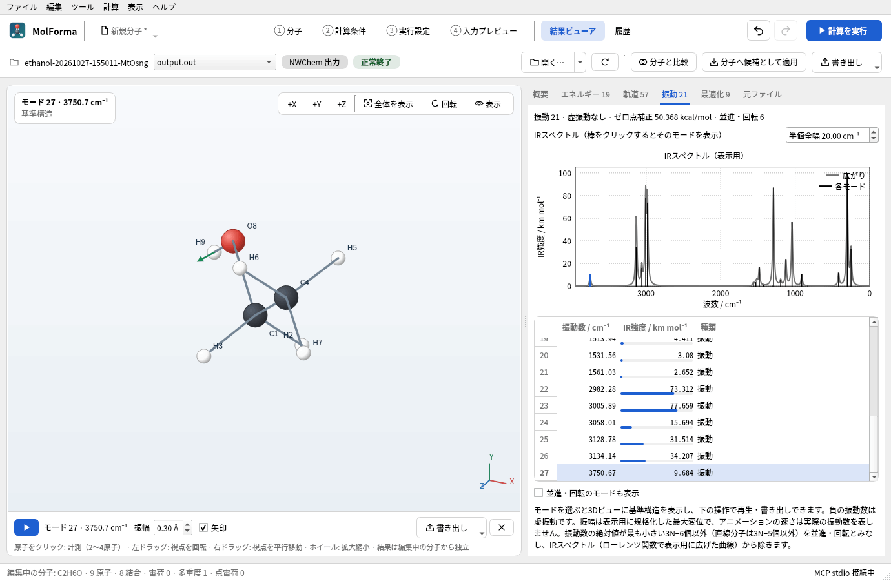
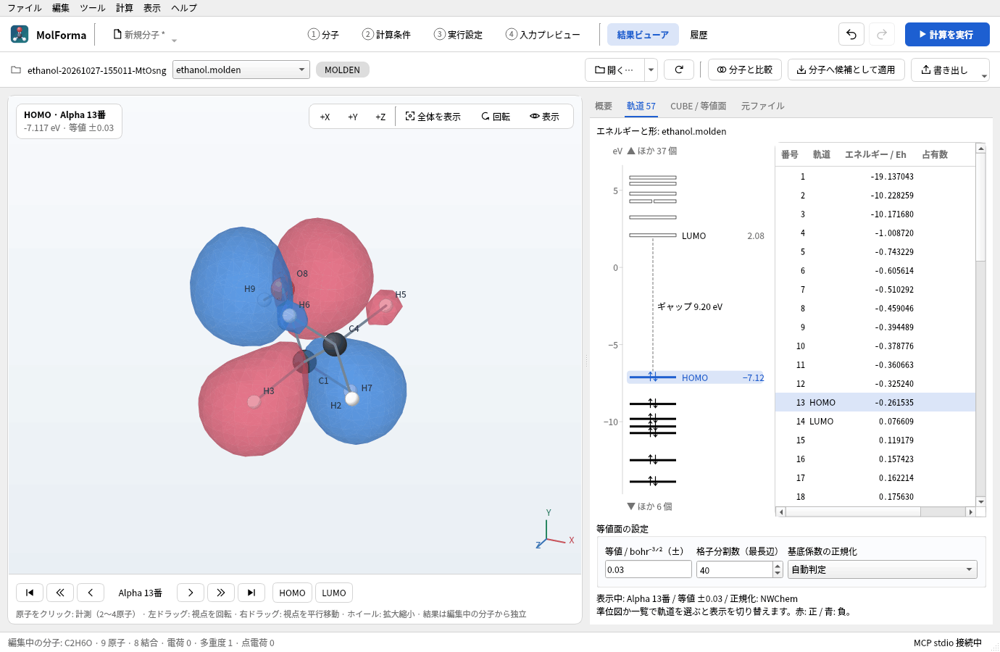

# 「結果ビューア」

上部のバーの「開く…」で単独の結果ファイルを読み込むか、その ▾ の「ジョブフォルダーを開く…」で同じフォルダーの対応ファイルを一覧にします。バーには左からジョブフォルダー名（ツールチップに全体のパス）、ファイル一覧、形式（NWChem 出力・MOLDEN・CUBE・XYZ）、NWChemログが正常終了していれば「正常終了」を示し（正常終了の記録がないときとエラーのときは、詳細タブの上の警告だけで示します）、右に「開く…」「再読込」「中止」「分子と比較」「分子へ候補として適用」「書き出し」を置きます（何も開いていない間は「開く…」だけ）。ウィンドウが狭く1行に収まらないときは、「分子と比較」「分子へ候補として適用」「書き出し」をアイコンだけにします（名前はツールチップ）。読込中・中止・エラー・「分子と比較」の結果は右側の詳細タブの下のメッセージ欄に表示し、ないときは欄を閉じます（欄の開閉で詳細タブの上端は動きません）。実行パネルの「結果ビューアへ」からは、表示中のジョブフォルダーを開きます。`output.out`があれば優先して選び、なければ一覧の最初の対応ファイルを開きます（XYZだけのフォルダーも開けます）。フォルダーの走査は直下のみです。加えて、MolFormaの`run.json`に記録したCUBE・MOLDENの出力先（最大2個）を一覧に含めます。permanentのサブフォルダーや絶対パスの出力も選べますが、再帰走査はしません。



**図1** エタノールの「最適化 → 振動数」のジョブフォルダーを開いたところ。「概要」のカードを押すと、該当する詳細タブを開きます。

ファイル一覧はログ・構造・CUBE・MOLDENの種類ごとに区切って並べます。NWChemの `freq animate` が出力する振動ごと・ステップごとのXYZ（`…m-001.s-001.xyz` 等）は「振動アニメーション: モード N（K枚）」の1項目にまとめ、選ぶと全ステップをつないだ構造列として読み込みます（3Dビュー下の再生ボタンで動かせます）。ファイル一覧で別のファイルを選ぶとすぐに読み込みを開始し、完了後に3Dビューと詳細を更新します。読込中に選び直すと前の読み込みを中止し、最後に選んだファイルを表示します。失敗した場合は前の表示を保持して詳細タブの下のメッセージ欄に理由を示します。

振動アニメーションの結合も取消可能な読込プロセス内で行います。「再読込」は元のXYZ群を読み直し、ステップの追加・削除も反映します。読込中に元ファイルの内容や一覧が変わった場合は結果を採用せず、前の表示を保持します。結合サイズの上限は64 MiBです。

| 形式 | 表示内容 |
| --- | --- |
| NWChem `.out` / `.log` | 出力座標表（Å / a.u.）、SCF・DFT・MP2・CCSD・CCSD(T)全エネルギーの出力順一覧、最適化の収束メッセージ、終了・エラーメッセージ（NWChemのerrquit枠は「NWChemエラー: <メッセージ>」として状態に表示）、投影後の振動数・変位・IR強度、最適化の「@」ステップと収束閾値、熱化学（温度ごとのZPE・内部エネルギー・エンタルピー補正、エントロピー、Cv、対称数）、双極子モーメント、最後の軌道解析の軌道エネルギー、TDDFTの励起状態（エネルギー・振動子強度・<S²>）、座標スキャン（MolFormaの `MolForma scan k/n` の印）とIRC（`&` 行と前進・後退）の各点、BSSE補正、COSMOの溶媒和エネルギー・SMDの溶媒和自由エネルギー、PROPERTYのMulliken電荷、ESP・RESP電荷、NMR遮蔽定数（等方・異方性）、分極率テンソル |
| `.xyz` | 単一構造・複数構造。フレーム選択・構造列の再生。NWChem `freq animate`の連結XYZにも対応 |
| `.cube` / `.cub` | Bohr単位の原子座標・格子、斜交格子、正負の等値面。負の原子数とデータIDを持つ軌道CUBE・`NVAL`による複数データの選択 |
| `.molden` / `.mld` / `.molde` | `[Atoms]`（Angs / AU）、`[GEOMETRIES] XYZ`、`[GEOCONV] energy`、`[MO]`の対称性・エネルギー・占有数・Alpha/Beta、`[FREQ]`・`[FR-COORD]`・`[FR-NORM-COORD]`・`[INT]` |

表示は編集中の分子から独立しています。ファイル読込、回転・拡大縮小、フレーム切替、振動再生でプロジェクト・固定原子・候補・Undo履歴を変更しません。結果の座標はすべて倍精度のÅへ変換し、結合は原子間距離から推定します。ビューアの結果・等値面・再生状態はプロジェクトに保存しません。既存の結果参照フィールドは従来どおり保持します。

3Dビューは「1 分子」と同じ構成です。右上の「+X」「+Y」「+Z」「全体を表示」「回転」「表示」（ラベル）で視点とラベルを操作します。「回転」は「左右回転」「上下回転」「画面内回転」のスライダー（−180〜180度）をポップアップで表示し、スライダーはマウス操作や+X/+Y/+Zに追従します。構造や等値面の表示方向だけが変わり、保存する構造の座標には影響しません。左上には表示中の内容（構造の番号と出典の行・タイトル、分子軌道の名前・エネルギー・等値、振動モード、CUBEのデータと格子）を示します。

3Dビューの下の操作欄は、表示中の内容に合わせて切り替わります。構造列では「最初の構造」「再生」「最後の構造」、構造番号、タイムライン（クリック・ドラッグ・矢印キーで選択）を置き、座標スキャン・IRCの点では各点のエネルギーを線で描いて最小値基準のΔE（kcal/mol）を添えます。MOLDENの分子軌道では軌道の移動ボタンと「HOMO」「LUMO」、振動ではモードの再生、振幅、変位の矢印、書き出しと、構造列に戻る「×」を置きます。操作欄の高さはページを切り替えても変わらないため（狭い幅ではまとまりごとに2行へ折り返します）、3Dビューの大きさは動きません。

読込中・完了・中止・エラーのメッセージは、結果ビューア下部の高さを固定した欄に表示します。軌道の切り替えでメッセージの行数が変わっても、3Dビューや矢印ボタンは上下に動きません。長いパスやエラーの全文は欄内をスクロールして確認・コピーできます。

振動はモード表かIRスペクトルの棒で選び、3Dビュー下の再生ボタンで再生します。負の振動数は虚振動です。−10 cm⁻¹未満の虚振動は有意なものとして赤で示します（それより小さい負の値は、振動数がほぼ0のモードの数値誤差であることが多いためです）。振幅は原子の最大変位を指定値へ規格化した表示用の値であり、再生速度は実際の振動数に比例しません。変位のないモードは数値表示のみです。バーの「書き出し」の「表示中の構造をXYZで書き出す…」は選択したフレーム、振動表示中は振動の基準構造をXYZへ書き出します。「3D表示をPNG画像で書き出す…」は現在の構造画面をPNGへ書き出します。

CUBEは正の等値面を赤、負の等値面を青で表示します。等値、データ番号、正負の表示、不透明度を変更できます。値そのものはファイルに記録された単位を使い、電子密度・軌道・静電ポテンシャル等を自動判定しません。座標・格子の単位はNWChemが出力するGaussian CUBEのBohrを使用します。負の格子数をÅ指定として使う拡張や、原子番号0のダミー中心は拒否します。各軸は2点以上必要です。等値面はmarching cubesで生成します。立方体の各面で等値面が辺を横切る点を結び、2通りに結べる面は双線形補間の鞍点の値（asymptotic decider）で決めるため、隣り合う立方体の面と一致し、面に隙間ができません。辺上の点は1回だけ求めて隣の三角形と共有し、VTKでは共有した頂点のメッシュとして保持してOpenGLで描きます（以前のmarching tetrahedraと比べて三角形数は約3分の1）。QPainter経路では奥行き順に描くため、透過面の交差・重なりは近似表示です。詳細は「[3D描画](rendering.md)」を参照してください。

読込・等値面生成は同じC++実行ファイルの別プロセスで行い、中止・別ファイルへの切替・ウィンドウ終了で停止します。失敗・中止では前の結果を保持します。読込前後でサイズ・更新日時・参照先が変わったファイルは採用しません。実行途中のログは「再読込」で更新してください（ログの自動追尾は実行パネルと「履歴」で行います）。「3 実行設定」で「終了したら結果ビューアに読み込む」を有効にしていると、計算の終了時にそのジョブフォルダーを読み込みます。「正常終了マーカーあり」は全taskの成功や収束を保証しません。最適化の収束・計算のエネルギー・虚振動の数などは「概要」に示します（MCPの `get_app_state` の結果の `message` には、画面なしモードでも、終了状態に添えて1行で返します。虚振動は「虚振動 2個（−10 cm⁻¹未満 1個）」のように全体の数と有意な数を示します）。NWChemログに正常終了の記録がない場合やエラーを検出した場合は、詳細タブの上に警告を表示し、「ログの末尾を表示」で「元ファイル」の末尾へ移動します。詳細タブ（エネルギー・軌道・振動・最適化・励起状態・経路・スキャン・物性・CUBE / 等値面・元ファイル）は、読み込んだファイルにデータのあるものだけを表示し、タブ名に件数（記録・軌道・並進回転を除く振動・最適化ステップ・励起状態・経路の点）を添えます。何も開いていないときは「概要」に開けるファイルの説明を表示し、3D画面の操作（+X/+Y/+Z・全体を表示・回転・表示）と3D画面の下の構造の切替は表示しません。表示・回転・計測の操作は構造を開くまで無効です。エネルギーと構造はそれぞれ出力順で表示し、最適化ステップとの1対1対応を仮定しません。「計算のエネルギー」はログをtaskごとに区切って求めた値で、最後のtaskの値です。振動数のtaskでは参照構造の値（数値Hessianはその後に変位構造のエネルギーを出力するため）、BSSE補正では補正後の値を使います。

読込上限は1ファイル128 MiB、1構造2000原子、2000構造かつ合計20万原子、CUBE200万格子点・全データ400万値、等値面50万三角形です。上限を超える場合は明示的にエラーにします。等値面が大きすぎる場合は「CUBE」の等値を変更してファイルを開き直すか、小さな格子を使用してください。「元ファイル」欄は末尾128 KiBを表示します。

「概要」は、最後の構造の組成式と、計算のエネルギー、構造最適化（収束・ステップ数・最終ステップが満たす判定の数）、虚振動（数と値、そのうち−10 cm⁻¹未満の数）、HOMO–LUMOギャップ（eV、スピン別）、双極子モーメント（Debye）、励起状態、座標スキャン・IRC、等値面、構造列をカードで示します。カードを押すと該当する詳細タブを開きます。続けて温度ごとの熱化学の補正値とGibbs補正 G = H − TS（MolFormaの算出値。電子エネルギーに加えて使用）、ほかの結果（BSSE・溶媒和・分極率など）、ログの状態と警告、同じフォルダーの結果ファイル（「開く」で切り替え）を表示します。「最適化」タブは最終ステップのGmax・Grms・Xrms・Xmaxを収束閾値と並べた判定、最終ステップ基準のエネルギー変化（kcal/mol）とGmax・Grmsの対数グラフ（破線は収束閾値）、ステップ表（閾値を満たした値を色付きで表示）を表示します。変位（Xrms・Xmax）は最初のステップでは判定せず、概要の判定の数にも含めません。「励起状態」タブは状態の一覧と、振動子強度をガウス関数（半値全幅をeVで指定）で広げた表示用の吸収スペクトルを波長またはエネルギー軸で表示します。ログの軌道はエネルギーと占有数だけで、形状の表示にはMOLDENが必要です。



**図2** 「最適化」タブ。最終ステップの4つの収束判定、エネルギーと勾配のグラフ（破線は閾値）、ステップの表です。

「分子へ候補として適用」は、表示中の構造（振動の再生中は基準構造）の座標を「1 分子」の分子へ候補として適用し、画面を「1 分子」に切り替えます。原子の数と順番・元素・ゴーストが一致する結果だけを受け付け、固定原子が結果で 0.001 Å を超えて動いている場合は拒否します（座標系の異なる結果を防ぐため）。原子ID・結合・残基・計算条件は変えず、「変更を確定」までは分子を変更しません。RMSDと最大変位をステータスバーに表示します。

「経路・スキャン」タブは座標スキャンの各点（値・エネルギー・最小値基準のΔE / kcal mol⁻¹）またはIRCの各点（遷移状態を0とし、前進方向を正・後退方向を負とした反応座標 s / amu½·Bohr、遷移状態基準のΔE）を表とグラフで表示し、行を選ぶとその点の構造を表示します。「物性」タブは原子ごとのMulliken・ESP・RESP電荷とNMR遮蔽定数・異方性の表と、分極率（a.u.とų）・BSSE補正・溶媒和エネルギーを表示します。NMRは絶対遮蔽定数で、化学シフトには同じ条件の基準物質の値との差が必要です。

「エネルギー」タブは全エネルギー（Eh、小数10桁）と、選んだ行を基準にしたΔEをkcal/mol・kJ/mol・eV・Hartree・cm⁻¹で表示します（既定の基準は最後の行）。手法の異なる行どうしの差には意味がありません。「振動」タブは振動数の絶対値が最も小さい6個（直線分子は5個）を「並進・回転」とし、それ以外の負の振動数を「虚振動」と表示します（3N個のモードがそろう場合）。並進・回転は既定で一覧から省き（IR強度は「—」）、「並進・回転のモードも表示」で表示します。概要の虚振動の数と値もこれを除いて数えます。モード表のIR強度は、最も強いモードに対する長さの棒でも示します。IRスペクトルは並進・回転と虚振動を除いたIR強度を、指定した半値全幅のローレンツ関数で広げた表示用の曲線で、波数の大きい側を左に描きます。棒をクリックするとそのモードを選び、選択中のモードの棒を強調します。3Dビュー下の「矢印」は選択したモードの変位を基準構造に矢印で重ね（最大の矢印は振幅の3倍）、「書き出し」の「振動の連番画像を書き出す…」は1周期を24枚のPNG、「振動をXYZ（複数構造）で書き出す…」は24フレームのXYZに書き出します。



**図3** 「振動」タブでO–H伸縮（3750.7 cm⁻¹）を選び、「矢印」をオンにしたところ。IRスペクトルの棒をクリックしても選べます。

結果の3D画面で原子をクリックすると（2〜4原子）、距離・角度・二面角を3Dビュー左下の欄に表示し、「画面に表示」で画面に残します（「消去」で選択と表示中の計測を消します）。計測は原子番号で保持するため、構造列の切替や振動の再生にも追従します。別のファイルを開くと消えます。「分子と比較」は表示中の構造と「1 分子」の分子を重ね合わせ、RMSDと最大のずれを表示します（同じ原子・同じ順番）。

任意形式のログ解析は未対応です。軌道の形状はMOLDENまたはNWChemが出力した分子軌道CUBEで確認できます。MOLDENの振動セクションは、そのデータを含むファイルを開いた場合に表示します。`MOLDENFILE`だけで振動セクションも出力されることを仮定しません。

## MOLDENから分子軌道を表示する

NWChemのログの「軌道」タブは軌道エネルギーだけを示し、番号はNWChemの軌道番号（ログに一部の軌道しかなくてもMOLDENと同じ番号）です。同じジョブフォルダーにMOLDENファイルがあれば、「形を表示」または軌道の行のダブルクリックでそのMOLDENを開き、同じ軌道（スピンとNWChemの番号が一致する軌道。未選択ならAlphaのHOMO）を表示します。MOLDENは「2 計算条件」の「軌道・出力ファイル」にある「MOLDENファイルを出力」で出力します。`[Atoms]`・`[GTO]`・`[MO]`を含むMOLDENを開くと、AlphaのHOMOを自動表示し、「軌道」タブへ移動します。Alphaの占有軌道がなければBeta、占有軌道がなければ最初の軌道を選びます。HOMOは占有数が正の軌道のうち最高エネルギー、LUMOは空軌道のうち最低エネルギーとして、スピン別に判定します。縮退軌道や任意の軌道も一覧から選べます。



**図4** 同じジョブのMOLDENファイル（エタノールのHOMO）。準位図または一覧で軌道を選ぶと、表示を切り替えます。

- 「軌道」タブ左の準位図は、スピンごとにHOMOの下とLUMOの上の6準位まで（HOMOの25 eV下からLUMOの15 eV上までの範囲）を描きます。占有軌道は電子の矢印付きの線、空軌道は枠で示し、ほぼ同じエネルギーの準位（縮退軌道）は横に並べます。1スピンの場合はHOMO・LUMOの名前とエネルギー、HOMO–LUMOギャップを添えます。範囲外の軌道は個数だけを示します（内殻軌道で価電子の準位が詰まらないように）。準位をクリックすると一覧と同じく軌道を選び、ポインターを重ねると番号・エネルギー・占有数を表示します。ログの軌道にも同じ図を表示します。一覧は、スピンが1種類ならスピン列を、対称性ラベルが同じなら対称性列を省きます。
- 「HOMO」「LUMO」（3Dビュー下の操作欄）は選択中のスピンの軌道を表示します。一覧の行をクリックするか上下キーで選ぶと、すぐに表示を切り替えます。読込中に選び直した場合は最後に選んだ軌道を表示します。軌道番号は「番号」列だけに表示し、Alpha/Betaごとに1から数えます。
- 3Dビュー下の操作欄に「先頭・10戻る・1戻る・1進む・10進む・末尾」の矢印ボタンがあります。表示中の軌道を基準に一覧の順序で移動し、Alpha/Betaの境界も越えます。10軌道分に満たない場合は先頭または末尾で止まります。表示中のスピンと番号を「1戻る」と「1進む」の間に、HOMO・LUMOからの位置（HOMO−1など）とエネルギーを3Dビュー左上に示します。
- 正の軌道関数を赤、負を青で描きます。全体の位相の符号は任意です。等値の既定は±0.03 bohr⁻³ᐟ²で、値を変えて再表示できます。正負の表示と不透明度は「CUBE / 等値面」で調整します。
- 格子は原子座標の各軸の最小・最大に3 Åを加えた範囲で、最も長い辺を40分割し、ほかの軸も同じ間隔にします（MolFormaが出力するCUBEの既定と同じ格子）。16〜100分割で調整できます。入力作成用のCUBE格子設定とは独立した閲覧時の設定です。
- 基底係数の正規化は、収縮関数の解析的な自己重なり積分から標準MOLDENとNWChem規約を判定し、使用した規約を表示します。標準はプリミティブの正規化因子を掛け、NWChem規約では係数内の因子を使い、収縮関数を正規化します。判定できない場合は形状を表示せず、利用者が規約を選んで再表示します。
- NWChemの`molden_norm none`では、有効なファイルでも収縮関数が未正規化のため自動判定できない場合があります（cc-pVQZで確認）。この場合は読込側の正規化で「標準MOLDEN」を選びます。外部ソフトへの受け渡し時の出力規約は「[CUBE・MOLDEN出力](advanced.md)」を参照してください。
- 等値と格子分割数はEnterキーまたは入力欄からの移動で確定すると、選択中の軌道に反映します。正規化は選択を変えると反映します。
- s・p・sp、Cartesianの6d/10f/15g、実球面調和関数の5d/7f/9gに対応します。MOLDEN規約の基底順序を使用します。STO・h以上の基底・複素軌道や、基底／係数の不足・不整合では形状を表示できません。構造・軌道情報は可能な範囲で表示し、理由を示します。

軌道評価と等値面生成はネイティブC++の別プロセスで行い、NWChemやPython、CUBEの生成は不要です。読込中止・古い結果の棄却は通常の結果読込と共通です。表示中の軌道番号を明示し、再計算失敗時は前の表示を保持します。MOLDENの別の構造フレーム・振動へ切り替えたときは、軌道の基準構造と異なる位置へ面を重ねません。編集中の分子・Undo・元ファイルは変更しません。

軌道計算ではGaussianの指数関数と座標のべき乗を各軸で再利用し、格子密度を下げずに高速化しています。格子はx方向の面ごとに複数のスレッドで分担して計算します（各格子点の値は分担に関係なく同じになります）。表示済みの等値面は約64 MiBを上限としてメモリに保持し、同じ軌道・等値・格子分割数・正規化で戻ると再計算せずに表示します。上限を超えると古いキャッシュから解放します。ファイルのパス・参照先・サイズ・更新日時・メタデータ変更日時が変わった場合や、ファイルを開き直した場合、「再読込」時は破棄します。未表示の軌道やキャッシュから解放された軌道には計算時間がかかります。このほか、読み込んだMOLDEN・CUBEの読み取り結果（MO係数・格子の値）と計算した軌道の格子の値を、ウィンドウを閉じるまで一時フォルダーに保持します（約512 MiBまで）。別の軌道・等値・データの表示ではファイルを読み直さず、同じ軌道の等値の変更では軌道を計算し直しません。同じファイルかどうかは上と同じ情報で判定し、「再読込」ではファイルから読み直します。

上限は4000基底、10000プリミティブ、1シェル100プリミティブ、MO係数400万個です。格子点数×プリミティブ数が10億を超え、各プリミティブの値が0にならない範囲で数えた計算量も10億を超える場合は、分割数を減らすよう案内します。全電子密度や静電ポテンシャルの再計算は未対応です。全エネルギーはMOLDENの`[GEOCONV]`に値がある場合のみ表示し、通常のNWChem計算の全エネルギーは`output.out`で確認します。

規約の参照: [MOLDEN形式](https://www.theochem.ru.nl/molden/molden_format.html)、[NWChemのMOLDEN正規化](https://nwchemgit.github.io/Properties.html#moldenfile)。

## NWChemでCUBE・MOLDENを生成する例

GUIでは「2 計算条件」の「軌道・出力ファイル」でCUBE・MOLDENの出力を有効にすると指示を自動生成します。外部で入力を手編集する場合は、SCF/DFTの軌道を計算した後に次のような指示を追加します。以下はHFで計算名が`water`、軌道ファイルが`water.movecs`、対象軌道がAlphaの5番の場合の例です。使用する計算・軌道番号・ファイル名・空間範囲に合わせて変更してください。DFTでは`task scf property`を`task dft property`へ変更します。

```text
property
  moldenfile
  molden_norm nwchem
end
task scf property

dplot
  vectors water.movecs
  limitxyz units angstrom
    -3 3 24
    -3 3 24
    -3 3 24
  spin alpha
  orbitals view; 1; 5
  gaussian
  output orbital5.cube
end
task dplot
```

`orbitals view`を省略して`spin total`を指定すると全電子密度のCUBEを生成できます。`limitxyz`の24は各方向の分割数で、格子点数は25です。正規化規約はMOLDENの利用先に合わせて選んでください。参照: [NWChem DPLOT](https://nwchemgit.github.io/DPLOT.html)、[NWChem Properties / MOLDENFILE](https://nwchemgit.github.io/Properties.html#moldenfile)、[MOLDEN形式](https://www.theochem.ru.nl/molden/molden_format.html)、[VMD CUBE reader](https://www.ks.uiuc.edu/Research/vmd/plugins/molfile/cubeplugin.html)。

## 結果ビューアの検証

`results`のQt Testは、ログの単位・エネルギー・終了判定・不完全な座標表、投影振動・IR強度、XYZ構造列、MOLDENの単位・軌道・振動、CUBEの斜交格子・正負の等値面・複数データ、taskごとの計算のエネルギー（振動数の参照構造・後続の一点計算）、不正数値・サイズ上限、プロセス転送、読込中止・古い結果の棄却、編集分子と履歴の保持、振動中の基準構造保存、終了状態の表示（正常終了はバー、そのほかは警告だけ）、読込後のメッセージ欄（空で閉じ、MCPには要約を返す）、何も開いていないときの3D操作の非表示、狭いウィンドウでのバーのアイコン表示、概要のカードからのタブ移動とタブ名の件数、収束判定、構造列のタイムライン、IRスペクトルの棒からのモード選択と3Dビュー下の操作欄の切替、ログの軌道から同じジョブのMOLDENの同じ軌道への移動を検査します。NWChem 7.3.1の実際のログ11件（最適化と振動数、TDDFT、物性、COSMO・SMD、CCSD(T)、開殻、IRC、BSSE、スキャン、エラー終了。`tests/fixtures/nwchem`）は、結果ビューア・実行中の進み具合・履歴の要約の読み取りを記録と照合します。通常のテストにNWChem・MPI・ネットワークは不要です。

2026-10-23に全8系列のCTestと、結果ビューア11件（初期化・終了処理・任意実機データ検証を含む）のAddressSanitizer検証が成功しました。NWChem実機で生成した水分子の最適化・投影後9振動モード、7軌道のMOLDEN、25×25×25格子のHOMO CUBE、振動アニメーションXYZを読み込み、画面画像を確認しました。水の6-31G計算ではMP2 −76.106091880695、CCSD −76.112438787689、CCSD(T) −76.113292997246、DFT/B3LYP −76.377870344163 Hartreeの値がログと一致することも確認しています。成功ログと、MOLDEN出力段階で失敗したログを区別して表示することを検証しました。

## MOLDEN軌道表示の検証

`molden`のQt Testでは、解析式によるs〜gの基底評価、Cartesianの規格化、球面調和関数の加法定理、標準／NWChem規約と収縮関数、spシェル、疎なMO係数、HOMO/LUMO・Alpha/Beta、基底と係数の不整合・重複・上限、等値面の法線（球状の面で外向き）、ワーカー転送、GUIの軌道切替・等値・中止・編集内容の保持を検査します。

高速化した格子計算は、異なる原子中心のs〜g・Cartesian／球面基底を混ぜた軌道で、格子点ごとの直接評価との差が1e-12未満であることを確認します。矢印の移動幅・端での停止・スピン境界、表示済み等値面の再利用、設定変更・ファイル更新・明示的な再読込での再計算、中止後の古い結果の棄却も検査します。

任意の実ファイルで、NWChemが出力したCUBEとの一致とGUI表示を検証できます（通常のCTestでは実行しません）。

```sh
QT_QPA_PLATFORM=offscreen MOLFORMA_MOLDEN_REAL=/path/to/benzene.molden \
  MOLFORMA_MOLDEN_CUBE=/path/to/benzene_homo.cube \
  MOLFORMA_MOLDEN_BASELINE=/path/to/baseline \
  MOLFORMA_MOLDEN_REFERENCES=/path/to/references \
  MOLFORMA_MOLDEN_ARTIFACTS=/tmp/molforma-molden \
  ./build/test_molden realBenzeneArtifacts realAngularReferences
```

- `MOLFORMA_MOLDEN_REAL`: ベンゼン/6-31GのMOLDEN（66軌道、HOMOはAlpha 21番）。HOMO・LUMOを表示し、`MOLFORMA_MOLDEN_ARTIFACTS` に画面画像を保存します。
- `MOLFORMA_MOLDEN_CUBE`: 同じ計算でNWChemが出力したHOMOのCUBE。MOLDENから求めた格子・値の範囲・三角形と比べます。
- `MOLFORMA_MOLDEN_BASELINE`: 1・21・22・41・66番軌道の等値面の基準（`before-<番号>.bin`）。ない場合はその回の結果を記録し、次回からは一致を検査します。等値面の生成方法を意図して変えた場合は、ディレクトリを空にして記録し直します。
- `MOLFORMA_MOLDEN_REFERENCES`: 水の `spherical`（cc-pVTZ球面）・`cartesian`（cc-pVTZ Cartesian）・`g_spherical`（cc-pVQZ球面）の `<名前>.molden` と、5・20・40番軌道の `<名前>_<番号>.cube`。

参照データはMolFormaで作れます。分子と基底を設定し、「2 計算条件」の「軌道・出力ファイル」でMOLDEN出力と、CUBE（分子軌道・HOMOまたは番号指定）を有効にして実行します。CUBEの格子（余白3 Å・最長辺40分割）は結果ビューアのMOLDEN表示の既定と同じです。

2026-10-24に、NWChem 7.3.1で作り直した参照データ（ベンゼン/6-31GのHOMO、水の3種の基底の各5・20・40番軌道）で、MOLDENから求めた等値面がCUBEと格子・正負・三角形数で一致し、各頂点の差が0.001 Å未満であることを確認しました。等値面の基準の記録と再現も確認しています。元のジョブファイルは変更していません。

関連: [「履歴」](history.md)、[3D描画](rendering.md)、[題材14 計算結果から次の計算へ](../recipes/reuse_result.md)、「[機能と操作](../features.md)」のページの一覧。
