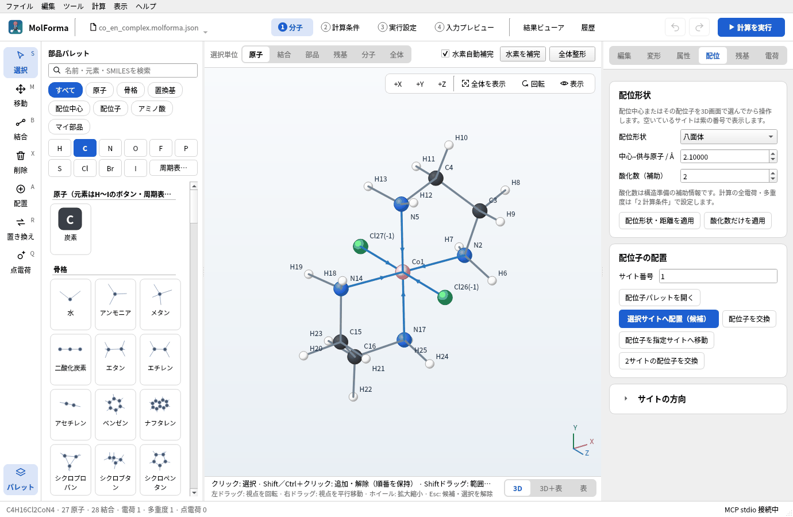

# MolForma

MolFormaは、量子化学計算プログラムNWChemのための分子エディタ・計算入力作成・結果表示のデスクトップアプリです。部品を置いて分子を組み、計算条件を選んでNWChemを実行し、最適化した構造や振動・軌道・スペクトルを確かめるまでを、1つの画面で行えます。Qt6 / C++20で書かれ、画面とマニュアルは日本語と英語に対応します。



## できること

- **分子を組む**: 原子・骨格・置換基・配位子・アミノ酸の部品をクリックで配置し、結合の種類、距離・角度・二面角を数値で指定します。配位中心と配位形状、配列からのペプチド（末端キャップ・側鎖の状態）、立体（R/S・E/Z）の記録と反転、同位体、外部点電荷、自作の部品（マイ部品）も扱えます。SMILESや構造ファイル（XYZ・MOL・SDF・PDBなど）、NWChem・Gaussian入力からも始められます。
- **力場で整える**: Open Babelの力場（MMFF94・UFF）で形を整え、配座を探索します。編集は候補として表示し、確かめてから確定します。
- **計算条件とNWChem入力**: HF・DFT・MP2・CCSD(T)、基底関数、電荷・多重度、構造最適化・振動数・遷移状態探索・IRC・座標スキャン、溶媒（COSMO・SMD）、相対論、物性、BSSE補正、TDDFTなどを選ぶと、検査済みのNWChem入力を作ります。
- **実行と結果**: NWChemをローカルで実行・停止し、進み具合とログを表示します。結果ビューアでは、最適化の経過、振動のアニメーションとIRスペクトル、分子軌道と電子密度の等値面、励起状態と吸収スペクトル、スキャン・IRCの経路を確かめ、構造を次の計算に取り込めます。
- **履歴**: 保存した計算を一覧し、同じ条件のジョブどうしのエネルギー差を比べ、分子と条件を再利用します。
- **AIからの操作**: MCPサーバーを内蔵しており、Claude CodeなどのAIクライアントから分子の編集や計算を頼めます。


## ドキュメント

| ページ | 内容 |
| --- | --- |
| [機能と操作](features.md) | 画面の構成、各タブ（「1 分子」〜「4 入力プレビュー」・結果ビューア・履歴）の機能、対応範囲と制限 |
| [題材から選ぶ実習](recipes.md) | 分子を組んでNWChemで計算し、結果を確かめるまでを題材ごとに通す16の実習（エタノール・金属錯体・ペプチド・BSSE補正・ラジカル・遷移状態など）。画面写真と練習データ付き |
| [MCPサーバー](mcp.md) | AIクライアントからの操作（Claude Code・Codexへの登録、公開ツール、安全のための制限） |

同じマニュアルはアプリの「ヘルプ → 操作ガイド・マニュアル」（F1）でも読めます。

## 入手とビルド

ソースコードは [GitHubのリポジトリ](https://github.com/hnakada123/MolForma) にあります。Qt6（Widgets）、Eigen3、Open Babel 3、CMake 3.21以上とC++20コンパイラでビルドします。RDKit C++とVTKがあれば、立体判定・残基認識とVTKによる3D描画も有効になります。計算にはNWChem（MPI版では対応するMPIランチャー）が別に必要です。実行時にPythonは必要ありません。手順はリポジトリのREADMEを参照してください。

```sh
cmake -S . -B build -G Ninja -DCMAKE_BUILD_TYPE=Release
cmake --build build -j 4
./build/molforma
```

## ライセンス

MolFormaはGPL-2.0-or-laterで配布します。
