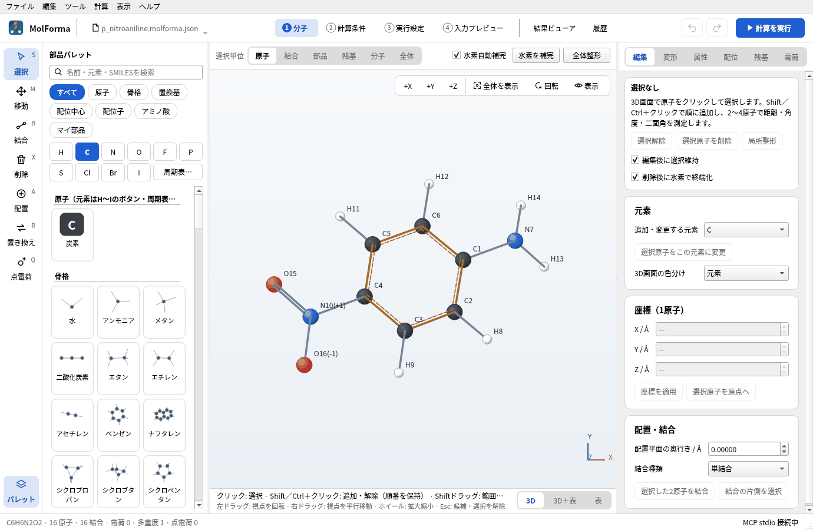
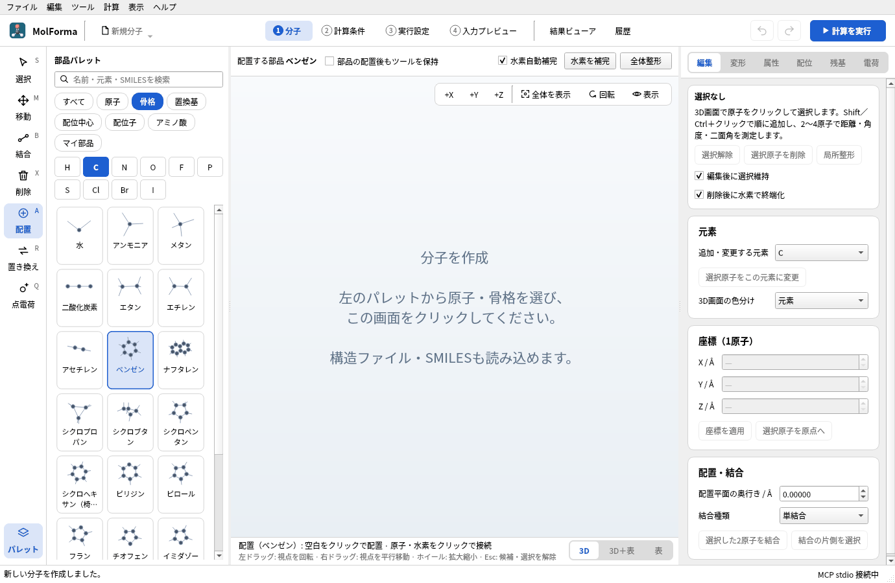
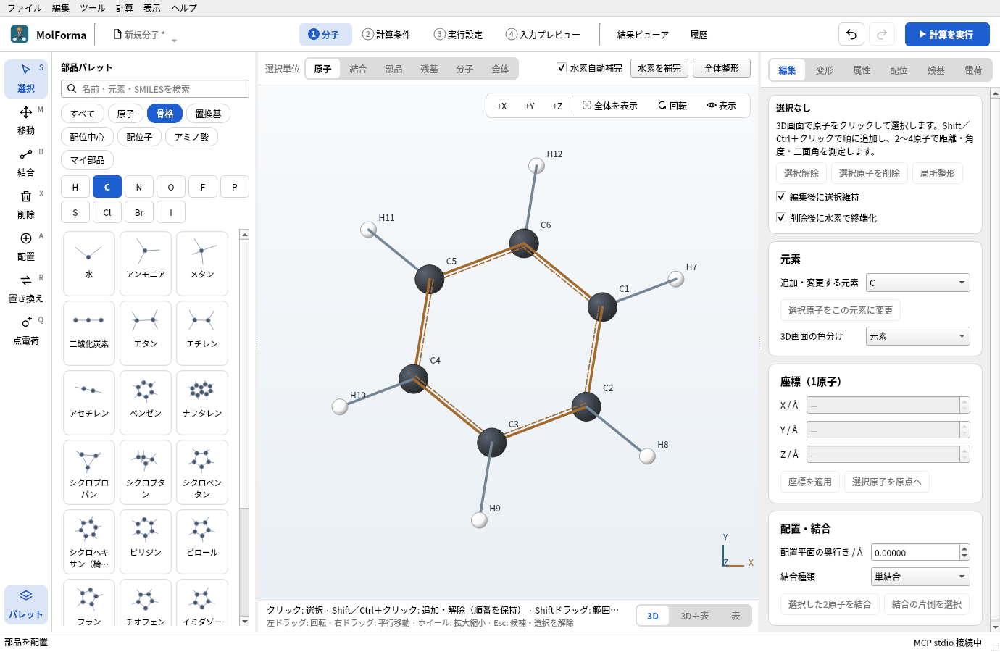
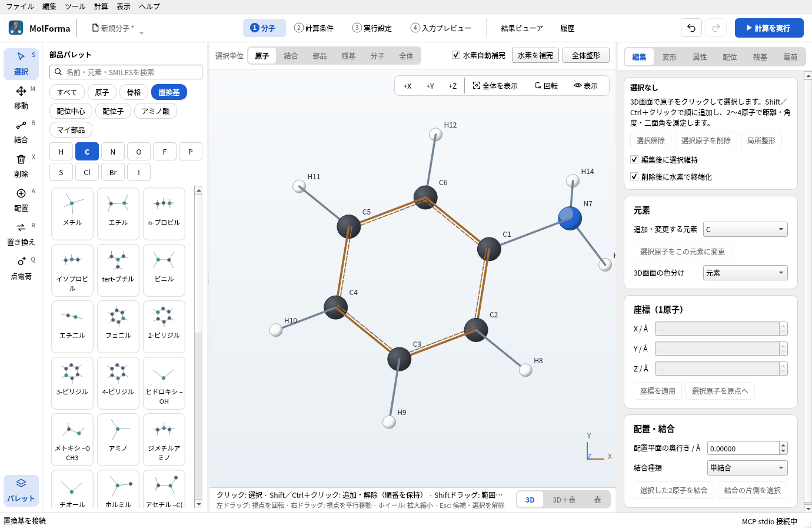
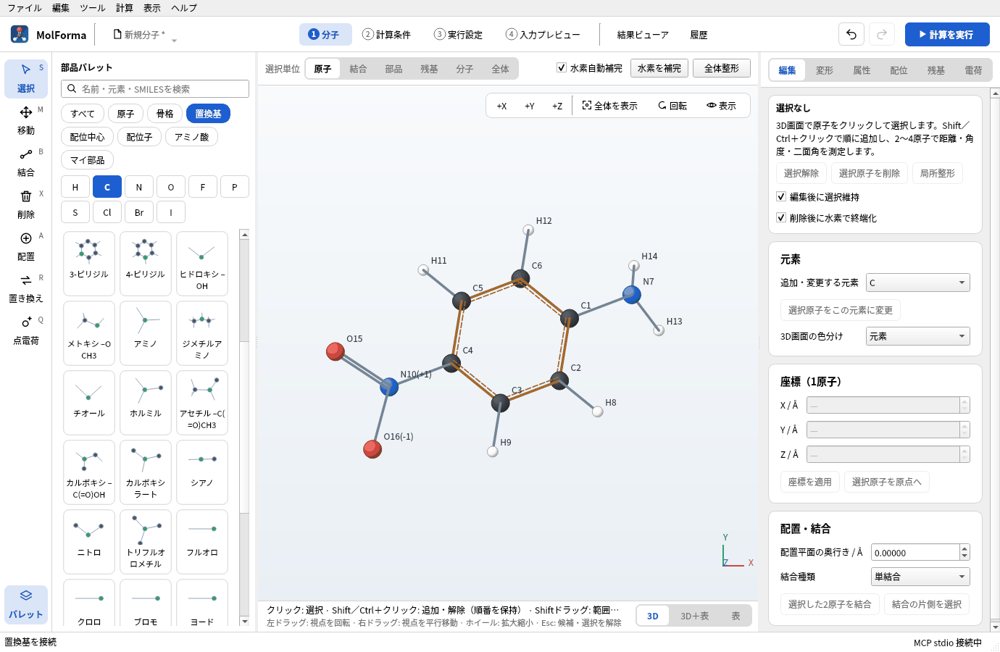
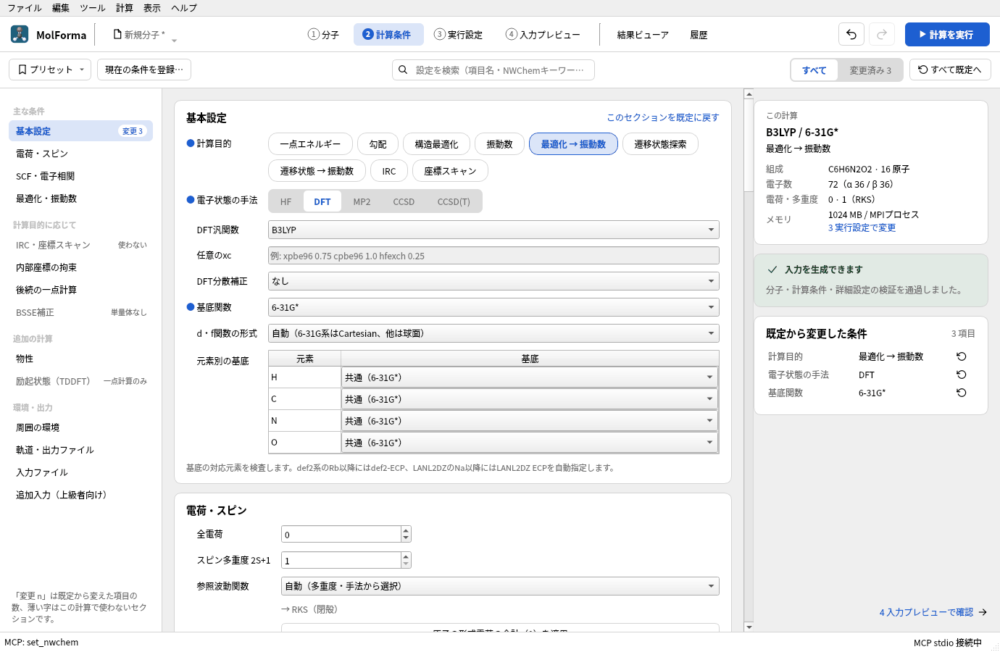
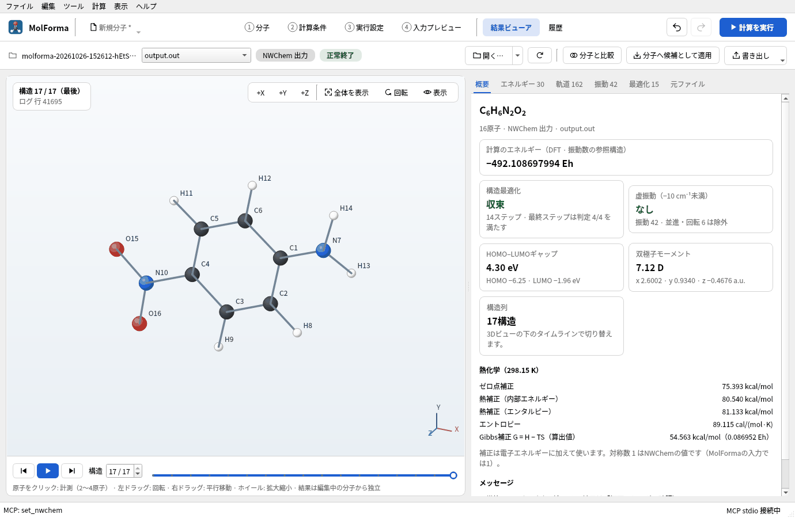
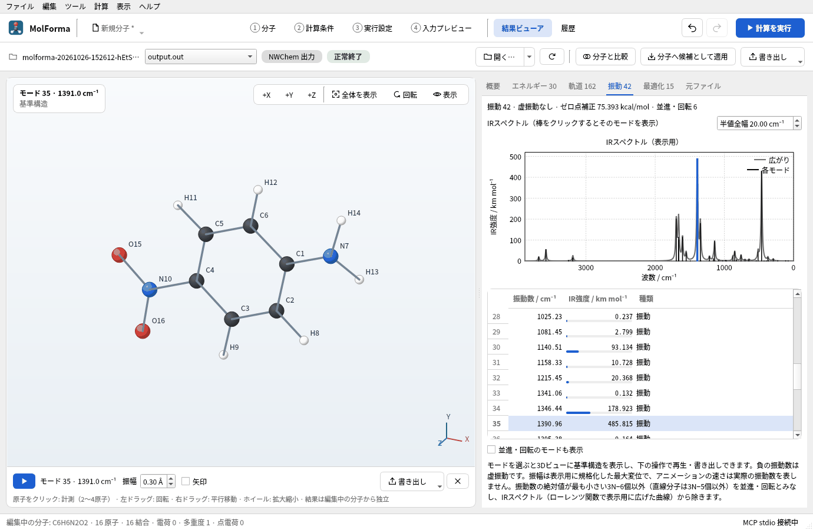

# 題材3 芳香族の置換体（p-ニトロアニリン）

ベンゼンの骨格テンプレートに置換基テンプレートを付けて、p-ニトロアニリンを作ります。置換基は「クリックした水素を置き換える」ので、どの水素をクリックするかでオルト・メタ・パラが決まります。B3LYP/6-31G*で最適化と振動数を計算し、同じ手順で作ったo体・m体とエネルギーを比べます。

| 作るもの | 内容 |
| --- | --- |
| 分子 | p-ニトロアニリン C₆H₆N₂O₂（16原子・電荷 0・一重項）。比較用にo体・m体 |
| 使う機能 | 骨格・置換基のテンプレート、部品の配置後のツール、番号の表示、全体整形 |
| 計算 | B3LYP/6-31G*、最適化 → 振動数（o体・m体は構造最適化） |
| 計算時間の目安 | 約35分（MPI 6プロセス、振動数の解析Hessianが大半） |
| 計算環境 | AMD Ryzen 7 2700X（8コア・16スレッド）、メモリ 32 GB、NWChem 7.3.1（Linux） |
| 練習データ | [`p_nitroaniline.kgui.json`](samples/p_nitroaniline.kgui.json)、[`o_nitroaniline.kgui.json`](samples/o_nitroaniline.kgui.json)、[`m_nitroaniline.kgui.json`](samples/m_nitroaniline.kgui.json) |

## 1. ベンゼンを置く

1. 「ファイル → 新規」で空の分子にします。
2. 部品パレットの上の分類で「骨格」を選び、「ベンゼン」をクリックします。ツールが「配置」になります。

   

   **図1** 分類「骨格」の「ベンゼン」を選ぶと、ツールが「配置」になります。

3. 3D画面の空白をクリックします。C6H6 · 12原子のベンゼンが置かれ、ツールは「選択」に戻ります。骨格・置換基などの部品を1つ置くと選択に戻るので、続けて置く場合は3D画面の上の「部品の配置後もツールを保持」をオンにします。

   

   **図2** 置いたベンゼン。環の炭素がC1〜C6、水素がH7〜H12です。置いた直後の部品は選択された状態で表示されます。

ラベルの番号では環の炭素がC1〜C6、それぞれの水素がH7〜H12です。番号が出ていなければ「表示 → 番号を表示」をオンにします。

## 2. アミノ基とニトロ基を付ける

1. 分類で「置換基」を選び、「アミノ」をクリックします。3D画面の下に「配置（アミノ）: 置き換える水素をクリック」と出ます。
2. ベンゼンの水素H7をクリックします。H7がNH2に置き換わり、アニリン（C6H7N · 14原子）になります。置換基は水素の位置にしか付かず、空白をクリックしても置けません。

   

   **図3** 「アミノ」でH7をクリックすると、その水素がNH2に置き換わってアニリンになります。

3. 「ニトロ」を選び、アミノ基の付いたC1から環を3つたどった炭素（C4、パラ位）の水素H10をクリックします。C6H6N2O2 · 16原子になり、ラベルにNの形式電荷「(+1)」と片方のOの「(−1)」が出ます（ニトロ基の共鳴構造の1つ）。全電荷は0のままです。

   

   **図4** パラ位の水素H10を「ニトロ」に置き換えたp-ニトロアニリン（C6H6N2O2 · 16原子）。

4. 「全体整形」を押して候補を確かめ、「変更を確定」します。

アミノ基の付いた炭素の隣（C2・C6）の水素を選ぶとオルト体、2つ先（C3・C5）ならメタ体になります。付ける場所を間違えたらCtrl+Zで戻します。付けた置換基を別の置換基に差し替えるには、パレットで新しい置換基を選び、左端の列で「置き換え」（R）にして、差し替える置換基の付け根の原子（アミノ基ならN）をクリックします。差し替えは候補として表示されます。

## 3. 計算条件を決める

1. 「2 計算条件」の「基本設定」で、計算目的を「最適化 → 振動数」、電子状態の手法を「DFT」（B3LYP）、基底関数を「6-31G*」にします。

   

   **図5** 計算目的・手法・基底関数を選んだ「2 計算条件」。

2. 全電荷 0・多重度 1（→ RKS（閉殻））を確かめます。

## 4. 計算して結果を見る

ヘッダーの「計算を実行」（F5）で計算します。振動数の計算（解析Hessian）は最適化より長くかかり、実行パネルではtaskごとに「完了」「実行中」と表示します。

**図6** 計算後の「結果ビューア」の「概要」。

**図7** 「振動」タブで最も強いIR吸収（NO2対称伸縮、1391 cm⁻¹）を選んだところ。

### 実行した結果

| 項目 | 値 |
| --- | --- |
| 計算のエネルギー | −492.108697994 Eh |
| 構造最適化 | 14ステップで収束、虚振動なし（振動 42） |
| 双極子モーメント | 7.12 D（アミノ基からニトロ基への電荷移動で大きい） |
| 主なIR吸収 | NO₂対称伸縮 1391 cm⁻¹（最も強い）、NH₂伸縮 3579・3682 cm⁻¹ |
| ゼロ点補正 | 75.39 kcal/mol |

同じ条件で構造最適化したo体・m体と比べると、次のようになります（p体は最適化 → 振動数の最適化の部分のエネルギー）。

| 異性体 | 計算のエネルギー | o体との差 | 双極子モーメント | 最適化 |
| --- | --- | --- | --- | --- |
| o-ニトロアニリン | −492.109508350 Eh | 0 | 4.74 D | 15ステップ |
| p-ニトロアニリン | −492.108697994 Eh | +0.51 kcal/mol | 7.12 D | 14ステップ |
| m-ニトロアニリン | −492.104968503 Eh | +2.85 kcal/mol | 5.65 D | 11ステップ |

o体ではアミノ基の水素とニトロ基の酸素が1.91 Åまで近づき、分子内水素結合をつくります。p体はアミノ基からニトロ基への共鳴（電荷移動）で安定化し、双極子モーメントも大きくなります。m体はこの共鳴が効かず、いちばん高いエネルギーになります。o体・m体の構造最適化は8プロセスでそれぞれ約14分・8分でした。

最適化した構造は[題材14](reuse_result.md)で励起状態（TDDFT）の計算に使います。

## うまくいかないとき

- **「置換する水素へクリックまたはドロップしてください」と出る**: 置換基を空白や炭素の上でクリックしました。置き換える水素の上をクリックします。
- **元素のボタン（C・N・Oなど）を押したら置換基が選べなくなった**: 元素のボタンは分類を「原子」に切り替えます。分類で「置換基」を選び直してください。
- **パレットに目的の部品が見つからない**: パレット上の検索欄に文字が残っていると、その文字を含む部品だけを表示します。検索欄を空にしてください。
- **ニトロ基の形式電荷が気になる**: N(+1)・O(−1)はニトロ基を1つの共鳴構造で表したもので、合計は0です。計算の全電荷は「2 計算条件」の値（0）を使います。

関連: [「1 分子」の画面・ツール・選択](../features/molecule.md)（ツールと部品パレット）、[題材14 計算結果から次の計算へ](reuse_result.md)。
