# 題材1 原子と結合から組む（エタノール）

骨格や置換基のテンプレートを使わず、原子のボタンと「配置」「結合」「削除」ツールだけで分子を組みます。炭素を1個置くとメタンになり、その水素をクリックすると炭素に、もう1つの水素をクリックすると酸素に置き換わって、クリック3回でエタノールができます。B3LYP/6-31G*の構造最適化と振動数計算まで通し、応用としてアセトアルデヒドとジメチルエーテルも組みます。

| 作るもの | 内容 |
| --- | --- |
| 分子 | エタノール C₂H₆O（9原子・電荷 0・一重項） |
| 使う機能 | 原子の配置と水素の置き換え、水素自動補完、全体整形、距離・角度の測定、削除、結合の種類、結合への原子の挿入 |
| 計算 | B3LYP/6-31G*、最適化 → 振動数 |
| 計算時間の目安 | 約2分（MPI 4プロセス） |
| 計算環境 | AMD Ryzen 7 2700X（8コア・16スレッド）、メモリ 32 GB、NWChem 7.3.1（Linux） |
| 練習データ | [`ethanol.molforma.json`](samples/ethanol.molforma.json)（整形後の初期構造と計算条件） |

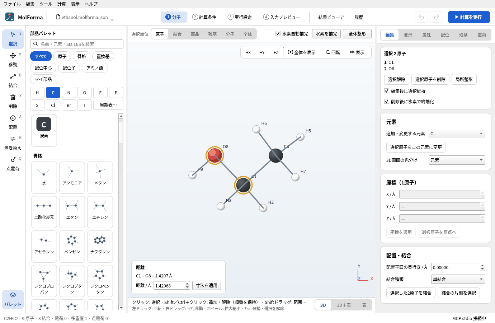

## 1. 炭素を1個置く

1. 「ファイル → 新規」で空の分子にします。
2. 左の部品パレットの元素のボタンで「C」を押します。左端の列のツールが「配置」に変わり、3D画面の上に「配置する部品 炭素（C）」と「結合の種類」が出ます。

   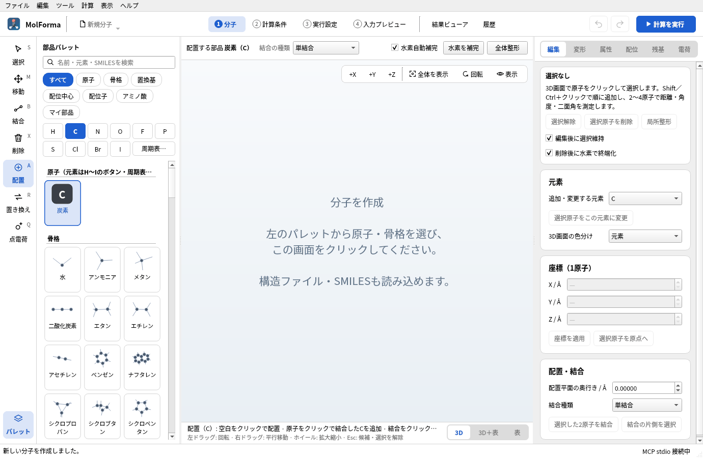

   **図1** 「C」を押すとツールが「配置」になり、3D画面の上に置く部品と結合の種類が出ます。

3. 3D画面の上の「水素自動補完」がオン、「結合の種類」が「単結合」であることを確かめます。前の作業で二重結合のままになっていると、次の手順でエチレンができます。
4. 3D画面の空白を1回クリックします。炭素に水素が4個付いたメタン（CH4 · 5原子）になります。最初の原子は、どこをクリックしても原点に置かれます。

   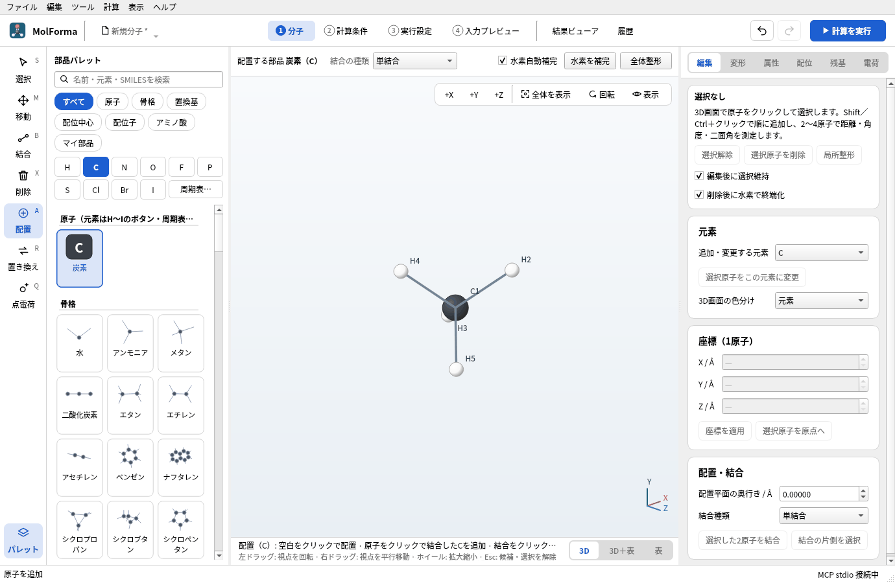

   **図2** 空白をクリックすると、炭素に水素が4個付いたメタン（CH4 · 5原子）になります。図2以降は、原子が重ならないよう3D画面を左ドラッグで回しています（視点だけが変わり、座標は変わりません）。

ラベルの番号（C1、H2…）は「4 入力プレビュー」の座標の行の順番と同じで、原子を足したり消したりするたびに1から振り直されます。番号を頼りに操作するときは、1手ごとに画面の番号を見直してください。

## 2. 水素を炭素・酸素に置き換える

「配置」ツールでは、クリックした場所によって動作が変わります。

| クリックした場所 | 動作 |
| --- | --- |
| 空白 | その場に新しい原子を置く（つながらない別の分子になる） |
| 水素 | 選んだ元素でその水素を置き換え、元の結合の向きに置く |
| 水素以外の原子 | その原子から結合を伸ばして置く（置き換えられる水素があれば1個を置き換える） |
| 結合 | 2原子の間に挿入する（応用で使います） |

1. 「C」のまま、水素の1つ（例: H2）をクリックします。エタン（C2H6 · 8原子）になり、新しい炭素にも水素が補われます。

   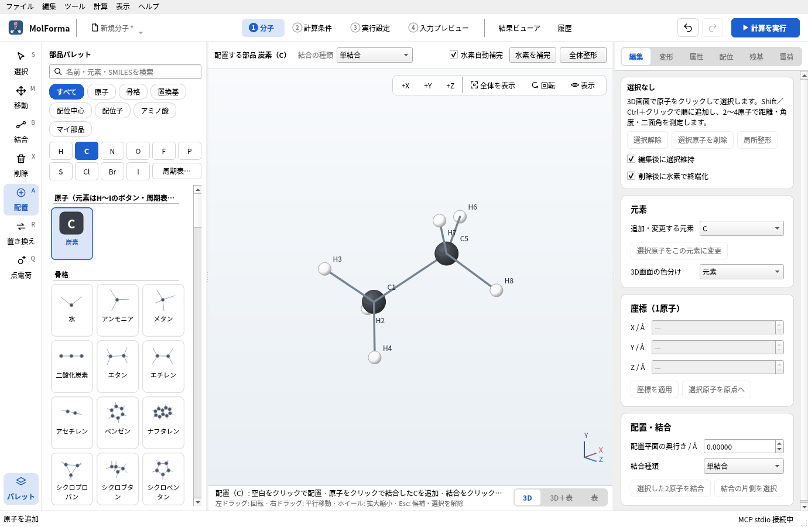

   **図3** H2をクリックすると、その水素が炭素C5に置き換わってエタン（C2H6 · 8原子）になります。

2. 「O」を押し、最初の炭素C1に付いている水素をクリックします。エタノール（C2H6O · 9原子）になり、酸素に水素が1個補われます。

   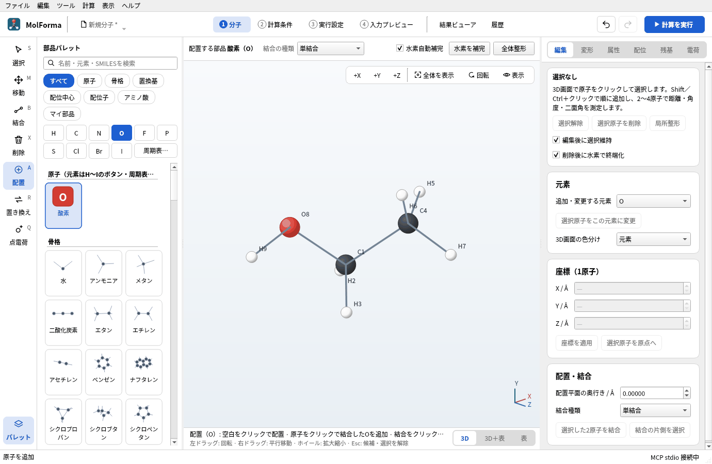

   **図4** 「O」に切り替えてC1の水素をクリックすると、エタノール（C2H6O · 9原子）になります。

ウィンドウ下端のステータスバーに分子式・原子数・結合数・電荷・多重度が出ます（`C2H6O · 9 原子 · 8 結合 · 電荷 0 · 多重度 1`）。クリック1回が「元に戻す」（Ctrl+Z）1回に対応するので、置く場所を間違えたら1手ずつ戻せます。

## 3. 形を整えて確かめる

水素補完は空いている向きに水素を置くだけなので、二面角（メチル基やO–Hの向き）は成り行きです。

1. 3D画面の上の「全体整形」を押します。力場で整えた構造が**候補**として琥珀色の帯に表示されます（「変更候補: 構造を整形」）。

   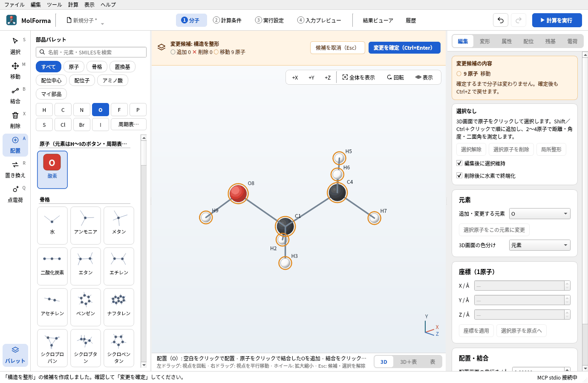

   **図5** 「全体整形」の結果は候補として表示されます。琥珀色の帯の「変更を確定」で適用し、「候補を取消」でやめます。

2. 形を確かめて「変更を確定」（Ctrl+Enter）を押します。やめるときは「候補を取消」（Esc）です。
3. 左端の列で「選択」（S）にし、C1をクリックしてからO8をShift＋クリックします。3D画面の左下に「距離 C1 – O8 = 1.4207 Å」のように表示されます。3原子を順に選ぶと角度（頂点は2番目の原子）、4原子では二面角が出ます。

   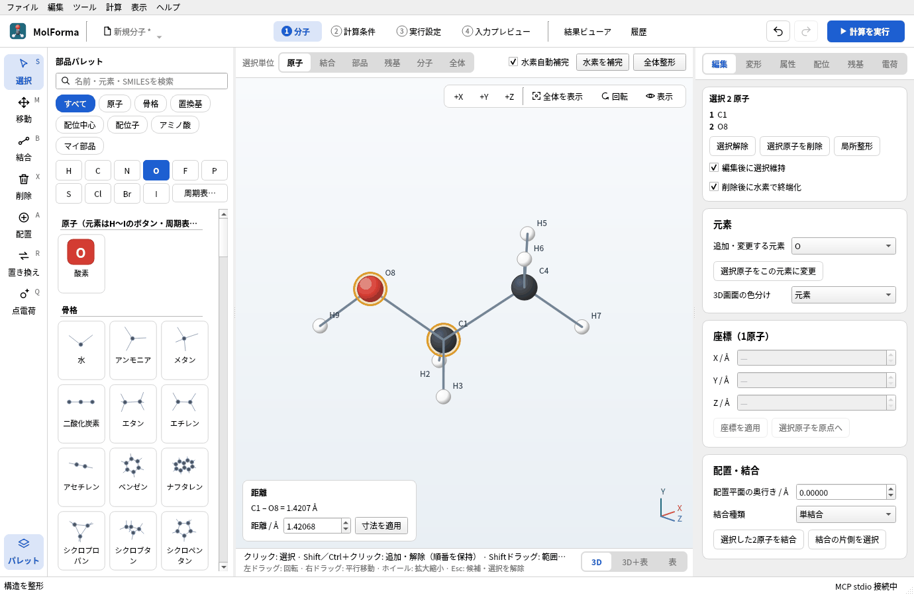

   **図6** C1とO8を選ぶと、3D画面の左下に距離が出ます。値を入れて「寸法を適用」を押すと、その距離に変わります。

数値を入れて「寸法を適用」を押すと、その距離・角度・二面角になるよう後に選んだ原子の側が動きます（[題材5](butane_conformers.md)）。

## 4. 計算条件を決める

1. ヘッダーの「2 計算条件」を開きます。
2. 「基本設定」で、計算目的を「最適化 → 振動数」、電子状態の手法を「DFT」にします。DFT汎関数は既定の「B3LYP」のまま、基底関数を「6-31G*」にします。
3. 「電荷・スピン」で全電荷 0・スピン多重度 1を確かめます。参照波動関数の欄の下に「→ RKS（閉殻）」と出ます。
4. 右の検査結果のカードが「入力を生成できます」であることを確かめます。

   

   **図7** 計算目的・手法・基底関数を選ぶと、右の欄に「入力を生成できます」と、既定から変えた条件が出ます。

## 5. 計算して結果を見る

1. 「4 入力プレビュー」で、`geometry` に9原子が並び、末尾が `task dft optimize` と `task dft frequencies` の2行であることを確かめます。

   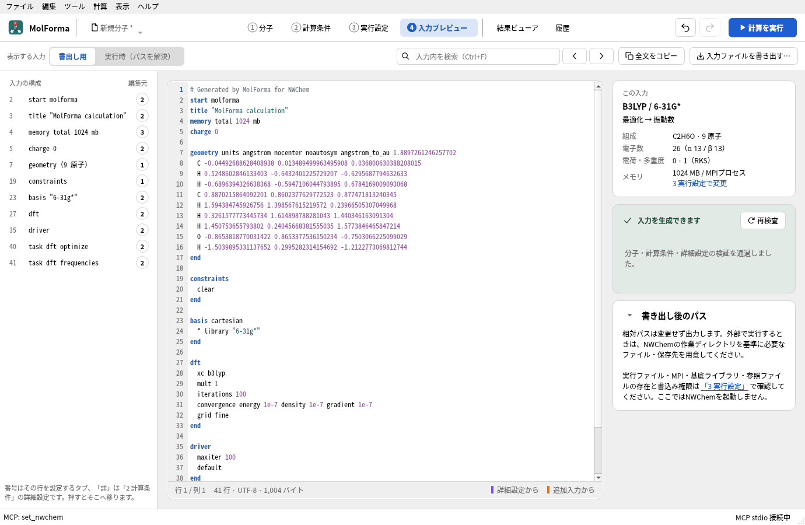

   **図8** 「4 入力プレビュー」。左の「入力の構成」で各ブロックへ移動できます。

2. 初めて計算する場合は「3 実行設定」で、NWChemの実行ファイル・MPIの起動数・ジョブ保存先を確かめます（「実行前の確認」が「実行できます」）。
3. ヘッダーの「計算を実行」（F5）を押します。右側に実行パネル（「実行状況とログ」）が開き、構造最適化のステップとGmax・Grmsなどの収束判定、続いて振動数のtaskの進み具合を表示します。

   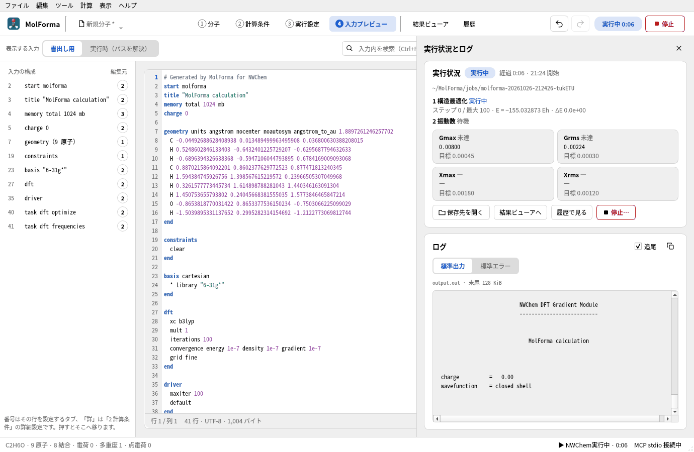

   **図9** 計算中の実行パネル。taskごとの状態と、構造最適化の収束判定（Gmax・Grms・Xmax・Xrms）の現在値と目標が出ます。

4. 終了すると「結果ビューア」に読み込まれ、ステータスバーに「計算が終了しました: 最適化: 収束 · E = −155.033797408 Eh（DFT） · 虚振動 0個」と出ます。
5. 「結果ビューア」の「概要」で、構造最適化（収束・ステップ数）、虚振動、HOMO–LUMOギャップ、双極子モーメント、熱化学を確かめます。「振動」タブではIRスペクトルとモードの表を見られ、行を選んで3Dビューの下の再生ボタンで振動を動かせます。

   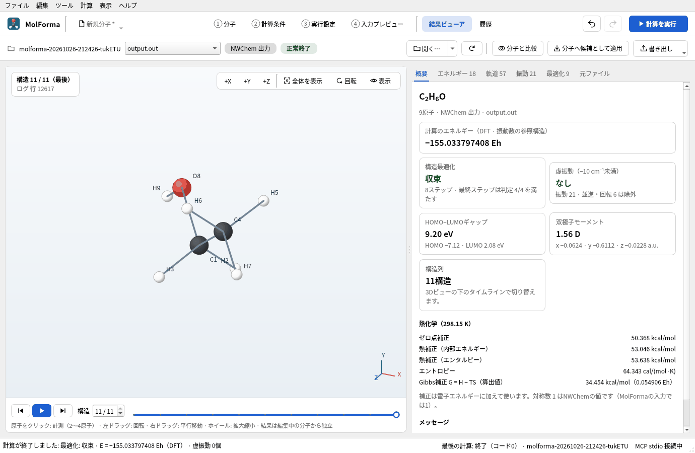

   **図10** 「結果ビューア」の「概要」。計算のエネルギー、最適化の収束、虚振動、HOMO–LUMOギャップ、双極子モーメント、熱化学が並びます。

   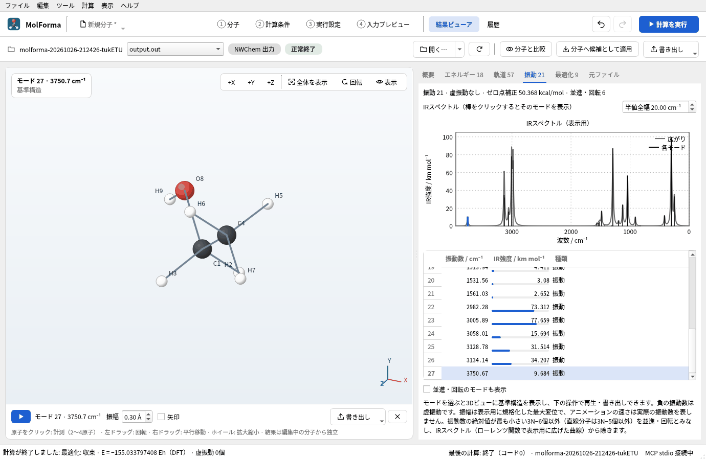

   **図11** 「振動」タブでO–H伸縮（3751 cm⁻¹）を選んだところ。3Dビューの下の再生ボタンで振動が動きます。

### 実行した結果

| 項目 | 値 |
| --- | --- |
| 計算のエネルギー | −155.033797408 Eh（振動数の参照構造） |
| 構造最適化 | 8ステップで収束 |
| 虚振動 | なし（振動 21、並進・回転 6 は除外） |
| 結合長 | C–O 1.425 Å、C–C 1.520 Å、O–H 0.969 Å |
| O–H伸縮 | 3751 cm⁻¹（スケーリングなし） |
| 双極子モーメント | 1.56 D |
| HOMO–LUMOギャップ | 9.20 eV |
| ゼロ点補正 / Gibbs補正（298.15 K） | 50.37 / 34.45 kcal/mol |

エタノールにはOHの向きが違う配座（anti・gauche）があります。二面角 H–O–C–C を変えて別の出発点から最適化してみるのも良い練習です。

## 応用: 削除・結合の種類・挿入

### アセトアルデヒド（水素を2個消して二重結合にする）

1. 手順2のエタノール（整形前でもかまいません）で、左端の列の「削除」（X）を選び、O–Hの水素をクリックします。削除は候補として表示されるので「変更を確定」します。水素だけを消したときは、「削除後に水素で終端化」がオンでも水素は補いません。

   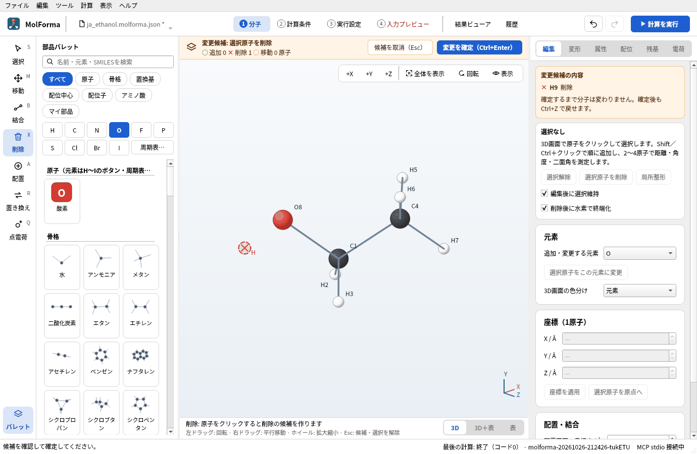

   **図12** 「削除」ツールで水素をクリックすると、消える原子に×印が付いた候補になります。

2. 同じようにC1の水素を1個削除して確定します。C2H4O · 7原子になります。
3. 「結合」（B）ツールにし、3D画面の上の「結合の種類」を「二重結合」にして、C1とOを順にクリックします。すでに結合している2原子なので、新しい結合は作らずに次数だけが変わります（3D画面にフォーカスがあるときは、2原子を選んで「2」キーでも同じです）。
4. 次数を変えても結合長は変わらないので、「全体整形」で整えます。

   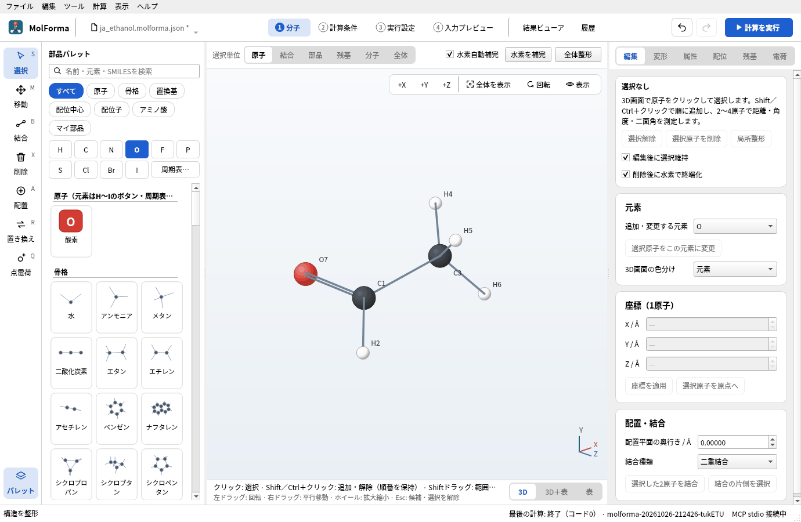

   **図13** 二重結合にして整形したアセトアルデヒド（C2H4O · 7原子）。

### ジメチルエーテル（結合に原子を挿入する）

1. 「ファイル → 新規」から手順1・2の前半でエタン（C2H6）を作ります。「結合の種類」は「単結合」に戻しておきます。
2. 「O」を押し、C–C結合の線の上をクリックします。2つの炭素の間に酸素が入り、C2H6O · 9原子になります。

   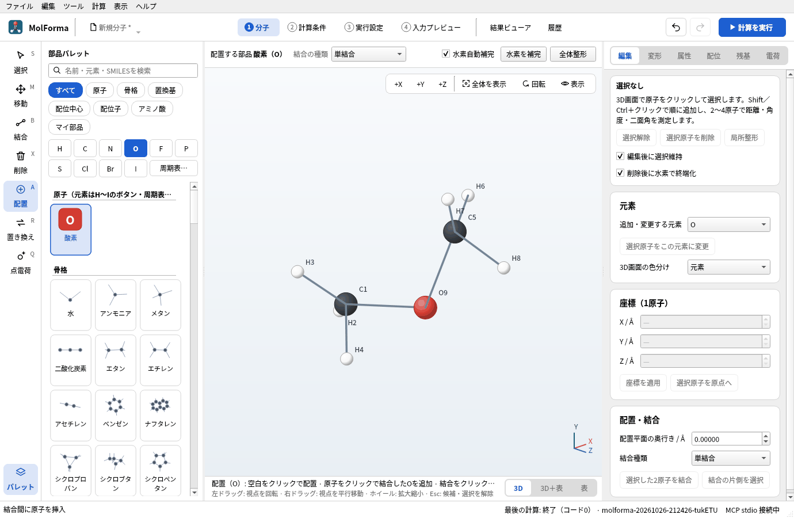

   **図14** C–C結合の上をクリックすると、2つの炭素の間に酸素O9が入ります（整形前）。

3. 挿入した原子は、共有結合半径から決めた結合長（C–O 1.42 Å）と四面体角（C–O–C 109.5°）の位置に置き、小さいほうの断片を外側へずらします。「全体整形」で整えると C–O–C は約111.5°になります。環の中の結合に挿入した場合は、ほかの原子を動かさず、結合の線から外した位置に置くので、「全体整形」で環を広げてください。

## うまくいかないとき

- **水素が付かない**: 3D画面の上の「水素自動補完」がオフです。原子を選んで（選ばなければ全体）「水素を補完」を押すと、足りない水素を補います。
- **水素を置き換えたつもりが原子が増えた**: 水素から少し外れた空白をクリックすると、別の分子として置かれます。Ctrl+Zで戻して水素の上をクリックし直してください。
- **エチレンやアセチレンができる**: 「結合の種類」が二重結合・三重結合のままです。原子を置くときもこの種類で結合します。
- **「4 入力プレビュー」のタブ名が赤い**: 入力を生成できません。ツールチップか「2 計算条件」の検査結果に理由が出ます。水素を消した直後は電子数が奇数になり、多重度1と合わないため赤くなります。
- **整形で「この構造に使える力場パラメータがありません」**: 結合次数や形式電荷が化学的に不自然です。「ツール → 構造を検査…」で原子価を確かめてください。

関連: [「1 分子」の画面・ツール・選択](../features/molecule.md)（ツールと部品パレット・選択・削除・候補）、[題材5 鎖状分子と配座](butane_conformers.md)、[題材15 同位体](isotopes.md)。
