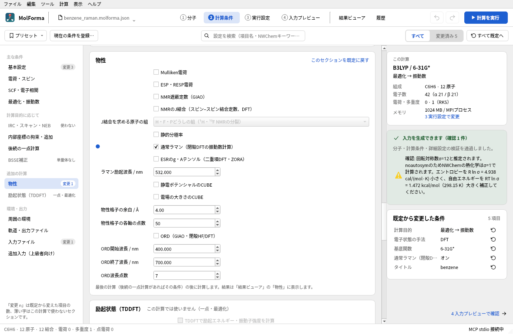
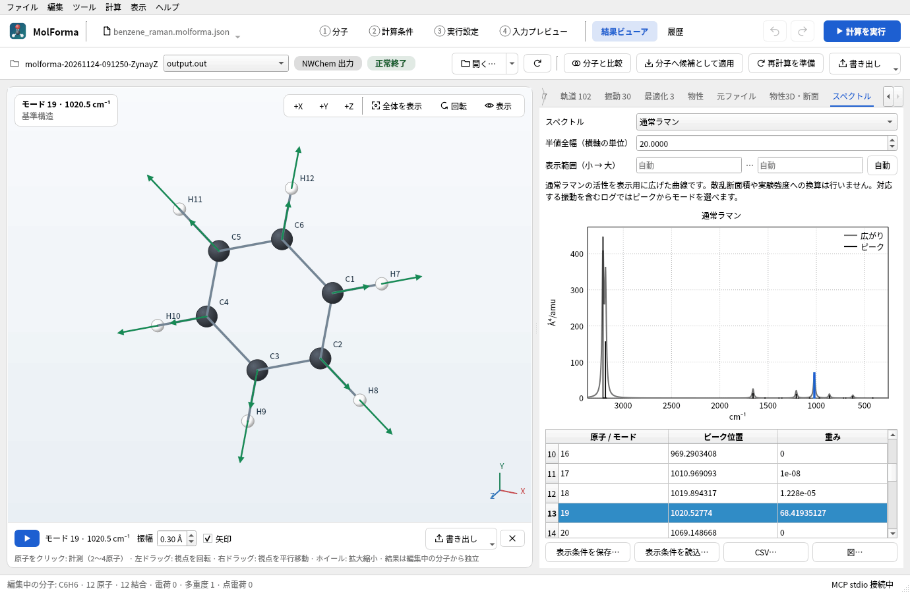
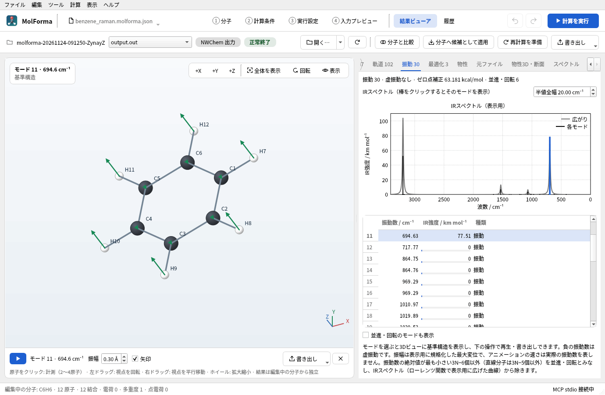

# 題材18 通常ラマンの計算と実測比較（ベンゼン）

ベンゼンの通常ラマンスペクトルをB3LYP/6-31G*で計算し、同じ計算のIRスペクトルと並べて、対称中心をもつ分子ではラマンとIRに同じ振動が現れない「交互禁制」を確かめます。公開されている実測の振動数と比べ、スケール因子で補える部分と補えない部分、計算の「ラマン活性」と実測の「強度」の違いを考えます。

| 作るもの | 内容 |
| --- | --- |
| 分子 | ベンゼン C₆H₆（12原子・電荷 0・一重項） |
| 使う機能 | 骨格テンプレート、通常ラマン（励起波長）、結果ビューアの「スペクトル」（ラマン活性）と「振動」（IR強度）、ピークからの振動の表示 |
| 計算 | 気相、B3LYP/6-31G*、最適化 → 振動数 → 通常ラマン（励起波長 532 nm） |
| 計算時間の目安 | 約60分（MPI 8プロセス。最適化 約20秒、振動数 約3分、ラマン 約57分） |
| 計算環境 | AMD Ryzen 7 2700X（8コア・16スレッド）、メモリ 32 GB、NWChem 7.3.1（Linux）。2026-11-24にMolForma MCPから実行 |
| 練習データ | [`benzene_raman.molforma.json`](samples/benzene_raman.molforma.json)（部品から置いたベンゼンと計算条件） |

練習データは構造と計算条件だけで、計算結果や実行設定は含めていません。自分で計算する場合は「3 実行設定」でNWChem・MPI・保存先を確認してください。

## 1. ベンゼンを置く

1. 「ファイル → 新規」で空の分子にします。
2. 部品パレットの分類「骨格」で「ベンゼン」をクリックし、3D画面の空白をクリックします。C6H6 · 12原子のベンゼンが置かれます（[題材3](aromatic_substitution.md)の図1・図2と同じ操作です）。

置いた直後のベンゼンは平面の正六角形です。計算は構造最適化から始めるので、「全体整形」や結合長の調整は要りません。

## 2. 計算条件を決める

1. 「2 計算条件」の「基本設定」で、計算目的を「最適化 → 振動数」、電子状態の手法を「DFT」（B3LYP）、基底関数を「6-31G*」にします。全電荷 0・多重度 1（RKS（閉殻））を確かめます。
2. 「物性」で「通常ラマン（閉殻DFTの振動数計算）」をオンにします。「ラマン励起波長 / nm」は既定の532 nm（緑のレーザー）のままにします。

   

   **図1** 「物性」で通常ラマンをオンにした計算条件。

3. 「4 入力プレビュー」で、`task dft optimize` と `task dft frequencies` の後に、`property` ブロックの `response 1 0.0856…`（532 nmの光子エネルギー、Eh）、`raman` ブロックの `normal`、`task dft raman` があることを確かめます。

通常ラマンは閉殻DFTの「振動数」か「最適化 → 振動数」で使えます。HF・MP2、開殻、後続の一点計算・TDDFT・BSSEとは併用できません（[計算条件](../features/calculation.md)）。励起波長は分極率を求める光の波長です。ベンゼンの電子吸収は紫外にあり、532 nmはそこから十分離れているので、共鳴を考えない通常ラマンとして扱えます。共鳴ラマンは計算しません。

## 3. 計算してラマンスペクトルを表示する

1. 「計算を実行」（F5）で実行します。NWChemは最適化と振動数の後、ラマンの段階でHessianをもう一度求め、各振動に沿って構造を正負にずらした2点で分極率を計算し、その差からラマン活性を求めます。時間の大半はこの段階です。
2. 正常終了したら、実行パネルの「結果ビューアへ」（または「履歴」の「結果ビューアで開く」）でジョブを開き、右側の「スペクトル」タブを選びます。ラマン活性を含むログでは種類が「通常ラマン」になり、半値全幅は20 cm⁻¹になります。横軸は波数（cm⁻¹、大きいほうが左）、縦軸はラマン活性（Å⁴/amu）です。
3. ピーク表で「ピーク位置」が1020.5 cm⁻¹、「重み」が約68の行（「原子 / モード」は19）を選びます。その振動が3D画面に出ます。すぐ上の1019.9 cm⁻¹（重みはほぼ0）は、ラマンにもIRにも出ない別の振動です。3D画面の下の「矢印」をオンにし、「選択したモードを再生」で動かすと、環の炭素と水素がすべて中心から同時に広がったり縮んだりする、環の呼吸振動であることがわかります。

**図2** ベンゼンの通常ラマン（B3LYP/6-31G*、半値全幅 20 cm⁻¹）。環の呼吸振動を選んだところ。

ピーク表の「原子 / モード」は「振動」タブのモードの番号、「重み」はラマン活性です。二重に縮退した振動は同じ位置に2行並び、曲線は両方を足して描きます。活性を実験の強度に換算したり、偏光解消度を求めたりはしません（[結果ビューア](../features/results.md#nmr通常ラマン溶液esrのスペクトル)）。ピーク表の下の「CSV…」でピークと曲線を、「図…」でチャートを書き出せます。

### 実行した結果

| 項目 | 値 |
| --- | --- |
| 計算のエネルギー | −232.248651049 Eh |
| 構造最適化 | 収束（「最適化」タブの3点） |
| 結合長 | C–C 1.397 Å、C–H 1.087 Å |
| 虚振動 | なし（並進・回転を除く30個の振動はすべて正。最低 415.1 cm⁻¹） |
| 振動数 | 20種類（そのうち10種類は二重に縮退） |
| ラマン活性のある振動 | 7種類（12個） |
| 計算時間 | 最適化 20秒、振動数 161秒、ラマン 3438秒（MPI 8プロセス） |

## 4. IRと比べる（交互禁制）

1. 右側の「振動」タブを開きます。IRスペクトルには4本しか出ません。
2. 最も強い694.6 cm⁻¹のモードを表で選び、再生します。6個の水素が環の面に垂直に同じ向きへ動く、面外のC–H変角振動です。

**図3** 同じジョブの「振動」タブ。IR強度が0でない振動は4種類だけです。

二つのタブの数値を振動数ごとに並べると、ラマン活性とIR強度の両方をもつ振動は1つもありません。ラマンに出ない振動の「重み」は0か10⁻⁴未満の数値誤差です。

| 現れるスペクトル | 計算した振動数 / cm⁻¹（縮退する振動は ×2） |
| --- | --- |
| ラマンだけ（7種類） | 621.9 ×2、864.8 ×2、1020.5、1207.9 ×2、1656.0 ×2、3184.1 ×2、3210.5 |
| IRだけ（4種類） | 694.6、1069.2 ×2、1531.4 ×2、3199.8 ×2 |
| どちらにも出ない（9種類） | 415.1 ×2、717.8、969.3 ×2、1011.0、1019.9、1185.7、1356.6、1387.2、3174.4 |

ベンゼン（D6h）は対称中心をもちます。対称中心について対称な振動（記号にgが付く）は分極率を変えるのでラマン活性になり得て、反対称な振動（u）は双極子モーメントを変えるのでIR活性になり得ます。そのため同じ振動が両方のスペクトルに出ることはありません（交互禁制）。どちらにも出ない振動もあります。対称中心のない分子（例えば[題材1](atoms_and_bonds.md)のエタノール）では、同じ振動がIRにもラマンにも出ます。

MolFormaの振動の表は対称性の記号を付けません。次の節の記号は、文献の帰属と、振動数の順・縮退・活性の有無で対応させたものです。

## 5. 実測と比べる

実測はNIST Chemistry WebBookに収録された島内のベンゼンの基本振動数（Shimanouchi, 1972）で、ラマンは液体、IRは気体の値です。計算の調和振動数は実測の基本振動数より大きくなりやすいので、CCCBDBのB3LYP/6-31G*のスケール因子 **0.960**（±0.022）を掛けた値も並べます。

| 対称 | 振動の型 | 計算 / cm⁻¹ | ×0.960 / cm⁻¹ | 実測（液体ラマン）/ cm⁻¹ | ×0.960 − 実測 | ラマン活性 / Å⁴ amu⁻¹ | 実測の強さ・偏光 |
| --- | --- | ---: | ---: | ---: | ---: | ---: | --- |
| a1g | C–H伸縮 | 3210.5 | 3082.1 | 3061.9 | +20.2 | 407.7 | VS・p |
| a1g | 環の伸縮（呼吸） | 1020.5 | 979.7 | 991.6 | −11.9 | 68.4 | VS・p |
| e1g | C–H変角 | 864.8 | 830.2 | 848.9 | −18.7 | 5.5 ×2 | M・dp |
| e2g | C–H伸縮 | 3184.1 | 3056.7 | 3046.8 | +9.9 | 155.7 ×2 | S・dp |
| e2g | 環の伸縮 | 1656.0 | 1589.8 | 1596（1606.4・1584.6） | −6.2 | 12.7 ×2 | S・dp |
| e2g | C–H変角 | 1207.9 | 1159.5 | 1178.0 | −18.5 | 10.3 ×2 | S・dp |
| e2g | 環の変形 | 621.9 | 597.0 | 605.6 | −8.6 | 4.1 ×2 | S・dp |

| 対称 | 振動の型 | 計算 / cm⁻¹ | ×0.960 / cm⁻¹ | 実測（気体IR）/ cm⁻¹ | ×0.960 − 実測 | IR強度 / km mol⁻¹ |
| --- | --- | ---: | ---: | ---: | ---: | ---: |
| a2u | 面外C–H変角 | 694.6 | 666.8 | 673 | −6.2 | 77.5 |
| e1u | C–H変角 | 1069.2 | 1026.4 | 1038 | −11.6 | 3.3 ×2 |
| e1u | 環の伸縮・変形 | 1531.4 | 1470.2 | 1486 | −15.8 | 6.5 ×2 |
| e1u | C–H伸縮 | 3199.8 | 3071.8 | 3063 | +8.8 | 51.9 ×2 |

ラマンの強さと偏光は実測表の記号で、VSは非常に強い、Sは強い、Mは中程度、pは偏光（polarized）、dpは偏光解消（depolarized）です。e2gの1596 cm⁻¹は、実測では1606.4と1584.6 cm⁻¹の2本に分かれて観測されています。e1uのC–H伸縮（3063 cm⁻¹）も、液体のIRでは2本に分かれています。

## 6. 計算はどこで役立つか考察する

まず次の問いを、図と表から自分で確かめてください。

1. ラマンの7本について、スケール因子を掛ける前と後の平均絶対誤差を求めてください。一律の因子で直りきらないのはどの種類の振動ですか。
2. 実測の1606と1585 cm⁻¹の2本に対し、計算のピークは1本です。調和振動の計算に何が足りないのでしょうか。
3. 計算で最も大きいラマン活性は3210.5 cm⁻¹のC–H伸縮（a1g、407.7 Å⁴/amu）です。実測では992 cm⁻¹の環の呼吸振動も3062 cm⁻¹と並んで「非常に強い」とされています。活性と強度の違いはどこから来るでしょうか。
4. 実測で偏光（p）とされるのはどの対称の振動ですか。この計算からそれを予測するには何が必要でしょうか。

### 読み取りの例

- **帰属には十分役立つ。** ラマンに出る7本・IRに出る4本・どちらにも出ない9種類という分け方と、縮退の有無は、実測の帰属とすべて一致します。スケール後の振動数の実測との差は、ラマンの7本で−18.7〜+20.2 cm⁻¹です。平均絶対誤差は、スケール前の62.4 cm⁻¹から13.4 cm⁻¹に減ります。
- **一律のスケールには限界がある。** スケール後もC–H伸縮は実測より大きく、それ以外の振動（992・849・1178 cm⁻¹など）は小さくなります。非調和性の大きさは振動の種類で違うので、1つの因子ですべてを直すことはできません。CCCBDBの±0.022は、3000 cm⁻¹付近では±70 cm⁻¹ほどのばらつきに当たります。
- **フェルミ共鳴は再現しない。** e2gの1596 cm⁻¹は、環の呼吸振動と606 cm⁻¹の振動の結合音（992 + 606 = 1598 cm⁻¹）と近く、互いに混ざって2本に分かれます。調和振動の計算は基本振動を1本ずつ与えるだけで、この分裂は出ません。
- **偏光は対称性で決まる。** 実測で偏光（p）なのは全対称（a1g）の2本で、ほかのラマン帯は偏光解消（dp）です。偏光解消度は分極率の微分テンソルの等方成分と異方成分の比から求まりますが、NWChemの通常ラマンの出力とMolFormaは活性だけを扱います。

**活性は強度ではない。** NWChemのラマン活性は分極率の微分から決まる分子の量です。測定される強度には、散乱光の波数の4乗と、振動数が低いほど大きくなる因子がかかります。広く使われる換算式 I ∝ (ν₀ − νᵢ)⁴ Sᵢ / [νᵢ (1 − exp(−hcνᵢ/kT))]（ν₀は励起光の波数、νᵢはスケール後の振動数、Sᵢは活性。Polavarapu, 1990）で、532 nm・298 Kとして計算すると次のようになります。

| 対称 | 振動の型 | ×0.960 / cm⁻¹ | 活性（相対） | 換算した強度（相対） | 実測の強さ |
| --- | --- | ---: | ---: | ---: | --- |
| a1g | C–H伸縮 | 3082 | 100 | 100 | VS |
| e2g | C–H伸縮 | 3057 | 76 | 77 | S |
| e2g | 環の伸縮 | 1590 | 6 | 17 | S（2本に分裂） |
| e2g | C–H変角 | 1160 | 5 | 21 | S |
| a1g | 環の伸縮（呼吸） | 980 | 17 | 88 | VS |
| e1g | C–H変角 | 830 | 3 | 18 | M |
| e2g | 環の変形 | 597 | 2 | 20 | S |

相対値は最大を100とし、縮退した振動は2個の合計です。

換算すると低い振動数の帯が相対的に強くなります。環の呼吸振動（980 cm⁻¹）は活性では最大の17%ですが、換算後は88%になり、実測でC–H伸縮と並んで「非常に強い」ことと合います。606 cm⁻¹の環の変形（実測S）も2%から20%になります。ただし実測の「VS」「S」はピークの高さの目安で、帯の幅や液体中の分子間相互作用、装置の感度も含みます。

この計算の価値は、どの振動がどちらのスペクトルに出るかを示し、観測された帯を振動の形と結びつけられることです。気相の1分子・調和振動の計算なので、液体中の振動数のずれ、フェルミ共鳴、帯の形や幅は別に考える必要があります。

発展課題として、基底関数を6-31+G*などの分散関数を含むものに変えて活性がどう変わるかを比べたり、置換ベンゼン（[題材3](aromatic_substitution.md)）で対称性が下がると交互禁制がどう崩れるかを確かめたりできます。これらはこのページで実行した計算ではありません。

## うまくいかないとき

- **「通常ラマン」をオンにすると検査結果にエラーが出る**: 計算目的が「振動数」か「最適化 → 振動数」、手法がDFT、多重度1（閉殻）かを確かめます。後続の一点計算・TDDFT・BSSE・ゴースト中心を使う設定ではオンにできません。
- **「スペクトル」タブが出ない**: ラマンの段階が終わる前に計算を止めると、ログにラマン活性の表がありません。「振動」タブだけが出ます。NWChemが書き出した `.normal` ファイルを開いても活性を表示できますが、構造と変位を含まないので振動の再生はできません。
- **ピークが針のように細い・つながって見える**: 「半値全幅（横軸の単位）」はcm⁻¹です。既定の20 cm⁻¹から変えて見やすくします。線幅は表示用で、活性の値は変わりません。
- **ピーク表の行が多い**: 二重に縮退した振動は2行に分かれて並びます。活性がほぼ0の行は、ラマンに出ない振動です。
- **虚振動が出る・縮退がずれる**: 構造が平面からずれたまま最適化を終えた可能性があります。部品のベンゼンから始め、最適化の収束を確かめます。
- **計算が長い**: ラマンの段階は振動の数（3N − 6）の2倍の分極率計算をします（ベンゼンでは60回）。原子の多い分子ではまず小さな分子で手順を確かめ、MPIのプロセス数を確認してください。
- **自分の数値が表と違う**: 基底関数の表現（6-31G*は既定でデカルト関数の6d）、DFTグリッド、SCF収束、励起波長を確認します。活性は振動数より基底関数の影響を受けやすい量です。

出典: Shimanouchi, T., Tables of Molecular Vibrational Frequencies Consolidated Volume I, National Bureau of Standards, 1972（[NIST Chemistry WebBook のベンゼンの振動](https://webbook.nist.gov/cgi/cbook.cgi?ID=C71432&Mask=800)、2026-11-24参照）。スケール因子: [NIST CCCBDB](https://cccbdb.nist.gov/vibscale2x.asp?method=8&basis=1)（B3LYP/6-31G*、0.960 ± 0.022、2026-11-24参照）。活性から強度への換算: P. L. Polavarapu, J. Phys. Chem. 94, 8106 (1990), [doi:10.1021/j100384a024](https://doi.org/10.1021/j100384a024)。計算法は[NWChemのラマン](https://nwchemgit.github.io/Properties.html#raman)を参照してください。

関連: [実習の一覧](../recipes.md)、[題材3 芳香族の置換体](aromatic_substitution.md)、[題材11 主族元素の分子](main_group.md)（縮退した振動）、[題材17 NMRの計算と実測比較](ethanol_nmr.md)、[計算条件](../features/calculation.md)、[結果ビューア](../features/results.md)。
